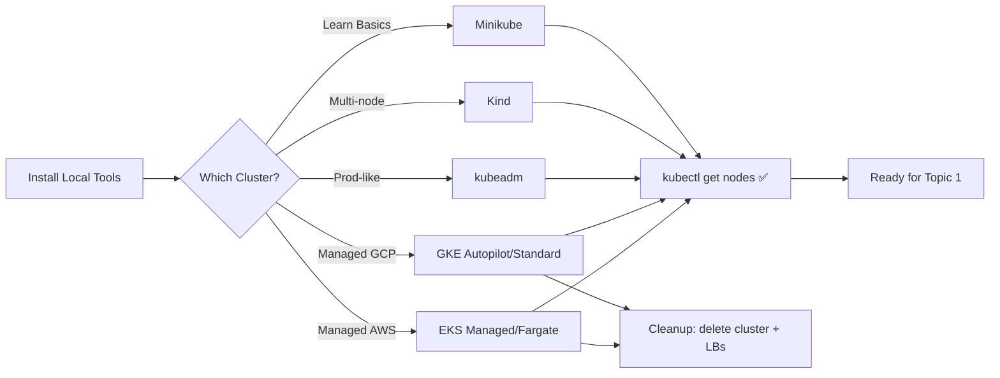

# 🧰 Pre-Module — Lab Environment Setup

> Everything you need to install, configure, and secure your local + cloud Kubernetes lab environments.  
> Complete this pre-module **before** starting Topic 1.

**Official References**
- Kubernetes install tools: https://kubernetes.io/docs/tasks/tools/
- Minikube: https://minikube.sigs.k8s.io/docs/start/
- Kind: https://kind.sigs.k8s.io/docs/user/quick-start/
- Google Kubernetes Engine (GKE): https://cloud.google.com/kubernetes-engine/docs/quickstarts
- Amazon Elastic Kubernetes Service (EKS): https://docs.aws.amazon.com/eks/latest/userguide/getting-started.html

---

## 📘 What You Will Set Up

| Environment | Purpose | Free Tier? |
|---|---|---|
| Docker Desktop / Podman | Local container runtime | Yes |
| Minikube | Single-node local cluster | Yes |
| Kind (Kubernetes-in-Docker) | Multi-node local cluster | Yes |
| kubeadm | Bare-metal / VM install (production-like) | Yes |
| GKE Autopilot & Standard | Managed cluster on Google Cloud | ~$300 free credit (90 days) |
| EKS Managed Node Groups & Fargate | Managed cluster on AWS | No free tier — costs apply |

---

## 🛠️ Section 1 — Local Tools to Install (All OS)

Install these **once** — every lab uses them.

| Tool | Purpose | Install (macOS) | Install (Linux) | Install (Windows) |
|---|---|---|---|---|
| `kubectl` | K8s CLI | `brew install kubectl` | `curl -LO "https://dl.k8s.io/release/$(curl -L -s https://dl.k8s.io/release/stable.txt)/bin/linux/amd64/kubectl" && sudo install kubectl /usr/local/bin/` | `choco install kubernetes-cli` |
| `minikube` | Local single-node cluster | `brew install minikube` | `curl -LO https://storage.googleapis.com/minikube/releases/latest/minikube-linux-amd64 && sudo install minikube-linux-amd64 /usr/local/bin/minikube` | `choco install minikube` |
| `kind` | Multi-node in Docker | `brew install kind` | `go install sigs.k8s.io/kind@latest` | `choco install kind` |
| `docker` | Container runtime | Docker Desktop | `sudo apt install docker.io` | Docker Desktop |
| `helm` | Package manager | `brew install helm` | `curl https://raw.githubusercontent.com/helm/helm/main/scripts/get-helm-3 \| bash` | `choco install kubernetes-helm` |
| `kustomize` | Overlay/templating | `brew install kustomize` | `curl -s "https://raw.githubusercontent.com/kubernetes-sigs/kustomize/master/hack/install_kustomize.sh" \| bash` | `choco install kustomize` |
| `k9s` | Terminal UI for K8s | `brew install k9s` | `curl -sS https://webinstall.dev/k9s \| bash` | `choco install k9s` |
| `stern` | Multi-pod log tailing | `brew install stern` | `go install github.com/stern/stern@latest` | `choco install stern` |
| `kubectx` / `kubens` | Fast context/namespace switcher | `brew install kubectx` | `sudo git clone https://github.com/ahmetb/kubectx /opt/kubectx` | `choco install kubectx` |
| `hey` | HTTP load generator | `brew install hey` | `go install github.com/rakyll/hey@latest` | `choco install hey` |
| `k6` | Modern load generator | `brew install k6` | `sudo apt install k6` (add repo) | `choco install k6` |
| `jq` | JSON processor | `brew install jq` | `sudo apt install jq` | `choco install jq` |
| `yq` | YAML processor | `brew install yq` | `snap install yq` | `choco install yq` |
| `gcloud` | GCP CLI | `brew install --cask google-cloud-sdk` | See https://cloud.google.com/sdk/docs/install | Installer from https://cloud.google.com/sdk |
| `aws` CLI v2 | AWS CLI | `brew install awscli` | `curl "https://awscli.amazonaws.com/awscli-exe-linux-x86_64.zip" -o awscliv2.zip && unzip && sudo ./aws/install` | MSI from AWS |
| `eksctl` | EKS CLI | `brew install eksctl` | `curl --silent --location "https://github.com/weaveworks/eksctl/releases/latest/download/eksctl_$(uname -s)_amd64.tar.gz" \| tar xz -C /tmp && sudo mv /tmp/eksctl /usr/local/bin` | `choco install eksctl` |

### Verify Installation
```bash
kubectl version --client
minikube version
kind version
docker version
helm version
kustomize version
gcloud version
aws --version
eksctl version
```

---

## 💻 Section 2 — Local Cluster Setup

### 2.1 Docker Desktop Kubernetes (Simplest)
1. Install Docker Desktop.
2. Open Docker Desktop → **Settings** → **Kubernetes** → check **Enable Kubernetes** → **Apply & Restart**.
3. Verify:
```bash
kubectl config use-context docker-desktop
kubectl get nodes
```

### 2.2 Minikube (Recommended for beginners)
```bash
# Start a single-node cluster with 4GB RAM, 2 CPUs
minikube start --cpus=2 --memory=4096 --driver=docker

# Verify
kubectl get nodes
minikube status

# Enable useful addons
minikube addons enable ingress
minikube addons enable metrics-server
minikube addons enable dashboard

# Open dashboard
minikube dashboard
```

### 2.3 Kind — Multi-node Local (Recommended for intermediate labs)

Save as `kind-3node.yaml`:
```yaml
kind: Cluster
apiVersion: kind.x-k8s.io/v1alpha4
name: k8s-lab
nodes:
- role: control-plane
- role: worker
- role: worker
```

```bash
kind create cluster --config kind-3node.yaml
kubectl cluster-info --context kind-k8s-lab
kubectl get nodes -o wide
```

### 2.4 kubeadm (Production-style — VMs)
Use two Ubuntu 22.04 VMs (2 vCPU, 4GB each). On both nodes:
```bash
sudo swapoff -a
sudo sed -i '/ swap / s/^\(.*\)$/#\1/g' /etc/fstab
sudo apt update && sudo apt install -y containerd apt-transport-https curl
sudo mkdir -p /etc/apt/keyrings
curl -fsSL https://pkgs.k8s.io/core:/stable:/v1.31/deb/Release.key | sudo gpg --dearmor -o /etc/apt/keyrings/kubernetes-apt-keyring.gpg
echo 'deb [signed-by=/etc/apt/keyrings/kubernetes-apt-keyring.gpg] https://pkgs.k8s.io/core:/stable:/v1.31/deb/ /' | sudo tee /etc/apt/sources.list.d/kubernetes.list
sudo apt update && sudo apt install -y kubelet kubeadm kubectl
sudo apt-mark hold kubelet kubeadm kubectl
```

On control-plane node:
```bash
sudo kubeadm init --pod-network-cidr=192.168.0.0/16
mkdir -p $HOME/.kube && sudo cp /etc/kubernetes/admin.conf $HOME/.kube/config
sudo chown $(id -u):$(id -g) $HOME/.kube/config
kubectl apply -f https://raw.githubusercontent.com/projectcalico/calico/v3.28.0/manifests/calico.yaml
```

Join worker (paste command printed by `kubeadm init`):
```bash
sudo kubeadm join <cp-ip>:6443 --token <token> --discovery-token-ca-cert-hash sha256:<hash>
```

---

## ☁️ Section 3 — GKE Setup (Google Cloud)

### 3.1 One-time GCP Project + Billing
```bash
# Log in
gcloud auth login

# Create a project (id must be globally unique)
gcloud projects create k8s-lab-$USER --set-as-default

# Link billing (get BILLING_ACCOUNT_ID from console → Billing)
gcloud billing projects link k8s-lab-$USER --billing-account=<BILLING_ACCOUNT_ID>

# Enable required APIs
gcloud services enable container.googleapis.com \
  compute.googleapis.com \
  cloudresourcemanager.googleapis.com \
  artifactregistry.googleapis.com \
  monitoring.googleapis.com \
  logging.googleapis.com
```

### 3.2 GKE Autopilot (fully managed — recommended for labs)
```bash
gcloud container clusters create-auto autopilot-lab \
  --region=asia-south1 \
  --release-channel=regular

# Get credentials
gcloud container clusters get-credentials autopilot-lab --region=asia-south1

kubectl get nodes
```

### 3.3 GKE Standard (control over node pools)
```bash
gcloud container clusters create std-lab \
  --zone=asia-south1-a \
  --num-nodes=2 \
  --machine-type=e2-medium \
  --disk-size=50 \
  --release-channel=regular \
  --enable-ip-alias

gcloud container clusters get-credentials std-lab --zone=asia-south1-a
```

### 3.4 Free-Tier Cost Guardrails on GCP
- Use `e2-small` or `e2-medium` — not `n2-standard`.
- Pick a **single zone** (not multi-region) for labs.
- Set a **budget alert** at $10, $25, $50 (Billing → Budgets).
- **Always** run cleanup at the end of a lab session.

---

## 🟧 Section 4 — EKS Setup (AWS)

### 4.1 AWS CLI + IAM
```bash
aws configure   # provide access key + secret + region (e.g., ap-south-1)
aws sts get-caller-identity   # verify
```

Required IAM permissions: `AdministratorAccess` (for lab account only — never a production identity).

### 4.2 EKS with Managed Node Groups
```bash
eksctl create cluster \
  --name eks-lab \
  --region ap-south-1 \
  --version 1.31 \
  --nodegroup-name workers \
  --node-type t3.medium \
  --nodes 2 \
  --nodes-min 1 \
  --nodes-max 3 \
  --managed \
  --with-oidc

# Verify
kubectl get nodes -o wide
```

### 4.3 EKS with Fargate
```bash
eksctl create cluster \
  --name eks-fargate-lab \
  --region ap-south-1 \
  --version 1.31 \
  --fargate
```

Fargate runs pods without you managing nodes. Charged per pod vCPU/memory-second.

### 4.4 Cost Guardrails on AWS
- **Do NOT** leave clusters running overnight — control-plane is $0.10/hr × 24 × 30 = **~$72/month** per cluster.
- Use **AWS Budgets** → alert at $10 and $50.
- Add tags `Purpose=lab` and `Owner=<you>` for tracking.

---

## 🚨 Section 5 — Cost-Safety Checklist (READ BEFORE EVERY CLOUD LAB)

**Before starting**
- [ ] Budget alert set (GCP Billing / AWS Budgets)
- [ ] Region selected (single zone/region)
- [ ] Cluster size minimal (2 nodes, small type)
- [ ] `Purpose=lab` tag/label applied
- [ ] Timer set for 90 min

**After finishing (MANDATORY)**
- [ ] Delete workloads: `kubectl delete -f <manifests>`
- [ ] Delete cluster:
  - GKE: `gcloud container clusters delete <name> --region=<r> --quiet`
  - EKS: `eksctl delete cluster --name=<name> --region=<r>`
- [ ] Delete leftover LoadBalancers (they cost money even without a cluster):
  - GCP: `gcloud compute forwarding-rules list` → delete each
  - AWS: `aws elbv2 describe-load-balancers` → delete each
- [ ] Delete leftover disks / PVs:
  - GCP: `gcloud compute disks list`
  - AWS: `aws ec2 describe-volumes --filters Name=status,Values=available`
- [ ] Confirm billing page shows no active resources

---

## 🧪 Section 6 — Pre-Module Verification Lab

### Lab 0.1 — Sanity Check (Beginner, 15 min)
**Objective**: Confirm every tool works end-to-end on your local cluster.

**Prerequisites**: Minikube installed, Docker running.

**Steps**
```bash
# 1. Start a fresh cluster
minikube delete && minikube start --cpus=2 --memory=4096

# 2. Deploy nginx
kubectl create deployment sanity-nginx --image=nginx:1.27

# 3. Wait until Ready
kubectl rollout status deployment/sanity-nginx

# 4. Expose it
kubectl expose deployment sanity-nginx --port=80 --type=NodePort

# 5. Curl the service
minikube service sanity-nginx --url | xargs curl -s | head -n 5

# 6. Cleanup
kubectl delete deployment,svc sanity-nginx
```

**Expected output**: HTML `<title>Welcome to nginx!</title>` in the curl.

**Troubleshoot**
| Error | Fix |
|---|---|
| `docker: command not found` | Start Docker Desktop |
| `error: You must be logged in to the server` | `minikube start` again |
| Curl hangs | `minikube tunnel` in another shell |

**Bonus**: Repeat all 6 steps on Kind. Then on GKE Autopilot. Then delete both cloud clusters.

---

## 🏗️ Section 7 — Workflow Diagram



---

## 🎯 Interview Deliverable — 60-second Answer
"In my lab I use a layered approach: Minikube for quick local experimentation, Kind when I need multi-node scenarios like DaemonSets or scheduler behavior, and I match that with GKE Autopilot on Google Cloud and EKS with managed node groups on AWS. I standardize the toolchain — kubectl, helm, kustomize, k9s, stern, kubectx — so muscle memory is identical everywhere. Before touching a cloud cluster I set a budget alert and label everything Purpose=lab, and my definition of done is always the cleanup step: cluster deleted, orphan load balancers checked, disks released. That discipline keeps the lab under a dollar a day."

