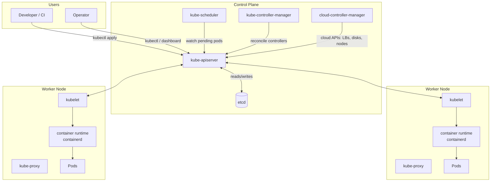

# 📘 Topic 1 — What is Kubernetes? History & Why Kubernetes

**Official Documentation Reference**
- Overview: https://kubernetes.io/docs/concepts/overview/
- Historical context (Borg → Omega → K8s): https://kubernetes.io/blog/2015/04/borg-predecessor-to-kubernetes/
- GKE overview: https://cloud.google.com/kubernetes-engine/docs/concepts/kubernetes-engine-overview
- EKS overview: https://docs.aws.amazon.com/eks/latest/userguide/what-is-eks.html

---

## 🔹 Definition
Kubernetes (K8s) is an open-source, extensible platform that automates deployment, scaling, healing, and operations of containerized applications across a cluster of machines.

---

## 🔹 About

### What problem does it solve?
Running one container on a laptop is trivial. Running **thousands** of containers, on **hundreds** of servers, under real-world stress — hardware failures, traffic spikes, rolling releases, security patches, secret rotation — is not. Before Kubernetes, teams wrote fragile shell scripts or paid vendors for closed platforms to handle this.

Kubernetes provides a **declarative control loop**: you describe the desired state (e.g., "I want 5 replicas of my API running with 2 GB memory each behind a load balancer"), and Kubernetes continuously reconciles reality to match that state.

### Origin
- **Google Borg (2003)**: internal cluster manager running Search, Gmail, YouTube.
- **Google Omega (2013)**: next-gen scheduler research.
- **Kubernetes (2014)**: Google open-sourced a Go-based re-implementation.
- **CNCF (2015)**: Google donated Kubernetes to the Cloud Native Computing Foundation.
- **v1.0**: July 2015.
- **v1.37**: current stable line as of 2026.
- The name comes from Greek κυβερνήτης — *helmsman*. "K8s" = K + 8 letters + s.

### Why it dominates
| Feature | What it means for you |
|---|---|
| Self-healing | Failed containers/pods restart automatically |
| Declarative API | Describe *what*, not *how* |
| Horizontal scaling | Add replicas by changing a number or based on CPU/RAM/custom metrics |
| Service discovery + load balancing | Pods find each other by DNS; traffic distributed automatically |
| Rolling updates + rollback | No-downtime deploys, one command to roll back |
| Storage orchestration | Attach local, EBS, GCE PD, EFS, Filestore, NFS transparently |
| Secret + config management | Decouple sensitive data from images |
| Extensibility | CRDs, operators, admission webhooks, custom schedulers |
| Portability | Same manifests run on laptop, GKE, EKS, AKS, on-prem |

### What Kubernetes is NOT
- Not a PaaS (does not build/deploy source code).
- Not middleware (no database, message bus, cache).
- Not a CI/CD tool (integrates with Jenkins, GitHub Actions, ArgoCD).
- Not a logging/monitoring stack (integrates with Prometheus, EFK, Cloud Logging).
- Not an orchestration engine in the workflow sense — it is a **set of independent control loops** converging on desired state.

---

## 🔹 How It Integrates With Other Kubernetes Components
Every layer of the K8s stack depends on Kubernetes primitives being present:

| Consumer | How it uses Kubernetes |
|---|---|
| Developers | Push image → kubectl apply → Deployment |
| CI/CD (Jenkins, GH Actions, ArgoCD) | Update manifests → apply → rollout |
| Service Mesh (Istio, Linkerd) | Inject sidecars via mutating admission webhooks |
| Observability (Prometheus, Grafana Loki) | Scrape metrics/logs via K8s service discovery |
| Storage (CSI drivers) | Dynamically provision PVs from PVC requests |
| Networking (CNI plugins) | Give each pod an IP; enforce NetworkPolicy |
| Security (OPA/Gatekeeper, Kyverno) | Intercept API requests via admission webhooks |

---

## 🏗️ Architecture / Flow Diagram

### High-level Component Diagram


### Reconciliation Loop
```mermaid
sequenceDiagram
  participant U as User
  participant A as API Server
  participant E as etcd
  participant C as Controller
  participant S as Scheduler
  participant K as Kubelet
  U->>A: kubectl apply -f deploy.yaml (desired=3 replicas)
  A->>E: persist Deployment object
  C->>A: watch Deployments; observe desired=3
  C->>A: create ReplicaSet + 3 Pod objects (Pending)
  S->>A: watch Pending Pods; pick a node for each
  S->>A: bind Pod to Node
  K->>A: watch Pods bound to me
  K->>K: pull image + start container via containerd
  K->>A: update Pod status = Running
  A->>U: kubectl get pods → 3 Running ✅
```

---

## 💻 Real-World Examples

### Example 1 — Deploy nginx and expose it
```yaml
# nginx-example.yaml
apiVersion: apps/v1
kind: Deployment
metadata:
  name: web
  labels: { app: web }
spec:
  replicas: 3
  selector: { matchLabels: { app: web } }
  template:
    metadata: { labels: { app: web } }
    spec:
      containers:
      - name: nginx
        image: nginx:1.27
        ports: [{ containerPort: 80 }]
        resources:
          requests: { cpu: 100m, memory: 128Mi }
          limits:   { cpu: 250m, memory: 256Mi }
---
apiVersion: v1
kind: Service
metadata: { name: web }
spec:
  selector: { app: web }
  ports: [{ port: 80, targetPort: 80 }]
  type: ClusterIP
```
```bash
kubectl apply -f nginx-example.yaml
kubectl get pods -l app=web
kubectl port-forward svc/web 8080:80
# open http://localhost:8080
```

### Example 2 — Rolling update + rollback
```bash
# Update image → K8s replaces pods 1 at a time
kubectl set image deployment/web nginx=nginx:1.28
kubectl rollout status deployment/web

# Oops — rollback
kubectl rollout undo deployment/web
```

---

## 💻 Related Commands

| Command | Flag | Purpose | Example |
|---|---|---|---|
| `kubectl version` | `--client` | Show only client version (skip server) | `kubectl version --client` |
| `kubectl cluster-info` | — | Confirm API and DNS endpoints | `kubectl cluster-info` |
| `kubectl get nodes` | `-o wide` | See node IPs and OS/kernel | `kubectl get nodes -o wide` |
| `kubectl get pods` | `-A` | All namespaces | `kubectl get pods -A` |
| `kubectl apply` | `-f` | Apply a manifest file | `kubectl apply -f deploy.yaml` |
| `kubectl apply` | `-k` | Apply a kustomize overlay | `kubectl apply -k overlays/prod` |
| `kubectl describe` | `pod/<n>` | Full event + status detail | `kubectl describe pod web-1` |
| `kubectl logs` | `-f` | Follow logs live | `kubectl logs -f pod/web-1` |
| `kubectl explain` | `--recursive` | Explain object fields | `kubectl explain pod.spec --recursive` |
| `kubectl api-resources` | `--namespaced=true` | List namespaced kinds | `kubectl api-resources --namespaced=true` |

---

## 🚨 Scenarios

### Scenario 1 — "Our monolith goes down under Black-Friday load"
- **Symptom**: single VM saturates at 500 req/s, cascading errors.
- **K8s fix**: containerize → Deployment with 10 replicas → HorizontalPodAutoscaler on CPU 70% → LoadBalancer service.
- **Result**: scale-out in ~60 s, zero-downtime during spikes.

### Scenario 2 — "Every deploy takes 2 hours of manual SSH"
- **Symptom**: engineers SSH into servers, `git pull`, restart supervisord.
- **K8s fix**: `kubectl set image` or ArgoCD auto-sync. Rolling update controlled by strategy `maxSurge/maxUnavailable`.
- **Result**: deploy = 90 s, rollback = 5 s.

### Scenario 3 — "A node died at 3 AM; my pager fired"
- **Symptom**: node crashes → traffic errors → oncall reboots node.
- **K8s fix**: Deployment controller re-creates pods on healthy nodes automatically; PodDisruptionBudget guarantees availability; multi-zone node pool means the incident is silent.

---

## ☁️ GCP GKE Perspective
- GKE runs the **control plane for free (per project)** on Autopilot; charges per pod resources.
- **Autopilot** = Google runs the nodes; you cannot SSH into them; pay per pod-second.
- **Standard** = you choose machine types and manage node pools.
- Deep GCP integrations: Workload Identity → GCP IAM, Cloud Logging, Cloud Monitoring, Backup for GKE, Cloud DNS.
- Release channels (Rapid / Regular / Stable) dictate upgrade cadence.

```bash
gcloud container clusters create-auto k8s-lab --region=asia-south1
gcloud container clusters get-credentials k8s-lab --region=asia-south1
gcloud container operations list
```

---

## 🟧 AWS EKS Perspective
- EKS charges **$0.10/hour** per cluster control plane, plus EC2/Fargate for workers.
- **Managed Node Groups** = EKS provisions EC2 in your VPC; you patch AMIs.
- **Self-Managed** = you fully own the ASG.
- **Fargate** = serverless pods; pay per pod-second, no nodes to manage; limitations on privileged, DaemonSets, hostPath.
- Native integrations: IRSA (IAM roles for service accounts), VPC CNI (pod = ENI), CloudWatch Container Insights, AWS Load Balancer Controller.

```bash
eksctl create cluster --name k8s-lab --region ap-south-1 --managed
aws eks update-kubeconfig --name k8s-lab --region ap-south-1
aws eks describe-cluster --name k8s-lab
```

---

## 🧪 Hands-On Lab Exercises

### Lab 1.1 — Your first Deployment (Beginner, 20 min)
**Objective**: Deploy nginx and see the reconciliation loop work.

**Prerequisites**: Minikube running, `kubectl` on PATH.

**Setup**
```bash
minikube start --cpus=2 --memory=4096
kubectl get nodes
```

**Steps**
1. Create the manifest `hello.yaml`:
```yaml
apiVersion: apps/v1
kind: Deployment
metadata: { name: hello }
spec:
  replicas: 3
  selector: { matchLabels: { app: hello } }
  template:
    metadata: { labels: { app: hello } }
    spec:
      containers:
      - name: nginx
        image: nginx:1.27
        ports: [{ containerPort: 80 }]
---
apiVersion: v1
kind: Service
metadata: { name: hello }
spec:
  selector: { app: hello }
  ports: [{ port: 80, targetPort: 80 }]
  type: NodePort
```
2. Apply: `kubectl apply -f hello.yaml`
3. Watch reconciliation: `kubectl get pods -w` (Ctrl-C after they're Running)
4. **Kill a pod** and observe self-healing:
```bash
kubectl delete pod $(kubectl get pods -l app=hello -o jsonpath='{.items[0].metadata.name}')
kubectl get pods -l app=hello       # new pod appears
```
5. Access: `minikube service hello --url`

**Verify**: `kubectl get deploy hello` shows `3/3 READY`.

**Expected Output**
```
NAME    READY   UP-TO-DATE   AVAILABLE   AGE
hello   3/3     3            3           45s
```

**Cleanup**: `kubectl delete -f hello.yaml`

**Troubleshoot**
| Error | Fix |
|---|---|
| `ImagePullBackOff` | `docker pull nginx:1.27` first / check DNS |
| Service not reachable | `minikube tunnel` in another shell |

**Bonus**: Scale to 10, then to 1. Watch `kubectl get pods -w`.

### Lab 1.2 — Kill a node, see K8s heal (Intermediate, 30 min)
**Objective**: Prove Kubernetes reschedules pods after a node failure.

**Prerequisites**: Kind cluster with 1 control-plane + 2 workers.

**Setup**
```bash
cat > kind-3.yaml <<'EOF'
kind: Cluster
apiVersion: kind.x-k8s.io/v1alpha4
nodes:
- role: control-plane
- role: worker
- role: worker
EOF
kind create cluster --config kind-3.yaml --name heal-lab
```

**Steps**
1. Deploy 6 pods with anti-affinity so they spread across nodes:
```yaml
apiVersion: apps/v1
kind: Deployment
metadata: { name: spread }
spec:
  replicas: 6
  selector: { matchLabels: { app: spread } }
  template:
    metadata: { labels: { app: spread } }
    spec:
      topologySpreadConstraints:
      - maxSkew: 1
        topologyKey: kubernetes.io/hostname
        whenUnsatisfiable: DoNotSchedule
        labelSelector: { matchLabels: { app: spread } }
      containers:
      - { name: web, image: nginx:1.27 }
```
2. `kubectl apply -f spread.yaml`
3. Confirm pods land on both workers: `kubectl get pods -o wide`
4. Simulate node death:
```bash
docker stop heal-lab-worker
kubectl get nodes -w   # node shows NotReady
```
5. After 5 min (default eviction), pods on that node get rescheduled to the surviving worker.

**Verify**: `kubectl get pods -o wide` shows all 6 pods running.

**Cleanup**: `kind delete cluster --name heal-lab`

**Bonus**: Restart the stopped node — `docker start heal-lab-worker` — then observe that already-running pods are NOT moved back (K8s does not preempt for balance without a rebalancer add-on).

### Lab 1.3 — Compare local vs GKE Autopilot vs EKS (Advanced, 60 min)
**Objective**: Deploy the same app in three environments and note the differences.

**Prerequisites**: gcloud + eksctl + credentials + budgets set.

**Steps**
1. Deploy `hello.yaml` (from Lab 1.1) on Minikube. Note pod IP range, Service type behavior.
2. Create GKE Autopilot: `gcloud container clusters create-auto trio --region=asia-south1`
3. `kubectl apply -f hello.yaml` on Autopilot. Change Service to `type: LoadBalancer`. Note that GKE provisions a real Google LB.
4. Create EKS: `eksctl create cluster --name trio --region ap-south-1 --managed`
5. Apply same manifest on EKS. Note the AWS Classic ELB provisioned.
6. Compare `kubectl get nodes -o wide` on each.

**Cleanup (mandatory)**
```bash
kubectl delete svc hello
gcloud container clusters delete trio --region=asia-south1 --quiet
eksctl delete cluster --name trio --region ap-south-1
```

**Bonus**: Time each step, tabulate cluster-creation duration.

---

## 🎯 Interview Deliverable Answer (60–90 s)
"**What**: Kubernetes is an open-source, declarative platform originally built at Google — evolved from Borg and Omega — that automates deploying, scaling, healing, and operating containerized applications on a cluster.  
**Why**: Before Kubernetes, teams glued together bash scripts and Nagios to keep dozens of servers alive. Kubernetes replaces that with a set of control loops that continuously drive the actual state of the cluster toward the state you declared in YAML. That gives us self-healing, zero-downtime rollouts, autoscaling, service discovery, and secret management — for free.  
**How**: I describe workloads as Deployments, expose them through Services and Ingress, keep configuration in ConfigMaps and Secrets, and let controllers do the rest. In production I run Kubernetes on GKE Autopilot or EKS with managed node groups, tie identity to GCP Workload Identity or IRSA, and monitor with Prometheus and Cloud Logging.  
**Example**: In my last project we migrated a monolithic API to Kubernetes; a bad release used to take 2 hours to roll back — with `kubectl rollout undo` it now takes 5 seconds, and our uptime went from 99.5% to 99.95%."

---

## ❓ Possible Interview Questions

### Basic (0–1 yr)
**Q1. What is Kubernetes?**  
Open-source container orchestration platform that automates deployment, scaling, and management of containerized apps.

**Q2. Why was Kubernetes created and by whom?**  
Google open-sourced it in 2014, based on 15+ years of experience running Borg internally; donated to CNCF in 2015.

**Q3. What does K8s stand for?**  
"K" + 8 letters between K and s + "s" — an abbreviation of Kubernetes.

**Q4. Name three problems Kubernetes solves.**  
Self-healing failed containers; automated rollouts/rollbacks; horizontal autoscaling and service discovery/load balancing.

### Intermediate (2 yr)
**Q5. What is the difference between imperative and declarative Kubernetes?**  
Imperative = `kubectl run/create/edit` telling K8s exact actions. Declarative = `kubectl apply -f` giving desired state; controllers reconcile. Declarative is safer, versionable, GitOps-friendly.

**Q6. Kubernetes is not a PaaS — explain.**  
K8s is a **container** platform: it does not build source code, provide databases, mandate a language/framework, or ship logging. It gives primitives you build a PaaS on (e.g., OpenShift, Cloud Foundry Korifi).

**Q7. What is a controller in Kubernetes?**  
A control loop watching a resource kind, comparing current state to desired state stored in etcd, and taking corrective action (e.g., Deployment controller ensures ReplicaSet count matches spec.replicas).

### Advanced (3–4 yr)
**Q8. Why does K8s use etcd and not a SQL database?**  
etcd is a distributed, strongly consistent (Raft) key-value store optimized for watch semantics — controllers need to be notified of every change instantly. SQL doesn't provide efficient long-lived watches at scale, and eventual consistency would break reconciliation guarantees.

**Q9. How does Kubernetes achieve extensibility without forking?**  
Through CRDs (custom resources), admission webhooks (mutating + validating), the API aggregation layer, custom schedulers, and device plugins/CSI/CNI interfaces.

**Q10. Give one thing Kubernetes explicitly does NOT do, and why that matters.**  
It does not run CI/CD or build code. That means teams choose Jenkins, GitHub Actions, or ArgoCD independently — preserving flexibility and letting K8s remain a stable execution substrate.

### Scenario-based
**Q11. A team wants to move a stateful Java app that stores files on the local disk to Kubernetes. Would you recommend it?**  
Yes, but with PersistentVolumes backed by network storage (EBS/PD/EFS/Filestore) and a StatefulSet (not Deployment) so pods keep stable identities. Warn about the migration complexity for stateful data.

### GKE-specific
**Q12. Why choose GKE Autopilot over Standard?**  
Autopilot removes node management — Google patches and scales nodes — and bills per pod resources. Choose Autopilot when you don't need custom OS, DaemonSets on system nodes, or specific GPU types.

### EKS-specific
**Q13. Why does EKS cost more than a self-hosted kubeadm cluster?**  
$0.10/hour per control plane (24×365 = ~$876/year) for AWS-managed HA control plane, integrated IAM, VPC CNI, automatic patching, and SLA. It's usually cheaper than the engineering time to run kubeadm HA yourself.

### Hands-on / Lab-based
**Q14. In your lab, what happens when you delete a pod under a Deployment?**  
The Deployment → ReplicaSet controller notices `current=2, desired=3`, creates a new Pod object, scheduler binds it to a node, kubelet pulls the image and starts the container. Usually within 5–10 s.

**Q15. Walk me through what `kubectl apply -f deploy.yaml` actually does end-to-end.**  
kubectl reads YAML → authenticates via kubeconfig → sends POST/PUT to kube-apiserver → apiserver runs authN/authZ + admission controllers → validates schema → persists to etcd → responds to kubectl → controllers watch the change → reconciliation begins.

