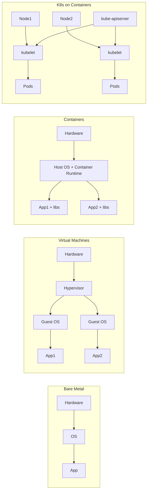
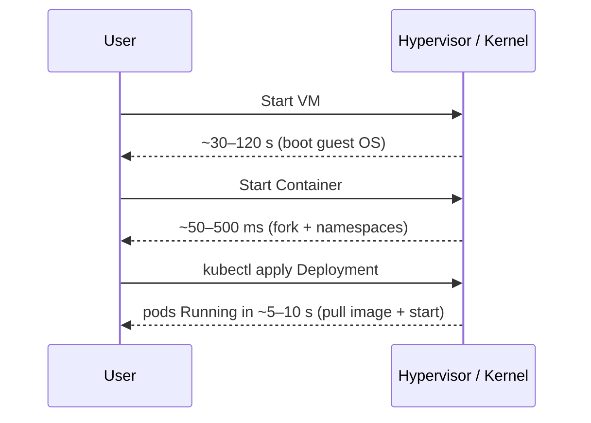

# 📘 Topic 2 — Containers vs VMs vs Kubernetes

**Official Documentation Reference**
- Concepts overview (Container era): https://kubernetes.io/docs/concepts/overview/
- Containers: https://kubernetes.io/docs/concepts/containers/
- Images: https://kubernetes.io/docs/concepts/containers/images/
- GKE overview: https://cloud.google.com/kubernetes-engine/docs/concepts/kubernetes-engine-overview
- EKS overview: https://docs.aws.amazon.com/eks/latest/userguide/what-is-eks.html

---

## 🔹 Definition
- **VM (Virtual Machine)** — a full guest OS running on virtualized hardware via a hypervisor.
- **Container** — an isolated, OS-level process bundled with its dependencies, sharing the host kernel.
- **Kubernetes** — an orchestrator that schedules, scales, heals, and networks many containers across many machines.

---

## 🔹 About

### Physical → VMs → Containers → Orchestrated Containers
1. **Bare metal**: one OS per box; wasted CPU when app idle; app conflicts.
2. **VMs (Xen/KVM/VMware)**: many guest OSes per host; strong isolation but each VM is ~1 GB RAM + minutes to boot.
3. **Containers (Docker/containerd/CRI-O)**: share kernel; ~10 MB overhead; start in milliseconds; portable image format.
4. **Kubernetes**: containers don't schedule, heal, network, or scale themselves. K8s handles that at fleet scale.

### Key mechanism: containers use Linux **namespaces** (PID, NET, MNT, UTS, IPC, USER, CGROUP) for isolation and **cgroups** for resource limits — no hypervisor.

### When to use which
| Situation | Best pick |
|---|---|
| Multi-tenant untrusted code | VM (stronger isolation) or Firecracker microVM |
| Windows-only enterprise app | VM (or Windows nodes on K8s) |
| Microservices, CI/CD, scaling | Containers + Kubernetes |
| One-off script | Docker container, no K8s |
| Regulatory heavy DB with static workload | VM often still wins |

---

## 🔹 How It Integrates With Other Kubernetes Components
Every Kubernetes primitive assumes the container abstraction:

| K8s Component | Relies on containers because... |
|---|---|
| kubelet | Uses CRI (containerd/CRI-O) to run containers |
| Pod | Group of 1+ containers sharing net/IPC/storage namespaces |
| Image pull | Container registry (Docker Hub, Artifact Registry, ECR) |
| CNI plugin | Attaches network namespace to pod |
| CSI driver | Mounts volumes into container filesystem |
| Security context | Sets Linux capabilities, UID, seccomp, AppArmor on the container |

VMs still show up: **GKE nodes = Compute Engine VMs**; **EKS nodes = EC2 VMs**; **kata-containers** or **Firecracker** wrap a container in a lightweight VM for stronger isolation.

---

## 🏗️ Architecture / Comparison Diagrams

### Layer Comparison


### Startup Time Sequence


---

## 🔹 Comparison Tables

### VM vs Container
| Attribute | VM | Container |
|---|---|---|
| Isolation | Hypervisor level (strong) | Kernel level (weaker) |
| Boot time | 30 s – 2 min | 50 ms – few seconds |
| Overhead | 100s of MB per VM (guest OS) | ~10 MB per container |
| Density | 10–20/host | 100s/host |
| Portability | Image + hypervisor | OCI image → any Linux |
| Kernel | Own | Shared with host |
| Security boundary | Very strong | Depends on kernel + seccomp/AppArmor |

### Docker vs Kubernetes (common interview trap)
| | Docker | Kubernetes |
|---|---|---|
| Layer | Runs one container | Runs many containers across nodes |
| Scope | Single machine | Cluster |
| Scaling | Manual (`docker run` again) | Declarative Deployments, HPA |
| Healing | None | Restarts pods, reschedules on failed nodes |
| Networking | Bridge/host per machine | Cluster-wide flat network, Services, DNS |
| Storage | Volumes on host | PV/PVC across nodes |

---

## 💻 Real-World Examples

### Example 1 — Same nginx: VM way vs container way
**VM way** (Bash):
```bash
# On an EC2 instance
sudo apt update && sudo apt install -y nginx
sudo systemctl start nginx
# to run 3 copies → 3 EC2 instances, ELB in front, manual patching
```

**Container way**:
```bash
docker run -d --name web -p 80:80 nginx:1.27
```

**Kubernetes way** (`nginx-k8s.yaml`):
```yaml
apiVersion: apps/v1
kind: Deployment
metadata: { name: web }
spec:
  replicas: 3
  selector: { matchLabels: { app: web } }
  template:
    metadata: { labels: { app: web } }
    spec:
      containers:
      - { name: nginx, image: nginx:1.27, ports: [{ containerPort: 80 }] }
```
`kubectl apply -f nginx-k8s.yaml` → 3 self-healing replicas across nodes with 1 command.

### Example 2 — Minimal multi-stage build → tiny container
```dockerfile
FROM golang:1.22 AS build
WORKDIR /src
COPY . .
RUN CGO_ENABLED=0 go build -o /out/app ./cmd/api

FROM gcr.io/distroless/static:nonroot
COPY --from=build /out/app /app
USER nonroot
ENTRYPOINT ["/app"]
```
Result: ~10 MB image, no shell, no package manager. Compare to a VM AMI ~1–4 GB.

---

## 💻 Related Commands

| Command | Flag | Purpose | Example |
|---|---|---|---|
| `docker ps` | `-a` | Include stopped containers | `docker ps -a` |
| `docker run` | `-d` | Detach | `docker run -d nginx` |
| `docker run` | `--rm` | Remove after exit | `docker run --rm alpine echo hi` |
| `docker exec` | `-it` | Interactive shell | `docker exec -it web sh` |
| `docker build` | `-t` | Tag image | `docker build -t me/app:1 .` |
| `docker push` | — | Push to registry | `docker push me/app:1` |
| `kubectl run` | `--image` | Create ad-hoc pod | `kubectl run tmp --image=busybox --rm -it -- sh` |
| `kubectl exec` | `-it` | Shell in container | `kubectl exec -it web-0 -- sh` |
| `crictl` | `ps` | Container list on a node (CRI) | `sudo crictl ps` |
| `nerdctl` | `ps` | Docker-like CLI for containerd | `nerdctl ps` |

---

## 🚨 Scenarios

### Scenario 1 — "Container works locally, breaks in K8s"
- **Root cause**: local Docker had `--privileged`, K8s pod runs as non-root with dropped capabilities.
- **Fix**: add securityContext explicitly:
```yaml
securityContext:
  runAsNonRoot: true
  runAsUser: 1000
  capabilities: { drop: ["ALL"] }
```

### Scenario 2 — "Legacy Windows service must live"
- **Root cause**: can't containerize legacy .NET Framework app.
- **Fix**: run it in a VM in the same VPC; expose it via a K8s `ExternalName` or headless Service so pods can reach it by DNS.

### Scenario 3 — "Pod restarted mid-request"
- **Root cause**: memory limit exceeded → OOMKilled → container restart.
- **Fix**: raise `resources.limits.memory` or fix the leak. Diagnose:
```bash
kubectl describe pod web-0 | grep -A2 "Last State"   # OOMKilled
kubectl top pod web-0
```

---

## ☁️ GCP GKE Perspective
- GKE **nodes are Compute Engine VMs** (Container-Optimized OS by default).
- **Autopilot** hides the VM; you only see pods. Google uses gVisor/sandboxed nodes for isolation on request (`--enable-gvisor` node pool in Standard).
- Artifact Registry replaces the deprecated Container Registry (`gcr.io`).
```bash
# Push an image
gcloud auth configure-docker asia-south1-docker.pkg.dev
docker tag me/app:1 asia-south1-docker.pkg.dev/$PROJECT/repo/app:1
docker push  asia-south1-docker.pkg.dev/$PROJECT/repo/app:1
```

---

## 🟧 AWS EKS Perspective
- EKS **nodes are EC2 instances** (Amazon Linux 2023 / Bottlerocket AMIs) OR **Fargate microVMs** (Firecracker).
- **Fargate** gives you a serverless-container experience — each pod runs in its own microVM for strong isolation, but no DaemonSets, no privileged, no hostPath.
- ECR is the container registry.
```bash
aws ecr get-login-password --region ap-south-1 | \
  docker login --username AWS --password-stdin <acct>.dkr.ecr.ap-south-1.amazonaws.com
docker tag me/app:1 <acct>.dkr.ecr.ap-south-1.amazonaws.com/app:1
docker push       <acct>.dkr.ecr.ap-south-1.amazonaws.com/app:1
```

---

## 🧪 Hands-On Lab Exercises

### Lab 2.1 — Build → Run → Kubernetes (Beginner, 30 min)
**Objective**: Take one Go/Python service through Docker then Kubernetes.

**Prerequisites**: Minikube, Docker.

**Steps**
1. `app.py`:
```python
from http.server import BaseHTTPRequestHandler, HTTPServer
class H(BaseHTTPRequestHandler):
    def do_GET(self):
        self.send_response(200); self.end_headers()
        self.wfile.write(b"hello from container\n")
HTTPServer(("", 8080), H).serve_forever()
```
2. `Dockerfile`:
```dockerfile
FROM python:3.12-slim
WORKDIR /app
COPY app.py .
CMD ["python", "app.py"]
EXPOSE 8080
```
3. Build: `docker build -t hello:1 .`
4. Run in Docker: `docker run --rm -p 8080:8080 hello:1` → `curl localhost:8080`
5. Load into Minikube: `minikube image load hello:1`
6. Deploy:
```bash
kubectl create deployment hello --image=hello:1
kubectl expose deployment hello --port=8080 --type=NodePort
minikube service hello --url | xargs curl
```

**Verify**: response = `hello from container`.

**Cleanup**: `kubectl delete deploy,svc hello`

**Bonus**: Slim image to `python:3.12-alpine`; measure size delta.

### Lab 2.2 — VM vs Container startup benchmark (Intermediate, 45 min)
**Objective**: Empirically compare boot times.

**Prerequisites**: Multipass / VirtualBox and Docker.

**Steps**
1. `time multipass launch --name vm-test 22.04` → note wall time (~30–60 s).
2. `time docker run --rm hello-world` → note wall time (~1 s).
3. `time kubectl run tmp --image=busybox --restart=Never --rm -it -- sh -c "echo hi"` → note wall time (~5 s including scheduling + pull).

Record in a table:
| Env | Boot to ready |
|---|---|
| VM (Ubuntu 22.04) | ~30–60 s |
| Docker container | ~1 s |
| K8s pod (cached image) | ~2–5 s |

**Cleanup**: `multipass delete vm-test && multipass purge`.

### Lab 2.3 — Firecracker microVMs on EKS Fargate (Advanced, 60 min)
**Objective**: Deploy a pod on Fargate (Firecracker microVM) and observe isolation.

**Prerequisites**: EKS Fargate cluster (`eksctl create cluster --fargate`).

**Steps**
1. `kubectl get nodes -o wide` — see `fargate-ip-…` nodes.
2. Deploy a pod; it runs in its own microVM.
3. Try `kubectl exec` — works, but `hostPath` / `privileged` will fail (Fargate limitations).
```yaml
apiVersion: v1
kind: Pod
metadata: { name: fg-demo, labels: { app: fg } }
spec:
  containers:
  - { name: c, image: nginx:1.27 }
```
4. Verify: `kubectl describe pod fg-demo` shows `Node: fargate-...`.

**Cleanup**: `eksctl delete cluster --name=<name> --region=ap-south-1`

**Bonus**: Try to add `hostPath` volume; observe rejection by Fargate admission.

---

## 🎯 Interview Deliverable Answer (60–90 s)
"**What**: VMs virtualize hardware — each VM ships its own OS. Containers virtualize the OS — they share the host kernel via Linux namespaces and cgroups, so they're an order of magnitude lighter and start in milliseconds. Kubernetes is the layer above: it orchestrates thousands of those containers across many machines.  
**Why**: We pick containers when we need portability, density, and fast iteration. We pick VMs when we need hard isolation, a different kernel, or Windows-only workloads. Kubernetes is what turns containers from a laptop tool into a production platform — scaling, healing, service discovery, rolling updates.  
**How**: In practice I containerize services using multi-stage Docker builds targeting distroless images, push to ECR or Artifact Registry, and deploy them as Deployments on EKS or GKE. Where regulation demands stronger isolation I'll pair it with Fargate microVMs on AWS or gVisor sandboxes on GKE.  
**Example**: We had a monolithic Java app on VMs — 40 minutes to deploy, 12 servers, 30% CPU utilization. Containerized on EKS with HPA, that dropped to 5 minutes to deploy, 6 nodes, 70% average utilization — with better reliability."

---

## ❓ Possible Interview Questions

### Basic
**Q1. Container vs VM in one line?**  
VM = own OS on virtualized hardware; container = isolated process on shared kernel.

**Q2. Why are containers faster to start?**  
No guest OS to boot — just a process with namespaces/cgroups; typically ~ms.

**Q3. What is an OCI image?**  
An Open Container Initiative-standard image format (layers + manifest + config). Docker images are OCI-compliant.

### Intermediate
**Q4. Which Linux features enable containers?**  
Namespaces (PID/NET/MNT/UTS/IPC/USER/CGROUP) for isolation; cgroups for CPU/memory limits; capabilities/seccomp/AppArmor/SELinux for security.

**Q5. Docker vs Kubernetes?**  
Docker runs one container per machine; Kubernetes orchestrates many across a cluster with scheduling, service discovery, healing, and scaling.

**Q6. Why is a container "not a small VM"?**  
Because it shares the host kernel — a kernel exploit escapes the container. That's why runtimes like gVisor/Kata/Firecracker exist for stronger isolation.

### Advanced
**Q7. When would you still pick a VM over a container in 2026?**  
Untrusted multi-tenant code without sandboxing; Windows-only legacy without Windows containers; kernel-module needs (e.g., DKMS drivers); strict regulatory boundary.

**Q8. Explain the CRI. Why did K8s deprecate dockershim?**  
CRI (Container Runtime Interface) is the gRPC contract kubelet uses to talk to runtimes. Dockershim was an adapter to Docker; removed in 1.24 so kubelet talks directly to containerd/CRI-O — simpler, less code.

**Q9. What's the difference between containerd and Docker?**  
containerd is the low-level runtime (image pull, container lifecycle); Docker is a toolchain (CLI, build, compose) that used to embed containerd. Kubernetes uses containerd directly.

### Scenario-based
**Q10. A container works on Docker Compose but fails on Kubernetes — where do you look?**  
readOnlyRootFilesystem/securityContext differences; missing volume mounts; DNS (K8s uses CoreDNS with different search); resource limits triggering OOM; env vars in Compose not translated to ConfigMap/Secret.

### GKE-specific
**Q11. How does GKE Autopilot handle the container isolation boundary?**  
Autopilot runs pods on multi-tenant nodes but enforces strict Pod Security Standards, no privileged, and per-pod Workload Identity. For stronger boundary use `--enable-sandbox` (gVisor).

### EKS-specific
**Q12. What isolation model does EKS Fargate use, and why does it matter?**  
Each pod runs in its own Firecracker microVM. This gives near-VM isolation with container ergonomics — ideal for multi-tenant SaaS, at the cost of no DaemonSets/privileged/hostPath.

### Hands-on / Lab-based
**Q13. In your lab, how did you measure that a container starts faster than a VM?**  
Timed `docker run` vs `multipass launch` on the same host. Containers: ~1 s; VM: ~45 s. K8s pods came in at ~3–5 s including scheduling and image cache lookup.

**Q14. You built a multi-stage Dockerfile — walk me through it.**  
First stage compiles with the SDK image; second stage copies the binary into a distroless/nonroot image. Smaller final image, no compiler, no shell — reduces attack surface and pull time.

**Q15. Show me how you would convert a docker-compose file to Kubernetes.**  
Each service → a Deployment (or StatefulSet for stateful); its ports → a Service; env → ConfigMap/Secret; volumes → PV/PVC. Or use `kompose convert` and refine the output.

