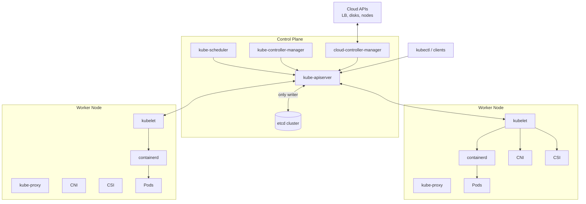
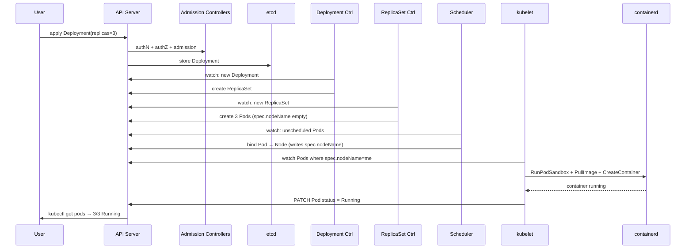
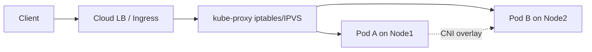

# 📘 Topic 3 — Kubernetes Architecture

**Official Documentation Reference**
- Cluster architecture: https://kubernetes.io/docs/concepts/architecture/
- Components: https://kubernetes.io/docs/concepts/overview/components/
- Nodes: https://kubernetes.io/docs/concepts/architecture/nodes/
- Control-plane ↔ node communication: https://kubernetes.io/docs/concepts/architecture/control-plane-node-communication/
- Cloud controller manager: https://kubernetes.io/docs/concepts/architecture/cloud-controller/
- GKE cluster architecture: https://cloud.google.com/kubernetes-engine/docs/concepts/cluster-architecture
- EKS cluster architecture: https://docs.aws.amazon.com/eks/latest/userguide/clusters.html

---

## 🔹 Definition
A Kubernetes cluster consists of a **control plane** (brain) that makes global decisions and a set of **worker nodes** (muscles) that run the containerized workloads. All state lives in **etcd**, and every component talks through the **API server**.

---

## 🔹 About

### Control Plane Components
| Component | Role | Talks to |
|---|---|---|
| **kube-apiserver** | REST front door for the cluster (only door to etcd) | Everyone |
| **etcd** | Consistent key-value store; source of truth | Only kube-apiserver |
| **kube-scheduler** | Assigns Pending pods to nodes | apiserver |
| **kube-controller-manager** | Runs built-in controllers (Deployment, ReplicaSet, Node, EndpointSlice, ServiceAccount…) | apiserver |
| **cloud-controller-manager** | Cloud-specific glue (LoadBalancers, disks, nodes) | apiserver + cloud API |

### Worker Node Components
| Component | Role |
|---|---|
| **kubelet** | Node agent: watches API for pods bound to it; talks to container runtime; reports status |
| **kube-proxy** | Implements Services (iptables/IPVS/nftables) — routes cluster IPs to pods |
| **container runtime** | containerd / CRI-O / (Docker via cri-dockerd, legacy) — actually runs containers via OCI |
| **CNI plugin** | Assigns pod IPs + wires the network (Calico, Cilium, VPC CNI, GKE DP-v2) |
| **CSI driver** | Attaches persistent storage into pods |

### Key contracts
- **CRI** — Container Runtime Interface (kubelet ↔ runtime).
- **CNI** — Container Network Interface (kubelet ↔ network plugin).
- **CSI** — Container Storage Interface (kubelet ↔ storage).
- **OCI** — image + runtime standards.

### High Availability
Production runs 3 or 5 control-plane replicas (etcd needs an odd number for Raft quorum), each with API server + scheduler + controller-manager. Only one scheduler / one controller-manager is "leader" at a time via leader election.

---

## 🔹 How It Integrates With Other Kubernetes Components

| Workflow step | Component sequence |
|---|---|
| `kubectl apply -f deploy.yaml` | kubectl → API server → admission → etcd |
| ReplicaSet creates pods | Deployment ctrl → ReplicaSet ctrl → API → etcd |
| Pod scheduling | Scheduler watches Pending pods → binds → apiserver |
| Pod start | kubelet watches → CRI pulls image → runs container → reports back |
| Service traffic | kube-proxy programs iptables/IPVS on every node |
| Autoscaling | HPA controller queries metrics-server → patches replicas |
| Cloud LB | cloud-controller-manager creates GCLB/ELB → updates Service status |

---

## 🏗️ Architecture Diagrams

### Component View


### Pod Creation Sequence


### Networking Overview


---

## 💻 Real-World Examples

### Example 1 — Check every component's health
```bash
kubectl get componentstatuses   # legacy (may be empty in v1.19+)
kubectl get --raw='/livez?verbose'
kubectl get --raw='/readyz?verbose'
kubectl get nodes
kubectl get pods -n kube-system
```

### Example 2 — Inspect etcd (on kubeadm cluster)
```bash
# On control-plane node
sudo ETCDCTL_API=3 etcdctl \
  --endpoints=https://127.0.0.1:2379 \
  --cacert=/etc/kubernetes/pki/etcd/ca.crt \
  --cert=/etc/kubernetes/pki/etcd/server.crt \
  --key=/etc/kubernetes/pki/etcd/server.key \
  member list
```

### Example 3 — Static pod manifest for control plane (kubeadm)
```yaml
# /etc/kubernetes/manifests/kube-apiserver.yaml   (managed by kubeadm)
apiVersion: v1
kind: Pod
metadata: { name: kube-apiserver, namespace: kube-system }
spec:
  containers:
  - name: kube-apiserver
    image: registry.k8s.io/kube-apiserver:v1.31.0
    command:
    - kube-apiserver
    - --advertise-address=10.0.0.10
    - --etcd-servers=https://127.0.0.1:2379
    - --service-cluster-ip-range=10.96.0.0/12
```

---

## 💻 Related Commands

| Command | Flag | Purpose | Example |
|---|---|---|---|
| `kubectl cluster-info` | `dump` | Deep dump for support | `kubectl cluster-info dump > cluster.log` |
| `kubectl get nodes` | `-o wide` | See internal/external IPs, kernel | `kubectl get nodes -o wide` |
| `kubectl describe node` | — | Capacity, taints, events | `kubectl describe node worker-1` |
| `kubectl get pods` | `-n kube-system` | See control-plane pods | `kubectl get pods -n kube-system` |
| `kubectl logs` | `-n kube-system kube-apiserver-cp1` | Read apiserver logs | (kubeadm only) |
| `kubectl top` | `nodes` | Live CPU/mem (needs metrics-server) | `kubectl top nodes` |
| `kubectl get --raw` | `/metrics` | Prometheus metrics | `kubectl get --raw /metrics` |
| `crictl` | `pods` | See pods on this node | `sudo crictl pods` |
| `journalctl` | `-u kubelet -f` | kubelet logs | `sudo journalctl -u kubelet -f` |
| `etcdctl` | `snapshot save` | Back up etcd | `etcdctl snapshot save snap.db` |

---

## 🚨 Scenarios

### Scenario 1 — "kubectl commands hang"
- **Root cause**: API server down or etcd unreachable.
- **Diagnose**: `curl -k https://<cp-ip>:6443/livez` → check response. On control-plane node: `sudo systemctl status kubelet` and `sudo crictl ps | grep apiserver`.
- **Fix**: restart kubelet (which restarts static pods) or restore etcd from snapshot.

### Scenario 2 — "Pods stuck Pending forever"
- **Root cause**: scheduler cannot find a fitting node — insufficient CPU/mem, or taints without tolerations, or nodeAffinity mismatch.
- **Diagnose**:
```bash
kubectl describe pod <name> | tail -20    # events
kubectl get nodes -o custom-columns=NAME:.metadata.name,ALLOCATABLE:.status.allocatable
```
- **Fix**: scale nodes, reduce requests, or add tolerations.

### Scenario 3 — "Nodes show NotReady"
- **Root cause**: kubelet crashed, disk pressure, PID pressure, or CNI plugin failure.
- **Diagnose**:
```bash
kubectl describe node <n>       # conditions
ssh node && sudo journalctl -u kubelet -n 100
```
- **Fix**: address the specific condition (clear /var/log, restart kubelet, reinstall CNI).

### Scenario 4 — "Split-brain risk with 2 controller-managers"
- **Root cause**: leader election broken (e.g., clock skew, lease expired).
- **Fix**: sync time (chrony/ntpd), verify `kubectl get leases -n kube-system`.

---

## ☁️ GCP GKE Perspective
- **You do not see** kube-apiserver / etcd / scheduler / controller-manager — Google runs them in Google's project, behind your regional endpoint.
- **Regional clusters** = HA control plane across 3 zones.
- **GKE Dataplane V2** replaces kube-proxy with an eBPF-based Cilium equivalent.
- **Autopilot** hides nodes too — you only see Pods and PodSpecs.
- **cloud-controller-manager** is managed and integrates with Compute Engine LBs, PD CSI, Filestore CSI.
- Health / diagnostics:
```bash
gcloud container clusters describe autopilot-lab --region=asia-south1
gcloud container operations list
gcloud logging read "resource.type=k8s_control_plane_component" --limit=20
```

---

## 🟧 AWS EKS Perspective
- Control plane is **fully AWS-managed** — you never SSH into apiserver/etcd. AWS runs multi-AZ HA and patches automatically.
- **VPC CNI** gives every pod a real ENI IP from your subnet — no overlay by default.
- **kube-proxy** and **CoreDNS** deploy as EKS add-ons you version.
- **Fargate** replaces both node and kubelet — a Firecracker microVM is spun up per pod by an AWS-managed data plane.
- Diagnostics:
```bash
aws eks describe-cluster --name eks-lab --region ap-south-1
aws eks list-addons --cluster-name eks-lab --region ap-south-1
aws logs tail /aws/eks/eks-lab/cluster --follow    # if control-plane logging enabled
```
- **Control-plane logging** must be enabled to get apiserver/audit/scheduler logs to CloudWatch — it's off by default.

---

## 🧪 Hands-On Lab Exercises

### Lab 3.1 — Explore control-plane on kubeadm (Beginner, 30 min)
**Objective**: See every component running as a static Pod and hit their /livez endpoints.

**Prerequisites**: kubeadm cluster from pre-module (Section 2.4).

**Steps**
1. `kubectl get pods -n kube-system` — spot `kube-apiserver-*`, `etcd-*`, `kube-scheduler-*`, `kube-controller-manager-*`.
2. On the control-plane node: `ls /etc/kubernetes/manifests/`.
3. `curl -k https://localhost:6443/livez?verbose | head`.
4. `sudo crictl ps | grep etcd`.

**Verify**: at least 4 static pods, `/livez` returns 200.

**Cleanup**: nothing (part of the cluster).

**Bonus**: Move `kube-scheduler.yaml` out of `/etc/kubernetes/manifests/` for 30 s; observe that the pod disappears; move it back.

### Lab 3.2 — Cause a Pending pod, diagnose the scheduler (Intermediate, 45 min)
**Objective**: Prove how the scheduler makes decisions using resource requests.

**Prerequisites**: Kind 3-node cluster.

**Steps**
1. Run:
```yaml
apiVersion: v1
kind: Pod
metadata: { name: gluttony }
spec:
  containers:
  - { name: c, image: pause:3.9, resources: { requests: { memory: "100Gi" } } }
```
2. `kubectl apply -f gluttony.yaml`
3. `kubectl get pod gluttony` → Pending
4. `kubectl describe pod gluttony | tail -10` → event: `0/3 nodes are available: 3 Insufficient memory`.
5. Reduce request to `100Mi`, apply, watch it schedule.

**Bonus**: Add a toleration for a taint you invent, verify scheduling to a tainted node.

### Lab 3.3 — Simulate API-server outage on Kind (Advanced, 60 min)
**Objective**: See what still works when apiserver is down.

**Prerequisites**: Kind cluster.

**Steps**
1. `docker exec -it kind-control-plane sh -c "mv /etc/kubernetes/manifests/kube-apiserver.yaml /tmp/"` (kubelet detects removal, kills apiserver).
2. `kubectl get pods` → hangs / fails.
3. Confirm existing pods keep running (kubelet keeps them alive from local cache).
4. Restore: `docker exec -it kind-control-plane sh -c "mv /tmp/kube-apiserver.yaml /etc/kubernetes/manifests/"`.
5. Wait ~30 s → `kubectl get pods` works again.

**Cleanup**: `kind delete cluster`.

**Bonus**: While apiserver is down, kill a pod on a worker (via `crictl stop`). Observe kubelet restarts it locally (no rescheduling until apiserver returns).

---

## 🎯 Interview Deliverable Answer (60–90 s)
"**What**: A Kubernetes cluster has two halves — a control plane and worker nodes. The control plane is the kube-apiserver, etcd, scheduler, controller-manager, and on a cloud the cloud-controller-manager. Workers run the kubelet, kube-proxy, a container runtime like containerd, plus CNI and CSI drivers.  
**Why**: This split gives us a single source of truth in etcd, one API front door, and horizontally scalable data plane. Every component follows a controller pattern: watch desired state, act, report actual state.  
**How**: A `kubectl apply` hits the apiserver, goes through authN/Z and admission, lands in etcd. Controllers see the change and create child objects; the scheduler picks a node; kubelet on that node pulls the image via CRI and starts the container; kube-proxy programs iptables so a Service IP reaches it.  
**Managed twist**: On GKE and EKS the control plane is opaque and highly available across zones; on Autopilot even the nodes are hidden. So in production I focus on what I can see — pod scheduling, resource requests, Service and Ingress routing — and trust the cloud provider's SLA on the control plane."

---

## ❓ Possible Interview Questions

### Basic
**Q1. Name the control-plane components.**  
kube-apiserver, etcd, kube-scheduler, kube-controller-manager, (cloud-)controller-manager.

**Q2. What runs on every worker node?**  
kubelet, kube-proxy, container runtime, CNI plugin.

**Q3. Why is etcd important?**  
It stores the entire cluster state — objects, configuration, secrets. Losing etcd = losing the cluster's memory.

### Intermediate
**Q4. Why is only the apiserver allowed to talk to etcd?**  
To centralize authentication, authorization, admission, validation, and audit — and to keep etcd's client fan-out small.

**Q5. What does the scheduler actually do?**  
Filters nodes by predicates (fit, affinity, taints, resources) then scores them (spread, image locality, NodeResourcesFit) and binds the pod to the highest-scoring node.

**Q6. Difference between kube-controller-manager and cloud-controller-manager?**  
kube-controller-manager runs cloud-agnostic controllers (Deployment, ReplicaSet, Node, EndpointSlice…). cloud-controller-manager runs cloud-specific ones (RouteController, ServiceController for LBs, NodeController that queries the cloud provider).

### Advanced
**Q7. Explain leader election in the control plane.**  
Multiple replicas of scheduler/controller-manager run for HA, but only the leader acts. They contend for a Lease object; the winner renews it; if it dies the lease expires and another wins.

**Q8. Walk me through what happens if etcd loses quorum.**  
Writes stop (reads may still work); apiserver becomes read-only; controllers cannot reconcile changes; workloads keep running because kubelets cache their pods. Fix: restore quorum (bring back members) or restore from snapshot.

**Q9. What is a static pod and where would you see one?**  
A pod defined by a manifest file (usually `/etc/kubernetes/manifests/`) that kubelet runs directly without going through apiserver. Control-plane components on kubeadm are static pods.

### Scenario-based
**Q10. `kubectl` returns "unable to connect to server: EOF". What now?**  
Check apiserver: `curl -k https://cp:6443/livez`. If down, check `kubelet` on control-plane, check etcd health, check the manifests directory, check disk pressure. On managed K8s, check cloud provider status page.

### GKE-specific
**Q11. Why can't I SSH into the GKE control plane?**  
Google runs it inside their tenant project; you only get the API endpoint. Diagnostics come via Cloud Logging and `gcloud container operations`.

### EKS-specific
**Q12. How do you get audit logs from an EKS control plane?**  
Enable control-plane logging (api, audit, authenticator, controllerManager, scheduler) on the cluster; logs land in CloudWatch under `/aws/eks/<name>/cluster`.

### Hands-on / Lab-based
**Q13. In your lab you stopped kube-apiserver. What still worked?**  
Existing pods kept running because kubelet had cached PodSpecs. New `kubectl` commands failed. When apiserver returned, everything reconciled without data loss because etcd was untouched.

**Q14. How would you back up an etcd cluster?**  
`ETCDCTL_API=3 etcdctl snapshot save snap.db` on one member, plus PKI directory. Store off-cluster (S3/GCS). To restore: stop apiservers, `etcdctl snapshot restore` per member, re-attach data dirs, restart.

**Q15. Show me how you would prove kube-proxy is doing its job.**  
Deploy 2-replica nginx behind a ClusterIP Service. From another pod: `for i in {1..10}; do curl -s <svc>:80 | grep Server; done`. See both pod hostnames — proof kube-proxy load-balances. Confirm rules via `sudo iptables-save | grep <cluster-ip>` on a node.

