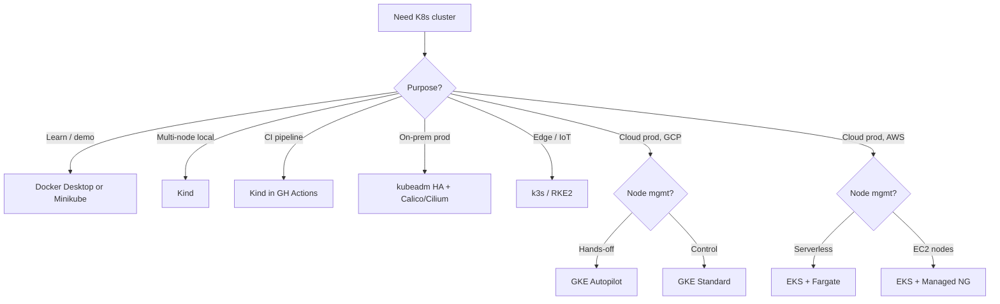

# 📘 Topic 4 — Cluster Setup Options

**Official Documentation Reference**
- Getting started: https://kubernetes.io/docs/setup/
- Learning environment: https://kubernetes.io/docs/setup/learning-environment/
- Production environment: https://kubernetes.io/docs/setup/production-environment/
- kubeadm: https://kubernetes.io/docs/setup/production-environment/tools/kubeadm/create-cluster-kubeadm/
- Minikube: https://minikube.sigs.k8s.io/docs/
- Kind: https://kind.sigs.k8s.io/
- GKE quickstart: https://cloud.google.com/kubernetes-engine/docs/quickstarts
- EKS getting-started: https://docs.aws.amazon.com/eks/latest/userguide/getting-started.html

---

## 🔹 Definition
Kubernetes can be installed in many shapes: for learning (Minikube, Kind, Docker Desktop), for production on your own hardware (kubeadm, Kubespray, Rancher RKE2), or as a fully managed cloud service (GKE, EKS, AKS, DOKS, LKE).

---

## 🔹 About

### What choice actually maps to what use case?
| Setup | Best for | Nodes | HA control plane | Time to bring up |
|---|---|---|---|---|
| **Docker Desktop K8s** | quick localhost tests | 1 | No | seconds |
| **Minikube** | learn kubectl, addons, dashboard | 1 (multi-node possible) | No | 1 min |
| **Kind** | multi-node local, CI pipelines | many (in Docker) | Optional (`--control-plane-nodes 3`) | 1–2 min |
| **kubeadm** | on-prem/production or CKAD/CKA prep | many | Yes (manual HA) | 20–60 min |
| **Kubespray** | Ansible-based prod install | many | Yes | 60 min+ |
| **RKE2 / k3s** | edge + IoT + hardened prod | many | Yes | 5–15 min |
| **GKE Autopilot** | GCP-managed, hands-off | Google manages | Yes (regional) | 4–7 min |
| **GKE Standard** | GCP-managed, node control | You size pools | Yes (regional) | 4–7 min |
| **EKS + Managed NG** | AWS-managed, EC2 workers | You choose types | Yes | 15–20 min |
| **EKS + Fargate** | serverless pods | AWS manages microVMs | Yes | 15–20 min |
| **AKS / DOKS / LKE** | Azure / DigitalOcean / Linode | Provider-managed | Yes | 5–10 min |

### Rules of thumb
- **Learning path**: Docker Desktop or Minikube → Kind → kubeadm.
- **Career interviews**: know Minikube, Kind, kubeadm, GKE, EKS.
- **Production**: managed (GKE/EKS/AKS) unless a hard reason forces on-prem (regulatory, air-gapped, existing hardware).

---

## 🔹 How It Integrates With Other Kubernetes Components
Every setup option pre-installs a specific stack:

| Setup | CNI default | Ingress default | LoadBalancer | Storage |
|---|---|---|---|---|
| Docker Desktop | Docker bridge | none | localhost | local hostPath |
| Minikube | bridge/kindnet | addon (`ingress`) | `minikube tunnel` | hostPath |
| Kind | kindnet | none | needs MetalLB | local-path-provisioner |
| kubeadm | user-chosen (Calico/Cilium/Flannel) | user-chosen | needs MetalLB or cloud | user-chosen |
| GKE Standard | GKE Dataplane V2 (eBPF) | GCE Ingress / NGINX | Google Cloud LB | PD-CSI / Filestore-CSI |
| GKE Autopilot | GKE DP-V2 (locked) | GCE Ingress | Google Cloud LB | PD-CSI (managed) |
| EKS Managed NG | VPC CNI (default) or Calico/Cilium | AWS Load Balancer Controller | NLB/ALB | EBS-CSI / EFS-CSI |
| EKS Fargate | VPC CNI | AWS LB Ctrl (ALB required) | ALB | EFS only |

---

## 🏗️ Setup Decision Flow



### Managed vs Self-Managed Cost/Effort
```mermaid
sequenceDiagram
  participant Op as Ops Engineer
  participant kubeadm as kubeadm HA
  participant EKS as EKS
  participant GKE as GKE Autopilot
  Op->>kubeadm: patch, upgrade, backup etcd, CA rotation…
  kubeadm-->>Op: ~1 FTE/quarter
  Op->>EKS: patch AMIs, add-ons; AWS runs control plane
  EKS-->>Op: ~0.3 FTE/quarter
  Op->>GKE: pick release channel; Google runs everything
  GKE-->>Op: ~0.1 FTE/quarter
```

---

## 💻 Real-World Examples

### Example 1 — Minikube multi-node
```bash
minikube start --nodes=3 --cpus=2 --memory=2048
kubectl get nodes
```

### Example 2 — Kind HA (3 CP + 3 workers)
```yaml
# kind-ha.yaml
kind: Cluster
apiVersion: kind.x-k8s.io/v1alpha4
nodes:
- role: control-plane
- role: control-plane
- role: control-plane
- role: worker
- role: worker
- role: worker
```
```bash
kind create cluster --config kind-ha.yaml --name ha
```

### Example 3 — kubeadm HA (stacked etcd)
1. Load balancer (HAProxy/keepalived) fronting 3 control-plane IPs on TCP 6443.
2. `sudo kubeadm init --control-plane-endpoint "lb.example.com:6443" --upload-certs --pod-network-cidr=192.168.0.0/16`.
3. On CP2 + CP3: `sudo kubeadm join lb.example.com:6443 --control-plane --certificate-key <k> --token <t> --discovery-token-ca-cert-hash sha256:<h>`.

### Example 4 — GKE Autopilot in one command
```bash
gcloud container clusters create-auto prod \
  --region=asia-south1 \
  --release-channel=regular
```

### Example 5 — EKS with eksctl
```yaml
# cluster.yaml
apiVersion: eksctl.io/v1alpha5
kind: ClusterConfig
metadata: { name: prod, region: ap-south-1, version: "1.31" }
managedNodeGroups:
- name: general
  instanceType: t3.medium
  desiredCapacity: 2
  minSize: 1
  maxSize: 5
  volumeSize: 50
```
```bash
eksctl create cluster -f cluster.yaml
```

---

## 💻 Related Commands

| Command | Flag | Purpose | Example |
|---|---|---|---|
| `minikube start` | `--nodes 3 --cpus 2 --memory 4g` | Multi-node local | `minikube start --nodes=3 --cpus=2 --memory=4g` |
| `minikube addons enable` | `<addon>` | Enable ingress/metrics-server | `minikube addons enable ingress` |
| `minikube service` | `--url` | Print URL of a Service | `minikube service web --url` |
| `kind create cluster` | `--config` | Use YAML config | `kind create cluster --config kind.yaml` |
| `kind get clusters` | — | List Kind clusters | `kind get clusters` |
| `kubeadm init` | `--pod-network-cidr` | Set pod CIDR for CNI | `sudo kubeadm init --pod-network-cidr=192.168.0.0/16` |
| `kubeadm join` | `--control-plane` | Join as CP node | see Example 3 |
| `kubeadm reset` | `-f` | Undo an init/join | `sudo kubeadm reset -f` |
| `gcloud container clusters create-auto` | `--region` | GKE Autopilot | see Example 4 |
| `gcloud container clusters get-credentials` | `--region` | Merge kubeconfig | `gcloud container clusters get-credentials prod --region=asia-south1` |
| `eksctl create cluster` | `-f` | Declarative EKS | `eksctl create cluster -f cluster.yaml` |
| `aws eks update-kubeconfig` | `--name --region` | Merge kubeconfig | `aws eks update-kubeconfig --name prod --region ap-south-1` |

---

## 🚨 Scenarios

### Scenario 1 — "Minikube: image pull is slow on flaky Wi-Fi"
- **Fix**: `minikube cache add nginx:1.27` warms an in-cluster cache; then `minikube image load ` uses local Docker images without a registry.

### Scenario 2 — "Kind cluster works locally but fails in CI"
- **Root cause**: CI runners often lack `/dev/kmsg` or run without kernel modules.
- **Fix**: use official kind GH Action `helm/kind-action`; increase Docker file limits; pre-load images with `kind load docker-image`.

### Scenario 3 — "kubeadm cluster: nodes stuck NotReady after init"
- **Root cause**: no CNI installed.
- **Fix**: `kubectl apply -f https://raw.githubusercontent.com/projectcalico/calico/v3.28.0/manifests/calico.yaml`.

### Scenario 4 — "GKE cluster creation fails with quota error"
- **Root cause**: default `SSD_TOTAL_GB` or `IN_USE_ADDRESSES` quota exhausted.
- **Fix**: request quota increase in the region, or pick a smaller machine type / no PD.

### Scenario 5 — "EKS Fargate pod stuck Pending"
- **Root cause**: pod's namespace/label doesn't match any Fargate profile selector.
- **Fix**: add the profile:
```bash
eksctl create fargateprofile --cluster prod --name default --namespace default
```

---

## ☁️ GCP GKE Perspective

### Autopilot vs Standard
| Feature | Autopilot | Standard |
|---|---|---|
| Node management | Google | You |
| Billing | Per pod resources | Per node VM |
| Node customization | Very limited | Full |
| DaemonSets | Allowed (Google-approved) | Free |
| Best for | Teams that want zero ops | Custom OS, GPUs, special workloads |

Handy commands
```bash
# List versions available in a channel
gcloud container get-server-config --region asia-south1

# Upgrade control plane
gcloud container clusters upgrade prod --master --cluster-version=1.31.3 --region=asia-south1

# Upgrade a node pool
gcloud container clusters upgrade prod --node-pool=default --cluster-version=1.31.3 --region=asia-south1

# Delete cluster
gcloud container clusters delete prod --region=asia-south1 --quiet
```

Notable GKE-only features: **release channels** (Rapid/Regular/Stable/No-channel), **maintenance windows/exclusions**, **Autopilot**, **GKE Dataplane V2** (eBPF), **Backup for GKE**, **GKE Enterprise (Fleet)**, **Workload Identity Federation**.

---

## 🟧 AWS EKS Perspective

### Managed NG vs Self-Managed vs Fargate
| Feature | Managed NG | Self-Managed | Fargate |
|---|---|---|---|
| Node OS | AL2023/Bottlerocket | Any | AWS microVM |
| Patching | AWS launches new AMI | You | AWS |
| Scaling | ASG | ASG | per-pod |
| Cost | EC2 hourly | EC2 hourly | vCPU/GB-second |
| Limits | 450 nodes/NG | Cluster-wide | 4 vCPU / 30 GB per pod |
| DaemonSets | Yes | Yes | No |

Handy commands
```bash
# List clusters
aws eks list-clusters --region ap-south-1

# Upgrade cluster version
aws eks update-cluster-version --name prod --kubernetes-version 1.31 --region ap-south-1

# Upgrade a managed NG
aws eks update-nodegroup-version --cluster-name prod --nodegroup-name general --region ap-south-1

# Add-on lifecycle
aws eks describe-addon-versions --kubernetes-version 1.31 --addon-name vpc-cni --region ap-south-1
aws eks update-addon --cluster-name prod --addon-name vpc-cni --addon-version <v> --region ap-south-1

# Delete
eksctl delete cluster --name prod --region ap-south-1
```

EKS-only integrations: **IRSA** (Pod IAM), **VPC CNI** (real ENI IPs), **AWS Load Balancer Controller** (ALB/NLB), **EBS/EFS CSI**, **CloudWatch Container Insights**, **EKS Access Entries** (2024+), **EKS Auto Mode** (2024+).

---

## 🧪 Hands-On Lab Exercises

### Lab 4.1 — Multi-node Kind cluster (Beginner, 30 min)
**Objective**: Create a 3-worker Kind cluster and confirm scheduling across workers.

**Prerequisites**: Docker, kind.

**Setup + Steps**
```bash
cat > kind-3.yaml <<'EOF'
kind: Cluster
apiVersion: kind.x-k8s.io/v1alpha4
name: multi
nodes:
- role: control-plane
- role: worker
- role: worker
- role: worker
EOF
kind create cluster --config kind-3.yaml
kubectl get nodes -o wide
kubectl create deployment web --image=nginx:1.27 --replicas=6
kubectl get pods -o wide     # confirm spread
```

**Cleanup**: `kind delete cluster --name multi`

**Bonus**: Load a local Docker image without a registry: `kind load docker-image me/app:1 --name multi`.

### Lab 4.2 — kubeadm HA control plane on VMs (Advanced, 90 min)
**Objective**: Build a 3-CP, 2-worker HA cluster.

**Prerequisites**: 5 Ubuntu 22.04 VMs, HAProxy VM in front of CPs, network reachability.

**Steps**
1. Install prereqs on all nodes (see pre-module section 2.4).
2. HAProxy config on LB VM:
```
frontend k8s
  bind *:6443
  mode tcp
  default_backend cps
backend cps
  mode tcp
  balance roundrobin
  server cp1 10.0.0.11:6443 check
  server cp2 10.0.0.12:6443 check
  server cp3 10.0.0.13:6443 check
```
3. On CP1: `sudo kubeadm init --control-plane-endpoint "lb.local:6443" --upload-certs --pod-network-cidr=192.168.0.0/16`.
4. Save the two join commands printed.
5. Install Calico: `kubectl apply -f https://raw.githubusercontent.com/projectcalico/calico/v3.28.0/manifests/calico.yaml`.
6. Join CP2, CP3 with `--control-plane --certificate-key ...`.
7. Join workers with plain join command.
8. Verify: `kubectl get nodes` shows 3 CP + 2 workers Ready.

**Cleanup**: `sudo kubeadm reset -f && sudo rm -rf /etc/cni/net.d $HOME/.kube` on each node; destroy VMs.

**Bonus**: Kill CP1; verify LB still gives access and workloads keep running.

### Lab 4.3 — GKE Autopilot vs EKS Fargate side-by-side (Intermediate, 60 min)
**Objective**: Bring up managed clusters on both clouds, deploy the same app, measure wall-clock time and quirks.

**Prerequisites**: gcloud, eksctl, budgets set.

**Steps**
1. Time GKE creation:
```bash
time gcloud container clusters create-auto side-by-side --region=asia-south1
```
2. Time EKS creation:
```bash
time eksctl create cluster --name side-by-side --region ap-south-1 --fargate
```
3. Apply the same nginx Deployment + LoadBalancer Service to both.
4. Compare: cluster creation time, LB provisioning time, pod scheduling time, cost estimate.

**Cleanup (mandatory)**
```bash
gcloud container clusters delete side-by-side --region=asia-south1 --quiet
eksctl delete cluster --name side-by-side --region ap-south-1
```

**Bonus**: Try to run a DaemonSet on both. On Autopilot Google may reject non-approved DaemonSets; on Fargate DaemonSets are outright unsupported.

---

## 🎯 Interview Deliverable Answer (60–90 s)
"**What**: I match the cluster setup to the goal. For learning I run Minikube; for realistic multi-node scenarios and CI I use Kind; for on-prem or production-like practice I use kubeadm; and for real workloads I run either GKE — Autopilot when we want zero node operations, Standard when we need custom node pools — or EKS with managed node groups when we're standardized on AWS.  
**Why**: Managed clusters bury the boring parts — control-plane HA, patching, etcd backups — so my team focuses on workloads. Self-hosted with kubeadm is invaluable for understanding failure modes and passing CKA, but it's a real time sink in production.  
**How**: My default recipe is: pick a region, use a release channel or LTS version, keep node pools small (`e2-medium`/`t3.medium`), enable Workload Identity (GKE) or IRSA (EKS), set budget alerts, then tear down at the end of the lab. I always add a maintenance window and a PodDisruptionBudget so upgrades don't hurt uptime.  
**Example**: On my last project we moved from a self-managed kubeadm cluster to GKE Autopilot; our ops toil dropped ~70% and our monthly cloud spend actually went down because Autopilot bills per pod, not per node."

---

## ❓ Possible Interview Questions

### Basic
**Q1. Difference between Minikube and Kind?**  
Minikube runs Kubernetes in a VM or container; single-cluster focus, addon ecosystem. Kind runs multi-node clusters entirely inside Docker containers, ideal for CI.

**Q2. Is Docker Desktop's Kubernetes production-grade?**  
No — single-node, no HA, mostly for developer inner loop.

**Q3. What tool is used to install Kubernetes on VMs manually?**  
`kubeadm`, plus Kubespray or RKE2 for automation.

### Intermediate
**Q4. What is a release channel in GKE?**  
A tier (Rapid/Regular/Stable/No-channel) controlling how quickly your cluster gets new K8s versions. Rapid is closest to upstream; Stable is most conservative.

**Q5. How does an EKS control plane differ from a kubeadm one?**  
EKS is fully managed and HA across AZs; you never touch the CP. kubeadm gives you every knob but you own patching, HA, backup, and audit.

**Q6. What CNI does GKE use by default?**  
GKE Dataplane V2 (eBPF, based on Cilium) is the recommended default.

### Advanced
**Q7. How would you build an HA control plane with kubeadm?**  
Three CP nodes with stacked etcd (or three external etcd), a TCP LB in front of 6443, use `--control-plane-endpoint`, join CPs with `--upload-certs`/`--certificate-key`, install a CNI, and put workers behind the same LB.

**Q8. Trade-offs of Fargate vs managed NG on EKS?**  
Fargate: no node ops, per-pod billing, strong isolation, but no DaemonSets, no privileged, no hostPath, limited pod sizes, higher pod cost. Managed NG: full pod features, cheaper per pod at scale, but you patch nodes.

**Q9. When would you pick Autopilot over Standard on GKE?**  
When teams don't need node-level customization, want per-pod billing, and want Google to enforce best-practice defaults (PSS, no privileged).

### Scenario-based
**Q10. Your Minikube pods can't reach the internet — where do you look?**  
Docker network, VM driver DNS, `--dns` flag, kube-proxy status, CoreDNS pod logs, MTU issues on Kind (`--containerd-config-patches`).

### GKE-specific
**Q11. What's the fastest way to give an app pod access to a GCS bucket on GKE?**  
Workload Identity: bind a Kubernetes ServiceAccount to a GCP IAM service account, no keys in the pod.

### EKS-specific
**Q12. How do you tell EKS to use a specific IAM role for a namespace's pods?**  
Enable OIDC provider, create IAM role trusting the OIDC issuer with a StringEquals condition on the ServiceAccount, annotate the SA with `eks.amazonaws.com/role-arn`.

### Hands-on / Lab-based
**Q13. Walk me through your Kind multi-node lab.**  
Declared 1 CP + 3 workers in kind-3.yaml, created the cluster, ran `nginx` with 6 replicas, confirmed pods spread across workers with `-o wide`. Then loaded a local image via `kind load docker-image` and redeployed.

**Q14. In your kubeadm HA lab, what did you do to survive CP1 failure?**  
LB continued routing to CP2/CP3, kubectl kept working, workloads unaffected. Verified etcd quorum (2/3) via `etcdctl member list`.

**Q15. On EKS you saw a Fargate pod pending — what next?**  
Check Fargate profile selectors, ensure namespace + labels match, check subnet capacity, check pod resources don't exceed Fargate max.

