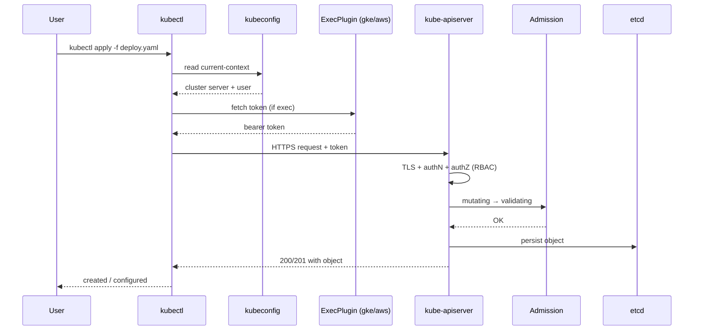
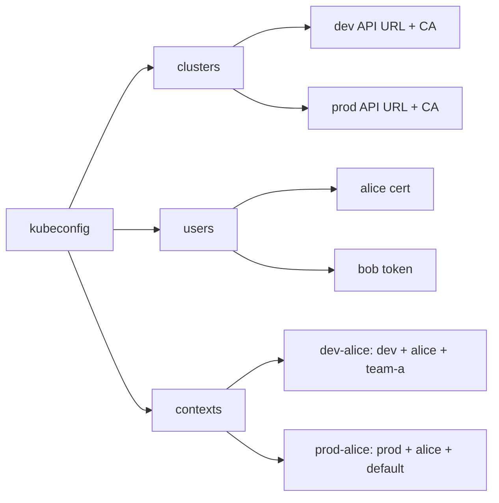

# 📘 Topic 5 — kubectl Basics and kubeconfig

**Official Documentation Reference**
- kubectl overview: https://kubernetes.io/docs/reference/kubectl/
- Introduction: https://kubernetes.io/docs/reference/kubectl/introduction/
- Cheat sheet: https://kubernetes.io/docs/reference/kubectl/quick-reference/
- kubeconfig: https://kubernetes.io/docs/concepts/configuration/organize-cluster-access-kubeconfig/
- Configure access to multiple clusters: https://kubernetes.io/docs/tasks/access-application-cluster/configure-access-multiple-clusters/
- GKE auth plugin: https://cloud.google.com/kubernetes-engine/docs/how-to/cluster-access-for-kubectl
- EKS auth: https://docs.aws.amazon.com/eks/latest/userguide/create-kubeconfig.html

---

## 🔹 Definition
**kubectl** is the official Kubernetes CLI that talks to the API server over HTTPS. **kubeconfig** is a YAML file that tells kubectl *which cluster* to talk to, *how to authenticate*, and *which namespace* to default to.

---

## 🔹 About

### kubectl in one paragraph
kubectl is a Go binary that reads your kubeconfig (default `$HOME/.kube/config`), builds a REST request, adds your credentials, sends it to the API server, and prints the response. Every command follows the pattern:
```
kubectl <verb> <resource> [name] [flags]
verbs   : get, describe, apply, create, delete, edit, rollout, scale, logs, exec, port-forward, cp, top, patch, replace, label, annotate, run, expose, drain, cordon, wait, explain, debug, auth, config
```

### Imperative vs Declarative
| Style | Example | Use when |
|---|---|---|
| Imperative command | `kubectl run web --image=nginx` | quick one-offs, learning |
| Imperative object config | `kubectl create -f deploy.yaml` | scripts |
| Declarative | `kubectl apply -f deploy.yaml` | production, GitOps |

### kubeconfig sections
```yaml
apiVersion: v1
kind: Config
clusters:                       # WHERE
- name: prod
  cluster:
    server: https://1.2.3.4:6443
    certificate-authority: /path/to/ca.crt
users:                          # WHO you are
- name: alice
  user:
    client-certificate: /path/to/alice.crt
    client-key:        /path/to/alice.key
contexts:                       # cluster + user + namespace triplet
- name: prod-alice
  context:
    cluster: prod
    user: alice
    namespace: default
current-context: prod-alice
```
Contexts are the powerful primitive — one command switches cluster, user, and namespace simultaneously.

### Merging multiple kubeconfigs
```bash
export KUBECONFIG="$HOME/.kube/config:$HOME/.kube/gke.yaml:$HOME/.kube/eks.yaml"
kubectl config view --merge --flatten > ~/.kube/merged
mv ~/.kube/merged ~/.kube/config
```

### Auth mechanisms
- **client certs** (kubeadm default)
- **bearer tokens / ServiceAccount tokens**
- **OIDC** (Dex, Google, Okta)
- **exec plugins** — kubectl calls an external binary to get creds (used by `gke-gcloud-auth-plugin` and `aws-iam-authenticator`/`aws eks get-token`)

---

## 🔹 How It Integrates With Other Kubernetes Components
- kubectl never talks to etcd directly — always via kube-apiserver.
- **authN** happens after TLS handshake — cert CN, OIDC id_token, or bearer token.
- **authZ** goes through RBAC (Roles, ClusterRoles).
- **Admission** runs after authZ (mutating, then validating).
- On managed clouds, auth plugins fetch short-lived tokens (Google IAM, AWS STS).

---

## 🏗️ Diagrams

### kubectl Request Flow


### kubeconfig Model


---

## 💻 Real-World Examples

### Example 1 — Everyday inspection cheat sheet
```bash
kubectl get pods -A -o wide
kubectl get svc,ingress -A
kubectl get events --sort-by=.lastTimestamp | tail -20
kubectl top pods --containers -A
kubectl describe pod web-0
```

### Example 2 — Multi-cluster context juggling
```bash
kubectl config get-contexts
kubectl config use-context prod-alice
kubectl config set-context --current --namespace=team-a
# Or with kubectx/kubens
kubectx prod-alice
kubens team-a
```

### Example 3 — Copy a file into a running pod, view remotely
```bash
kubectl cp ./patch.sh web-0:/tmp/patch.sh
kubectl exec -it web-0 -- bash /tmp/patch.sh
kubectl port-forward svc/web 8080:80   # local:pod
```

### Example 4 — Common apply patterns
```bash
kubectl apply -f manifests/                      # a directory
kubectl apply -k overlays/prod                   # kustomize
kubectl apply --server-side -f deploy.yaml       # SSA (safer for shared objects)
kubectl apply --dry-run=client -f deploy.yaml -o yaml   # preview
kubectl diff -f deploy.yaml                      # show live vs proposed diff
```

### Example 5 — Debug a broken pod without editing it
```bash
kubectl debug -it web-0 --image=busybox --target=web
# creates an ephemeral debug container in the same PID/net namespaces
```

---

## 💻 Related Commands

| Command | Flag | Purpose | Example |
|---|---|---|---|
| `kubectl get` | `-o wide` | Extra columns | `kubectl get pods -o wide` |
| `kubectl get` | `-o yaml` / `-o json` | Machine-readable | `kubectl get svc -o yaml` |
| `kubectl get` | `-w` | Watch changes | `kubectl get pods -w` |
| `kubectl get` | `-l app=web` | Label selector | `kubectl get pods -l app=web` |
| `kubectl get` | `--field-selector` | Field selector | `kubectl get pods --field-selector status.phase=Running` |
| `kubectl describe` | — | Verbose incl. events | `kubectl describe deploy web` |
| `kubectl apply` | `-f` / `-k` | Declarative apply | `kubectl apply -f d.yaml` |
| `kubectl apply` | `--server-side` | Server-Side Apply | `kubectl apply --server-side -f d.yaml` |
| `kubectl apply` | `--dry-run=client` | Preview | `kubectl apply --dry-run=client -f d.yaml -o yaml` |
| `kubectl create` | `--dry-run=client -o yaml` | Generate YAML skeleton | `kubectl create deployment web --image=nginx --dry-run=client -o yaml` |
| `kubectl delete` | `-f` / `--all` | Remove | `kubectl delete -f d.yaml` |
| `kubectl delete` | `--grace-period=0 --force` | Force kill | `kubectl delete pod stuck --grace-period=0 --force` |
| `kubectl edit` | — | Live edit an object | `kubectl edit deploy web` |
| `kubectl scale` | `--replicas=` | Change replicas | `kubectl scale deploy web --replicas=5` |
| `kubectl rollout` | `status` / `undo` / `history` | Deployment control | `kubectl rollout undo deploy/web` |
| `kubectl logs` | `-f -c c1 --previous` | Follow, container, previous | `kubectl logs -f -c app web-0 --previous` |
| `kubectl exec` | `-it -- <cmd>` | Interactive shell | `kubectl exec -it web-0 -- sh` |
| `kubectl port-forward` | `svc/…` | Local tunnel | `kubectl port-forward svc/web 8080:80` |
| `kubectl cp` | — | Copy files | `kubectl cp file web-0:/tmp/file` |
| `kubectl top` | `pod/node` | Live CPU/mem | `kubectl top pods -A` |
| `kubectl config` | `use-context` | Switch context | `kubectl config use-context prod` |
| `kubectl config` | `set-context --current --namespace=` | Change default NS | `kubectl config set-context --current --namespace=dev` |
| `kubectl config` | `view` / `--minify` | Show config | `kubectl config view --minify` |
| `kubectl auth` | `can-i` / `whoami` | RBAC test / identity | `kubectl auth can-i create pods -n dev` |
| `kubectl explain` | `--recursive` | Field reference | `kubectl explain pod.spec.containers --recursive` |
| `kubectl api-resources` | `--namespaced=true` | List kinds | `kubectl api-resources --namespaced=true` |
| `kubectl debug` | `--image` `--target` | Ephemeral container | `kubectl debug -it web-0 --image=busybox --target=web` |
| `kubectl wait` | `--for=condition=Ready` | Wait on state | `kubectl wait --for=condition=Ready pod/web-0 --timeout=60s` |

---

## 🚨 Scenarios

### Scenario 1 — "kubectl works on my laptop, fails on colleague's"
- **Root cause**: kubeconfig path or context differs. `$KUBECONFIG` env var unset on the second machine.
- **Fix**: Share the merged kubeconfig or export via `export KUBECONFIG=~/.kube/config-shared`.

### Scenario 2 — "Wrong cluster deploy"
- **Root cause**: `kubectl apply` executed in the wrong context.
- **Fix**: Adopt `kube-ps1` in the shell prompt or use `kubectx`. For pipelines set `KUBECONFIG` per job explicitly, never rely on a shared file.

### Scenario 3 — "gke-gcloud-auth-plugin: command not found"
- **Root cause**: since K8s 1.26, GKE requires a separate auth plugin.
- **Fix**:
```bash
gcloud components install gke-gcloud-auth-plugin
export USE_GKE_GCLOUD_AUTH_PLUGIN=True
gcloud container clusters get-credentials <name> --region <r>
```

### Scenario 4 — "aws eks get-token expired"
- **Root cause**: kubeconfig uses `aws-iam-authenticator` which is deprecated; STS token expired.
- **Fix**: regenerate with `aws eks update-kubeconfig` (uses `aws eks get-token`).

### Scenario 5 — "error: forbidden: user cannot list pods"
- **Root cause**: RBAC missing.
- **Fix**: `kubectl auth can-i list pods --as=<user>`. Bind a Role.

---

## ☁️ GCP GKE Perspective
- Auth plugin: **gke-gcloud-auth-plugin** (installed via `gcloud components install`).
- `gcloud container clusters get-credentials <name> --region <r>` merges an entry into `~/.kube/config`.
- Under the hood the context uses exec plugin `gke-gcloud-auth-plugin` → returns a short-lived Google OAuth token.
- To grant cluster access to another user: give them GCP IAM role `roles/container.developer` **and** RBAC role inside the cluster.
```bash
gcloud container clusters get-credentials prod --region asia-south1
kubectl config current-context      # gke_project_asia-south1_prod
```

---

## 🟧 AWS EKS Perspective
- Auth: `aws eks get-token` (from AWS CLI v2) via kubectl exec plugin.
- `aws eks update-kubeconfig --name <cluster> --region <r>` writes a context.
- Since 2024: **EKS Access Entries** replaces the aws-auth ConfigMap:
```bash
aws eks create-access-entry --cluster-name prod --principal-arn arn:aws:iam::<a>:user/alice --region ap-south-1
aws eks associate-access-policy \
  --cluster-name prod --principal-arn arn:aws:iam::<a>:user/alice \
  --policy-arn arn:aws:eks::aws:cluster-access-policy/AmazonEKSAdminPolicy \
  --access-scope type=cluster --region ap-south-1
```
- IAM Identity Center or SSO users work via `aws configure sso` and refresh automatically.

---

## 🧪 Hands-On Lab Exercises

### Lab 5.1 — Master the imperative to declarative flow (Beginner, 30 min)
**Objective**: Generate YAML from imperative commands, edit, apply, diff.

**Prerequisites**: any cluster.

**Steps**
```bash
# 1. Generate skeleton
kubectl create deployment web --image=nginx:1.27 --dry-run=client -o yaml > deploy.yaml

# 2. Edit → set replicas: 3

# 3. Apply
kubectl apply -f deploy.yaml

# 4. See what would change
sed -i 's/nginx:1.27/nginx:1.28/' deploy.yaml
kubectl diff -f deploy.yaml
kubectl apply -f deploy.yaml
kubectl rollout status deploy/web
```
**Verify**: `kubectl get deploy web -o wide` shows image `nginx:1.28`.

**Cleanup**: `kubectl delete -f deploy.yaml`.

**Bonus**: Repeat with `--server-side` and observe managedFields.

### Lab 5.2 — Multi-cluster kubeconfig (Intermediate, 45 min)
**Objective**: Switch between Minikube, Kind, GKE, EKS with one command.

**Prerequisites**: Minikube + Kind + GKE + EKS clusters (or a subset).

**Steps**
```bash
# Aggregate configs
cp ~/.kube/config ~/.kube/config.bak
export KUBECONFIG=~/.kube/config:~/.kube/gke:~/.kube/eks
kubectl config view --merge --flatten > ~/.kube/all
mv ~/.kube/all ~/.kube/config
unset KUBECONFIG

# Rename ugly contexts
kubectl config rename-context gke_myproj_asia-south1_prod gke-prod
kubectl config rename-context arn:aws:eks:ap-south-1:1234:cluster/prod eks-prod
kubectl config get-contexts

# Fast switching
kubectx minikube && kubectl get nodes
kubectx kind-multi && kubectl get nodes
kubectx gke-prod && kubectl get nodes
kubectx eks-prod && kubectl get nodes
```
**Verify**: `kubectl config get-contexts` shows 4 named contexts.

**Cleanup**: none, or `mv ~/.kube/config.bak ~/.kube/config`.

**Bonus**: Add a `kube-ps1` prompt so the shell always shows current context.

### Lab 5.3 — Debug a pod with kubectl debug + auth can-i (Advanced, 60 min)
**Objective**: Diagnose a running pod and confirm RBAC.

**Prerequisites**: any cluster; deploy `nginx` first.

**Steps**
1. `kubectl run web --image=nginx:1.27`
2. `kubectl debug -it web --image=busybox --target=web -- sh` — you're in the same PID/net namespace.
3. Inside: `ps -ef` (see nginx PIDs), `wget -qO- localhost` — should return HTML.
4. Test RBAC as a different user:
```bash
kubectl auth can-i list pods                  # yes
kubectl auth can-i create pods --as=svc:default    # depends on RBAC
kubectl auth whoami
```
5. Simulate a permission gap: create a Role with only `get pods` and bind to a ServiceAccount, then try `create pods` as that SA.

**Cleanup**: `kubectl delete pod web`, delete Role/Binding.

**Bonus**: Try `kubectl debug node/<node>` — spins up a privileged debug pod on that node.

---

## 🎯 Interview Deliverable Answer (60–90 s)
"**What**: kubectl is the command-line client for the Kubernetes API. It reads a kubeconfig file that describes clusters, users, and contexts, then sends authenticated REST calls to the API server for every verb — get, apply, describe, exec, logs, port-forward, and so on.  
**Why**: The kubeconfig model is what makes multi-cluster work sane. A single context is a triplet — cluster + user + namespace — so switching from dev to prod is one command. Combined with plugins like kubectx and kubens, it prevents the classic 'oops, wrong cluster' incident.  
**How**: I keep separate config files per environment merged with `KUBECONFIG=…`, rename ugly generated contexts, and always show current context in my shell prompt. For managed clouds, I let `gcloud container clusters get-credentials` or `aws eks update-kubeconfig` write the entries, which set up exec-plugin authentication — GKE uses `gke-gcloud-auth-plugin`, EKS uses `aws eks get-token`.  
**Example**: On a recent incident I diagnosed a crash-looping API by chaining `kubectl describe`, `kubectl logs --previous`, and `kubectl debug` with an ephemeral busybox container — within five minutes I confirmed a bad env var was set by a stale ConfigMap and rolled back with `kubectl rollout undo`."

---

## ❓ Possible Interview Questions

### Basic
**Q1. What is kubectl and where is kubeconfig by default?**  
kubectl is the K8s CLI. Default kubeconfig is `$HOME/.kube/config`; override with `--kubeconfig` or `$KUBECONFIG`.

**Q2. `kubectl get pods` shows nothing — why?**  
Wrong namespace (`-n <ns>` or `-A`), wrong context, or no pods exist.

**Q3. Difference between `apply` and `create`?**  
`create` fails if object exists; `apply` patches by merging (or SSA). `apply` is idempotent and safe to re-run.

### Intermediate
**Q4. What is a kubectl context?**  
A named triple: cluster + user + namespace. `kubectl config use-context <name>` selects one.

**Q5. Explain `--server-side` apply.**  
SSA sends the intent to the apiserver, which computes the merge patch tracking `managedFields`. Multiple actors can own different fields safely.

**Q6. How do you inspect the exact YAML the apiserver stored?**  
`kubectl get <res> <name> -o yaml`. Add `--show-managed-fields=false` for readability. `kubectl get -o json | jq` for scripting.

### Advanced
**Q7. What does the exec plugin flow look like for GKE?**  
kubectl invokes `gke-gcloud-auth-plugin`, which uses gcloud's stored credentials to mint a Google OAuth access token, returns it as an ExecCredential JSON, which kubectl attaches as Bearer.

**Q8. When would you use `kubectl replace --force`?**  
When the target object cannot be patched cleanly (immutable fields changed, e.g., Service selector). It deletes and recreates — dangerous, use sparingly.

**Q9. Difference between `kubectl edit` and `kubectl patch`?**  
`edit` opens the object in `$EDITOR` (round-trip through YAML). `patch` applies a JSON/Strategic-merge/JSON-Patch operation programmatically — better for scripts.

### Scenario-based
**Q10. A junior deployed to prod by accident. How would you prevent it going forward?**  
Separate kubeconfig files per env, restricted RBAC per user, `kubectl` shell prompt showing context, and require CI/CD (ArgoCD) to be the only deployer for prod.

### GKE-specific
**Q11. Why does `kubectl` sometimes fail with `error: exec plugin: gke-gcloud-auth-plugin not found` after upgrading?**  
Since K8s 1.26 the plugin is separate. Install via `gcloud components install gke-gcloud-auth-plugin`.

### EKS-specific
**Q12. In EKS, how do you find your identity mapping?**  
Older: `kubectl -n kube-system get cm aws-auth -o yaml`. Newer: `aws eks list-access-entries --cluster-name <n>` and `list-associated-access-policies`.

### Hands-on / Lab-based
**Q13. Walk me through a debug flow you've used.**  
`kubectl describe pod` for events → `kubectl logs -f --previous` for crashed container → `kubectl exec` for live inspection → `kubectl debug -it <pod> --image=busybox --target=<c>` for ephemeral tooling → `kubectl port-forward` to hit the app locally.

**Q14. Show me how to preview a change without applying.**  
`kubectl diff -f deploy.yaml` or `kubectl apply --dry-run=server -f deploy.yaml -o yaml` — server-side dry run runs admission and validation without persisting.

**Q15. How would you list every namespaced resource in a namespace?**  
```bash
kubectl api-resources --verbs=list --namespaced -o name | \
  xargs -n1 kubectl get -n <ns> --ignore-not-found
```

