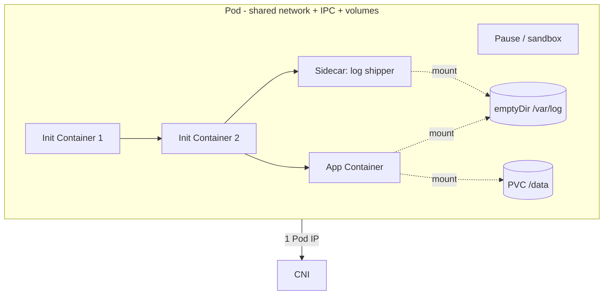
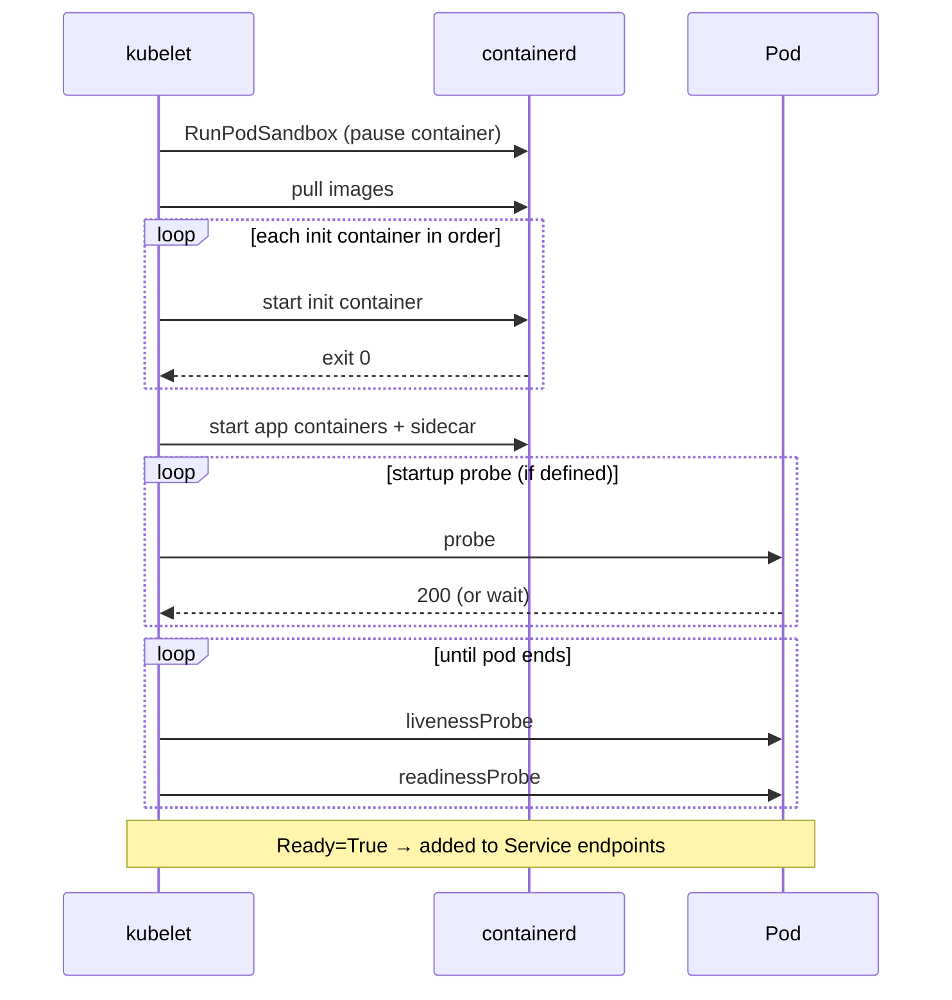
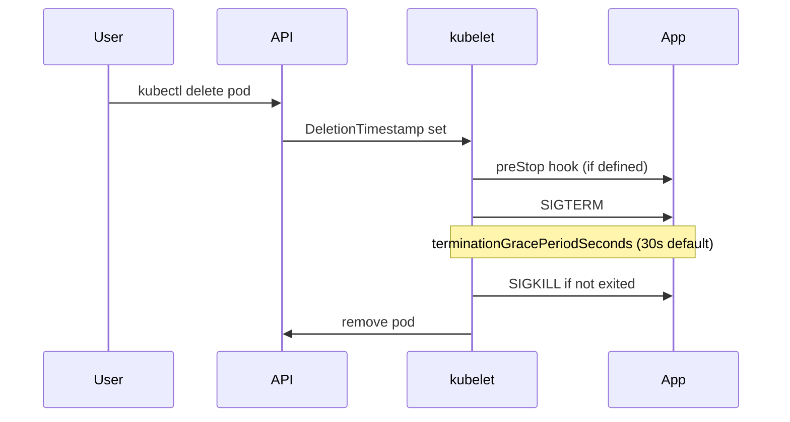

# 📘 Topic 6 — Pods

**Official Documentation Reference**
- Pods: https://kubernetes.io/docs/concepts/workloads/pods/
- Pod Lifecycle: https://kubernetes.io/docs/concepts/workloads/pods/pod-lifecycle/
- Init Containers: https://kubernetes.io/docs/concepts/workloads/pods/init-containers/
- Sidecar Containers: https://kubernetes.io/docs/concepts/workloads/pods/sidecar-containers/
- Static Pods: https://kubernetes.io/docs/tasks/configure-pod-container/static-pod/
- Ephemeral Containers: https://kubernetes.io/docs/concepts/workloads/pods/ephemeral-containers/
- GKE Pods: https://cloud.google.com/kubernetes-engine/docs/concepts/pod
- EKS Pods (VPC CNI): https://docs.aws.amazon.com/eks/latest/userguide/pod-networking.html

---

## 🔹 Definition
A **Pod** is the smallest deployable unit in Kubernetes — a group of one or more containers that share network namespace, IPC, PID (optional), storage volumes, and lifecycle. Every pod gets one IP address.

---

## 🔹 About

### Why pods, not just containers?
Kubernetes chose Pods (a Borg-inspired concept) so tightly coupled processes could co-locate — for example a main app + log tailer that share `/var/log`. Containers in a pod always land on the same node and start/stop together.

### Pod phases (`.status.phase`)
| Phase | Meaning |
|---|---|
| `Pending` | Accepted by API, waiting to schedule or pull images |
| `Running` | Bound to a node, at least one container is running or starting |
| `Succeeded` | All containers exited 0 and won't restart |
| `Failed` | All containers exited, at least one non-zero |
| `Unknown` | Node lost contact (rare in modern K8s) |

### Pod conditions
`PodScheduled`, `Initialized`, `ContainersReady`, `Ready` — all must be True before the pod serves traffic.

### Container states
`Waiting`, `Running`, `Terminated` — each with `reason` (e.g., `CrashLoopBackOff`, `ImagePullBackOff`, `OOMKilled`).

### Init containers
Run **sequentially** before app containers. Must finish successfully. Use for schema migrations, waiting for a dependency, seeding config.

### Sidecar containers (native since 1.29)
Long-running helpers declared with `restartPolicy: Always` in the initContainers list. Start before app containers, run in parallel, terminate after them. Perfect for log shippers, service-mesh proxies, secret refresh agents.

### Static pods
Managed by kubelet directly from a manifest file (`/etc/kubernetes/manifests/`); NOT via apiserver. Control-plane components on kubeadm are static pods. A "mirror pod" appears in the apiserver so you can see it with `kubectl get pods`.

### Ephemeral containers
Debug-only containers added into a running pod with `kubectl debug`. Cannot have ports/probes/resources. Great when the app image has no shell.

### Restart policy
`Always` (default for Deployment pods), `OnFailure` (typical for Jobs), `Never` (one-shot). Applies to every container in the pod.

### Multi-container pod patterns
- **Sidecar** — proxy/log/secret helper.
- **Ambassador** — abstracts an external service behind localhost.
- **Adapter** — normalizes output format (e.g., app → statsd → Prometheus).

---

## 🔹 How It Integrates With Other Kubernetes Components
| Component | Interaction |
|---|---|
| Scheduler | Binds Pod to Node (writes `spec.nodeName`) |
| kubelet | Runs containers via CRI; runs probes; reports status |
| CNI | Assigns Pod IP; wires netns |
| CSI | Mounts volumes into containers |
| kube-proxy | Programs Service → Pod endpoints |
| Deployment / ReplicaSet / StatefulSet / DaemonSet / Job | Create Pods from templates |
| ServiceAccount | Auto-mounted token for API auth |
| Admission (PSA, Kyverno, OPA) | Enforce security context, images, labels |

---

## 🏗️ Diagrams

### Pod Anatomy


### Lifecycle & Probes Sequence


### Termination (graceful shutdown)


---

## 💻 Real-World Examples

### Example 1 — Multi-container pod with init + sidecar
```yaml
apiVersion: v1
kind: Pod
metadata:
  name: web
  labels: { app: web }
spec:
  initContainers:
  - name: wait-for-db
    image: busybox:1.36
    command: ['sh', '-c', 'until nc -z db 5432; do sleep 2; done']
  - name: log-shipper       # native sidecar (K8s 1.29+)
    image: fluent/fluent-bit:3
    restartPolicy: Always
    volumeMounts:
    - { name: applogs, mountPath: /var/log/app }
  containers:
  - name: app
    image: nginx:1.27
    ports: [{ containerPort: 80 }]
    livenessProbe:
      httpGet: { path: /, port: 80 }
      initialDelaySeconds: 5
      periodSeconds: 10
    readinessProbe:
      httpGet: { path: /, port: 80 }
      periodSeconds: 5
    resources:
      requests: { cpu: 100m, memory: 128Mi }
      limits:   { cpu: 500m, memory: 256Mi }
    volumeMounts:
    - { name: applogs, mountPath: /var/log/nginx }
  volumes:
  - name: applogs
    emptyDir: {}
  terminationGracePeriodSeconds: 30
```

### Example 2 — Pod with lifecycle hooks + security context
```yaml
apiVersion: v1
kind: Pod
metadata: { name: hardened }
spec:
  securityContext:
    runAsNonRoot: true
    runAsUser: 1000
    fsGroup: 2000
    seccompProfile: { type: RuntimeDefault }
  containers:
  - name: app
    image: gcr.io/distroless/static:nonroot
    securityContext:
      allowPrivilegeEscalation: false
      readOnlyRootFilesystem: true
      capabilities: { drop: ["ALL"] }
    lifecycle:
      postStart:
        exec: { command: ["/bin/warmup"] }
      preStop:
        exec: { command: ["/bin/drain", "--wait=10s"] }
```

### Example 3 — Static pod (kubeadm nodes)
Drop this file on any worker at `/etc/kubernetes/manifests/echo.yaml`:
```yaml
apiVersion: v1
kind: Pod
metadata: { name: echo }
spec:
  containers:
  - { name: c, image: hashicorp/http-echo, args: ["-text=hi"] }
```
kubelet starts it automatically; `kubectl get pod echo-<node>` shows the mirror.

---

## 💻 Related Commands

| Command | Flag | Purpose | Example |
|---|---|---|---|
| `kubectl run` | `--image` | Ad-hoc pod | `kubectl run tmp --image=busybox --rm -it -- sh` |
| `kubectl run` | `--restart=Never` | Bare pod (not a Deployment) | `kubectl run p --image=nginx --restart=Never` |
| `kubectl get pods` | `-o wide` | See node + IP | `kubectl get pods -o wide` |
| `kubectl describe pod` | — | Events + probes + volumes | `kubectl describe pod web` |
| `kubectl logs` | `-c <container>` | Pick a container | `kubectl logs web -c log-shipper` |
| `kubectl logs` | `--previous` | Prior container instance | `kubectl logs web --previous` |
| `kubectl exec` | `-it -- sh` | Shell into a container | `kubectl exec -it web -c app -- sh` |
| `kubectl debug` | `--image --target` | Ephemeral debug container | `kubectl debug -it web --image=busybox --target=app` |
| `kubectl port-forward` | `pod/<n> local:remote` | Local tunnel | `kubectl port-forward pod/web 8080:80` |
| `kubectl delete pod` | `--grace-period=0 --force` | Force kill | `kubectl delete pod web --grace-period=0 --force` |
| `kubectl label pod` | `key=val` | Add label | `kubectl label pod web env=prod` |
| `kubectl annotate pod` | `key=val` | Add annotation | `kubectl annotate pod web owner=team-a` |
| `kubectl top pod` | `--containers` | Live CPU/mem per container | `kubectl top pod web --containers` |
| `kubectl explain pod.spec` | `--recursive` | Field docs | `kubectl explain pod.spec.containers --recursive` |

---

## 🚨 Scenarios

### Scenario 1 — Pod is `Pending`
- **Common causes**: no node fits resource requests; taints without tolerations; unschedulable node selector/affinity; PVC not bound.
- **Diagnose**: `kubectl describe pod` (events at the bottom).
- **Fix**: reduce requests, add tolerations, wait for PVC, add nodes.

### Scenario 2 — Pod in `CrashLoopBackOff`
- **Cause**: container exits repeatedly (bad command, missing env, misconfig).
- **Diagnose**: `kubectl logs <pod> --previous`, `kubectl describe pod`.
- **Fix**: correct env/config; add readiness before liveness; check startupProbe if slow-boot.

### Scenario 3 — Pod is `Running` but not `Ready`
- **Cause**: readinessProbe failing; sidecar not up; ephemeral storage full.
- **Diagnose**: `kubectl describe pod` → conditions block; `kubectl logs -c <sidecar>`.
- **Fix**: relax probe, fix container, mount larger emptyDir.

### Scenario 4 — `OOMKilled`
- **Cause**: memory usage exceeded `limits.memory`; kernel OOM-killer terminated container.
- **Diagnose**: `kubectl describe pod | grep -A2 "Last State"` shows `OOMKilled`.
- **Fix**: bump limit, fix leak, add pod-level cgroup for a group of containers.

### Scenario 5 — Static pod won't update
- **Cause**: file wasn't overwritten atomically; kubelet cache mismatch.
- **Fix**: `mv new.yaml /etc/kubernetes/manifests/kube-apiserver.yaml`; kubelet restarts the pod within seconds.

---

## ☁️ GCP GKE Perspective
- **Autopilot pod defaults**: enforced securityContext (non-root, no privileged), resource requests required, no hostPath, no host network. Google keeps a fleet of preconfigured pod sizes; requests are rounded up.
- **Autopilot pricing**: per pod CPU-second, memory-second, and ephemeral-storage-second.
- **GKE Standard**: normal pod behavior; `kubectl get pods -o wide` shows node names.
- **GKE Sandbox** (`--sandbox=type=gvisor`) runs pods under gVisor for stronger isolation.
- Handy:
```bash
gcloud container node-pools describe default-pool --cluster prod --region asia-south1
```

---

## 🟧 AWS EKS Perspective
- **VPC CNI** = every Pod gets a real VPC IP from a secondary ENI on the node. IP exhaustion is real: use `WARM_ENI_TARGET`, `MINIMUM_IP_TARGET`, or **prefix delegation** (`ENABLE_PREFIX_DELEGATION=true`) to pack more IPs per ENI.
- **Fargate pods**: run in Firecracker microVMs; no DaemonSets/privileged/hostPath. Have implicit resource limits (0.25–4 vCPU, 0.5–30 GB).
- **Pod Identity** (2023+) or **IRSA** attach IAM roles per pod ServiceAccount.
- Handy:
```bash
kubectl get pod web -o jsonpath='{.spec.nodeName}'
aws ec2 describe-network-interfaces --filters "Name=tag:node.k8s.amazonaws.com/instance_id,Values=<i>"
```

---

## 🧪 Hands-On Lab Exercises

### Lab 6.1 — Init container + sidecar + probes (Beginner, 30 min)
**Objective**: Watch the exact order of init → sidecar → app.

**Prerequisites**: Minikube (K8s ≥ 1.29 for native sidecar).

**Setup + Steps**
```yaml
# pod-order.yaml
apiVersion: v1
kind: Pod
metadata: { name: order-demo, labels: { app: order } }
spec:
  initContainers:
  - name: init-a
    image: busybox:1.36
    command: ['sh','-c','echo init-a; sleep 3']
  - name: sidecar-log
    image: busybox:1.36
    restartPolicy: Always
    command: ['sh','-c','while true; do echo sidecar $(date); sleep 5; done']
  containers:
  - name: app
    image: nginx:1.27
    readinessProbe:
      httpGet: { path: /, port: 80 }
      periodSeconds: 3
```
```bash
kubectl apply -f pod-order.yaml
kubectl get pod order-demo -w      # watch init → running
kubectl logs order-demo -c init-a
kubectl logs order-demo -c sidecar-log
kubectl logs order-demo -c app
kubectl describe pod order-demo | grep -A5 Conditions
```
**Verify**: `Initialized=True`, `Ready=True`, sidecar keeps logging every 5 s.

**Cleanup**: `kubectl delete pod order-demo`.

**Bonus**: Make init-a `exit 1` and observe pod stuck in `Init:CrashLoopBackOff`.

### Lab 6.2 — Force `OOMKilled` and diagnose (Intermediate, 45 min)
**Objective**: Trigger a memory kill and read the signals.

**Steps**
```yaml
apiVersion: v1
kind: Pod
metadata: { name: hungry }
spec:
  containers:
  - name: mem
    image: polinux/stress
    resources:
      requests: { memory: "50Mi", cpu: "100m" }
      limits:   { memory: "100Mi", cpu: "200m" }
    command: ["stress"]
    args: ["--vm", "1", "--vm-bytes", "250M", "--vm-hang", "1"]
```
```bash
kubectl apply -f hungry.yaml
kubectl get pod hungry -w
kubectl describe pod hungry | grep -A3 "Last State"     # OOMKilled
kubectl logs hungry --previous
```
**Bonus**: Raise limit to 300Mi; verify pod stays Running.

### Lab 6.3 — Debug a distroless pod with ephemeral container (Advanced, 45 min)
**Objective**: Diagnose a pod whose image has no shell.

**Steps**
```yaml
apiVersion: v1
kind: Pod
metadata: { name: distro }
spec:
  containers:
  - name: app
    image: gcr.io/distroless/static:nonroot
    command: ["/nonexistent"]  # will fail
```
```bash
kubectl apply -f distro.yaml
kubectl get pod distro                # CrashLoopBackOff
kubectl debug -it distro --image=busybox --target=app -- sh
# inside busybox:
ls /proc/1/root/               # inspect distroless image files
ps -ef                         # see app process (crashed) via shared PID (add shareProcessNamespace)
exit
kubectl describe pod distro | tail -15
```
**Cleanup**: `kubectl delete pod distro`.

**Bonus**: Add `shareProcessNamespace: true` to the pod spec and redo `ps -ef` inside the ephemeral container.

---

## 🎯 Interview Deliverable Answer (60–90 s)
"**What**: A Pod is the smallest deployable unit in Kubernetes. It's a group of one or more containers that share a network namespace, IPC, and optionally the process namespace — they always land on the same node, get one Pod IP, and share their lifecycle.  
**Why**: The pod abstraction lets us co-locate tightly coupled processes — a main app with a log shipper sidecar or a service-mesh proxy — without giving up per-container images or resource limits. Init containers guarantee ordered setup before the app starts.  
**How**: In production I design pods with an init container that waits for dependencies, a native sidecar (K8s 1.29+) for log forwarding or Envoy, an app container with tight resource requests and limits, and explicit liveness/readiness/startup probes. I set a securityContext for non-root, drop capabilities, and use a preStop hook so the app can drain connections cleanly before SIGTERM.  
**Example**: On a payment service we cut cold-start errors to zero by adding a startup probe on the app plus an init container that ran a migration; readiness kept the pod out of the Service endpoints until it was truly warm."

---

## ❓ Possible Interview Questions

### Basic
**Q1. What is a Pod?**  
Smallest deployable unit — group of containers sharing network/IPC/storage and lifecycle.

**Q2. Can a Pod have more than one container?**  
Yes — one main container plus sidecars/init containers.

**Q3. Do containers in the same Pod share an IP?**  
Yes — one Pod IP; containers talk over `localhost` on different ports.

### Intermediate
**Q4. Difference between init container and sidecar.**  
Init runs to completion before app containers. Sidecar (native since 1.29) runs alongside app for its whole lifetime; declared as an initContainer with `restartPolicy: Always`.

**Q5. What are pod phases?**  
Pending, Running, Succeeded, Failed, Unknown.

**Q6. What's a static pod?**  
Pod created directly by kubelet from a manifest directory, bypassing the API server. Control-plane components on kubeadm are static pods.

### Advanced
**Q7. Explain PID namespace sharing.**  
`shareProcessNamespace: true` merges PID namespaces so containers see each other's processes — useful for debug sidecars or signal delivery.

**Q8. How do liveness, readiness, and startup probes differ?**  
Liveness restarts the container if it hangs; readiness gates it out of Service endpoints if not ready; startup delays the other two while a slow-boot app comes up.

**Q9. What happens during graceful termination?**  
DeletionTimestamp set → pod removed from Service endpoints → preStop hook runs → SIGTERM → grace period (default 30 s) → SIGKILL. Meanwhile kubelet updates status.

### Scenario-based
**Q10. A pod is stuck in `ContainerCreating` for 10 minutes — where do you look?**  
`kubectl describe pod` (events) → check image pull errors, missing Secret/ConfigMap, PVC binding, CNI failures (`FailedCreatePodSandBox`).

### GKE-specific
**Q11. Why does Autopilot reject my pod with `hostPath` mount?**  
Autopilot enforces PSS restricted-ish policies; hostPath, hostNetwork, and privileged are blocked. Use a PVC or CSI-backed volume instead.

### EKS-specific
**Q12. Your EKS node ran out of pod IPs — options?**  
Enable `ENABLE_PREFIX_DELEGATION=true` on VPC CNI, or move to larger instance types (more ENIs), or use secondary CIDRs.

### Hands-on / Lab-based
**Q13. Show me how you'd diagnose a distroless pod with no shell.**  
`kubectl debug -it <pod> --image=busybox --target=<container>` — ephemeral container joins net/PID namespaces without touching the pod spec.

**Q14. What order did you observe in your lab: init, sidecar, app?**  
Init containers ran serially first; native sidecar started, then app container. Sidecar continued after app was terminated on delete.

**Q15. When would you avoid multi-container pods?**  
When components have independent scaling or lifecycle needs — those belong in separate Deployments and Services.

