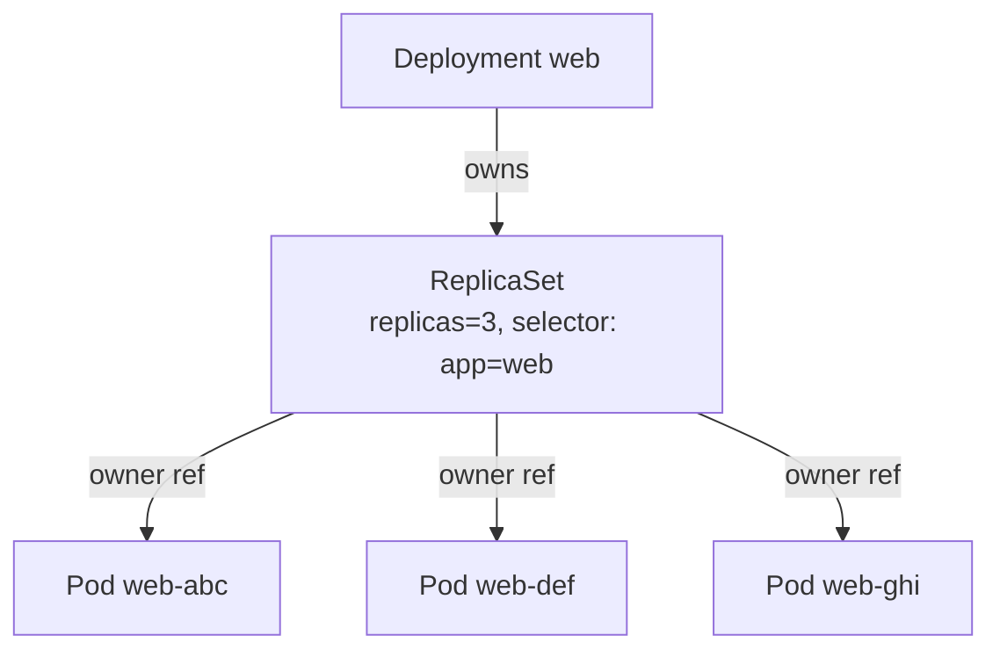
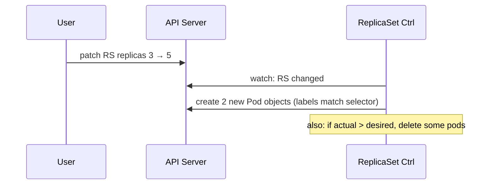

# 📘 Topic 7 — ReplicaSets

**Official Documentation Reference**
- ReplicaSet: https://kubernetes.io/docs/concepts/workloads/controllers/replicaset/
- ReplicationController (legacy): https://kubernetes.io/docs/concepts/workloads/controllers/replicationcontroller/
- Owners and dependents: https://kubernetes.io/docs/concepts/overview/working-with-objects/owners-dependents/
- GKE workloads: https://cloud.google.com/kubernetes-engine/docs/concepts/workload
- EKS workloads: https://docs.aws.amazon.com/eks/latest/userguide/workloads.html

---

## 🔹 Definition
A **ReplicaSet** maintains a stable set of replica Pods running at any given time — guaranteeing a specified number of Pods matching a label selector are always alive.

---

## 🔹 About

### Why ReplicaSets exist
Before Deployments, ReplicaSets provided horizontal replication + healing. Today they still power that muscle, but you rarely create them by hand — a **Deployment owns a ReplicaSet** and creates a new one each time you change the pod template.

### Key spec fields
| Field | Meaning |
|---|---|
| `spec.replicas` | Desired pod count |
| `spec.selector` | Label selector matching the pods it owns |
| `spec.template` | Pod template |

### Selector semantics
- `matchLabels` — key/value equality.
- `matchExpressions` — set-based (`In`, `NotIn`, `Exists`, `DoesNotExist`).
- Selector and template labels **must match** or the API rejects it.

### OwnerReferences and garbage collection
Every Pod created by a RS carries `ownerReferences` pointing back to the RS. Deleting the RS cascades to Pods unless you pass `--cascade=orphan`.

### ReplicaSet vs ReplicationController
- RS supports set-based selectors; RC only equality.
- RC is legacy — do not use for new work.

### When to touch a RS directly
- Debugging a rollout (see which RS a Deployment created).
- Scaling manually with `kubectl scale rs/<name>` (rarely).

---

## 🔹 How It Integrates With Other Kubernetes Components
| Component | Interaction |
|---|---|
| Deployment | Creates & manages RS (one per pod-template hash) |
| Pod | Owned by RS via ownerReferences |
| Scheduler | Places RS-owned pods on nodes |
| HPA | Scales `replicas` of the RS's owner Deployment |
| Kube-controller-manager | Hosts the `replicaset` controller |

---

## 🏗️ Diagrams

### RS is a wrapper over Pods


### Reconciliation


---

## 💻 Real-World Examples

### Example 1 — Bare ReplicaSet
```yaml
apiVersion: apps/v1
kind: ReplicaSet
metadata:
  name: web
  labels: { app: web }
spec:
  replicas: 3
  selector:
    matchLabels: { app: web, tier: front }
  template:
    metadata:
      labels: { app: web, tier: front }
    spec:
      containers:
      - { name: nginx, image: nginx:1.27, ports: [{ containerPort: 80 }] }
```
```bash
kubectl apply -f rs.yaml
kubectl get rs
kubectl get pods -l app=web
kubectl delete pod $(kubectl get pod -l app=web -o jsonpath='{.items[0].metadata.name}')
kubectl get pods -l app=web        # replacement appears
```

### Example 2 — Set-based selector
```yaml
apiVersion: apps/v1
kind: ReplicaSet
metadata: { name: multi-env }
spec:
  replicas: 4
  selector:
    matchExpressions:
    - { key: env, operator: In, values: [dev, staging] }
    - { key: app, operator: Exists }
  template:
    metadata: { labels: { app: web, env: dev } }
    spec:
      containers: [{ name: nginx, image: nginx:1.27 }]
```

### Example 3 — Scale a Deployment's underlying RS
```bash
kubectl get deploy web -o jsonpath='{.metadata.uid}'
kubectl get rs -l app=web -o wide         # spot the RS whose CURRENT ≠ DESIRED
kubectl scale rs/<rs-name> --replicas=6   # temporary; Deployment will reconcile next apply
```

---

## 💻 Related Commands

| Command | Flag | Purpose | Example |
|---|---|---|---|
| `kubectl get rs` | `-o wide` | See RS + selector | `kubectl get rs -o wide` |
| `kubectl describe rs` | — | Events + pod status | `kubectl describe rs web-abc` |
| `kubectl scale rs` | `--replicas=` | Change replica count | `kubectl scale rs/web-abc --replicas=5` |
| `kubectl delete rs` | `--cascade=orphan` | Delete RS, keep pods | `kubectl delete rs web-abc --cascade=orphan` |
| `kubectl get pods` | `-l <selector>` | Query by selector | `kubectl get pods -l app=web` |
| `kubectl edit rs` | — | Manual edit | `kubectl edit rs web-abc` |
| `kubectl rollout status` | `rs/<name>` | Not supported (use deploy) | — |

---

## 🚨 Scenarios

### Scenario 1 — Pods keep respawning after `kubectl delete pod`
- **Cause**: RS controller ensures desired count.
- **Fix**: Delete the RS or scale it to 0: `kubectl scale rs/web --replicas=0`.

### Scenario 2 — Selector mismatch across ReplicaSets
- **Cause**: Two RS have overlapping selectors → they "fight" for the same pods.
- **Fix**: Add a unique label (e.g., `pod-template-hash` that Deployments add automatically) and align selectors.

### Scenario 3 — Deployment stuck with old RS pods
- **Cause**: New RS pods failing readiness; Deployment keeps old pods to satisfy availability.
- **Diagnose**: `kubectl get rs -l app=web` (READY column), `kubectl describe rs <new-hash>`.
- **Fix**: Fix probes/image; `kubectl rollout undo deploy/web` if needed.

---

## ☁️ GCP GKE Perspective
- RS behavior is identical. On **Autopilot** each pod is billed per resource-second, so an idle-but-alive RS still costs money — scale to 0 when not needed.
- `gcloud container clusters describe` won't show RS specifics; use `kubectl get rs`.

## 🟧 AWS EKS Perspective
- Same on EKS. On **Fargate**, each RS pod is a microVM; scaling replicas up = more microVMs allocated.
- IP planning: 10 replicas × VPC CNI without prefix delegation = 10 VPC IPs consumed.

---

## 🧪 Hands-On Lab Exercises

### Lab 7.1 — See a RS heal itself (Beginner, 20 min)
**Steps**
```bash
cat <<'EOF' | kubectl apply -f -
apiVersion: apps/v1
kind: ReplicaSet
metadata: { name: rs-demo }
spec:
  replicas: 3
  selector: { matchLabels: { app: demo } }
  template:
    metadata: { labels: { app: demo } }
    spec: { containers: [{ name: c, image: nginx:1.27 }] }
EOF
kubectl get rs,pod -l app=demo
kubectl delete pod -l app=demo --wait=false
kubectl get pods -l app=demo -w    # new pod appears within seconds
```
**Cleanup**: `kubectl delete rs rs-demo`.

**Bonus**: `kubectl scale rs/rs-demo --replicas=0` then back to 3.

### Lab 7.2 — Orphan pods with `--cascade=orphan` (Intermediate, 30 min)
**Steps**
```bash
kubectl apply -f rs.yaml
kubectl delete rs rs-demo --cascade=orphan
kubectl get pods -l app=demo          # pods survive
kubectl label pods -l app=demo orphaned=true
```
**Bonus**: Create a new RS with the same selector — it "adopts" the orphan pods.

### Lab 7.3 — Two RS fight for the same label (Advanced, 30 min)
**Steps**
1. Apply RS A with `matchLabels: {app: fight}` replicas=3 and template labels `{app: fight, color: red}`.
2. Apply RS B with same selector but template labels `{app: fight, color: blue}`.
3. `kubectl get pods -l app=fight -w` — pods oscillate between red and blue as each RS creates and the other doesn't recognize.
4. Fix by adding `color` to each selector.

**Cleanup**: delete both RS.

---

## 🎯 Interview Deliverable Answer (60–90 s)
"**What**: A ReplicaSet is a controller that keeps a fixed number of pods matching a label selector alive. If pods are deleted or nodes die, it creates replacements; if too many exist, it deletes extras.  
**Why**: It's the primitive that gives Kubernetes its self-healing property for stateless workloads.  
**How**: In practice I never write a ReplicaSet by hand — I write a Deployment. The Deployment creates one ReplicaSet per pod template revision, which makes rolling updates and rollbacks trivial. If I need to inspect a rollout I look at the underlying ReplicaSets with `kubectl get rs`, watch which one is scaling up vs down.  
**Example**: On a rollout gone bad, we saw both the old and new RS at 2/2 for hours. `kubectl describe rs <new-hash>` showed readiness failures. We fixed the probe, and the new RS scaled up while the old scaled down — the rollout completed without touching the Deployment definition."

---

## ❓ Possible Interview Questions

### Basic
**Q1. What does a ReplicaSet do?** Ensures a specified number of replica pods are running.  
**Q2. Difference between RS and RC?** RS supports set-based selectors; RC only equality. RC is legacy.  
**Q3. Do you create ReplicaSets directly?** Rarely — Deployments manage them for you.

### Intermediate
**Q4. What links a Pod to its ReplicaSet?** `metadata.ownerReferences` pointing to the RS.  
**Q5. What is `pod-template-hash`?** A label Deployment adds to every RS/Pod based on the template's hash, ensuring unique selectors per revision.  
**Q6. What happens when you scale a RS to 0?** All owned pods are deleted; RS remains.

### Advanced
**Q7. How does the RS controller decide which pods to delete when scaling down?**  
It ranks candidates: pods not on a real node > pending > unready > lowest-ready-time > lowest phase.  
**Q8. Can a RS adopt pre-existing pods?** Yes — if labels match selector and pods have no controller ref.  
**Q9. What is cascade delete?** Deleting an owner (RS) triggers deletion of dependents (Pods) by garbage collector.

### Scenario-based
**Q10. Two RS with overlapping selectors — what happens?** They "fight" — each creates pods to satisfy its count but sees the other's pods as excess to delete, causing thrashing. Fix selectors.

### GKE-specific
**Q11. On Autopilot, does a paused RS still cost money?** A scaled-to-0 RS costs nothing (no pods). A scaled-to-N RS is billed per pod-second regardless of activity.

### EKS-specific
**Q12. Your RS wants 20 replicas but only 6 pods run on EKS — likely reason?** VPC CNI IP exhaustion on the node subnets. Confirm with `kubectl describe pod` events like `failed to assign an IP address`.

### Hands-on / Lab-based
**Q13. Show a RS healing after pod deletion.** Delete a pod owned by RS; observe replacement appearing in `kubectl get pods -w`.  
**Q14. How do you inspect the RSes a Deployment created?** `kubectl get rs -l app=<name>`; each has `.metadata.ownerReferences` pointing to the Deployment.  
**Q15. When would you orphan RS pods?** Rare — during a delicate migration to a new controller, or when snapshotting a state for forensic analysis.

