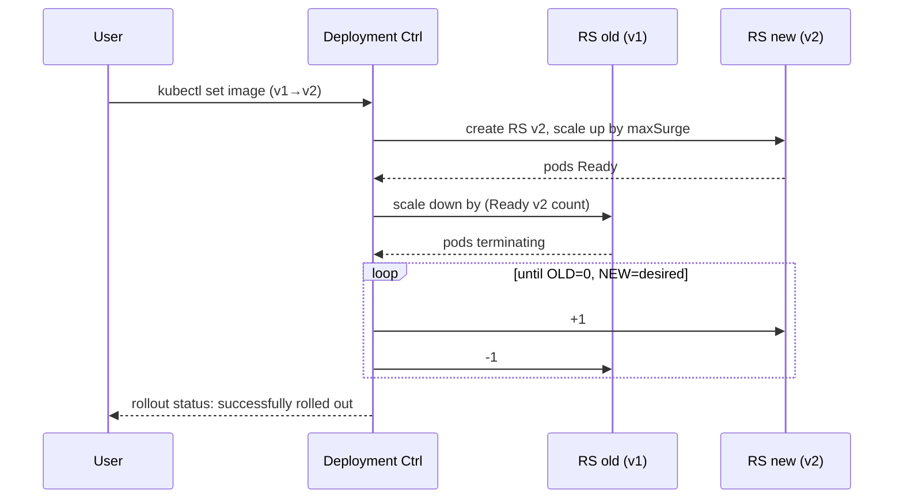
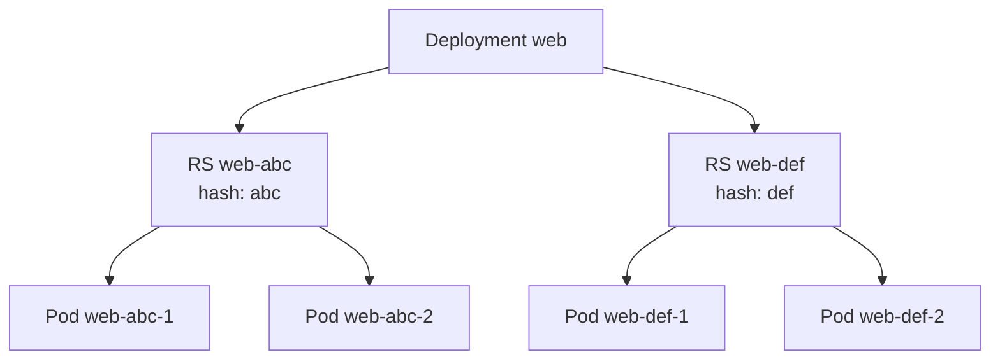
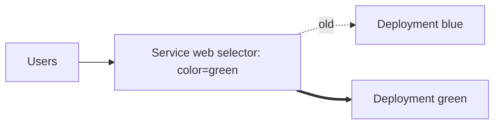

# 📘 Topic 8 — Deployments (Rolling Updates, Rollbacks, Strategies)

**Official Documentation Reference**
- Deployment: https://kubernetes.io/docs/concepts/workloads/controllers/deployment/
- Update deployment without downtime: https://kubernetes.io/docs/tasks/run-application/update-deployment-rolling/
- Canary tutorial: https://kubernetes.io/docs/tutorials/stateless-application/canary-deployment/
- GKE Deployment: https://cloud.google.com/kubernetes-engine/docs/how-to/updating-apps
- EKS rollouts: https://docs.aws.amazon.com/eks/latest/userguide/workloads.html

---

## 🔹 Definition
A **Deployment** is a higher-level controller that manages ReplicaSets to run stateless application pods and to perform declarative, no-downtime updates and rollbacks.

---

## 🔹 About

### Anatomy
- Deployment → creates a **new ReplicaSet** each time the pod template changes (identified by `pod-template-hash`).
- Old ReplicaSets are kept for **rollback history** (default 10, controlled by `revisionHistoryLimit`).

### Update strategies
| `spec.strategy.type` | Behavior | Downtime | Use case |
|---|---|---|---|
| `RollingUpdate` (default) | Gradually replace pods respecting `maxSurge` + `maxUnavailable` | None | Web/API services |
| `Recreate` | Kill all old, then create new | Yes | Apps that cannot run 2 versions concurrently (single-writer DB migrations, incompatible schemas) |

### RollingUpdate knobs
- `maxSurge` — extra pods allowed above `replicas` during update (default 25%).
- `maxUnavailable` — pods allowed to be down during update (default 25%).
- `minReadySeconds` — how long a new pod must be Ready before considered available (add to catch flaky pods).
- `progressDeadlineSeconds` — fail the rollout if no progress in this window (default 600 s).

### Advanced patterns (via manifest + Service tricks)
- **Blue-green** — 2 Deployments (`blue`, `green`); switch Service selector from `color: blue` to `color: green`.
- **Canary** — one Deployment `stable`, one Deployment `canary` with fewer replicas; both selected by the same Service via a shared `app` label.
- **Progressive delivery** (Argo Rollouts, Flagger) — CRDs that add proper canary/blue-green with traffic-shift metrics.

### Pause/resume
`kubectl rollout pause deploy/web` freezes updates; useful to bundle multiple edits before triggering a rollout.

---

## 🔹 How It Integrates With Other Kubernetes Components
| Component | Interaction |
|---|---|
| ReplicaSet | Deployment creates/scales/deletes RS per revision |
| Service | Points at Deployment's pods via selector (unchanged during rollout) |
| HPA | Scales `.spec.replicas` on the Deployment |
| Ingress | Routes external traffic to the Service |
| PodDisruptionBudget | Guards evictions during rollouts + node drains |
| Admission (Kyverno/OPA) | Can enforce probes, resources, image registries |

---

## 🏗️ Diagrams

### Rolling update timeline


### Deployment ↔ RS ↔ Pod ownership


### Blue-green switch


---

## 💻 Real-World Examples

### Example 1 — Production-ready Deployment
```yaml
apiVersion: apps/v1
kind: Deployment
metadata:
  name: web
  labels: { app: web }
spec:
  replicas: 5
  revisionHistoryLimit: 5
  progressDeadlineSeconds: 300
  strategy:
    type: RollingUpdate
    rollingUpdate:
      maxSurge: 25%
      maxUnavailable: 0        # zero-downtime rollouts
  minReadySeconds: 10
  selector:
    matchLabels: { app: web }
  template:
    metadata: { labels: { app: web } }
    spec:
      terminationGracePeriodSeconds: 45
      containers:
      - name: app
        image: myrepo/web:1.4.2
        ports: [{ containerPort: 8080 }]
        resources:
          requests: { cpu: 100m, memory: 128Mi }
          limits:   { cpu: 500m, memory: 512Mi }
        startupProbe:
          httpGet: { path: /healthz, port: 8080 }
          failureThreshold: 30
          periodSeconds: 2
        readinessProbe:
          httpGet: { path: /ready, port: 8080 }
          periodSeconds: 5
        livenessProbe:
          httpGet: { path: /healthz, port: 8080 }
          periodSeconds: 10
        lifecycle:
          preStop:
            exec: { command: ["/bin/drain","--wait=20s"] }
```

### Example 2 — Rolling update, then rollback
```bash
kubectl set image deploy/web app=myrepo/web:1.4.3
kubectl rollout status deploy/web
# oh no
kubectl rollout undo deploy/web                      # to previous
kubectl rollout undo deploy/web --to-revision=3      # to specific
kubectl rollout history deploy/web
```

### Example 3 — Canary using two Deployments + one Service
```yaml
apiVersion: v1
kind: Service
metadata: { name: web }
spec:
  selector: { app: web }        # matches both stable and canary
  ports: [{ port: 80, targetPort: 8080 }]
---
apiVersion: apps/v1
kind: Deployment
metadata: { name: web-stable }
spec:
  replicas: 9
  selector: { matchLabels: { app: web, track: stable } }
  template: { metadata: { labels: { app: web, track: stable } },
              spec: { containers: [{ name: c, image: myrepo/web:1.4.2 }] } }
---
apiVersion: apps/v1
kind: Deployment
metadata: { name: web-canary }
spec:
  replicas: 1
  selector: { matchLabels: { app: web, track: canary } }
  template: { metadata: { labels: { app: web, track: canary } },
              spec: { containers: [{ name: c, image: myrepo/web:1.4.3 }] } }
```
Ratio: 9:1 traffic split at Service level.

### Example 4 — Recreate strategy
```yaml
spec:
  strategy: { type: Recreate }
```

---

## 💻 Related Commands

| Command | Flag | Purpose | Example |
|---|---|---|---|
| `kubectl create deployment` | `--image` | Create quickly | `kubectl create deploy web --image=nginx` |
| `kubectl set image` | `deploy/<n> <c>=` | Trigger a rollout | `kubectl set image deploy/web app=nginx:1.28` |
| `kubectl scale` | `--replicas=` | Manual scale | `kubectl scale deploy/web --replicas=5` |
| `kubectl rollout status` | `deploy/<n>` | Watch progress | `kubectl rollout status deploy/web` |
| `kubectl rollout history` | `deploy/<n>` | List revisions | `kubectl rollout history deploy/web` |
| `kubectl rollout history` | `--revision=3` | Show one revision | `kubectl rollout history deploy/web --revision=3` |
| `kubectl rollout undo` | `--to-revision=N` | Rollback | `kubectl rollout undo deploy/web --to-revision=2` |
| `kubectl rollout pause` | `deploy/<n>` | Hold updates | `kubectl rollout pause deploy/web` |
| `kubectl rollout resume` | `deploy/<n>` | Continue | `kubectl rollout resume deploy/web` |
| `kubectl rollout restart` | `deploy/<n>` | Recycle pods (no image change) | `kubectl rollout restart deploy/web` |
| `kubectl set env` | `deploy/<n> K=V` | Update env → rollout | `kubectl set env deploy/web LOG=info` |
| `kubectl edit deploy` | — | Live edit YAML | `kubectl edit deploy web` |
| `kubectl patch deploy` | `--type=…` | Scripted change | `kubectl patch deploy web -p '{"spec":{"replicas":3}}'` |
| `kubectl expose deploy` | `--port --type` | Create Service | `kubectl expose deploy web --port=80 --type=ClusterIP` |

---

## 🚨 Scenarios

### Scenario 1 — Rollout stuck at "1 old / 1 new"
- **Cause**: New pods failing readiness (bad image, config, DB down).
- **Diagnose**: `kubectl rollout status deploy/web`; `kubectl describe rs -l app=web` for new-hash RS events; `kubectl logs -l track=canary --previous`.
- **Fix**: `kubectl rollout undo deploy/web` or fix underlying cause.

### Scenario 2 — Rollback to earlier version
- **Cause**: v1.4.3 causes 500s.
- **Fix**:
```bash
kubectl rollout undo deploy/web             # to last
kubectl rollout undo deploy/web --to-revision=3
```

### Scenario 3 — Downtime during update
- **Cause**: `maxUnavailable=25%` with only 4 replicas → 1 pod down at a time; PDB not set.
- **Fix**: Set `maxUnavailable: 0`, `maxSurge: 1`, add PDB `minAvailable: 4`.

### Scenario 4 — Rollout finishes but stale traffic
- **Cause**: readinessProbe succeeded before app fully warm.
- **Fix**: Add startup probe or `minReadySeconds: 30`.

### Scenario 5 — Stuck at "waiting for deployment ... to be observed by the controller"
- **Cause**: `.spec.template.metadata.labels` doesn't match `.spec.selector.matchLabels`, or selector is being changed (immutable after creation).
- **Fix**: Recreate the Deployment with correct selector.

---

## ☁️ GCP GKE Perspective
- On **Autopilot** the same rollout mechanics apply, but scheduling constraints may slow scale-ups if pod resources force a new node provision. Set `minReadySeconds` slightly higher.
- **Backup for GKE** can snapshot Deployment + PVC state before a risky rollout.
- **Cloud Deploy** (`gcloud deploy releases create`) is Google's managed CD that drives Deployments across GKE targets.

## 🟧 AWS EKS Perspective
- Same Deployment mechanics.
- **AWS CodeDeploy for Kubernetes** and **App Mesh** can front canary/blue-green with weighted traffic.
- **Argo Rollouts** and **Flagger** are the go-to CRDs that shift traffic with Istio/App Mesh/ALB weighted target groups.

---

## 🧪 Hands-On Lab Exercises

### Lab 8.1 — First rolling update + rollback (Beginner, 30 min)
**Steps**
```bash
kubectl create deploy web --image=nginx:1.26 --replicas=4
kubectl set image deploy/web nginx=nginx:1.27
kubectl rollout status deploy/web
kubectl rollout history deploy/web
kubectl set image deploy/web nginx=nginx:not-real
kubectl rollout status deploy/web       # will fail after progressDeadlineSeconds
kubectl rollout undo deploy/web
```
**Bonus**: change `maxUnavailable: 0` and time the rollout vs default 25%.

### Lab 8.2 — Blue-Green via Service selector (Intermediate, 45 min)
**Steps**
1. Deploy blue: `kubectl create deploy blue --image=nginx:1.26 && kubectl label deploy blue color=blue --overwrite`.
2. Deploy green: `kubectl create deploy green --image=nginx:1.27 && kubectl label deploy green color=green --overwrite`.
3. Add labels to pods via template: `kubectl set env` won't do it — edit `spec.template.metadata.labels` to add `color: blue`/`green`.
4. Create Service pointing to `color: blue`.
5. Verify traffic hits blue.
6. Switch: `kubectl patch svc web -p '{"spec":{"selector":{"color":"green"}}}'`.
7. Verify traffic hits green.

**Bonus**: Automate with `kubectl` and `hey` load generator to measure switch latency.

### Lab 8.3 — Canary with metrics (Advanced, 60 min)
**Steps**
1. Deploy `web-stable` (9 replicas) and `web-canary` (1 replica) as in Example 3.
2. Install `hey` and run: `hey -z 60s -c 20 http://<svc-ip>/`.
3. Inspect logs — ~10% requests go to canary.
4. Simulate canary failure: set `web-canary` image to `nginx:not-real`. Its readiness fails → Service excludes it. Traffic returns to stable.
5. Fix canary → gradually scale `web-canary=3, web-stable=7` for 30% canary.
6. Full cutover: scale stable=0, canary=10.

**Cleanup**: `kubectl delete deploy web-stable web-canary && kubectl delete svc web`.

**Bonus**: Replace with **Argo Rollouts** — install controller, replace both Deployments with one Rollout CR with `steps: [{setWeight: 10}, {pause: {}}, {setWeight: 50}, {pause: {}}, {setWeight: 100}]`.

---

## 🎯 Interview Deliverable Answer (60–90 s)
"**What**: A Deployment is the standard way to run stateless workloads in Kubernetes. Internally it manages ReplicaSets — one per pod-template revision — which manage the actual pods.  
**Why**: Because Deployments give us declarative rolling updates and rollbacks in one line. `kubectl set image` triggers a new RS to scale up while the old scales down, and if anything goes wrong `kubectl rollout undo` gets us back to the previous revision within seconds.  
**How**: I tune three knobs in production: `maxSurge` and `maxUnavailable` (usually 25% surge, 0% unavailable for zero-downtime), `minReadySeconds` to catch flaky pods, and a `PodDisruptionBudget` to protect availability during node drains. I combine that with startup, readiness, and liveness probes plus a preStop hook so we drain connections cleanly.  
**Example**: Last month a bad config went to prod. Because we had `revisionHistoryLimit: 10` and `minReadySeconds: 20`, only two pods flipped before we detected the error rate spike, and `kubectl rollout undo` recovered us in five seconds — end users never noticed."

---

## ❓ Possible Interview Questions

### Basic
**Q1. What is a Deployment?** A controller that manages ReplicaSets to run stateless pods with declarative updates.  
**Q2. Which command triggers a rolling update?** `kubectl set image`, `kubectl edit`, or `kubectl apply` with a changed template.  
**Q3. What are `maxSurge` and `maxUnavailable`?** Extra pods allowed during update / pods allowed to be down.

### Intermediate
**Q4. Deployment strategies?** `RollingUpdate` (default), `Recreate`.  
**Q5. How does rollback work?** Deployment keeps `revisionHistoryLimit` old ReplicaSets; `kubectl rollout undo` scales the previous RS back up.  
**Q6. Difference between Deployment and StatefulSet?** Deployment: identical, interchangeable pods, no stable identity/storage. StatefulSet: ordered, stable identity, per-pod storage.

### Advanced
**Q7. Why is the selector immutable after Deployment creation?** Mutating selector could orphan or capture pods across revisions unpredictably.  
**Q8. Can you do blue-green with a plain Deployment?** Yes, using two Deployments and switching Service selector; but Argo Rollouts / Flagger handle it more safely.  
**Q9. What does `kubectl rollout restart deploy/web` actually do?** Adds/updates an annotation on the pod template, triggering a new RS with identical image but new pods — used to reload ConfigMaps/Secrets.

### Scenario-based
**Q10. Rollout stuck; new RS has 0 Ready pods. Steps?** `describe` new RS + pods → check probes → check image pull → check ConfigMap/Secret refs → undo or fix.

### GKE-specific
**Q11. On Autopilot, why might a rollout take longer than on Standard?** Autopilot may provision extra nodes to satisfy `maxSurge` pods; startup includes node creation time.

### EKS-specific
**Q12. On EKS with ALB Ingress, how do you do canary with real weight?** AWS Load Balancer Controller supports weighted target groups annotated on Ingress; combine with Argo Rollouts.

### Hands-on / Lab-based
**Q13. Walk me through a canary rollout you did.** Two Deployments behind one Service, initial 90/10 split, monitor error rate via Prometheus, scale canary up progressively, cut over. Or migrate to Argo Rollouts + Analysis Templates.  
**Q14. How do you force pods to reload a changed ConfigMap?** `kubectl rollout restart deploy/web` or use `stakater/Reloader` operator to auto-restart on ConfigMap change.  
**Q15. How would you verify a rollout succeeded?** `kubectl rollout status deploy/web` returns 0; Ready=desired; Available=desired; error rate/latency SLOs still healthy.

