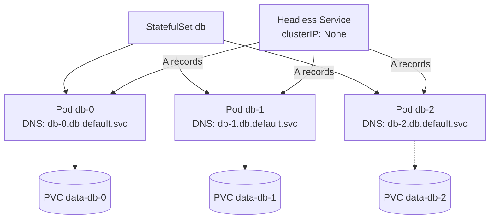
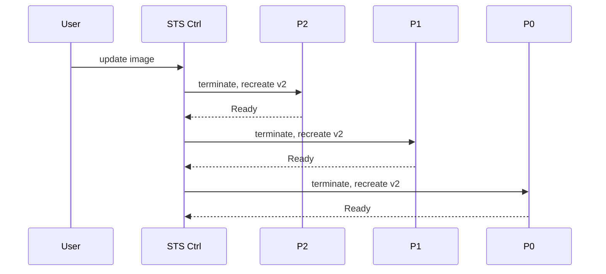

# 📘 Topic 9 — StatefulSets

**Official Documentation Reference**
- StatefulSets: https://kubernetes.io/docs/concepts/workloads/controllers/statefulset/
- StatefulSet basics tutorial: https://kubernetes.io/docs/tutorials/stateful-application/basic-stateful-set/
- Run replicated stateful app: https://kubernetes.io/docs/tasks/run-application/run-replicated-stateful-application/
- Scale a StatefulSet: https://kubernetes.io/docs/tasks/run-application/scale-stateful-set/
- Delete: https://kubernetes.io/docs/tasks/run-application/delete-stateful-set/
- GKE StatefulSets: https://cloud.google.com/kubernetes-engine/docs/how-to/stateful-apps
- EKS storage: https://docs.aws.amazon.com/eks/latest/userguide/storage.html

---

## 🔹 Definition
A **StatefulSet** manages the deployment and scaling of a set of Pods that require **stable identity**, **ordered creation/deletion**, and **stable persistent storage** — unlike Deployments where pods are interchangeable.

---

## 🔹 About

### What makes StatefulSets different from Deployments
| Property | Deployment | StatefulSet |
|---|---|---|
| Pod name | Random hash suffix | `<name>-0, <name>-1, ...` deterministic |
| Storage | Shared (or none) | One PVC per pod (via `volumeClaimTemplates`) |
| Creation order | Parallel | Ordered `-0` → `-N` |
| Deletion order | Parallel | Reverse: `-N` → `-0` |
| Networking | Random pod DNS via Service | Stable DNS via headless Service: `pod-0.svc.ns.svc.cluster.local` |
| Update strategy | RollingUpdate / Recreate | RollingUpdate (default) / OnDelete |
| Use case | Web, API, stateless workers | Databases, message queues, distributed systems |

### Headless Service
`spec.clusterIP: None`. Instead of a virtual IP, DNS returns A records for each pod. StatefulSets rely on this for stable pod DNS names.

### volumeClaimTemplates
Each replica gets its own PersistentVolumeClaim generated from the template — `data-<sts>-0`, `data-<sts>-1`, etc. Deleting the StatefulSet does **not** delete PVCs by default; use `persistentVolumeClaimRetentionPolicy` (K8s 1.27+).

### Update strategies
- `RollingUpdate` (default) — updates in reverse ordinal order; each pod must become Ready before next.
- `OnDelete` — you delete pods manually; StatefulSet recreates them with the new template.
- `partition` — freezes ordinal < partition (used for staged canaries: only pods with ordinal ≥ partition are updated).

### Pod management policy
- `OrderedReady` (default) — sequential create/scale.
- `Parallel` — create/scale in parallel; still stable identity.

---

## 🔹 How It Integrates With Other Kubernetes Components
| Component | Interaction |
|---|---|
| Headless Service | Provides stable per-pod DNS |
| PVC + StorageClass | Dynamic per-pod storage |
| CSI driver | Provisions actual PD/EBS/EFS/Filestore volume |
| Scheduler | Places pod on a node with the right zone (topology-aware for zonal disks) |
| PodDisruptionBudget | Protect during drains |
| Deployment | Not related — StatefulSet is a peer controller |

---

## 🏗️ Diagrams

### Stable identity


### Ordered rollout


---

## 💻 Real-World Examples

### Example 1 — PostgreSQL primary + replicas
```yaml
apiVersion: v1
kind: Service
metadata: { name: pg }
spec:
  clusterIP: None
  selector: { app: pg }
  ports: [{ port: 5432 }]
---
apiVersion: apps/v1
kind: StatefulSet
metadata: { name: pg }
spec:
  serviceName: pg
  replicas: 3
  selector: { matchLabels: { app: pg } }
  template:
    metadata: { labels: { app: pg } }
    spec:
      terminationGracePeriodSeconds: 60
      containers:
      - name: pg
        image: postgres:16
        ports: [{ containerPort: 5432, name: pg }]
        env:
        - { name: POSTGRES_PASSWORD, valueFrom: { secretKeyRef: { name: pg-secret, key: password } } }
        - { name: PGDATA, value: /var/lib/postgresql/data/pgdata }
        volumeMounts:
        - { name: data, mountPath: /var/lib/postgresql/data }
        readinessProbe:
          exec: { command: ["pg_isready","-U","postgres"] }
          periodSeconds: 5
  volumeClaimTemplates:
  - metadata: { name: data }
    spec:
      accessModes: ["ReadWriteOnce"]
      resources: { requests: { storage: 10Gi } }
      storageClassName: standard-rwo
  persistentVolumeClaimRetentionPolicy:
    whenDeleted: Retain
    whenScaled:  Retain
```

### Example 2 — Parallel pod management for a faster cluster of caches
```yaml
spec:
  podManagementPolicy: Parallel
  updateStrategy:
    type: RollingUpdate
    rollingUpdate: { partition: 2 }   # only pods ordinal >= 2 are updated
```

### Example 3 — Reach a specific pod by DNS
```bash
kubectl exec -it pg-1 -- ping pg-0.pg.default.svc.cluster.local
```

---

## 💻 Related Commands

| Command | Flag | Purpose | Example |
|---|---|---|---|
| `kubectl get sts` | `-o wide` | List StatefulSets | `kubectl get sts` |
| `kubectl scale sts` | `--replicas=N` | Scale (orderly) | `kubectl scale sts pg --replicas=5` |
| `kubectl rollout status sts` | — | Watch rollout | `kubectl rollout status sts/pg` |
| `kubectl rollout undo sts` | `--to-revision=N` | Rollback | `kubectl rollout undo sts/pg` |
| `kubectl rollout restart sts` | — | Recycle pods | `kubectl rollout restart sts/pg` |
| `kubectl delete sts` | `--cascade=orphan` | Keep pods | `kubectl delete sts pg --cascade=orphan` |
| `kubectl get pvc` | `-l app=pg` | List per-pod PVCs | `kubectl get pvc -l app=pg` |
| `kubectl patch sts` | `--type='json' -p=...` | Change partition | `kubectl patch sts pg --type=json -p='[{"op":"replace","path":"/spec/updateStrategy/rollingUpdate/partition","value":2}]'` |

---

## 🚨 Scenarios

### Scenario 1 — Pod `pg-1` stuck Pending while `pg-2` was requested
- **Cause**: `podManagementPolicy: OrderedReady` blocks creation of higher ordinal until previous is Ready.
- **Fix**: Fix `pg-1`, or switch to `Parallel` if ordering isn't required.

### Scenario 2 — Deleted the StatefulSet and lost data
- **Cause**: `persistentVolumeClaimRetentionPolicy.whenDeleted: Delete` set.
- **Fix**: Always `Retain` for stateful data; take snapshots regularly.

### Scenario 3 — StatefulSet upgrade only partially rolled out
- **Cause**: `updateStrategy.rollingUpdate.partition: N` freezes ordinals below N.
- **Fix**: Lower `partition` to 0 gradually (staged canary).

### Scenario 4 — Pod `db-2` scheduled to wrong zone; can't attach EBS
- **Cause**: EBS volume is zonal; scheduler placed pod in different AZ than volume.
- **Fix**: `volumeBindingMode: WaitForFirstConsumer` on StorageClass so the volume is created in the pod's zone.

### Scenario 5 — Headless Service DNS returns nothing
- **Cause**: `serviceName` in STS doesn't match the Service name, or Service selector doesn't match pod labels.
- **Fix**: align both.

---

## ☁️ GCP GKE Perspective
- **Regional Persistent Disks (regional-pd)** — synchronous replication across two zones; good for StatefulSet HA. `storageClassName: regional-pd` in some setups; typically use `pd-ssd` with topology constraints.
- **Filestore CSI** — ReadWriteMany, useful when app requires shared filesystem (rare for STS but useful for stateful workloads).
- **Backup for GKE** can snapshot PVs + StatefulSet manifests.
- **Autopilot** — StatefulSets supported; ensure StorageClass is `standard-rwo` (default managed) or `premium-rwo`.

## 🟧 AWS EKS Perspective
- **EBS gp3** — most common per-pod volume; zonal.
- **EFS** — ReadWriteMany, cross-AZ; slower for typical DBs but works for shared workloads.
- **EBS CSI driver** must be installed as an add-on: `aws eks create-addon --cluster-name prod --addon-name aws-ebs-csi-driver`.
- Multi-AZ StatefulSet: use `topologySpreadConstraints` + `WaitForFirstConsumer` StorageClass to keep pods and volumes co-located.
- **Fargate** cannot use EBS; only EFS works — so most databases don't run on Fargate.

---

## 🧪 Hands-On Lab Exercises

### Lab 9.1 — StatefulSet basics (Beginner, 30 min)
**Steps**
```yaml
# sts.yaml
apiVersion: v1
kind: Service
metadata: { name: nginx-sts }
spec:
  clusterIP: None
  selector: { app: web }
  ports: [{ port: 80 }]
---
apiVersion: apps/v1
kind: StatefulSet
metadata: { name: web }
spec:
  serviceName: nginx-sts
  replicas: 3
  selector: { matchLabels: { app: web } }
  template:
    metadata: { labels: { app: web } }
    spec:
      containers:
      - name: nginx
        image: nginx:1.27
        volumeMounts: [{ name: data, mountPath: /usr/share/nginx/html }]
  volumeClaimTemplates:
  - metadata: { name: data }
    spec:
      accessModes: ["ReadWriteOnce"]
      resources: { requests: { storage: 1Gi } }
```
```bash
kubectl apply -f sts.yaml
kubectl get pods -l app=web -w    # web-0 → Ready → web-1 → Ready → web-2
kubectl get pvc                   # data-web-0/1/2
kubectl exec -it web-0 -- sh -c 'echo hello-0 > /usr/share/nginx/html/index.html'
kubectl delete pod web-0
kubectl exec -it web-0 -- cat /usr/share/nginx/html/index.html   # still hello-0
```
**Cleanup**: `kubectl delete sts web && kubectl delete pvc -l app=web && kubectl delete svc nginx-sts`.

### Lab 9.2 — Partition-based canary (Intermediate, 45 min)
**Steps**
1. Deploy STS with 5 replicas, `partition: 0`, image `v1`.
2. Set `partition: 4` and image `v2`. Only `web-4` updates.
3. Verify: `kubectl describe pod web-4 | grep Image`.
4. Lower `partition: 2` → web-4, web-3, web-2 update.
5. Lower `partition: 0` → all updated.

**Bonus**: Use `updateStrategy.rollingUpdate.maxUnavailable: 2` (K8s 1.27+) to parallelize rollout while preserving ordinals.

### Lab 9.3 — Multi-AZ Postgres StatefulSet on EKS with EBS (Advanced, 90 min)
**Steps**
1. Ensure EBS CSI add-on installed.
2. Create StorageClass:
```yaml
apiVersion: storage.k8s.io/v1
kind: StorageClass
metadata: { name: ebs-wait }
provisioner: ebs.csi.aws.com
parameters: { type: gp3 }
volumeBindingMode: WaitForFirstConsumer
```
3. Apply Postgres STS from Example 1 with `storageClassName: ebs-wait`.
4. Add `topologySpreadConstraints` to spread pods across 3 AZs.
5. `kubectl get pods -o custom-columns=NAME:.metadata.name,NODE:.spec.nodeName,ZONE:.metadata.annotations."topology\.kubernetes\.io/zone"`.
6. Delete pod `pg-1`; observe reschedule to same AZ (because PVC pins zone).
7. Trigger backup with Velero: `velero backup create pg-snap --include-namespaces=default --snapshot-volumes`.

**Cleanup**: `eksctl delete cluster`.

---

## 🎯 Interview Deliverable Answer (60–90 s)
"**What**: A StatefulSet is Kubernetes' primitive for stateful workloads. Unlike a Deployment, its pods have stable ordinal names, stable DNS via a headless Service, and their own PersistentVolumeClaims created from a volumeClaimTemplate.  
**Why**: Databases and distributed systems need identity. A PostgreSQL replica pod that becomes `pg-1` today must come back as `pg-1` after a restart, on the same data. Deployments can't guarantee that.  
**How**: I pair a StatefulSet with a headless Service, per-pod PVCs on a StorageClass with `WaitForFirstConsumer`, and topology spread constraints so each pod lands in a different zone but with its zonal volume. Rollouts happen in reverse ordinal order — I sometimes stage them with `partition`. I set `persistentVolumeClaimRetentionPolicy: Retain` so accidental deletes don't drop data, and I combine with PDBs and regular Velero or Backup-for-GKE snapshots.  
**Example**: We ran a 3-node Kafka on EKS as a StatefulSet with EBS gp3, spread across three AZs. When we upgraded Kafka to a new minor version, we set `partition: 2` first, watched the canary pod for an hour, then lowered `partition` to zero — no message loss, no downtime."

---

## ❓ Possible Interview Questions

### Basic
**Q1. Deployment vs StatefulSet?** Deployment: interchangeable pods. StatefulSet: stable identity, stable storage, ordered lifecycle.  
**Q2. Do StatefulSet pods keep their name after restart?** Yes: `web-0` will always be `web-0`.  
**Q3. What is a headless Service?** A Service with `clusterIP: None`; DNS returns per-pod A records instead of a virtual IP.

### Intermediate
**Q4. What is `volumeClaimTemplates`?** A template that generates a PVC per pod (e.g., `data-web-0`).  
**Q5. What is `podManagementPolicy: Parallel`?** Skips ordered create/scale — still gives stable identity.  
**Q6. How do you scale down a StatefulSet safely?** Ensure app supports it (drain leader, rebalance), then `kubectl scale sts <n> --replicas=X`. Pods terminate in reverse ordinal order.

### Advanced
**Q7. What is `partition` in updateStrategy?** Ordinals `< partition` are frozen; only `>= partition` update. Used for staged canaries.  
**Q8. What happens to PVCs on delete?** Retained by default; use `persistentVolumeClaimRetentionPolicy` (K8s 1.27+) to auto-delete on scale-down or STS delete.  
**Q9. How do you handle zonal storage in multi-AZ?** `WaitForFirstConsumer` StorageClass so PV is created in the same zone the pod is scheduled to.

### Scenario-based
**Q10. STS pod stuck attaching volume after node crash — likely cause?** Volume still attached to old node; needs force detach or wait for kubelet cleanup. Check `volumeattachments` and node status.

### GKE-specific
**Q11. What's the fastest way to get multi-zone durability for a StatefulSet on GKE?** Use regional PDs (synchronous cross-zone replication) or app-level replication (e.g., Postgres streaming) across zonal PDs.

### EKS-specific
**Q12. Can you run a StatefulSet on Fargate?** With limits: EBS not supported; only EFS (RWX) — most databases require RWO block storage, so managed node groups are the norm.

### Hands-on / Lab-based
**Q13. Show me how you'd do a canary rollout of a StatefulSet.** Set `partition: N-1`; only the last pod updates. Validate. Lower `partition` in steps until 0.  
**Q14. What happens if I delete pod `db-0`?** Same PVC re-attaches to the new `db-0` pod; data preserved; DNS name preserved.  
**Q15. How would you back up a database StatefulSet?** Two layers: app-level (pg_dump, WAL to S3/GCS) + volume snapshots (CSI VolumeSnapshot / Velero / Backup for GKE) + off-cluster storage.

