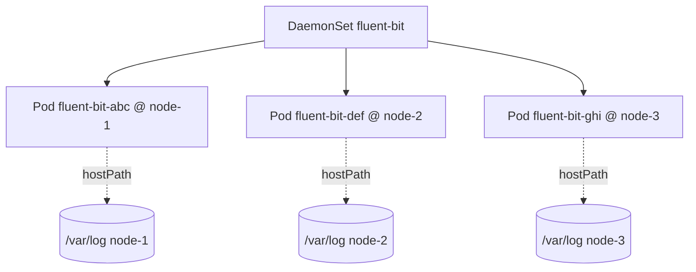
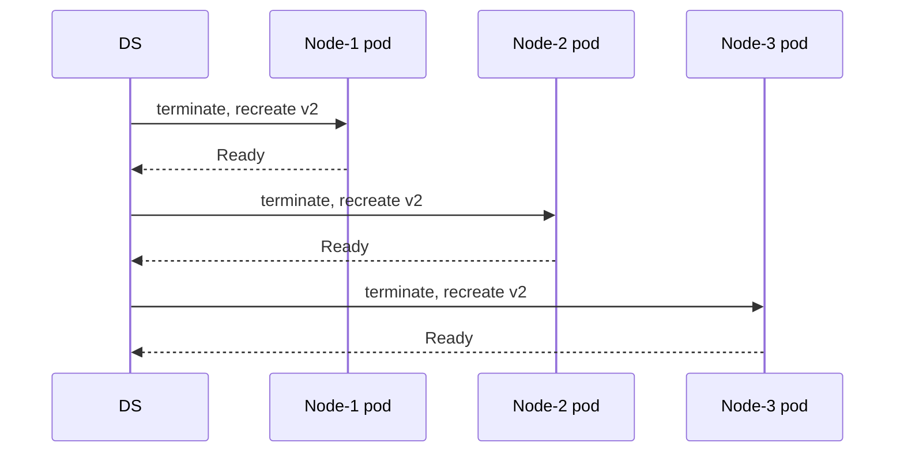

# 📘 Topic 10 — DaemonSets

**Official Documentation Reference**
- DaemonSet: https://kubernetes.io/docs/concepts/workloads/controllers/daemonset/
- Basic DaemonSet task: https://kubernetes.io/docs/tasks/manage-daemon/create-daemon-set/
- Rolling update: https://kubernetes.io/docs/tasks/manage-daemon/update-daemon-set/
- Rollback: https://kubernetes.io/docs/tasks/manage-daemon/rollback-daemon-set/
- Running pods on some nodes: https://kubernetes.io/docs/tasks/manage-daemon/pods-some-nodes/
- GKE DaemonSets: https://cloud.google.com/kubernetes-engine/docs/how-to/deploying-workloads-overview
- EKS DaemonSets & VPC CNI: https://docs.aws.amazon.com/eks/latest/userguide/managing-vpc-cni.html

---

## 🔹 Definition
A **DaemonSet** ensures that a copy of a Pod runs on **every (matching) node** in the cluster. As nodes join, DaemonSet pods appear; as nodes leave, they're garbage-collected.

---

## 🔹 About

### Typical uses
- **Node-level agents**: log shippers (Fluent Bit, Fluentd, Filebeat), metrics agents (node-exporter, Datadog, New Relic).
- **CNI plugins**: Calico, Cilium, kindnet, VPC CNI — deployed as DaemonSets.
- **CSI node components**: driver-registrar sidecars, node-plugin daemons.
- **Storage / networking daemons**: kube-proxy (on non-eBPF clusters), MetalLB speakers, ingress-controller in `hostNetwork` mode.
- **Security agents**: Falco, Sysdig, Aqua.

### Scheduling model
- The DaemonSet controller uses the default scheduler (since K8s 1.17). Each pod carries a `nodeAffinity` targeting a single node.
- Respects **nodeSelector**, **affinity**, **taints/tolerations**.
- Special toleration `op: Exists` on `node.kubernetes.io/*` lets DS survive NotReady/unschedulable — hence log agents keep running on failing nodes.

### Update strategies
- `RollingUpdate` (default) — updates one node at a time.
- `OnDelete` — you delete pods manually; DS recreates with new template.

### Not on managed nodes?
- **GKE Autopilot** blocks DaemonSets **unless** they belong to Google's allowlist (e.g., Datadog, GKE Metrics Agent).
- **EKS Fargate** does not support DaemonSets — Fargate nodes are per-pod microVMs; instead run the agent as a sidecar.

---

## 🔹 How It Integrates With Other Kubernetes Components
| Component | Interaction |
|---|---|
| Node | DS runs one pod per matching node |
| Scheduler | Assigns DS pod to node via nodeAffinity |
| Taints/Tolerations | Control which nodes get DS pods |
| CNI | Often *itself* a DaemonSet (Calico, Cilium) |
| CSI | Node component runs as DS |
| Logging/monitoring stack | The heart of "one agent per node" pattern |

---

## 🏗️ Diagrams

### One pod per node


### Rolling update


---

## 💻 Real-World Examples

### Example 1 — Fluent Bit log shipper
```yaml
apiVersion: apps/v1
kind: DaemonSet
metadata:
  name: fluent-bit
  namespace: logging
spec:
  selector: { matchLabels: { app: fluent-bit } }
  updateStrategy:
    type: RollingUpdate
    rollingUpdate: { maxUnavailable: 1 }
  template:
    metadata: { labels: { app: fluent-bit } }
    spec:
      serviceAccountName: fluent-bit
      tolerations:
      - operator: Exists                 # run on every node, including tainted
      containers:
      - name: fluent-bit
        image: fluent/fluent-bit:3.1
        resources:
          requests: { cpu: 50m, memory: 64Mi }
          limits:   { cpu: 200m, memory: 200Mi }
        volumeMounts:
        - { name: varlog, mountPath: /var/log, readOnly: true }
        - { name: varlibdocker, mountPath: /var/lib/docker/containers, readOnly: true }
        - { name: config, mountPath: /fluent-bit/etc }
      volumes:
      - { name: varlog, hostPath: { path: /var/log } }
      - { name: varlibdocker, hostPath: { path: /var/lib/docker/containers } }
      - { name: config, configMap: { name: fluent-bit-config } }
```

### Example 2 — Run only on GPU nodes
```yaml
spec:
  template:
    spec:
      nodeSelector: { accelerator: nvidia }
      tolerations:
      - { key: nvidia.com/gpu, operator: Exists, effect: NoSchedule }
      containers:
      - { name: gpu-agent, image: nvidia/gpu-operator:1.0 }
```

### Example 3 — Prometheus node-exporter
```yaml
apiVersion: apps/v1
kind: DaemonSet
metadata: { name: node-exporter, namespace: monitoring }
spec:
  selector: { matchLabels: { app: node-exporter } }
  template:
    metadata: { labels: { app: node-exporter } }
    spec:
      hostNetwork: true
      hostPID: true
      containers:
      - name: ne
        image: prom/node-exporter:v1.8.2
        args: ["--path.rootfs=/host", "--web.listen-address=0.0.0.0:9100"]
        ports: [{ containerPort: 9100, hostPort: 9100 }]
        volumeMounts: [{ name: root, mountPath: /host, readOnly: true }]
      volumes: [{ name: root, hostPath: { path: / } }]
      tolerations: [{ operator: Exists }]
```

---

## 💻 Related Commands

| Command | Flag | Purpose | Example |
|---|---|---|---|
| `kubectl get ds` | `-A` | List DaemonSets everywhere | `kubectl get ds -A` |
| `kubectl describe ds` | `<name>` | See per-node status | `kubectl describe ds fluent-bit -n logging` |
| `kubectl rollout status ds` | — | Watch rolling update | `kubectl rollout status ds/fluent-bit -n logging` |
| `kubectl rollout undo ds` | `--to-revision=N` | Rollback | `kubectl rollout undo ds/fluent-bit -n logging` |
| `kubectl rollout restart ds` | — | Recycle pods | `kubectl rollout restart ds/fluent-bit -n logging` |
| `kubectl set image ds` | `<c>=` | Trigger update | `kubectl set image ds/fluent-bit fluent-bit=fluent/fluent-bit:3.2 -n logging` |
| `kubectl label node` | `key=val` | Change which nodes match nodeSelector | `kubectl label node gpu-1 accelerator=nvidia` |
| `kubectl taint node` | `key=val:eff` | Add taint (DS needs matching toleration) | `kubectl taint node infra-1 dedicated=infra:NoSchedule` |

---

## 🚨 Scenarios

### Scenario 1 — DaemonSet pods missing on a new node
- **Cause**: node has taint the DS pod doesn't tolerate; or nodeSelector doesn't match.
- **Diagnose**: `kubectl describe node <n>` (taints/labels), `kubectl describe ds <n>` (desired vs current).
- **Fix**: add toleration or label the node.

### Scenario 2 — Update rolled out but old pods remain on a NotReady node
- **Cause**: DS rolling update skips unavailable nodes.
- **Fix**: fix the node; DS will reconcile when it becomes Ready.

### Scenario 3 — Log shipper causes noisy neighbor (100% CPU)
- **Cause**: no resource limits; parsing spike.
- **Fix**: set `resources.limits` + priorityClass so it can't starve app pods.

### Scenario 4 — Agent needs privileged mode → Autopilot rejects
- **Cause**: Autopilot forbids privileged.
- **Fix**: use the vendor's Autopilot-compatible variant, or move to Standard.

### Scenario 5 — DaemonSet not covered by Cluster Autoscaler
- **Cause**: Cluster Autoscaler ignores DS pods when scaling nodes.
- **Fix**: this is desirable — DS pods "come for free" on new nodes; watch node ceilings for total agent overhead.

---

## ☁️ GCP GKE Perspective
- **Autopilot**: DaemonSets are restricted to a Google allowlist (Datadog, New Relic, Dynatrace, Splunk, etc.). Your own DS is generally rejected — build agents as sidecars instead.
- **Standard**: full DaemonSet freedom. Common defaults installed: `fluentbit-gke`, `gke-metrics-agent`, `gke-metadata-server`, `netd`, `gke-node-problem-detector`.
- Check with: `kubectl get ds -n kube-system`.

## 🟧 AWS EKS Perspective
- **Managed NG**: full DS support. AWS ships several system DaemonSets: `aws-node` (VPC CNI), `kube-proxy`, `coredns` (Deployment). `aws-node` scaling and IP counts affect pod density.
- **Fargate**: DaemonSets NOT supported. Run monitoring/log agents as sidecars in every pod, or use CloudWatch Container Insights via built-in log driver.
- Common third-party DaemonSets: `cluster-autoscaler` (not DS), `aws-load-balancer-controller` (Deployment), `metrics-server` (Deployment), `node-exporter` (DS), Datadog Agent (DS).

---

## 🧪 Hands-On Lab Exercises

### Lab 10.1 — Simple DaemonSet on Kind (Beginner, 20 min)
**Steps**
```yaml
# ds.yaml
apiVersion: apps/v1
kind: DaemonSet
metadata: { name: ping }
spec:
  selector: { matchLabels: { app: ping } }
  template:
    metadata: { labels: { app: ping } }
    spec:
      tolerations: [{ operator: Exists }]
      containers:
      - name: c
        image: busybox:1.36
        command: ["sh","-c","while true; do echo alive; sleep 30; done"]
```
```bash
kind create cluster --config kind-3.yaml
kubectl apply -f ds.yaml
kubectl get ds ping        # DESIRED=3, CURRENT=3, READY=3
kubectl get pods -o wide -l app=ping
```
**Cleanup**: `kubectl delete ds ping && kind delete cluster`.

### Lab 10.2 — Node selector + taints (Intermediate, 40 min)
**Steps**
1. Label one worker: `kubectl label node <n> role=edge`.
2. Taint another: `kubectl taint node <n> dedicated=infra:NoSchedule`.
3. Update DS template to `nodeSelector: {role: edge}` and add tolerations only for `role=edge` nodes.
4. Verify: DS pod runs only on the `role=edge` node.
5. Add another label to the tainted node with `role=edge`; verify DS still won't schedule there without toleration for `dedicated=infra`.
6. Add matching toleration; verify pod appears.

**Bonus**: Use `preferredDuringSchedulingIgnoredDuringExecution` to prefer but not require.

### Lab 10.3 — Fluent Bit log shipping (Advanced, 60 min)
**Objective**: real end-to-end log flow.

**Prerequisites**: any cluster with 2+ workers; ELK, Loki, or `stdout` sink.

**Steps**
1. Deploy Fluent Bit DS from Example 1.
2. Apply a ConfigMap `fluent-bit-config` with an input reading `/var/log/containers/*.log` and output `stdout`.
3. `kubectl -n logging logs -l app=fluent-bit --tail=20` — see aggregated logs.
4. Add Loki output; verify logs appear in Grafana.
5. Trigger rollout: change parser; `kubectl rollout status ds/fluent-bit -n logging`.

**Cleanup**: `kubectl delete ns logging`.

**Bonus**: Set `updateStrategy.rollingUpdate.maxUnavailable: 30%` and observe faster rollout across many nodes.

---

## 🎯 Interview Deliverable Answer (60–90 s)
"**What**: A DaemonSet is a controller that runs exactly one pod on every node — or every matching node — of a cluster. It's how we ship node-level agents like log shippers, metrics collectors, CNI and CSI drivers.  
**Why**: These agents need to be on the node itself, usually with hostPath volumes to read `/var/log` or hostNetwork to expose metrics. A Deployment can't guarantee 'one on each node' — a DaemonSet does.  
**How**: I define the DaemonSet with wide tolerations so it runs even on tainted nodes, tight resource requests/limits so it can't starve app pods, and a nodeSelector when the agent should only run on a subset (like GPU nodes). Rolling updates go one node at a time by default.  
**Managed nuance**: On GKE Autopilot only allowlisted DaemonSets are permitted, and on EKS Fargate DaemonSets aren't supported at all — so for those environments I turn the agent into a sidecar or use vendor-provided cloud-native integrations.  
**Example**: We standardized on Fluent Bit DaemonSet across 200 nodes on EKS with resource limits 200m/200Mi — total overhead was 40 vCPU and 40 GB for the whole log pipeline, and rollouts of parser changes finished in under two minutes."

---

## ❓ Possible Interview Questions

### Basic
**Q1. What is a DaemonSet?** Controller that runs one pod per node.  
**Q2. Give 3 use cases.** Log shipper, metrics agent, CNI plugin (or storage node plugin).  
**Q3. Does a DS need a Service?** Usually no — the agent talks to the node's kernel or filesystem; if it exposes an endpoint, use hostPort or a headless Service.

### Intermediate
**Q4. What happens when a new node joins?** DS controller creates a pod on it automatically.  
**Q5. How does DS handle tainted nodes?** Only runs there if it has a matching toleration; commonly uses `operator: Exists` to run everywhere.  
**Q6. DS update strategies?** `RollingUpdate` (default) and `OnDelete`.

### Advanced
**Q7. Does the scheduler place DS pods?** Yes (since 1.17). The DS controller writes a nodeAffinity pointing to one specific node; the scheduler binds.  
**Q8. Can DS scale?** Not by replica count — by the number of matching nodes. Change nodeSelector or add/remove nodes.  
**Q9. How does DS interact with Cluster Autoscaler?** CA ignores DS pods when calculating scale-up need; DS pods appear automatically on new nodes.

### Scenario-based
**Q10. Node has 100 pods; log shipper drops messages. Steps?** Increase agent's `resources.limits`, tune buffer/flush parameters, sample high-noise namespaces, run per-namespace collectors instead of one giant DS.

### GKE-specific
**Q11. Why does Autopilot reject my new DS?** Autopilot restricts DaemonSets to a Google allowlist. Use an approved vendor variant or move to Standard.

### EKS-specific
**Q12. Fargate + logging — how?** DaemonSets aren't allowed. Enable Fluent Bit sidecar per pod or use CloudWatch Container Insights (Fargate emits logs directly to CloudWatch).

### Hands-on / Lab-based
**Q13. Show me a DS that runs only on GPU nodes.** `nodeSelector: {accelerator: nvidia}` + toleration for `nvidia.com/gpu: NoSchedule`.  
**Q14. How do you make a DS survive a node under memory pressure?** Set `priorityClassName: system-node-critical` and modest resource requests; kubelet won't evict critical pods first.  
**Q15. How do you roll back a DS?** `kubectl rollout undo ds/<name>` — works exactly like Deployment rollback; templates are versioned as ControllerRevisions.

