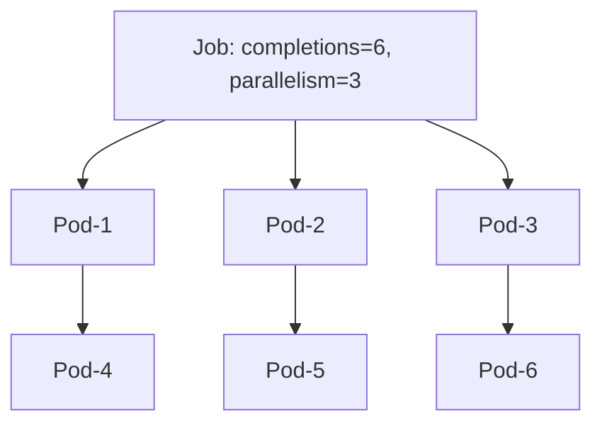
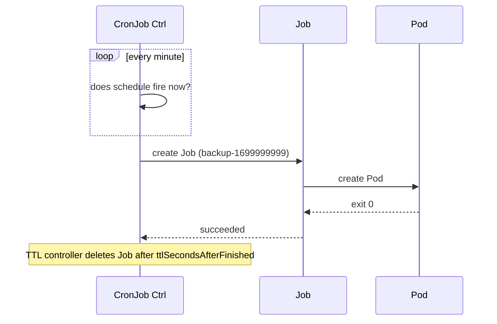

# 📘 Topic 11 — Jobs and CronJobs

**Official Documentation Reference**
- Job: https://kubernetes.io/docs/concepts/workloads/controllers/job/
- CronJob: https://kubernetes.io/docs/concepts/workloads/controllers/cron-jobs/
- Automated tasks with CronJob: https://kubernetes.io/docs/tasks/job/automated-tasks-with-cron-jobs/
- TTL cleanup for finished jobs: https://kubernetes.io/docs/concepts/workloads/controllers/ttlafterfinished/
- Pod failure policy: https://kubernetes.io/docs/tasks/job/pod-failure-policy/
- GKE batch: https://cloud.google.com/kubernetes-engine/docs/concepts/batch
- EKS batch (Karpenter/Batch on EKS): https://docs.aws.amazon.com/eks/latest/userguide/batch.html

---

## 🔹 Definition
- **Job** — a workload that runs one or more pods to **completion** (success). Perfect for batch tasks, migrations, one-off scripts.
- **CronJob** — a Job scheduled by cron expression. Perfect for periodic tasks: backups, report generation, retention cleanup.

---

## 🔹 About

### Job spec fields
| Field | Meaning |
|---|---|
| `completions` | Total successful pod completions required |
| `parallelism` | How many pods run concurrently |
| `backoffLimit` | Retries before marking job Failed (default 6) |
| `activeDeadlineSeconds` | Hard wall-clock timeout |
| `ttlSecondsAfterFinished` | Auto-delete finished Job (and its pods) after N seconds |
| `completionMode` | `NonIndexed` (default) or `Indexed` (workers get `JOB_COMPLETION_INDEX`) |
| `podFailurePolicy` | Rules to fast-fail or ignore specific exit codes (K8s 1.26+ stable) |
| `suspend` | true/false — pause a Job |

### Job patterns
- **Non-parallel** — one pod, one completion.
- **Parallel with fixed completions** — worker pool doing N units.
- **Parallel with work queue** — one pod pulls from a queue until empty; `completions: 1` with `parallelism: N`.
- **Indexed** — each pod knows its index (e.g., `JOB_COMPLETION_INDEX=3`) for static work assignment.

### CronJob spec
| Field | Meaning |
|---|---|
| `schedule` | Cron expression (`"*/5 * * * *"`) — **UTC by default**; K8s 1.27+ supports `timeZone: "Asia/Kolkata"` |
| `concurrencyPolicy` | `Allow` (default), `Forbid`, `Replace` |
| `successfulJobsHistoryLimit` / `failedJobsHistoryLimit` | Retain last N Jobs |
| `startingDeadlineSeconds` | Skip missed schedules older than this |
| `suspend` | Pause future runs |

### CronJob quirks
- **Missed schedules**: if the controller was down and > 100 schedules were missed, CronJob stops trying (protective).
- **Idempotency**: schedule can double-fire (rare); jobs must be idempotent.
- **Time zones**: use `timeZone` field (K8s 1.27+) rather than relying on cluster TZ.

---

## 🔹 How It Integrates With Other Kubernetes Components
| Component | Interaction |
|---|---|
| Pod | Job creates Pods with `restartPolicy: OnFailure` or `Never` |
| ReplicaSet/Deployment | Unrelated (different controller) |
| Node autoscaler | Scales up to run parallel jobs; scales down after `ttlSecondsAfterFinished` |
| Event | Job posts events on success/failure |
| Admission (LimitRange, ResourceQuota) | Enforced per pod including Job pods |

---

## 🏗️ Diagrams

### Job with parallelism


### CronJob lifecycle


---

## 💻 Real-World Examples

### Example 1 — One-shot migration Job
```yaml
apiVersion: batch/v1
kind: Job
metadata: { name: db-migrate }
spec:
  backoffLimit: 2
  ttlSecondsAfterFinished: 3600
  template:
    spec:
      restartPolicy: OnFailure
      containers:
      - name: mig
        image: myrepo/migrate:1.4.2
        command: ["migrate", "-database", "$(DB_URL)", "up"]
        envFrom: [{ secretRef: { name: db-url } }]
```

### Example 2 — Indexed parallel Job (batch ML inference)
```yaml
apiVersion: batch/v1
kind: Job
metadata: { name: infer }
spec:
  completions: 20
  parallelism: 5
  completionMode: Indexed
  ttlSecondsAfterFinished: 600
  template:
    spec:
      restartPolicy: Never
      containers:
      - name: worker
        image: myrepo/inference:2.1
        env:
        - name: SHARD
          valueFrom: { fieldRef: { fieldPath: metadata.annotations['batch.kubernetes.io/job-completion-index'] } }
        command: ["python","run.py","--shard","$(SHARD)","--of","20"]
```

### Example 3 — CronJob with timezone
```yaml
apiVersion: batch/v1
kind: CronJob
metadata: { name: nightly-backup }
spec:
  schedule: "0 2 * * *"            # 2 AM
  timeZone: "Asia/Kolkata"
  concurrencyPolicy: Forbid
  successfulJobsHistoryLimit: 3
  failedJobsHistoryLimit: 3
  jobTemplate:
    spec:
      backoffLimit: 1
      ttlSecondsAfterFinished: 86400
      template:
        spec:
          restartPolicy: OnFailure
          containers:
          - name: dump
            image: myrepo/pg-backup:1.0
            envFrom: [{ secretRef: { name: pg-secret } }]
            command: ["/usr/local/bin/backup.sh"]
```

### Example 4 — Fast-fail on config error (podFailurePolicy)
```yaml
spec:
  backoffLimit: 6
  podFailurePolicy:
    rules:
    - action: FailJob                 # bail immediately
      onExitCodes: { operator: In, values: [42] }
    - action: Ignore                  # infrastructure fault
      onPodConditions:
      - { type: DisruptionTarget }
```

---

## 💻 Related Commands

| Command | Flag | Purpose | Example |
|---|---|---|---|
| `kubectl create job` | `--image` | Ad-hoc Job | `kubectl create job hello --image=busybox -- echo hi` |
| `kubectl create job` | `--from=cronjob/<n>` | Run a CronJob now | `kubectl create job manual --from=cronjob/nightly-backup` |
| `kubectl get jobs` | `-A` | List Jobs | `kubectl get jobs -A` |
| `kubectl describe job` | — | See conditions | `kubectl describe job db-migrate` |
| `kubectl logs job/<n>` | `--tail=100` | Aggregate pod logs of Job | `kubectl logs job/db-migrate` |
| `kubectl delete job` | `--cascade=orphan` | Keep pods | `kubectl delete job db-migrate --cascade=orphan` |
| `kubectl get cronjob` | — | Active/last schedule | `kubectl get cronjob` |
| `kubectl patch cj` | `-p '{"spec":{"suspend":true}}'` | Pause | `kubectl patch cj nightly-backup -p '{"spec":{"suspend":true}}'` |
| `kubectl create job` | `--dry-run=client -o yaml` | Skeleton | `kubectl create job x --image=busybox --dry-run=client -o yaml` |

---

## 🚨 Scenarios

### Scenario 1 — CronJob missed schedules
- **Cause**: controller manager down > 100 schedules; or `startingDeadlineSeconds` too small.
- **Fix**: raise `startingDeadlineSeconds`; investigate controller-manager availability; adopt CronJob v1 (batch/v1).

### Scenario 2 — Migration Job re-runs on retry, breaks schema
- **Cause**: not idempotent; `backoffLimit` allows retries.
- **Fix**: Use idempotent migrations (e.g., `golang-migrate` versioned), `backoffLimit: 0` for destructive tasks, capture "already applied" errors with `podFailurePolicy: Ignore`.

### Scenario 3 — Finished Jobs pile up
- **Cause**: no `ttlSecondsAfterFinished`; `successfulJobsHistoryLimit` too high.
- **Fix**: set both.

### Scenario 4 — Parallel Job wastes work when one pod slow
- **Cause**: `completions=100, parallelism=10` with static work assignment.
- **Fix**: Use work-queue pattern (Redis/SQS/PubSub) and set `completions: 1, parallelism: 10`, workers exit when queue is empty.

### Scenario 5 — CronJob runs twice at DST rollover
- **Cause**: naive UTC schedule + local intent.
- **Fix**: Use `timeZone` field; keep schedule at UTC hour or use `0 */6 * * *` style intervals.

---

## ☁️ GCP GKE Perspective
- **Autopilot** supports Jobs and CronJobs directly; pods bill per-second while running.
- **GKE Batch (Batch API)** — Google's managed batch runtime that consumes GKE for underlying compute; useful for HPC.
- **Cloud Scheduler → Cloud Run / GKE** — Alternative for scheduled tasks outside cluster.
- Node auto-provisioning scales up for big batch jobs; add `cluster-autoscaler.kubernetes.io/safe-to-evict: "false"` on critical Job pods.

## 🟧 AWS EKS Perspective
- **AWS Batch on EKS** — managed queue + priority + array jobs; runs pods on your EKS cluster.
- **Karpenter** shines here — provisions right-sized Spot nodes just to run a batch of Jobs, terminates when done.
- **Fargate** — Jobs work, but each pod = a microVM start-up latency (~30–60 s). For high-throughput short jobs, prefer managed NG.
- **EventBridge Scheduler** — cluster-external alternative to CronJob.

---

## 🧪 Hands-On Lab Exercises

### Lab 11.1 — Your first Job and CronJob (Beginner, 30 min)
**Steps**
```bash
# Job
kubectl create job hello --image=busybox -- /bin/sh -c 'echo hello; sleep 3'
kubectl get pods -l job-name=hello
kubectl logs job/hello

# CronJob every minute
cat <<'EOF' | kubectl apply -f -
apiVersion: batch/v1
kind: CronJob
metadata: { name: heartbeat }
spec:
  schedule: "* * * * *"
  jobTemplate:
    spec:
      ttlSecondsAfterFinished: 60
      template:
        spec:
          restartPolicy: OnFailure
          containers:
          - { name: c, image: busybox, command: ["sh","-c","date; echo alive"] }
EOF
kubectl get cronjob heartbeat -w
```
**Cleanup**: `kubectl delete job hello && kubectl delete cronjob heartbeat`.

### Lab 11.2 — Parallel indexed Job (Intermediate, 45 min)
**Steps**
1. Apply Example 2 with a script that writes `/shared/shard-$SHARD.txt` (add PVC or use hostPath emptyDir).
2. `kubectl get pods -l job-name=infer -o wide` — expect 5 at a time.
3. `kubectl logs -l job-name=infer --prefix=true` to see per-pod output.
4. Delete pod-0; verify replacement gets same index.

**Bonus**: Kill a node with 3 infer pods; observe them re-created on other nodes.

### Lab 11.3 — Fault-tolerant work queue (Advanced, 90 min)
**Objective**: Consume 1,000 messages from Redis with 20 workers, retry-safe.

**Steps**
1. Deploy Redis: `helm install redis bitnami/redis`.
2. Preload 1,000 keys `task:1..1000`.
3. Deploy Job:
```yaml
apiVersion: batch/v1
kind: Job
metadata: { name: worker }
spec:
  completions: 1
  parallelism: 20
  template:
    spec:
      restartPolicy: OnFailure
      containers:
      - name: w
        image: myrepo/queue-worker:1
        env: [{ name: REDIS, value: redis-master.default.svc:6379 }]
```
4. Watch: `kubectl get pods -l job-name=worker -w`.
5. Kill some pods mid-flight; verify workers idempotently re-pull messages until queue empty.
6. Check `kubectl get job worker -o yaml` — succeeded.

**Cleanup**: `kubectl delete job worker && helm uninstall redis`.

**Bonus**: Add `podFailurePolicy` to fast-fail on exit code 3 (unrecoverable).

---

## 🎯 Interview Deliverable Answer (60–90 s)
"**What**: A Job runs one or more pods to completion. A CronJob is a Job that fires on a schedule. Together they cover every batch pattern — migrations, backups, report generation, ML inference sweeps.  
**Why**: Deployments are wrong for finite work — they'd restart pods forever. Jobs track successful completions, allow parallelism, and clean up when done using `ttlSecondsAfterFinished`.  
**How**: For migrations I use a single-completion Job with `backoffLimit: 0`. For heavy batch work I use indexed Jobs or a work-queue pattern with `parallelism` up to my worker capacity. For nightlies I use CronJob with `timeZone`, `concurrencyPolicy: Forbid`, and small `successfulJobsHistoryLimit` to keep the namespace clean. On EKS I let Karpenter provision Spot nodes for the batch, and on GKE Autopilot the pods just run and I pay per second.  
**Example**: We had a nightly Postgres backup CronJob that once double-ran during a DST transition and doubled our S3 bill. Setting the `timeZone` field and `concurrencyPolicy: Forbid` fixed it permanently."

---

## ❓ Possible Interview Questions

### Basic
**Q1. Job vs Deployment?** Job = run to completion; Deployment = long-running services.  
**Q2. What's `completions` vs `parallelism`?** Completions = total successes required. Parallelism = concurrent pods.  
**Q3. CronJob schedule format?** Standard 5-field cron; UTC by default.

### Intermediate
**Q4. `restartPolicy` for Job pods?** `OnFailure` or `Never`. Never `Always`.  
**Q5. What does `ttlSecondsAfterFinished` do?** Auto-deletes Job (and pods) after N seconds.  
**Q6. Difference `concurrencyPolicy` values?** `Allow` (parallel runs), `Forbid` (skip if previous still running), `Replace` (kill previous).

### Advanced
**Q7. What is `podFailurePolicy`?** Rules to control retry vs immediate failure based on exit codes or Pod conditions (stable K8s 1.26+).  
**Q8. Indexed Job — what is `JOB_COMPLETION_INDEX`?** An env var giving each pod a unique 0..N-1 index for static work partitioning.  
**Q9. Why does a CronJob stop firing after being paused a day?** > 100 missed schedules trigger safety — recreate or bump `startingDeadlineSeconds`.

### Scenario-based
**Q10. Migration job stuck retrying — how to debug?** `kubectl describe job` for backoff events, `kubectl logs --previous` on failed pod, review `podFailurePolicy`, ensure migration is idempotent.

### GKE-specific
**Q11. On Autopilot, my parallel Job scales slowly — why?** New pods trigger node provisioning; add `cluster-autoscaler.kubernetes.io/safe-to-evict: "false"` and consider pre-warming node pools (Standard only).

### EKS-specific
**Q12. How would you cost-optimize a huge batch job on EKS?** Karpenter provisioner with Spot capacity type, `podFailurePolicy` for Spot interruption exit codes, and `ttlSecondsAfterFinished` for cleanup.

### Hands-on / Lab-based
**Q13. How did you verify a CronJob ran on time?** `kubectl get cronjob` shows `LAST SCHEDULE`; drill into `kubectl get jobs -l app=heartbeat` for actual pods; audit via events.  
**Q14. How would you rerun a CronJob manually?** `kubectl create job manual --from=cronjob/<n>`.  
**Q15. How do you cancel a running Job?** `kubectl patch job <n> -p '{"spec":{"suspend":true}}'` (K8s 1.24+ stable) or `kubectl delete job <n>`.

