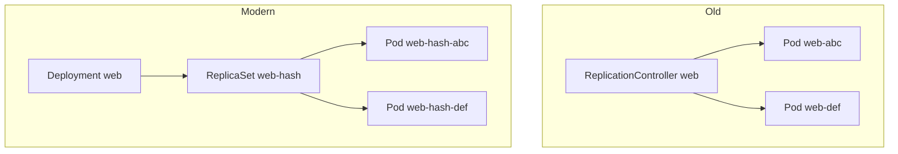
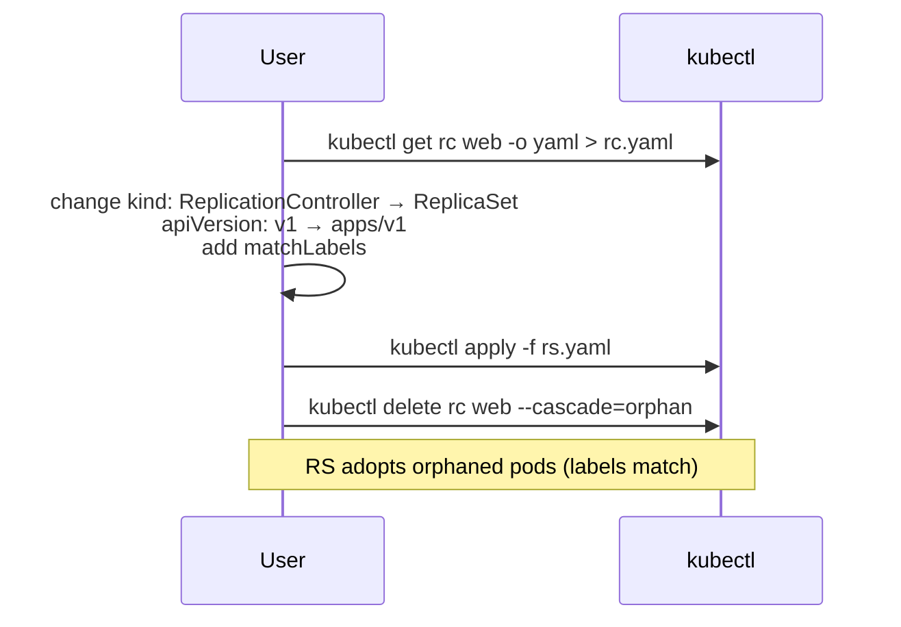

# 📘 Topic 12 — ReplicationControllers (Legacy)

**Official Documentation Reference**
- ReplicationController: https://kubernetes.io/docs/concepts/workloads/controllers/replicationcontroller/
- Deprecation policy: https://kubernetes.io/docs/reference/using-api/deprecation-policy/

---

## 🔹 Definition
A **ReplicationController (RC)** is the original Kubernetes controller that ensures a specified number of pod replicas are running at any given time. It has been superseded by **ReplicaSet** (and, at a higher level, **Deployment**) — new work should use those.

---

## 🔹 About

### Why it exists in the docs
RC shipped with Kubernetes v1.0 in 2015. It solved the same problem RS solves today: "keep N pods alive". It's still in the API (`v1` group) for backward compatibility.

### What changed with ReplicaSet
| Feature | RC | RS |
|---|---|---|
| Selector | Equality only (`app=web`) | Equality + set-based (`env In (dev,stg)`) |
| API group | core `v1` | `apps/v1` |
| Used by Deployment | No | Yes |
| Recommended for new work? | No | Only via Deployment |
| Rolling updates | Manual via `kubectl rolling-update` (deprecated CLI) | Handled by Deployment |

### Should you ever create one?
Almost never. Recognize it in old Helm charts, legacy manifests, or CKA exam material — then migrate.

### Migration path
- `RC → RS` — straightforward: same fields, add `apps/v1` group, change `kind`.
- `RC → Deployment` — the modern answer; gain rolling updates and rollback for free.

---

## 🔹 How It Integrates With Other Kubernetes Components
| Component | Interaction |
|---|---|
| Pod | RC creates/deletes pods matching its selector |
| Service | Same as RS/Deployment — Service selects the pods by label |
| kube-controller-manager | Hosts the `replicationcontroller` controller |
| Deployment | **Does not manage RC** — Deployment always uses ReplicaSet |

---

## 🏗️ Diagrams

### Legacy hierarchy


### Migration flow


---

## 💻 Real-World Examples

### Example 1 — Bare ReplicationController (recognize, don't build new)
```yaml
apiVersion: v1
kind: ReplicationController
metadata:
  name: web
spec:
  replicas: 3
  selector:
    app: web                   # equality only
  template:
    metadata:
      labels: { app: web }
    spec:
      containers:
      - { name: nginx, image: nginx:1.27, ports: [{ containerPort: 80 }] }
```

### Example 2 — Convert RC to Deployment
```yaml
apiVersion: apps/v1
kind: Deployment
metadata:
  name: web
spec:
  replicas: 3
  selector:
    matchLabels: { app: web }
  template:
    metadata: { labels: { app: web } }
    spec:
      containers:
      - { name: nginx, image: nginx:1.27, ports: [{ containerPort: 80 }] }
```
Apply the Deployment, delete the RC with `--cascade=orphan`, let Deployment/RS adopt the pods.

### Example 3 — Scaling still works
```bash
kubectl scale rc/web --replicas=5
kubectl get rc web
kubectl delete rc web
```

---

## 💻 Related Commands

| Command | Flag | Purpose | Example |
|---|---|---|---|
| `kubectl get rc` | `-A` | List RCs everywhere | `kubectl get rc -A` |
| `kubectl describe rc` | — | See pods and events | `kubectl describe rc web` |
| `kubectl scale rc` | `--replicas=` | Change count | `kubectl scale rc/web --replicas=5` |
| `kubectl delete rc` | `--cascade=orphan` | Preserve pods | `kubectl delete rc web --cascade=orphan` |
| `kubectl expose rc` | `--port --type` | Create Service | `kubectl expose rc web --port=80` |
| `kubectl rolling-update` | (deprecated CLI, removed) | Old rolling update | — |

---

## 🚨 Scenarios

### Scenario 1 — "We inherited a chart that uses RC"
- **Action**: rewrite as Deployment. Keep same labels so Services keep working. Apply the Deployment first, then delete the RC with `--cascade=orphan`.

### Scenario 2 — RC exists but pods have extra labels
- **Cause**: RC only matches on equality; extras don't matter for matching but complicate selector overlap.
- **Fix**: still safe; just be careful with Services that select by broader labels.

### Scenario 3 — CKA exam asks to fix a scaling issue on an RC
- **Action**: `kubectl scale rc/<n> --replicas=N` or edit the manifest.

---

## ☁️ GCP GKE Perspective
- GKE supports RC (upstream compatibility). No GKE-specific features rely on RC. Autopilot allows RC pods provided they meet Autopilot restrictions.
- No `gcloud` shortcuts for RC — same `kubectl` verbs as anywhere.

## 🟧 AWS EKS Perspective
- Same story. EKS supports RC; no reason to prefer it. Managed add-ons never use RC.

---

## 🧪 Hands-On Lab Exercises

### Lab 12.1 — Create + scale + delete an RC (Beginner, 20 min)
**Steps**
```bash
kubectl apply -f - <<'EOF'
apiVersion: v1
kind: ReplicationController
metadata: { name: rc-demo }
spec:
  replicas: 2
  selector: { app: demo }
  template:
    metadata: { labels: { app: demo } }
    spec: { containers: [{ name: c, image: nginx:1.27 }] }
EOF
kubectl scale rc/rc-demo --replicas=4
kubectl get pods -l app=demo -o wide
kubectl delete pod -l app=demo --wait=false
kubectl get pods -l app=demo -w      # RC replaces them
kubectl delete rc rc-demo
```
**Bonus**: Try to add a `matchExpressions` selector — the API will reject it (RC doesn't support set-based).

### Lab 12.2 — Migrate RC to Deployment without downtime (Intermediate, 45 min)
**Steps**
1. Deploy RC with 3 replicas + a Service selecting `app: demo`.
2. Run a `hey` load: `hey -z 60s http://<svc>/`.
3. Create Deployment with `matchLabels: {app: demo}` and same template, replicas 3.
4. Deployment will spawn new pods; the Service now has 6 endpoints.
5. `kubectl delete rc rc-demo --cascade=orphan` → RC's pods are orphaned; Deployment adopts them via label match.
6. Ensure `hey` shows zero failures throughout.

**Bonus**: Repeat but use RS (`apps/v1 ReplicaSet`) as the target instead of Deployment; then wrap that RS with a Deployment.

### Lab 12.3 — RC on Autopilot compatibility check (Advanced, 30 min)
**Steps**
1. On GKE Autopilot: `kubectl apply -f rc.yaml`.
2. Confirm pods run.
3. Try to set `privileged: true` on the container — expect admission rejection (Autopilot policy).
4. Compare with same manifest on Standard/Minikube.

**Cleanup**: `kubectl delete rc rc-demo`.

---

## 🎯 Interview Deliverable Answer (60–90 s)
"**What**: The ReplicationController is Kubernetes' original replica controller from v1.0. Given a template and a count, it keeps that many pods alive.  
**Why-not**: We rarely use RC today — ReplicaSet added set-based selectors and lives under the `apps/v1` group, and Deployments layered rolling updates and rollbacks on top of ReplicaSets. So the modern reflex is 'Deployment for stateless, StatefulSet for stateful, DaemonSet for node-level, Job/CronJob for finite work'.  
**How to handle in the wild**: When I inherit an RC — usually in an old Helm chart — I migrate: write an equivalent Deployment, apply it, then delete the RC with `--cascade=orphan` so the Deployment's ReplicaSet adopts the running pods; no downtime.  
**Interview relevance**: CKA and legacy code still test RC, so I know its selector limitation (equality only) and how to convert it.  
**Example**: On a 2018-era code base we had 40 RCs. In a single sprint we replaced each with a Deployment using a scripted `sed`/`yq` transform and rolled through canary namespaces first."

---

## ❓ Possible Interview Questions

### Basic
**Q1. What does an RC do?** Ensures N pod replicas exist for a given label selector.  
**Q2. Is RC still supported?** Yes for backward compatibility, but not recommended.  
**Q3. Replacement for RC?** ReplicaSet (managed by Deployment).

### Intermediate
**Q4. RC vs RS?** RS adds set-based selectors and lives under `apps/v1`; RC is core `v1`, equality only.  
**Q5. Why did K8s deprecate `kubectl rolling-update`?** Deployments do rolling updates declaratively; the imperative CLI became redundant and error-prone.  
**Q6. Can Deployment manage RC?** No — Deployment always creates ReplicaSets.

### Advanced
**Q7. Explain how you'd migrate 100 RCs to Deployments safely.**  
Script the manifest transformation (change kind, apiVersion, selector to matchLabels, keep template labels). Apply Deployment. Verify Service endpoints. `kubectl delete rc --cascade=orphan`. Deployment/RS adopts orphan pods; no restarts.

**Q8. What is the API group and version of RC?** `v1` (core).  
**Q9. Any performance difference RC vs RS?** Not meaningful; both are controllers watching pods. RS is the future.

### Scenario-based
**Q10. Two RCs select the same label — what happens?** Same "fighting" problem as RS: each tries to reach its `replicas` count using overlapping pods. Fix selectors.

### GKE-specific
**Q11. Does Autopilot care if you use RC?** No — it applies the same admission rules; but the recommendation is Deployment.

### EKS-specific
**Q12. Does IRSA work with RC pods?** Yes — IRSA acts on the ServiceAccount, independent of the workload controller kind.

### Hands-on / Lab-based
**Q13. In your lab, how did you migrate an RC to a Deployment without downtime?**  
Applied Deployment first (adds new pods), verified traffic served correctly, then deleted the RC with `--cascade=orphan` so the Deployment's ReplicaSet adopted the surviving pods via label match.  
**Q14. Show me how to prove pod adoption worked.** `kubectl get pod <name> -o jsonpath='{.metadata.ownerReferences[*].kind}'` — should print `ReplicaSet` after adoption.  
**Q15. Any pitfalls in RC-to-Deployment migration?** Label mismatches, Service selector too broad (may pick up new/old pods indiscriminately), and forgetting `--cascade=orphan` (which would delete pods first, then Deployment recreates them = brief downtime).

