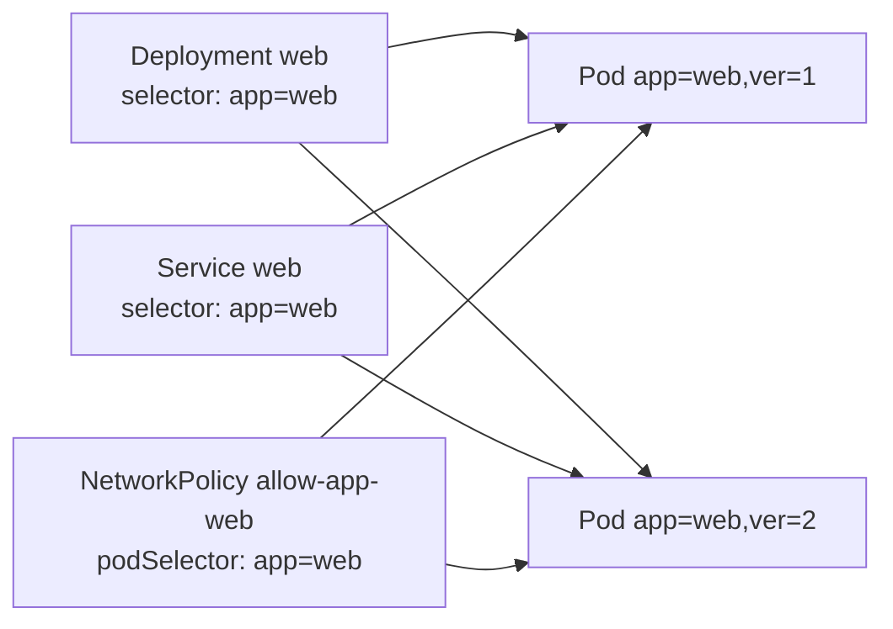
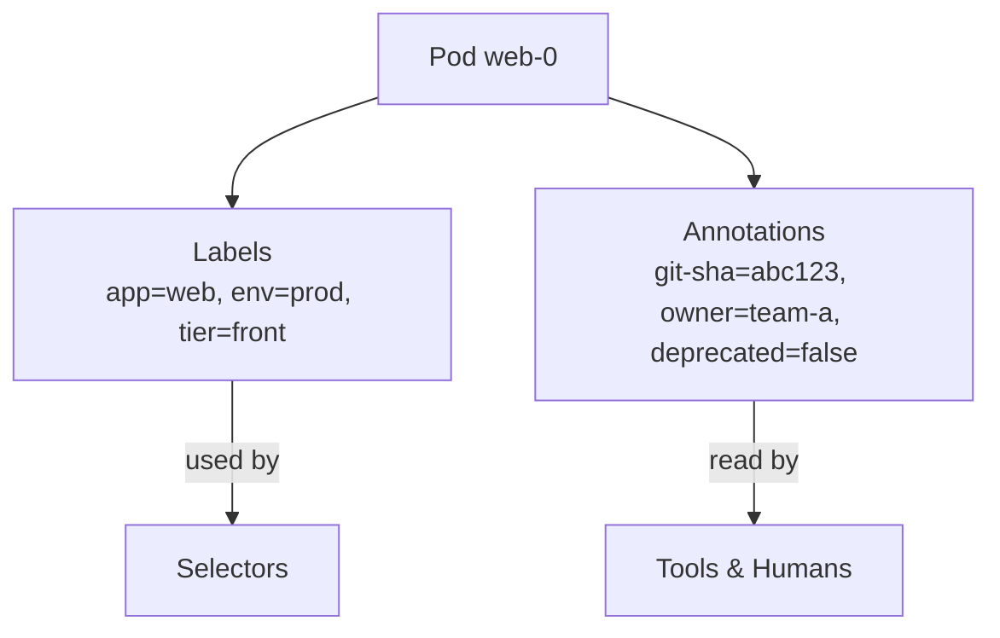

# 📘 Topic 13 — Labels, Selectors, Annotations

**Official Documentation Reference**
- Labels & Selectors: https://kubernetes.io/docs/concepts/overview/working-with-objects/labels/
- Annotations: https://kubernetes.io/docs/concepts/overview/working-with-objects/annotations/
- Recommended labels: https://kubernetes.io/docs/concepts/overview/working-with-objects/common-labels/
- Field selectors: https://kubernetes.io/docs/concepts/overview/working-with-objects/field-selectors/
- Well-known labels/annotations/taints: https://kubernetes.io/docs/reference/labels-annotations-taints/

---

## 🔹 Definition
- **Label** — a small `key: value` pair on any Kubernetes object used to organize and **select** groups of objects.
- **Selector** — a query over labels (equality or set-based) used by controllers, Services, kubectl, and network policies.
- **Annotation** — a non-identifying `key: value` used to attach arbitrary metadata (build info, ownership, tooling hints); **not** used for selection.

---

## 🔹 About

### Label rules
- Key: optional prefix `example.com/` + name (`app.kubernetes.io/name`).
- Prefix must be a DNS subdomain, ≤ 253 chars.
- Name/value: alphanumerics + `-_.`, ≤ 63 chars.
- Values may be empty.

### Recommended labels (`app.kubernetes.io/…`)
| Label | Purpose |
|---|---|
| `app.kubernetes.io/name` | App name (`mysql`) |
| `app.kubernetes.io/instance` | Unique instance (`mysql-abc`) |
| `app.kubernetes.io/version` | Version (`8.0.36`) |
| `app.kubernetes.io/component` | Role (`database`) |
| `app.kubernetes.io/part-of` | Higher-level app (`wordpress`) |
| `app.kubernetes.io/managed-by` | Deployer (`helm`, `argocd`, `kustomize`) |

### Selectors
Two flavors:
- **Equality-based**: `app=web`, `tier!=cache`.
- **Set-based**: `env in (dev, stg)`, `role notin (db)`, `key`, `!key`.

Consumers of selectors:
- Services (`spec.selector`)
- Deployments/RS/STS/DS (`spec.selector.matchLabels` / `matchExpressions`)
- NetworkPolicies (`spec.podSelector`)
- Node affinity / anti-affinity (`labelSelector`)
- kubectl (`-l app=web,tier=front`)

### Field selectors
Distinct from label selectors — filter by object field:
```bash
kubectl get pods --field-selector status.phase=Running,spec.nodeName=node-1
kubectl get events --field-selector type=Warning
```

### Annotations vs labels
| Property | Label | Annotation |
|---|---|---|
| Purpose | Identify & select | Arbitrary metadata |
| Used by K8s selectors | Yes | No |
| Size | Small | Larger (up to 256KB total) |
| Values | Constrained | Any string, arbitrary content |
| Examples | `app=web`, `env=prod` | `git-sha`, `owner=team-a`, `deprecated=true`, `nginx.ingress.kubernetes.io/rewrite-target` |

### Well-known annotations
- `kubectl.kubernetes.io/last-applied-configuration`
- `deployment.kubernetes.io/revision`
- `pod-security.kubernetes.io/enforce`
- Cloud provider hints: `service.beta.kubernetes.io/aws-load-balancer-type`, `cloud.google.com/neg`.

---

## 🔹 How It Integrates With Other Kubernetes Components
| Component | Usage |
|---|---|
| Services | `selector` maps traffic to pods |
| Controllers | `spec.selector` determines which pods to manage |
| NetworkPolicies | `podSelector` + `namespaceSelector` gate traffic |
| Scheduling | `nodeAffinity` / `topologyKey` use labels |
| Cost / audit | Labels power cluster cost reporting (Kubecost, GKE cost breakdown) |
| Ingress controllers | Annotations enable extra features |
| Cloud LB provisioning | Annotations tune LB type/SG/SSL |

---

## 🏗️ Diagrams

### Selector graph


### Labels vs Annotations


---

## 💻 Real-World Examples

### Example 1 — Full label set on a Deployment
```yaml
apiVersion: apps/v1
kind: Deployment
metadata:
  name: web
  labels:
    app.kubernetes.io/name: web
    app.kubernetes.io/instance: web-prod
    app.kubernetes.io/version: 1.4.2
    app.kubernetes.io/component: frontend
    app.kubernetes.io/part-of: shop
    app.kubernetes.io/managed-by: argocd
    env: prod
    team: platform
  annotations:
    git.example.com/commit: abc123
    owner: platform-team@company.io
    argocd.argoproj.io/tracking-id: shop:apps/Deployment:prod/web
spec:
  selector:
    matchLabels:
      app.kubernetes.io/name: web
      app.kubernetes.io/instance: web-prod
  template:
    metadata:
      labels:
        app.kubernetes.io/name: web
        app.kubernetes.io/instance: web-prod
        env: prod
    spec:
      containers: [{ name: c, image: myrepo/web:1.4.2 }]
```

### Example 2 — Set-based selector for canary
```yaml
apiVersion: v1
kind: Service
metadata: { name: web }
spec:
  selector: null                         # NOT allowed: use ports + selector below
  # Real trick: two Deployments (stable, canary) both labeled app=web
  # Service selector app=web catches both.
  ports: [{ port: 80 }]
```

### Example 3 — kubectl label filtering
```bash
kubectl get pods -l 'app=web,env in (prod,stg)'
kubectl get pods -l 'env,tier!=cache'
kubectl label pod web-0 canary=true --overwrite
kubectl label pod web-0 canary-              # removes
kubectl annotate deploy web owner=team-x --overwrite
```

### Example 4 — Ingress with NGINX annotations
```yaml
metadata:
  annotations:
    nginx.ingress.kubernetes.io/rewrite-target: /$2
    nginx.ingress.kubernetes.io/limit-rps: "50"
    cert-manager.io/cluster-issuer: letsencrypt-prod
```

---

## 💻 Related Commands

| Command | Flag | Purpose | Example |
|---|---|---|---|
| `kubectl label` | `<obj> key=val` | Add/set label | `kubectl label pod web-0 env=prod` |
| `kubectl label` | `--overwrite` | Replace existing | `kubectl label pod web-0 env=prod --overwrite` |
| `kubectl label` | `key-` | Remove | `kubectl label pod web-0 env-` |
| `kubectl get` | `-l` / `--selector` | Filter by labels | `kubectl get pods -l app=web,tier=front` |
| `kubectl get` | `--show-labels` | Show label columns | `kubectl get pods --show-labels` |
| `kubectl get` | `-L key1,key2` | Show specific labels as columns | `kubectl get pods -L env,tier` |
| `kubectl get` | `--field-selector` | Filter by fields | `kubectl get pods --field-selector status.phase=Running` |
| `kubectl annotate` | `<obj> key=val` | Add/set annotation | `kubectl annotate pod web-0 owner=x` |
| `kubectl annotate` | `key-` | Remove | `kubectl annotate pod web-0 owner-` |
| `kubectl get` | `-o jsonpath='{.items[*].metadata.labels}'` | Extract labels | `kubectl get pods -o jsonpath='{.items[*].metadata.labels}'` |

---

## 🚨 Scenarios

### Scenario 1 — Service returns no endpoints
- **Cause**: Service selector doesn't match any pod labels.
- **Diagnose**: `kubectl get endpoints <svc>`; `kubectl describe svc <svc>`.
- **Fix**: Align selector or pod labels: `kubectl label pod <p> app=web`.

### Scenario 2 — Deployment "adopts" unrelated pods
- **Cause**: too-broad selector matches pods created by other controllers/humans.
- **Fix**: use unique labels (e.g., add `app.kubernetes.io/instance`) and set the selector accordingly.

### Scenario 3 — Cost report groups all workloads together
- **Cause**: missing `team`/`env`/`cost-center` labels.
- **Fix**: enforce required labels via Kyverno/OPA admission.

### Scenario 4 — Annotation exceeds size (256KB total)
- **Cause**: pushing entire config blobs into annotations.
- **Fix**: Move to a ConfigMap and reference by name.

### Scenario 5 — Ingress feature not activating
- **Cause**: Annotation on wrong object (Ingress vs Service) or misspelled prefix.
- **Fix**: check controller docs; validate with `kubectl describe ing`.

---

## ☁️ GCP GKE Perspective
- **GKE cost allocation** relies on labels; enable label sync in `gcloud container clusters update`.
- **Node labels**: `topology.kubernetes.io/zone`, `cloud.google.com/gke-nodepool`, `cloud.google.com/gke-preemptible`.
- Annotations for LB: `cloud.google.com/neg: '{"ingress": true}'`, `networking.gke.io/load-balancer-type`, `cloud.google.com/backend-config`.
- Workload Identity annotation on ServiceAccount: `iam.gke.io/gcp-service-account=<sa@project.iam.gserviceaccount.com>`.

## 🟧 AWS EKS Perspective
- **VPC CNI** node labels: `topology.kubernetes.io/zone`, `karpenter.sh/provisioner-name`.
- **Service annotations** for AWS LB Controller:
  - `service.beta.kubernetes.io/aws-load-balancer-type: nlb`
  - `service.beta.kubernetes.io/aws-load-balancer-scheme: internet-facing`
  - `service.beta.kubernetes.io/aws-load-balancer-ssl-cert: arn:aws:acm:…`
- **IRSA** annotation on ServiceAccount: `eks.amazonaws.com/role-arn=arn:aws:iam::…:role/…`.
- **AWS cost allocation tags** for CUR require namespace/pod labels + explicit CUR tag config.

---

## 🧪 Hands-On Lab Exercises

### Lab 13.1 — Label & select (Beginner, 20 min)
**Steps**
```bash
kubectl run p1 --image=nginx --labels="app=web,env=dev"
kubectl run p2 --image=nginx --labels="app=web,env=prod"
kubectl run p3 --image=nginx --labels="app=api,env=prod"

kubectl get pods -l app=web
kubectl get pods -l 'env in (dev,prod), app=web'
kubectl get pods --show-labels
kubectl label pod p1 canary=true
kubectl get pods -L env,canary
```
**Cleanup**: `kubectl delete pod p1 p2 p3`.

### Lab 13.2 — Enforce required labels with Kyverno (Intermediate, 60 min)
**Steps**
1. Install Kyverno: `kubectl apply -f https://raw.githubusercontent.com/kyverno/kyverno/main/config/install.yaml`.
2. Apply policy:
```yaml
apiVersion: kyverno.io/v1
kind: ClusterPolicy
metadata: { name: require-labels }
spec:
  validationFailureAction: Enforce
  rules:
  - name: check-labels
    match: { any: [{ resources: { kinds: ["Deployment","StatefulSet","DaemonSet"] } }] }
    validate:
      message: "Labels app.kubernetes.io/name, env, team required."
      pattern:
        metadata:
          labels:
            app.kubernetes.io/name: "?*"
            env: "?*"
            team: "?*"
```
3. Try to create a Deployment missing `team` — rejected.
4. Add labels; accepted.

**Cleanup**: `kubectl delete clusterpolicy require-labels`.

**Bonus**: Convert policy to `Audit` mode; view violations via `kubectl get policyreport -A`.

### Lab 13.3 — Label-driven canary + cost allocation (Advanced, 60 min)
**Steps**
1. Deploy Deployments `web-stable` and `web-canary`, both with `app=web`.
2. Service selects `app=web` → 90/10 traffic split.
3. Install Kubecost (`helm install kubecost kubecost/cost-analyzer`).
4. Confirm cost dashboard breaks down by `env`, `team` labels.
5. Add cost dashboards per label; validate cost allocation.

**Cleanup**: `helm uninstall kubecost && kubectl delete deploy web-stable web-canary`.

**Bonus**: On GKE enable **Cost Allocation** in cluster settings and compare with Kubecost.

---

## 🎯 Interview Deliverable Answer (60–90 s)
"**What**: Labels are the key/value tags Kubernetes uses to organize and select objects. Selectors query those labels — equality-based or set-based — and are how Services find pods, controllers find their replicas, and NetworkPolicies scope traffic. Annotations are structurally similar but are not used for selection — they carry metadata for humans and tooling.  
**Why**: Labels are the graph that ties every object together. Without a consistent labeling scheme, cost reports, RBAC scoping, alert routing, and multi-tenant policies all fall apart.  
**How**: I standardize on the `app.kubernetes.io/*` recommended labels plus `env`, `team`, `cost-center`. I enforce them at admission with Kyverno so nothing lands without them. Annotations carry git SHAs, owner emails, and controller-specific hints — like NGINX Ingress rules or Workload Identity/IRSA bindings.  
**Example**: In one platform we added a Kyverno policy requiring `team` and `cost-center` on every workload; within a month our monthly cloud bill had a clean per-team breakdown, and platform charges dropped 22% after the offending team optimized its overprovisioned deployments."

---

## ❓ Possible Interview Questions

### Basic
**Q1. Label vs annotation?** Label = selectable metadata; annotation = arbitrary metadata not used for selection.  
**Q2. Give 3 recommended labels.** `app.kubernetes.io/name`, `app.kubernetes.io/instance`, `app.kubernetes.io/version`.  
**Q3. Can labels be empty?** Values can be empty; keys cannot.

### Intermediate
**Q4. Equality vs set-based selectors — examples.**  
Equality: `app=web`. Set-based: `env in (dev,stg)`.  
**Q5. Which controllers accept set-based selectors?** RS, Deployment, DS, STS, Job — via `matchExpressions`. Service and RC support only equality-based.  
**Q6. What is a field selector?** Filter by an object's field (e.g., `status.phase=Running`), not by labels.

### Advanced
**Q7. Why does the API forbid mutating a Deployment's `spec.selector` after creation?** It could orphan/adopt pods across versions, breaking rollout and ownership guarantees.  
**Q8. How do you enforce label conventions across a fleet?** Admission controllers — Kyverno/OPA Gatekeeper policies validating and mutating manifests.  
**Q9. Are annotations size-limited?** All annotations on one object combined must be < 256KB.

### Scenario-based
**Q10. A Service has no endpoints but pods are Running — steps?** Compare `kubectl get svc <n> -o yaml` selector vs pod labels; ensure ports/targetPort match container port; check readinessProbe.

### GKE-specific
**Q11. How does GKE's Workload Identity know which GCP SA to use?** The annotation `iam.gke.io/gcp-service-account` on the Kubernetes ServiceAccount points to a GCP SA that trusts the K8s SA.

### EKS-specific
**Q12. How do you tell AWS LB Controller to create an NLB instead of ALB?** Set `service.beta.kubernetes.io/aws-load-balancer-type: nlb` annotation on the Service.

### Hands-on / Lab-based
**Q13. Show me a set-based selector.**  
```yaml
selector:
  matchExpressions:
  - { key: env, operator: In, values: [dev, stg] }
  - { key: tier, operator: NotIn, values: [cache] }
```
**Q14. How would you find every deprecated Deployment?** `kubectl get deploy -A -o json | jq '.items[] | select(.metadata.annotations["deprecated"]=="true")'`.  
**Q15. How do you rename a label across all pods?** `kubectl label pods -A --all newkey=$OLDVAL` scripted via jsonpath, or use `kubectl label --overwrite` after Kyverno policy migration.

