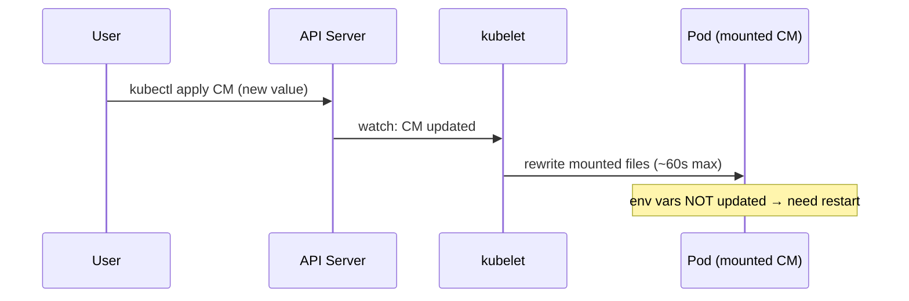

# 📘 Topic 14 — ConfigMaps

**Official Documentation Reference**
- ConfigMap: https://kubernetes.io/docs/concepts/configuration/configmap/
- Configure a Pod to use a ConfigMap: https://kubernetes.io/docs/tasks/configure-pod-container/configure-pod-configmap/
- Updating configuration via a ConfigMap (tutorial): https://kubernetes.io/docs/tutorials/configuration/updating-configuration-via-a-configmap/
- GKE ConfigMap best practices: https://cloud.google.com/kubernetes-engine/docs/concepts/configmap
- EKS externalized config: https://docs.aws.amazon.com/eks/latest/best-practices/

---

## 🔹 Definition
A **ConfigMap** is a Kubernetes API object that stores **non-sensitive** configuration data as key/value pairs. Pods consume ConfigMaps as environment variables, command-line arguments, or as files mounted into volumes.

---

## 🔹 About

### Why ConfigMaps
The Twelve-Factor App principle "config in the environment" — separate config from images so the same image ships to dev, staging, and prod with different behavior. ConfigMaps hold DB URLs, feature flags, log levels, arbitrary config files.

### Ways a pod consumes a ConfigMap
| Consumption | Behavior |
|---|---|
| `env` (single key → env var) | Value baked in at container start |
| `envFrom` (whole ConfigMap) | Every key becomes an env var |
| Volume (`volumes.configMap`) | Each key becomes a file in the mount path |
| Volume subPath | Mount a single key as one file next to existing files |
| `spec.containers.command/args` `$(VAR)` interpolation | Reference env vars from ConfigMap |

### Immutability
`immutable: true` (K8s 1.21+) → prevents any updates. Improves apiserver cache efficiency and prevents drift. Use for versioned ConfigMaps (`cm-v1`, `cm-v2`).

### Size limit
Total size of a single ConfigMap ≤ **1 MiB**. Larger config → split into multiple, or use a volume/secret store.

### Updates and reload behavior
- **Env vars**: NOT updated after container start; requires pod restart.
- **Volume mounts**: kubelet updates files in place, usually within ~1 minute (via projected volume periodic sync). App must watch the file to hot-reload.
- **subPath mounts**: NOT updated (mount is bind-mount to a single file).

### Update propagation tools
- `stakater/Reloader` — watches ConfigMap/Secret changes and rolling-restarts owning Deployments.
- Kustomize `configMapGenerator` — appends a hash suffix to the name; any change → new ConfigMap → rolling update.
- Argo CD auto-syncs.

### Binary data
Use `.binaryData` (base64) for non-UTF-8 content.

---

## 🔹 How It Integrates With Other Kubernetes Components
| Component | Interaction |
|---|---|
| Pod | Consumes via env/volume/subPath |
| Deployment/STS/DS | Reference ConfigMap in template |
| RBAC | Namespace-scoped access controlled by Roles |
| Kustomize/Helm | Generate ConfigMaps with hash suffixes |
| Admission (Kyverno) | Enforce presence of required keys |
| External Secrets Operator | Can sync from external stores into ConfigMaps too |

---

## 🏗️ Diagrams

### ConfigMap consumption modes
```mermaid
flowchart LR
  CM[ConfigMap app-config<br/>DB_URL=..., LOG=info,<br/>nginx.conf=...]
  CM -->|env| E1[Pod env DB_URL]
  CM -->|envFrom| E2[All keys as env]
  CM -->|volume| F1[/etc/config/DB_URL<br/>/etc/config/nginx.conf]
  CM -->|subPath| F2[/etc/nginx/nginx.conf]
```

### Update propagation


---

## 💻 Real-World Examples

### Example 1 — ConfigMap from literals + files
```bash
kubectl create cm app-config \
  --from-literal=LOG_LEVEL=info \
  --from-literal=FEATURE_X=true \
  --from-file=nginx.conf=./nginx.conf
```

### Example 2 — Consume as env + as volume
```yaml
apiVersion: v1
kind: Pod
metadata: { name: web }
spec:
  containers:
  - name: app
    image: nginx:1.27
    env:
    - name: LOG_LEVEL
      valueFrom: { configMapKeyRef: { name: app-config, key: LOG_LEVEL } }
    envFrom:
    - configMapRef: { name: app-config }        # every key
    volumeMounts:
    - { name: nginx-conf, mountPath: /etc/nginx/nginx.conf, subPath: nginx.conf }
  volumes:
  - name: nginx-conf
    configMap:
      name: app-config
      items:
      - { key: nginx.conf, path: nginx.conf }
```

### Example 3 — Immutable, versioned
```yaml
apiVersion: v1
kind: ConfigMap
metadata: { name: app-config-v2 }
immutable: true
data:
  LOG_LEVEL: info
  FEATURE_X: "true"
```
Deployment references `app-config-v2`. Next change → `app-config-v3` + new Deployment revision.

### Example 4 — Kustomize with automatic hash
```yaml
# kustomization.yaml
configMapGenerator:
- name: app-config
  literals:
  - LOG_LEVEL=info
  - FEATURE_X=true
generatorOptions:
  disableNameSuffixHash: false      # hash appended
```
`kubectl apply -k .` — changed literal produces `app-config-<newhash>`, triggering rolling update on any Deployment that references the generated name.

---

## 💻 Related Commands

| Command | Flag | Purpose | Example |
|---|---|---|---|
| `kubectl create cm` | `--from-literal=` | Inline value | `kubectl create cm c --from-literal=K=V` |
| `kubectl create cm` | `--from-file=` | File contents as value | `kubectl create cm c --from-file=./nginx.conf` |
| `kubectl create cm` | `--from-env-file=` | dotenv format | `kubectl create cm c --from-env-file=.env` |
| `kubectl get cm` | `-o yaml` | Show all data | `kubectl get cm app-config -o yaml` |
| `kubectl describe cm` | — | Human-readable | `kubectl describe cm app-config` |
| `kubectl edit cm` | — | Live edit | `kubectl edit cm app-config` |
| `kubectl delete cm` | `<name>` | Remove | `kubectl delete cm app-config` |
| `kubectl create cm` | `--dry-run=client -o yaml` | Skeleton | `kubectl create cm c --from-literal=A=B --dry-run=client -o yaml` |
| `kubectl rollout restart deploy` | — | Force pods to reload env-based CM changes | `kubectl rollout restart deploy web` |

---

## 🚨 Scenarios

### Scenario 1 — App doesn't see new config
- **Cause**: consumed as env; container was never restarted after CM edit.
- **Fix**: `kubectl rollout restart deploy/<n>` or move to volume mount + app watch.

### Scenario 2 — subPath ignores updates
- **Cause**: subPath is a bind mount to a specific file; kubelet doesn't refresh.
- **Fix**: mount whole directory (drop subPath) or use symlink pattern + Reloader.

### Scenario 3 — ConfigMap exceeded 1 MiB
- **Cause**: dumping large JSON/YAML blob.
- **Fix**: split into multiple CMs, or use a `Secret` with binary, or a mounted volume from object store via init container.

### Scenario 4 — Rolling restart takes too long during config change
- **Cause**: many pods, tight PDB, `maxUnavailable: 0`.
- **Fix**: raise `maxSurge`, allow small `maxUnavailable`, use canary namespace first.

### Scenario 5 — Two teams overwrite each other's CM
- **Cause**: shared CM name, no ownership annotations.
- **Fix**: namespace separation, RBAC per team, `app.kubernetes.io/managed-by` annotations.

---

## ☁️ GCP GKE Perspective
- **ConfigMaps are cluster-local**. To share cluster-external config, use **GCP Secret Manager** (via CSI driver `secrets-store-csi-driver-provider-gcp`) or **Config Sync** (Anthos Config Management) to pull YAMLs from a Git repo.
- **Anthos Config Management** enforces ConfigMap standards across a fleet of clusters.
- **Autopilot**: normal ConfigMap semantics; volume mount refresh delay similar to Standard.

## 🟧 AWS EKS Perspective
- **AWS AppConfig** or **AWS Secrets Manager** for cluster-external config.
- **CSI Secrets Store driver** with the AWS provider can mount SSM parameters/Secrets Manager entries as files or sync them into ConfigMaps.
- **EKS Blueprints** ships opinionated Reloader/Kustomize/ArgoCD wiring so config changes trigger rolling updates automatically.

---

## 🧪 Hands-On Lab Exercises

### Lab 14.1 — Env vs volume consumption (Beginner, 30 min)
**Steps**
```bash
kubectl create cm greeting --from-literal=GREET=hello --from-literal=NAME=world
cat <<'EOF' | kubectl apply -f -
apiVersion: v1
kind: Pod
metadata: { name: cm-demo }
spec:
  containers:
  - name: c
    image: busybox
    command: ["sh","-c","echo $GREET $NAME; sleep 3600"]
    envFrom: [{ configMapRef: { name: greeting } }]
    volumeMounts: [{ name: v, mountPath: /etc/greet }]
  volumes:
  - name: v
    configMap: { name: greeting }
EOF
kubectl logs cm-demo
kubectl exec cm-demo -- ls /etc/greet
kubectl exec cm-demo -- cat /etc/greet/GREET
# update
kubectl create cm greeting --from-literal=GREET=hi --from-literal=NAME=world --dry-run=client -o yaml | kubectl apply -f -
sleep 90
kubectl exec cm-demo -- cat /etc/greet/GREET     # updated
kubectl logs cm-demo                            # env still says hello
```
**Cleanup**: `kubectl delete pod cm-demo && kubectl delete cm greeting`.

### Lab 14.2 — Kustomize hash-based rollout (Intermediate, 45 min)
**Steps**
1. Create `kustomization.yaml` with `configMapGenerator` and a Deployment referencing `app-config`.
2. `kubectl apply -k .` — CM created as `app-config-<hash>`; Deployment env references that name (Kustomize substitutes).
3. Change a literal; re-apply. New CM name → new Deployment revision → rolling update.
4. `kubectl rollout history deploy/web` shows revisions.

**Bonus**: Add `annotations: {reloader.stakater.com/auto: "true"}` and repeat without Kustomize hash to see Reloader restart pods.

### Lab 14.3 — CSI Secrets Store for GSM (GKE) or SSM/SM (EKS) (Advanced, 90 min)
**Steps (EKS example)**
1. Install driver: `helm install csi-secrets-store secrets-store-csi-driver/secrets-store-csi-driver --set syncSecret.enabled=true`.
2. Install AWS provider: `kubectl apply -f https://raw.githubusercontent.com/aws/secrets-store-csi-driver-provider-aws/main/deployment/aws-provider-installer.yaml`.
3. Create IAM role with `SecretsManager:GetSecretValue` and IRSA-bind to SA `csi-app`.
4. Apply:
```yaml
apiVersion: secrets-store.csi.x-k8s.io/v1
kind: SecretProviderClass
metadata: { name: aws-secret }
spec:
  provider: aws
  parameters: { objects: |
    - objectName: "prod/api-config"
      objectType: "secretsmanager"
      jmesPath:
      - path: LOG_LEVEL
        objectAlias: LOG_LEVEL }
  secretObjects:
  - secretName: sync-cm
    type: Opaque
    data: [{ objectName: LOG_LEVEL, key: LOG_LEVEL }]
```
5. Pod mounts the secret as file; `sync-cm` propagates a K8s Secret too (which you could also convert to CM via ExternalSecrets Operator).

**Cleanup**: `helm uninstall csi-secrets-store && kubectl delete secretproviderclass aws-secret`.

---

## 🎯 Interview Deliverable Answer (60–90 s)
"**What**: A ConfigMap externalizes non-sensitive configuration from a container image — DB URLs, log levels, entire config files. Pods consume it as environment variables, envFrom groups, or as files mounted from a volume.  
**Why**: This lets one image ship to every environment. It also decouples ops changes from image builds — flipping a feature flag doesn't require a new release pipeline.  
**How**: For most apps I use `envFrom` for simple keys and volume mounts for structured files like `nginx.conf`. I always know the update semantics: env vars need a pod restart, volume mounts refresh in about a minute. To make config changes trigger a controlled rollout I use Kustomize's `configMapGenerator` with a name hash, so any diff produces a new ConfigMap name and rolls the Deployment automatically. As a backup I run Stakater Reloader.  
**Example**: We once shipped a bug because a feature flag was baked as an env var and the pod never restarted. Since then we moved feature flags to a mounted JSON file the app watches; changes propagate in < 60 s without rolling anything."

---

## ❓ Possible Interview Questions

### Basic
**Q1. What is a ConfigMap?** Namespaced object storing non-sensitive key/value config.  
**Q2. Ways a pod uses a ConfigMap?** env, envFrom, volume mount, subPath, command args interpolation.  
**Q3. Is a ConfigMap encrypted at rest?** Only if you configured apiserver encryption-at-rest; by default it's plaintext in etcd.

### Intermediate
**Q4. If you update a CM, do env-consumed pods see the change?** No — they need to restart.  
**Q5. What's the size limit of a ConfigMap?** 1 MiB per object.  
**Q6. What does `immutable: true` do?** Locks the ConfigMap; improves scale, prevents drift; commonly paired with versioned names.

### Advanced
**Q7. How does Kustomize handle CM updates?** Appends a hash suffix; any change makes a new CM name → triggers Deployment rollout automatically.  
**Q8. What's `stakater/Reloader`?** A controller that watches ConfigMap/Secret changes and adds an annotation to owner Deployments, triggering a rolling restart.  
**Q9. subPath vs full mount?** subPath binds one file (no live refresh); full mount is a directory that refreshes.

### Scenario-based
**Q10. Pods missing env var — steps?** `kubectl describe pod` (env), `kubectl get cm <n> -o yaml`, verify key name matches, verify SA has read RBAC, check for typos.

### GKE-specific
**Q11. How do you sync ConfigMaps across many GKE clusters?** Anthos Config Management pulling YAMLs from Git; or ArgoCD applied per cluster.

### EKS-specific
**Q12. Common alternative to ConfigMap on EKS for dynamic config?** AWS AppConfig with cross-app rollout policies; or SSM Parameter Store fetched by init container.

### Hands-on / Lab-based
**Q13. Show me how you trigger a rollout when a CM changes.** Use Kustomize `configMapGenerator` (hash) or add Reloader annotation `reloader.stakater.com/auto: "true"`.  
**Q14. How would you enforce that all Deployments have `LOG_LEVEL` set?** Kyverno policy validating `envFrom` or `env` includes `LOG_LEVEL`.  
**Q15. How do you inspect the actual bytes in a CM?** `kubectl get cm <n> -o yaml | yq '.data'`; for binary use `.binaryData` (base64-decode).

