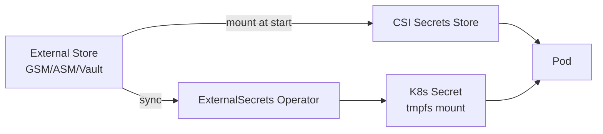
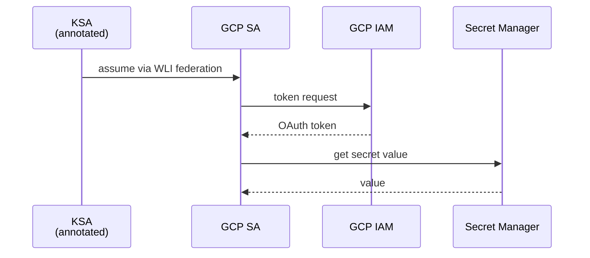
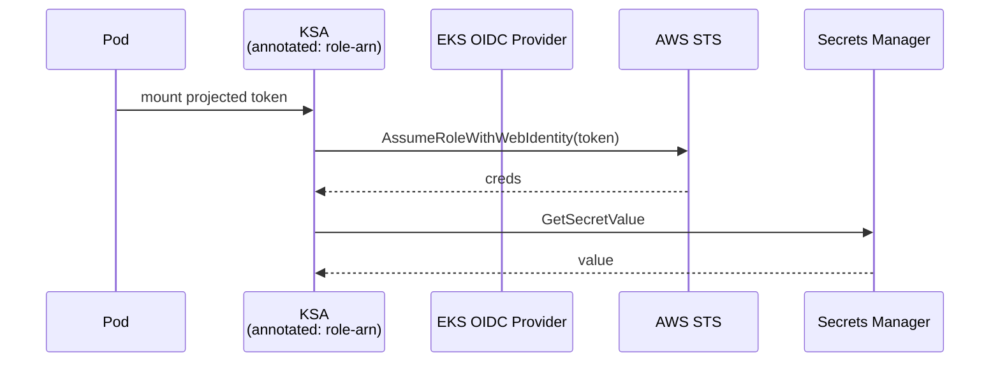

# 📘 Topic 15 — Secrets (Including External Secret Managers)

**Official Documentation Reference**
- Secrets concept: https://kubernetes.io/docs/concepts/configuration/secret/
- Manage Secrets with kubectl: https://kubernetes.io/docs/tasks/configmap-secret/managing-secret-using-kubectl/
- Distribute credentials securely: https://kubernetes.io/docs/tasks/inject-data-application/distribute-credentials-secure/
- Encrypting data at rest: https://kubernetes.io/docs/tasks/administer-cluster/encrypt-data/
- Good practices for Secrets: https://kubernetes.io/docs/concepts/security/secrets-good-practices/
- GKE Secret Manager add-on: https://cloud.google.com/kubernetes-engine/docs/how-to/secret-manager
- Workload Identity Federation for GKE: https://cloud.google.com/kubernetes-engine/docs/how-to/workload-identity
- EKS IRSA: https://docs.aws.amazon.com/eks/latest/userguide/iam-roles-for-service-accounts.html
- EKS Pod Identity: https://docs.aws.amazon.com/eks/latest/userguide/pod-identities.html
- External Secrets Operator: https://external-secrets.io

---

## 🔹 Definition
A **Secret** is a namespaced Kubernetes object that stores small amounts of **sensitive** data — passwords, tokens, TLS certs, SSH keys — separately from the container image. Data is base64-encoded in the object (not encrypted by itself).

---

## 🔹 About

### Key point up front
**Base64 is NOT encryption**. Anyone with `get secrets` on the namespace can decode. Secure Secrets with:
1. **Encryption at rest** on etcd (KMS provider).
2. **RBAC** so only intended workloads/humans can read them.
3. **External secret stores** for the source of truth.
4. **Audit logging** on Secret access.

### Secret types
| Type | Purpose |
|---|---|
| `Opaque` (default) | Arbitrary keys |
| `kubernetes.io/service-account-token` | Legacy SA token (auto-created for SAs pre-1.24) |
| `kubernetes.io/dockerconfigjson` | Registry pull creds |
| `kubernetes.io/tls` | TLS cert + key |
| `kubernetes.io/basic-auth` | Username + password |
| `kubernetes.io/ssh-auth` | SSH private key |
| `bootstrap.kubernetes.io/token` | Cluster bootstrap tokens |

### Consumption
Same shapes as ConfigMaps: `env`, `envFrom`, volume, subPath. Also imagePullSecrets (list in pod spec / SA).

### tmpfs mount
Secret volumes mount as `tmpfs` — never touch disk on the node. This is a hardening default.

### Encryption at rest
Configure `--encryption-provider-config` on the apiserver with `aescbc`, `aesgcm`, or (best) an external **KMS provider** (`kms v2`). GKE and EKS enable this by default with Google Cloud KMS / AWS KMS.

### External Secrets — the modern pattern
Instead of storing secrets in etcd, store them in a real secret manager (**GCP Secret Manager**, **AWS Secrets Manager**, **AWS SSM Parameter Store**, **HashiCorp Vault**, **Azure Key Vault**, **1Password Connect**, …) and pull them into pods:

Approaches:
- **CSI Secrets Store driver** — mounts secrets as files at pod start.
- **External Secrets Operator (ESO)** — a CRD `ExternalSecret` continuously syncs a value into a native K8s `Secret`.
- **Sealed Secrets (Bitnami)** — encrypt secrets with cluster public key; commit encrypted `SealedSecret` to Git; controller decrypts into `Secret`.

### Cloud identity for accessing external stores
- **GKE**: Workload Identity — bind a Kubernetes SA to a GCP SA (annotation `iam.gke.io/gcp-service-account`).
- **EKS**: **IRSA** (OIDC-based per SA) or **Pod Identity** (2023+, simpler API + no OIDC bootstrap).

### Best practices
- Never `kubectl create secret` with a real value on a shared terminal (bash history!). Use `--from-file` referring to a file you `chmod 600`, or ExternalSecrets/CSI.
- Restrict RBAC: separate `list` from `get` from `describe`.
- Rotate: pods holding secrets in env don't auto-refresh; volume mounts refresh (~1 min).
- Enable `--audit-policy` to log Secret reads.
- Use **immutable Secrets** (K8s 1.21+) to prevent tampering.

---

## 🔹 How It Integrates With Other Kubernetes Components
| Component | Interaction |
|---|---|
| ServiceAccount | Auto-mounted projected token (bound audience, expiring) |
| kubelet | Mounts secrets as tmpfs |
| API server | Encrypts/decrypts via KMS |
| Admission (Kyverno) | Enforce no-secret-in-env / IRSA presence |
| ESO / CSI driver | Pull secrets from cloud managers |
| Ingress + cert-manager | TLS Secrets |

---

## 🏗️ Diagrams

### Secret data path


### GKE Workload Identity


### EKS IRSA


---

## 💻 Real-World Examples

### Example 1 — Create a Secret and consume as env + volume
```bash
kubectl create secret generic db-cred \
  --from-literal=USER=app \
  --from-literal=PASSWORD='S3cure!'
```
```yaml
apiVersion: v1
kind: Pod
metadata: { name: web }
spec:
  containers:
  - name: c
    image: alpine
    command: ["sh","-c","printenv | grep DB_; sleep 3600"]
    envFrom: [{ secretRef: { name: db-cred } }]
    volumeMounts: [{ name: creds, mountPath: /var/creds, readOnly: true }]
  volumes:
  - name: creds
    secret: { secretName: db-cred, defaultMode: 0400 }
```

### Example 2 — TLS + image pull secrets
```bash
kubectl create secret tls web-tls --cert=tls.crt --key=tls.key
kubectl create secret docker-registry regcred \
  --docker-server=ghcr.io --docker-username=alice --docker-password=$TOKEN
```
```yaml
spec:
  imagePullSecrets: [{ name: regcred }]
```

### Example 3 — ExternalSecret (ESO) pulling from AWS Secrets Manager
```yaml
apiVersion: external-secrets.io/v1beta1
kind: SecretStore
metadata: { name: aws-sm }
spec:
  provider:
    aws:
      service: SecretsManager
      region: ap-south-1
      auth: { jwt: { serviceAccountRef: { name: eso-sa } } }   # uses IRSA
---
apiVersion: external-secrets.io/v1beta1
kind: ExternalSecret
metadata: { name: db-cred }
spec:
  refreshInterval: 1h
  secretStoreRef: { name: aws-sm, kind: SecretStore }
  target: { name: db-cred, creationPolicy: Owner }
  data:
  - { secretKey: PASSWORD, remoteRef: { key: prod/db/password } }
  - { secretKey: USER,     remoteRef: { key: prod/db/user } }
```

### Example 4 — Workload Identity (GKE) accessing GCP Secret Manager
```bash
# GCP side
gcloud iam service-accounts create app-gsa --project $PROJECT
gcloud projects add-iam-policy-binding $PROJECT \
  --member=serviceAccount:app-gsa@$PROJECT.iam.gserviceaccount.com \
  --role=roles/secretmanager.secretAccessor
gcloud iam service-accounts add-iam-policy-binding \
  app-gsa@$PROJECT.iam.gserviceaccount.com \
  --role=roles/iam.workloadIdentityUser \
  --member="serviceAccount:$PROJECT.svc.id.goog[prod/app-ksa]"
```
```yaml
# K8s side
apiVersion: v1
kind: ServiceAccount
metadata:
  name: app-ksa
  namespace: prod
  annotations:
    iam.gke.io/gcp-service-account: app-gsa@PROJECT.iam.gserviceaccount.com
```
App code uses google-cloud-secret-manager library; no keys shipped.

### Example 5 — Sealed Secret in Git
```bash
kubectl create secret generic db-cred --from-literal=P=x --dry-run=client -o yaml | \
  kubeseal --controller-name=sealed-secrets --format=yaml > sealed.yaml
git add sealed.yaml
```
Controller in cluster decrypts to `Secret`.

---

## 💻 Related Commands

| Command | Flag | Purpose | Example |
|---|---|---|---|
| `kubectl create secret generic` | `--from-literal=` | Inline | `kubectl create secret generic s --from-literal=K=V` |
| `kubectl create secret generic` | `--from-file=` | File → key | `kubectl create secret generic s --from-file=key=./key.pem` |
| `kubectl create secret tls` | `--cert --key` | TLS | `kubectl create secret tls t --cert=c --key=k` |
| `kubectl create secret docker-registry` | `--docker-*` | Registry creds | `kubectl create secret docker-registry r --docker-server=... --docker-username=... --docker-password=...` |
| `kubectl get secret` | `-o jsonpath='{.data.PASSWORD}'` | Read (base64) | `... \| base64 -d` |
| `kubectl describe secret` | — | Redacts data (only shows keys) | `kubectl describe secret db-cred` |
| `kubectl delete secret` | `<name>` | Remove | `kubectl delete secret db-cred` |
| `kubectl patch secret` | `-p` | Update field | `kubectl patch secret db-cred -p '{"stringData":{"P":"new"}}'` |
| `kubeseal` | `--format=yaml` | Encrypt for GitOps | see Example 5 |
| `eksctl create iamserviceaccount` | `--role-name` | Bootstrap IRSA | `eksctl create iamserviceaccount --cluster=prod --namespace=default --name=eso-sa --attach-policy-arn=arn:aws:iam::aws:policy/SecretsManagerReadWrite --approve` |
| `gcloud iam` | `add-iam-policy-binding` | Bind KSA → GSA | see Example 4 |

---

## 🚨 Scenarios

### Scenario 1 — Secret checked into Git in plaintext
- **Fix**: rotate the credential immediately; move to SealedSecrets or ExternalSecrets; add pre-commit hook `git-secrets`.

### Scenario 2 — Pod restarted losing rotated password
- **Cause**: env consumption of secret; password rotated in secret manager but pod holds old value.
- **Fix**: use volume mount + app reload, or ESO with `refreshInterval` + Reloader.

### Scenario 3 — Secret decoded by unintended user
- **Cause**: overly permissive RBAC (`list secrets` cluster-wide).
- **Fix**: least-privileged Role scoped to specific secret names; enable audit for `secrets`.

### Scenario 4 — imagePullBackOff for private registry
- **Cause**: `imagePullSecrets` missing or wrong namespace.
- **Fix**: create secret in same namespace as pod, add to SA `imagePullSecrets`.

### Scenario 5 — CSI Secrets Store won't mount
- **Cause**: SecretProviderClass mismatched namespace; missing driver DaemonSet; SA lacks IRSA/WLI.
- **Fix**: `kubectl describe pod` events; check `kubectl -n kube-system get ds secrets-store-csi-driver`.

---

## ☁️ GCP GKE Perspective
- **Application-layer secret encryption** enabled with `--database-encryption-key` on cluster creation (uses Cloud KMS).
- **Secret Manager add-on** (`--enable-secret-manager`) provides native volume mounting of Secret Manager secrets without CSI-driver install.
- **Workload Identity Federation** is the recommended way for pods to authenticate to GCP APIs — no static keys.
- **Backup for GKE** captures Secrets as part of application backups (encrypted with your KMS key).

## 🟧 AWS EKS Perspective
- **KMS envelope encryption** for K8s Secrets: `aws eks create-cluster --encryption-config resources=[secrets],provider={keyArn=…}`.
- **IRSA** for existing clusters (OIDC bootstrap + role trust). **Pod Identity** (2023+) is simpler — no OIDC required, uses eks-pod-identity-agent DaemonSet.
- **AWS Secrets Manager & SSM Parameter Store** are the two managed backends; both work through CSI Secrets Store or ESO.
- **AWS ACM** for TLS certificates in front of ALB — Ingress annotation `service.beta.kubernetes.io/aws-load-balancer-ssl-cert` avoids storing certs in K8s Secret.

---

## 🧪 Hands-On Lab Exercises

### Lab 15.1 — Create & consume a Secret (Beginner, 30 min)
**Steps**
```bash
kubectl create secret generic api-key --from-literal=API_KEY=abc123
kubectl run demo --image=alpine --restart=Never -- \
  sh -c 'echo $API_KEY; sleep 3600' -- --overrides='
{"spec":{"containers":[{"name":"demo","image":"alpine",
  "envFrom":[{"secretRef":{"name":"api-key"}}]}]}}'
# or use a Pod manifest (cleaner)
kubectl logs demo
kubectl get secret api-key -o jsonpath='{.data.API_KEY}' | base64 -d
```
**Cleanup**: `kubectl delete pod demo && kubectl delete secret api-key`.

**Bonus**: Mount the secret as a volume and inspect `ls -la /var/secret` — permissions should be 0400 tmpfs.

### Lab 15.2 — External Secrets Operator with AWS Secrets Manager (Intermediate, 90 min)
**Prerequisites**: EKS with OIDC (`eksctl utils associate-iam-oidc-provider --cluster=prod --approve`).

**Steps**
1. Install ESO: `helm repo add external-secrets https://charts.external-secrets.io && helm install external-secrets external-secrets/external-secrets -n external-secrets --create-namespace`.
2. Bootstrap IRSA: `eksctl create iamserviceaccount --cluster=prod --name=eso-sa --namespace=default --attach-policy-arn=arn:aws:iam::aws:policy/SecretsManagerReadWrite --approve`.
3. Push a value: `aws secretsmanager create-secret --name prod/db/password --secret-string 'S3cure!'`.
4. Apply SecretStore + ExternalSecret from Example 3.
5. Confirm K8s Secret `db-cred` synced: `kubectl get secret db-cred -o yaml`.
6. Rotate the AWS secret; wait `refreshInterval`; confirm K8s Secret updated.

**Cleanup**: `helm uninstall external-secrets -n external-secrets && aws secretsmanager delete-secret --secret-id prod/db/password --force-delete-without-recovery`.

### Lab 15.3 — Workload Identity → GCP Secret Manager (Advanced, 90 min)
**Prerequisites**: GKE with Workload Identity enabled.

**Steps**
1. GCP: `gcloud secrets create db-password --replication-policy=automatic && echo -n 'S3cure!' | gcloud secrets versions add db-password --data-file=-`.
2. Create GSA + bind to KSA (Example 4).
3. Create KSA with annotation.
4. Deploy a pod using the Python google-cloud-secret-manager library; no static keys.
5. Verify pod reads the secret from Secret Manager.
6. Rotate: `echo 'NewS3cret' | gcloud secrets versions add db-password --data-file=-`; pod re-reads on next call.

**Bonus**: Replace app code with the GKE **Secret Manager add-on** volume mount (`--enable-secret-manager`); simpler and no code changes.

---

## 🎯 Interview Deliverable Answer (60–90 s)
"**What**: A Kubernetes Secret is a namespaced object for sensitive data — passwords, TLS certs, tokens. It looks like a ConfigMap, but base64-encoded and mounted as tmpfs. Base64 is not encryption; real security comes from encryption at rest, tight RBAC, and pulling from an external secret store.  
**Why**: Committing secrets to Git or baking them into images is one of the fastest ways to a breach. Externalizing them means the source of truth is a hardened service — GCP Secret Manager, AWS Secrets Manager, or Vault — and rotation is one API call.  
**How**: In production I don't put real secrets in etcd directly. I use ExternalSecrets Operator with cloud identity — Workload Identity on GKE, IRSA or Pod Identity on EKS — so pods pull from Secret Manager without any static credentials. I mount them as volumes so rotation propagates without pod restarts, or pair with Reloader when I need env vars. For GitOps I use SealedSecrets when there is no cloud store available.  
**Example**: On a project we moved from storing DB passwords as inline K8s Secrets to ExternalSecrets from GCP Secret Manager. Rotation went from 'file a ticket, coordinate a rollout' to 'one gcloud command, done in under a minute across all environments'."

---

## ❓ Possible Interview Questions

### Basic
**Q1. Is a Secret encrypted?** Base64-encoded, not encrypted, unless encryption-at-rest is configured.  
**Q2. Secret vs ConfigMap?** Same shape; Secret intended for sensitive data, mounted as tmpfs, subject to stricter defaults.  
**Q3. What is `imagePullSecrets`?** Field on Pod/SA pointing to a `dockerconfigjson` Secret for private registries.

### Intermediate
**Q4. What is encryption at rest and how do you enable it?** apiserver `EncryptionConfiguration` with a provider (aescbc/kms). GKE/EKS enable via cluster flags with cloud KMS.  
**Q5. Why prefer volume mount over env for secret?** Volume updates propagate; env doesn't. Also, env vars can leak via `kubectl describe pod`, crash dumps, and process listings.  
**Q6. Difference between Sealed Secrets and External Secrets Operator?** Sealed Secrets: encrypt at commit, decrypt in-cluster (secret still lives in etcd). ESO: source of truth stays outside; a K8s Secret is a projection.

### Advanced
**Q7. Explain IRSA end-to-end.** Cluster has OIDC provider → IAM role trusts OIDC issuer with condition on SA → SA annotated with role ARN → projected token mounted into pod → AWS SDK exchanges token for STS creds via `AssumeRoleWithWebIdentity`.  
**Q8. Difference between IRSA and EKS Pod Identity?** Pod Identity (2023+) uses a DaemonSet agent + associations API instead of OIDC — no OIDC provider setup; simpler for many clusters, but IRSA still works cross-account.  
**Q9. What is Workload Identity Federation on GKE?** KSA presents an OIDC token to Google STS; STS returns credentials for the bound GSA. No keys downloaded.

### Scenario-based
**Q10. A pod needs a rotated secret every hour without restarting — design?** ExternalSecret with `refreshInterval: 1h`, mount as volume, app watches the file, or use CSI Secrets Store with rotationPollInterval.

### GKE-specific
**Q11. What's the fastest way to give a pod access to a GCP Secret Manager secret?** Enable Workload Identity, annotate KSA with GSA that has `secretmanager.secretAccessor`. Or enable the Secret Manager add-on and mount directly.

### EKS-specific
**Q12. Least-privilege pattern for an app that reads only one secret?** Create IAM role scoped to `secretsmanager:GetSecretValue` on a specific ARN; IRSA-bind to the app's SA.

### Hands-on / Lab-based
**Q13. Show me creating a TLS secret and mounting it.** `kubectl create secret tls web-tls --cert=t.crt --key=t.key`; reference it under `ingress.spec.tls.secretName`.  
**Q14. How would you audit who read a Secret?** Enable API server audit logging with rules on `secrets` verbs; ship to Cloud Logging / CloudWatch.  
**Q15. How do you rotate a K8s Secret without downtime?** External store rotates → ESO/CSI syncs → volume file updates → app reloads (SIGHUP or file-watcher); Reloader rolls pods if using env consumption.

