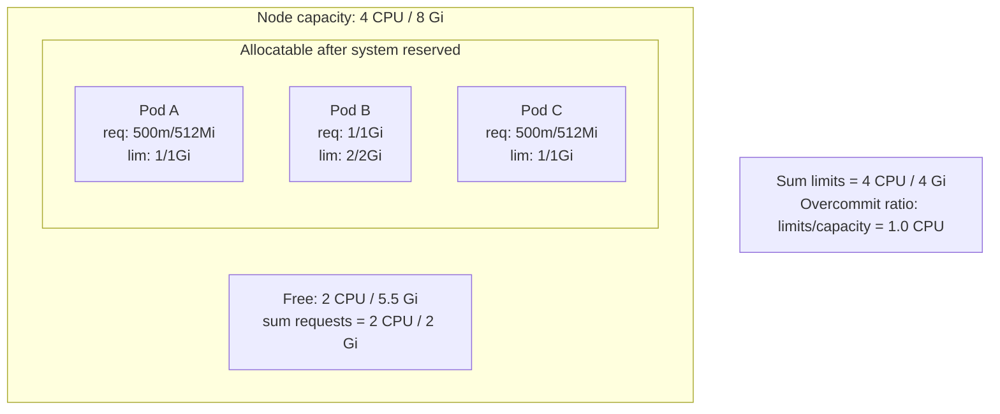
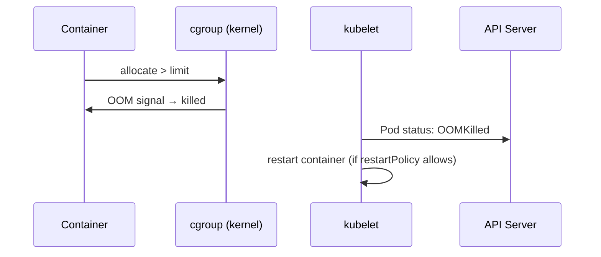

# 📘 Topic 16 — Resource Requests and Limits

**Official Documentation Reference**
- Resource management: https://kubernetes.io/docs/concepts/configuration/manage-resources-containers/
- Assign memory: https://kubernetes.io/docs/tasks/configure-pod-container/assign-memory-resource/
- Assign CPU: https://kubernetes.io/docs/tasks/configure-pod-container/assign-cpu-resource/
- QoS classes: https://kubernetes.io/docs/tasks/configure-pod-container/quality-service-pod/
- LimitRange: https://kubernetes.io/docs/concepts/policy/limit-range/
- ResourceQuota: https://kubernetes.io/docs/concepts/policy/resource-quotas/
- GKE resource management: https://cloud.google.com/kubernetes-engine/docs/concepts/autopilot-resource-requests
- EKS Fargate resources: https://docs.aws.amazon.com/eks/latest/userguide/fargate-pod-configuration.html

---

## 🔹 Definition
**Requests** declare the minimum CPU/memory a container needs (used for scheduling). **Limits** declare the maximum a container may use (enforced at runtime). Together they drive scheduling, QoS class, and resource isolation.

---

## 🔹 About

### Units
| Resource | Unit | Example |
|---|---|---|
| CPU | millicores | `100m` = 0.1 vCPU; `1` = 1 vCPU |
| Memory | bytes | `128Mi` (mebibytes), `1Gi` (gibibytes) |
| Ephemeral storage | bytes | `500Mi` |

### Requests vs Limits
| Property | Request | Limit |
|---|---|---|
| Purpose | Scheduling guarantee | Runtime ceiling |
| Scheduler uses | Yes — pod fits on a node only if `allocatable - sum(requests)` ≥ this pod's request | No |
| Enforced by kernel | CPU: no hard cap (CFS shares) | CPU: CFS quota throttling; Memory: OOM-killed if exceeded |
| Default if omitted | 0 (BestEffort) | Unlimited |

### QoS (Quality of Service) classes
| Class | Condition | Eviction priority |
|---|---|---|
| **Guaranteed** | All containers have `requests == limits` for CPU **and** memory | Last to evict |
| **Burstable** | At least one container has a request set, but not all match limits | Middle |
| **BestEffort** | No requests or limits at all | First to evict |

### LimitRange (per namespace defaults/constraints)
Forces containers to get default requests/limits if none specified, and caps maximums.

### ResourceQuota (per namespace totals)
Caps aggregate resources consumed by all pods/PVCs in a namespace: total CPU requests, total memory limits, total PVC count, etc.

### Overcommit and the bin-packing trap
- Requests can be < limits → node can be "overcommitted" (sum of limits > capacity).
- Under pressure, the kernel OOM-kills containers that exceeded limits, and kubelet evicts pods above requests that don't fit in memory.
- Production rule of thumb: set requests to P50 usage, limits to P99 + headroom.

### CPU throttling
When a container hits its CPU limit, the kernel's CFS (Completely Fair Scheduler) throttles it — the container pauses mid-cycle. Visible as high `container_cpu_cfs_throttled_seconds_total` in Prometheus.

---

## 🔹 How It Integrates With Other Kubernetes Components
| Component | Interaction |
|---|---|
| Scheduler | Uses requests for fit/score (NodeResourcesFit, NodeResourcesBalancedAllocation) |
| kubelet | Enforces limits via cgroups (v1 or v2) |
| HPA | Scales based on utilization = actual / request |
| VPA | Recommends request/limit values |
| LimitRange | Admission defaulting/capping |
| ResourceQuota | Admission rejecting if quota exceeded |
| PriorityClass | Higher-priority pods can preempt lower ones when resources are scarce |

---

## 🏗️ Diagrams

### How requests vs limits map to the node


### OOM sequence


---

## 💻 Real-World Examples

### Example 1 — Deployment with proper resources
```yaml
apiVersion: apps/v1
kind: Deployment
metadata: { name: api }
spec:
  replicas: 3
  selector: { matchLabels: { app: api } }
  template:
    metadata: { labels: { app: api } }
    spec:
      containers:
      - name: api
        image: myrepo/api:2.0
        resources:
          requests: { cpu: 250m, memory: 256Mi }
          limits:   { cpu: 1,    memory: 512Mi }
```

### Example 2 — LimitRange defaults
```yaml
apiVersion: v1
kind: LimitRange
metadata: { name: defaults, namespace: dev }
spec:
  limits:
  - type: Container
    default:        { cpu: 500m, memory: 256Mi }      # default limit
    defaultRequest: { cpu: 100m, memory: 128Mi }      # default request
    max:            { cpu: 2,    memory: 2Gi }
    min:            { cpu: 50m,  memory: 64Mi }
```

### Example 3 — ResourceQuota
```yaml
apiVersion: v1
kind: ResourceQuota
metadata: { name: team-quota, namespace: dev }
spec:
  hard:
    requests.cpu: "8"
    requests.memory: 16Gi
    limits.cpu: "16"
    limits.memory: 32Gi
    pods: "40"
    persistentvolumeclaims: "10"
```
```bash
kubectl describe quota team-quota -n dev
```

### Example 4 — Guaranteed QoS
```yaml
resources:
  requests: { cpu: 500m, memory: 512Mi }
  limits:   { cpu: 500m, memory: 512Mi }    # requests == limits
```

---

## 💻 Related Commands

| Command | Flag | Purpose | Example |
|---|---|---|---|
| `kubectl top pod` | `--containers` | Live CPU/mem | `kubectl top pod -n prod --containers` |
| `kubectl top node` | — | Node CPU/mem | `kubectl top node` |
| `kubectl describe node` | — | Allocatable, requests/limits totals | `kubectl describe node worker-1` |
| `kubectl describe pod` | — | See QoS, resource fields | `kubectl describe pod api-0` |
| `kubectl set resources` | `deploy/<n> -c <c> --requests=... --limits=...` | Patch resources | `kubectl set resources deploy/api -c api --requests=cpu=200m,memory=256Mi --limits=cpu=1,memory=512Mi` |
| `kubectl describe quota` | `-n <ns>` | Check quota usage | `kubectl describe quota team-quota -n dev` |
| `kubectl describe limitrange` | `-n <ns>` | Check defaults | `kubectl describe limitrange defaults -n dev` |
| `kubectl get pod -o jsonpath` | `'{.spec.containers[*].resources}'` | Extract resources | `kubectl get pod api-0 -o jsonpath='{.spec.containers[*].resources}'` |

---

## 🚨 Scenarios

### Scenario 1 — Pod stuck Pending: "Insufficient cpu"
- **Cause**: sum of existing requests + this pod's request exceeds node allocatable.
- **Fix**: add nodes, reduce requests, or delete idle workloads.

### Scenario 2 — Container OOMKilled repeatedly
- **Cause**: memory limit too low or memory leak.
- **Diagnose**: `kubectl describe pod` → `Last State: Terminated, Reason: OOMKilled`. `kubectl top pod --containers`.
- **Fix**: raise limit (after confirming leak isn't the issue), or fix app leak.

### Scenario 3 — API latency spikes at high load
- **Cause**: CPU throttling — `container_cpu_cfs_throttled_seconds_total` is high.
- **Fix**: raise CPU limit, or remove CPU limit entirely (set request only) and rely on CFS shares. This is a valid production pattern if nodes aren't contended.

### Scenario 4 — ResourceQuota blocks new deploys
- **Cause**: quota exhausted.
- **Fix**: `kubectl describe quota` → identify used vs hard. Right-size existing workloads or increase quota.

### Scenario 5 — VPA recommends lower requests but dev won't accept
- **Cause**: cultural inertia — "better safe than sorry".
- **Fix**: show Prometheus data for P99 usage. Start VPA in `Off` mode (recommend only), apply gradually.

---

## ☁️ GCP GKE Perspective
- **Autopilot** enforces requests on every pod. If you omit them, Autopilot applies defaults (0.5 CPU, 512 Mi). Billing is per pod-second of requested resources.
- **Autopilot** has minimum pod sizes: 0.25 vCPU, 512 Mi memory.
- **Standard** has no enforcement by default; use LimitRange.
- **GKE Managed Prometheus** scrapes `container_cpu_cfs_throttled_*` automatically.
- **GKE VPA** recommendation is built-in: enable in `gcloud container clusters update`.

## 🟧 AWS EKS Perspective
- **Fargate** rounds up pod resource requests to nearest Fargate configuration (e.g., 0.25/0.5/1/2/4 vCPU with memory buckets). Always set requests explicitly.
- **Managed NG**: no enforcement by default; use LimitRange + ResourceQuota.
- **CloudWatch Container Insights** exposes `pod_cpu_utilization`, `pod_memory_utilization` for right-sizing.
- **Karpenter** uses pod resource requests to select the cheapest instance type that fits.

---

## 🧪 Hands-On Lab Exercises

### Lab 16.1 — Trigger OOMKill and throttling (Beginner, 30 min)
**Steps**
```yaml
# oom.yaml
apiVersion: v1
kind: Pod
metadata: { name: oom }
spec:
  containers:
  - name: stress
    image: polinux/stress
    resources:
      requests: { memory: 50Mi, cpu: 100m }
      limits:   { memory: 100Mi, cpu: 200m }
    command: ["stress","--vm","1","--vm-bytes","250M","--vm-hang","1"]
```
```bash
kubectl apply -f oom.yaml
kubectl get pod oom -w                # OOMKilled → CrashLoopBackOff
kubectl describe pod oom | grep -A3 "Last State"
```
**Cleanup**: `kubectl delete pod oom`.

**Bonus**: Set `--vm-bytes 80M` → pod runs fine; confirm with `kubectl top pod oom`.

### Lab 16.2 — LimitRange + ResourceQuota enforcement (Intermediate, 45 min)
**Steps**
1. Create namespace `lab16`: `kubectl create ns lab16`.
2. Apply LimitRange (Example 2) and ResourceQuota (Example 3) to `lab16`.
3. Deploy a pod without resources → LimitRange injects defaults.
4. Deploy pods until quota exhausted → admission rejects.
5. `kubectl describe quota -n lab16` → see used vs hard.

**Cleanup**: `kubectl delete ns lab16`.

### Lab 16.3 — VPA recommendation (Advanced, 60 min)
**Steps**
1. Install VPA: `kubectl apply -f https://github.com/kubernetes/autoscaler/releases/latest/download/vpa-v1-crd-gen.yaml && kubectl apply -f https://github.com/kubernetes/autoscaler/releases/latest/download/vpa-rbac.yaml`.
2. Deploy a web app with initial `requests: {cpu: 1, memory: 1Gi}`.
3. Create VPA in `Off` mode:
```yaml
apiVersion: autoscaling.k8s.io/v1
kind: VerticalPodAutoscaler
metadata: { name: web-vpa }
spec:
  targetRef: { apiVersion: apps/v1, kind: Deployment, name: web }
  updatePolicy: { updateMode: "Off" }
```
4. Generate load with `hey -z 120s http://<svc>/`.
5. `kubectl describe vpa web-vpa` → read recommendations.
6. Apply recommended values.

**Cleanup**: delete VPA + Deployment.

---

## 🎯 Interview Deliverable Answer (60–90 s)
"**What**: Requests declare the floor a pod needs for scheduling — the scheduler ensures those resources are available on the node. Limits set the ceiling — the kernel throttles CPU and OOM-kills memory when a container exceeds them. Together they determine the pod's QoS class: Guaranteed when requests equal limits, Burstable when only requests are set, BestEffort with neither.  
**Why**: Without requests, the scheduler packs pods blindly and nodes thrash under contention. Without limits, a single runaway container can starve the node. The QoS class drives eviction priority: BestEffort dies first, Guaranteed last.  
**How**: I set requests to P50 observed usage and limits to P99 plus a 20% buffer, and validate with Prometheus metrics and VPA in Off mode before shrinking. I enforce LimitRange per namespace for defaults and ResourceQuota for team-level budgets. On GKE Autopilot requests are mandatory, and on EKS Fargate they're rounded to the nearest billing bucket — so I always specify them explicitly.  
**Example**: We reduced our cluster from 80 to 50 nodes after a right-sizing sprint — VPA showed most services were requesting 4× their P99. Savings: ~$12K/month."

---

## ❓ Possible Interview Questions

### Basic
**Q1. Request vs limit?** Request = scheduling guarantee; limit = runtime cap.  
**Q2. What happens when memory exceeds the limit?** OOMKilled by the kernel.  
**Q3. CPU unit `250m` means?** 0.25 vCPU (one quarter of a core).

### Intermediate
**Q4. Name the three QoS classes.** Guaranteed, Burstable, BestEffort.  
**Q5. What is CPU throttling?** CFS quota restricts a container's CPU cycles per period; visible as high `container_cpu_cfs_throttled_seconds_total`.  
**Q6. What does a LimitRange do?** Sets per-container default requests/limits, min/max constraints, and per-PVC min/max in a namespace.

### Advanced
**Q7. Should you always set CPU limits?** Debated. Setting limits prevents runaway but causes throttling even when the node has free CPU. Some teams set requests only (rely on CFS shares). Google's guidance for Autopilot: limits required.  
**Q8. How does the scheduler use requests?** Two phases — filtering nodes where `allocatable - existingRequests >= podRequests`, then scoring nodes by resource balance.  
**Q9. Explain eviction order under memory pressure.** BestEffort first, then Burstable (by how far they exceed request), then Guaranteed (only if system reserved is at risk).

### Scenario-based
**Q10. Cluster is 90% allocated but `kubectl top` shows 30% actual usage — what's wrong?** Over-requested. Requests are high relative to actual. Right-size with VPA; reclaim with Cluster Autoscaler scale-down.

### GKE-specific
**Q11. What are Autopilot's minimum pod resources?** 0.25 vCPU, 512 Mi memory (as of 2024+). Smaller requests are rounded up.

### EKS-specific
**Q12. Why does Fargate sometimes bill more than expected?** It rounds to the nearest Fargate pod size (0.25/0.5/1/2/4 CPU). A pod requesting 0.3 vCPU is billed at 0.5 vCPU.

### Hands-on / Lab-based
**Q13. How would you observe CPU throttling?** Query Prometheus: `rate(container_cpu_cfs_throttled_seconds_total[5m])`.  
**Q14. Show me how VPA works.** Deploy app, create VPA in Off mode, generate load, `kubectl describe vpa` → read `Lower Bound / Target / Upper Bound` recommendations.  
**Q15. How would you prevent a team from deploying without resource requests?** ResourceQuota with `requests.cpu` set → admission rejects pods without requests. Or Kyverno/OPA policy explicitly validating the field.

