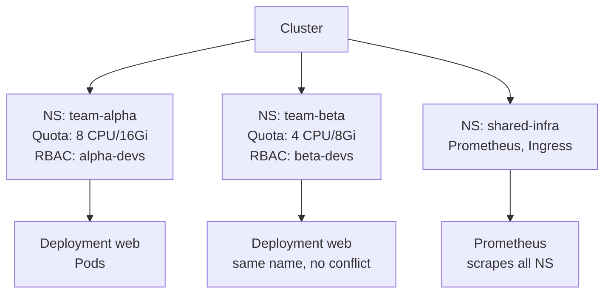
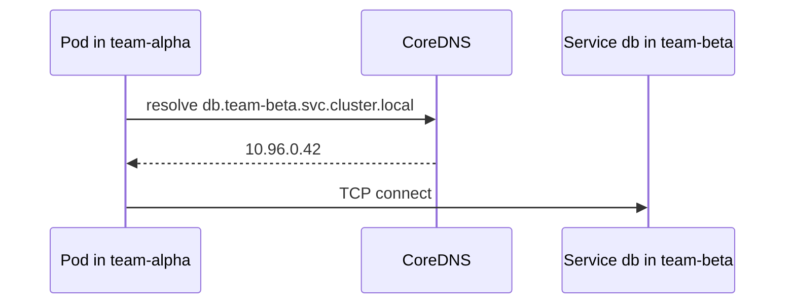

# 📘 Topic 17 — Namespaces

**Official Documentation Reference**
- Namespaces: https://kubernetes.io/docs/concepts/overview/working-with-objects/namespaces/
- Share a cluster with namespaces: https://kubernetes.io/docs/tasks/administer-cluster/namespaces/
- Namespaces walkthrough: https://kubernetes.io/docs/tutorials/cluster-management/namespaces-walkthrough/
- GKE team-based multi-tenancy: https://cloud.google.com/kubernetes-engine/docs/concepts/multitenancy-overview
- EKS multi-tenancy: https://docs.aws.amazon.com/eks/latest/best-practices/multi-tenancy.html

---

## 🔹 Definition
A **Namespace** is a virtual cluster inside a physical Kubernetes cluster. It provides a scope for names, RBAC, resource quotas, network policies, and limit ranges — enabling multi-tenancy on a single cluster.

---

## 🔹 About

### Default namespaces
| Namespace | Purpose |
|---|---|
| `default` | Where objects land when no namespace is given |
| `kube-system` | Control-plane + cluster-critical add-ons |
| `kube-public` | Publicly readable (cluster-info ConfigMap) |
| `kube-node-lease` | Node heartbeat Lease objects |

### Namespaced vs cluster-scoped resources
| Namespaced | Cluster-scoped |
|---|---|
| Pod, Service, Deployment, ConfigMap, Secret, PVC, Role, RoleBinding, Ingress, NetworkPolicy | Node, PV, ClusterRole, ClusterRoleBinding, Namespace, StorageClass, IngressClass, PriorityClass, CRD |

Check with: `kubectl api-resources --namespaced=true/false`.

### What namespaces give you
- **Name isolation** — two Deployments named `web` can coexist in different namespaces.
- **RBAC scoping** — Roles and RoleBindings are namespace-scoped.
- **Resource quotas** — cap CPU, memory, pod count per namespace.
- **LimitRange** — per-container default resources.
- **Network policies** — namespace-level traffic rules.
- **Service DNS** — `svc.ns.svc.cluster.local`.

### What namespaces do NOT do
- They are **not** a security boundary — pods in different namespaces can still reach each other by default (until NetworkPolicy is enforced).
- They do **not** isolate workloads at the kernel level (that's what node isolation, sandboxing, or separate clusters do).

### Naming conventions
Common patterns: `team-<name>`, `env-<name>` (prod/stg/dev), `app-<name>`.

---

## 🔹 How It Integrates With Other Kubernetes Components
| Component | Interaction |
|---|---|
| RBAC (Role/RoleBinding) | Scoped per namespace |
| ResourceQuota | Enforces per-NS limits |
| LimitRange | Defaults per NS |
| NetworkPolicy | `namespaceSelector` gates cross-NS traffic |
| Service DNS | `<svc>.<ns>.svc.cluster.local` |
| Kyverno/OPA | Policies can target specific namespaces |
| Admission (PSA) | `pod-security.kubernetes.io/*` labels set per NS |

---

## 🏗️ Diagrams

### Multi-tenant namespace layout


### Cross-namespace DNS


---

## 💻 Real-World Examples

### Example 1 — Create and use
```bash
kubectl create namespace staging
kubectl run web --image=nginx --namespace=staging
kubectl get pods -n staging
kubectl config set-context --current --namespace=staging
```

### Example 2 — Full tenant namespace setup
```yaml
# 1. Namespace
apiVersion: v1
kind: Namespace
metadata:
  name: team-alpha
  labels:
    pod-security.kubernetes.io/enforce: restricted
    team: alpha
---
# 2. ResourceQuota
apiVersion: v1
kind: ResourceQuota
metadata: { name: quota, namespace: team-alpha }
spec:
  hard:
    requests.cpu: "8"
    requests.memory: 16Gi
    limits.cpu: "16"
    limits.memory: 32Gi
    pods: "50"
---
# 3. LimitRange
apiVersion: v1
kind: LimitRange
metadata: { name: defaults, namespace: team-alpha }
spec:
  limits:
  - type: Container
    default:        { cpu: 500m, memory: 256Mi }
    defaultRequest: { cpu: 100m, memory: 128Mi }
---
# 4. RBAC
apiVersion: rbac.authorization.k8s.io/v1
kind: RoleBinding
metadata: { name: alpha-devs, namespace: team-alpha }
subjects:
- { kind: Group, name: alpha-devs, apiGroup: rbac.authorization.k8s.io }
roleRef: { kind: ClusterRole, name: edit, apiGroup: rbac.authorization.k8s.io }
---
# 5. NetworkPolicy — deny all ingress by default
apiVersion: networking.k8s.io/v1
kind: NetworkPolicy
metadata: { name: deny-all, namespace: team-alpha }
spec:
  podSelector: {}
  policyTypes: [Ingress]
```

### Example 3 — kubens for fast switching
```bash
kubens team-alpha     # all kubectl commands now target team-alpha
kubens -              # switch back
```

---

## 💻 Related Commands

| Command | Flag | Purpose | Example |
|---|---|---|---|
| `kubectl create ns` | — | Create | `kubectl create ns staging` |
| `kubectl get ns` | — | List | `kubectl get ns` |
| `kubectl delete ns` | — | Delete (cascades all objects inside!) | `kubectl delete ns staging` |
| `kubectl get all` | `-n <ns>` | List core objects | `kubectl get all -n kube-system` |
| `kubectl get pods` | `-A` | All namespaces | `kubectl get pods -A` |
| `kubectl config set-context` | `--current --namespace=<ns>` | Change default NS | `kubectl config set-context --current --namespace=prod` |
| `kubens` | `<ns>` | Fast switch | `kubens prod` |
| `kubectl api-resources` | `--namespaced=true` | List NS-scoped kinds | `kubectl api-resources --namespaced=true` |
| `kubectl describe quota` | `-n <ns>` | Check usage | `kubectl describe quota -n team-alpha` |
| `kubectl label ns` | `key=val` | Add labels (PSA etc) | `kubectl label ns team-alpha pod-security.kubernetes.io/enforce=restricted` |

---

## 🚨 Scenarios

### Scenario 1 — Accidentally deleted a namespace
- **Impact**: all objects inside are deleted (pods, services, secrets, PVCs).
- **Fix**: restore from backup (Velero / Backup for GKE). Prevention: restrict `delete namespaces` RBAC; add finalizers or Kyverno policies.

### Scenario 2 — Namespace stuck in `Terminating`
- **Cause**: a finalizer on an object inside is never cleared (often CRDs or stuck PVCs).
- **Fix**: identify stuck finalizers: `kubectl get all,pvc,crd -n <ns>`. Patch the object to remove the finalizer. As a last resort: `kubectl get ns <ns> -o json | jq '.spec.finalizers=[]' | kubectl replace --raw "/api/v1/namespaces/<ns>/finalize" -f -`.

### Scenario 3 — Service in NS-A can't reach DB in NS-B
- **Cause**: NetworkPolicy in NS-B blocks cross-NS ingress, or DNS name is wrong.
- **Fix**: Allow from NS-A via `namespaceSelector` in NetworkPolicy, and use FQDN: `db.ns-b.svc.cluster.local`.

### Scenario 4 — Team exhausted their quota
- **Cause**: deploying without monitoring quota.
- **Fix**: `kubectl describe quota -n team-x`. Right-size workloads or increase quota after review.

---

## ☁️ GCP GKE Perspective
- **GKE Enterprise** provides **Policy Controller** (OPA Gatekeeper) to enforce namespace labels, quota presence, and naming.
- **Config Sync** can reconcile namespace YAML from Git across fleet clusters.
- **Autopilot** charges per pod-second; namespaces don't affect billing — just organizational.
- **Hierarchical Namespaces Controller (HNC)** — propagate Roles, NetworkPolicies from parent NS to children (mature on GKE).

## 🟧 AWS EKS Perspective
- **EKS Blueprints** ships opinionated "team" namespaces with quota, LimitRange, RBAC, and ArgoCD AppProjects.
- **Fargate profiles** bind to one or more namespaces/labels — a Fargate profile `selector: [{namespace: team-alpha}]` runs only pods in `team-alpha`.
- **AWS RAM** + multiple EKS clusters is the alternative when namespace isolation is insufficient for compliance.

---

## 🧪 Hands-On Lab Exercises

### Lab 17.1 — Namespace + quota + LimitRange (Beginner, 30 min)
**Steps**
1. `kubectl create ns lab17`.
2. Apply ResourceQuota (hard.pods: 5) and LimitRange from Example 2.
3. Deploy 6 replicas → 5th succeeds, 6th rejected by quota.
4. `kubectl describe quota -n lab17`.

**Cleanup**: `kubectl delete ns lab17`.

### Lab 17.2 — Cross-namespace networking + NetworkPolicy (Intermediate, 45 min)
**Steps**
1. Create `ns-a`, `ns-b`.
2. Deploy `web` in `ns-a` and `db` in `ns-b` (nginx for demo).
3. From `ns-a` pod: `curl db.ns-b.svc.cluster.local` → works.
4. Apply `deny-all` ingress NetworkPolicy in `ns-b`.
5. Retry curl → timeout.
6. Add allow rule with `namespaceSelector: {matchLabels: {team: alpha}}` and label `ns-a` → works again.

**Cleanup**: `kubectl delete ns ns-a ns-b`.

### Lab 17.3 — Stuck Terminating namespace rescue (Advanced, 30 min)
**Steps**
1. `kubectl create ns stuck`.
2. Apply a custom CRD + CR with a finalizer in `stuck`.
3. `kubectl delete ns stuck` → hangs in Terminating.
4. Identify stuck object: `kubectl get all -n stuck`.
5. Patch finalizer: `kubectl patch <obj> -n stuck -p '{"metadata":{"finalizers":[]}}' --type=merge`.
6. Namespace terminates.

**Bonus**: Investigate the `replace --raw finalize` escape hatch.

---

## 🎯 Interview Deliverable Answer (60–90 s)
"**What**: A Namespace is a virtual cluster partition inside one physical Kubernetes cluster. It scopes object names, RBAC, resource quotas, limit ranges, network policies, and Pod Security Standards.  
**Why**: On a shared cluster, namespaces are how we enforce soft multi-tenancy — each team gets its own namespace with a budget (ResourceQuota), guardrails (LimitRange, NetworkPolicy), and least-privilege access (RoleBinding). Service DNS is namespace-aware, so teams can both name their services 'web' without conflict.  
**How**: I provision each team's namespace as a bundle: Namespace + ResourceQuota + LimitRange + RoleBinding + default-deny NetworkPolicy + PSA label. I enforce this with Config Sync on GKE or ArgoCD on EKS so every namespace is Git-managed. Cross-namespace traffic is explicit — allowed only by NetworkPolicy rules with namespaceSelector.  
**Example**: When our platform grew from 2 to 8 teams, we replaced separate clusters with one large GKE Standard cluster, one namespace per team, each with its own quota. Savings were ~40% — instead of 8 idle control planes, we had one, with full RBAC isolation."

---

## ❓ Possible Interview Questions

### Basic
**Q1. What is a namespace?** Virtual cluster partition scoping names, RBAC, quotas, and policies.  
**Q2. Name the four default namespaces.** `default`, `kube-system`, `kube-public`, `kube-node-lease`.  
**Q3. Are nodes namespaced?** No — they are cluster-scoped.

### Intermediate
**Q4. How does namespace isolation differ from network isolation?** Namespaces only scope API objects. Pods in different namespaces can still network freely unless NetworkPolicy enforces isolation.  
**Q5. How do you set the default namespace for kubectl?** `kubectl config set-context --current --namespace=<n>` or `kubens <n>`.  
**Q6. What is PSA per namespace?** Labels like `pod-security.kubernetes.io/enforce: restricted` activate Pod Security Admission at the namespace level.

### Advanced
**Q7. How do you prevent accidental namespace deletion?** Restrict `delete` verb on `namespaces` via RBAC; add a Kyverno policy blocking deletion if pods exist; or use a finalizer.  
**Q8. What is HNC?** Hierarchical Namespace Controller — lets a parent namespace propagate Roles, NetworkPolicies, Secrets down to child namespaces.  
**Q9. Namespace stuck Terminating — what's happening?** An object inside has a finalizer that was never removed. Find it, clear the finalizer, and the namespace controller completes deletion.

### Scenario-based
**Q10. Two teams share a cluster but one team's batch jobs starve the other — fix?** ResourceQuota per namespace caps total requests; PriorityClass to preempt low-priority batch; separate node pools with taints per team.

### GKE-specific
**Q11. How do Fargate profiles relate to namespaces on EKS?** A Fargate profile selector binds to a namespace + optional labels; pods matching run on Fargate, others on managed NG.

### EKS-specific
**Q12. How does GKE Config Sync help namespace management?** It reconciles namespace manifests from a Git repo across a fleet of GKE clusters — any drift is corrected automatically.

### Hands-on / Lab-based
**Q13. Show me cross-namespace DNS.** From a pod in `ns-a`: `nslookup db.ns-b.svc.cluster.local` resolves to the ClusterIP.  
**Q14. How would you carve up a cluster for 5 teams?** 5 namespaces, each with quota + LimitRange + RoleBinding + NetworkPolicy + PSA label, provisioned from Git.  
**Q15. How do you list all resources in a namespace?** `kubectl api-resources --verbs=list --namespaced -o name | xargs -n1 kubectl get -n <ns> --ignore-not-found`.

