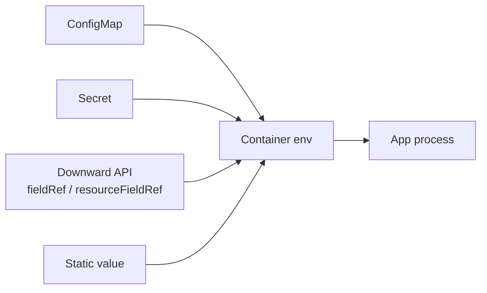
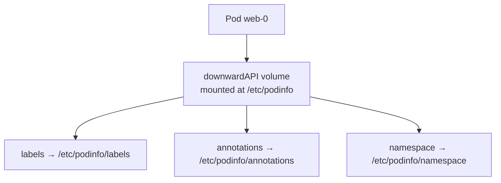

# 📘 Topic 18 — Environment Variables and Downward API

**Official Documentation Reference**
- Define env: https://kubernetes.io/docs/tasks/inject-data-application/define-environment-variable-container/
- Dependent env vars: https://kubernetes.io/docs/tasks/inject-data-application/define-interdependent-environment-variables/
- Downward API (env): https://kubernetes.io/docs/tasks/inject-data-application/environment-variable-expose-pod-information/
- Downward API (volume): https://kubernetes.io/docs/tasks/inject-data-application/downward-api-volume-expose-pod-information/
- Downward API concept: https://kubernetes.io/docs/concepts/workloads/pods/downward-api/
- GKE workload config: https://cloud.google.com/kubernetes-engine/docs/how-to/configuring-workloads
- EKS env vars: https://docs.aws.amazon.com/eks/latest/userguide/workloads.html

---

## 🔹 Definition
**Environment variables** in Kubernetes inject configuration into containers at startup. The **Downward API** is a mechanism that exposes pod and container metadata — name, namespace, labels, annotations, resource requests/limits, node name — as environment variables or files, without calling the API server.

---

## 🔹 About

### Ways to set env vars
| Source | Field | Example |
|---|---|---|
| Static literal | `env[].value` | `DB_HOST: postgres` |
| ConfigMap key | `env[].valueFrom.configMapKeyRef` | one key from a CM |
| Secret key | `env[].valueFrom.secretKeyRef` | one key from a Secret |
| All ConfigMap keys | `envFrom[].configMapRef` | bulk import |
| All Secret keys | `envFrom[].secretRef` | bulk import |
| Downward API (pod field) | `env[].valueFrom.fieldRef` | `metadata.name`, `metadata.namespace`, `spec.nodeName` |
| Downward API (resource) | `env[].valueFrom.resourceFieldRef` | `requests.cpu`, `limits.memory` |
| Dependent interpolation | `$(VAR)` in `value` | `URL: http://$(DB_HOST):5432` |

### Available downward API fields
**Via `fieldRef.fieldPath`**
- `metadata.name` — pod name
- `metadata.namespace` — pod namespace
- `metadata.uid` — pod UID
- `metadata.labels['key']` — specific label
- `metadata.annotations['key']` — specific annotation
- `spec.nodeName` — node name
- `spec.serviceAccountName` — SA name
- `status.podIP` — pod IP
- `status.hostIP` — node IP

**Via `resourceFieldRef`**
- `requests.cpu`, `limits.cpu`, `requests.memory`, `limits.memory`, `requests.ephemeral-storage`, `limits.ephemeral-storage`

### Volume-based Downward API
Mount all labels/annotations/fields as files under a directory. Files update live (unlike env vars).

### Limitations
- Env vars are set at container start and never refreshed.
- Env vars from ConfigMaps/Secrets are snapshots. For live updates, use volume mounts.
- Env var name collisions: last source wins (order matters).
- `envFrom` skips keys that aren't valid env-var names (e.g., containing dots).

---

## 🔹 How It Integrates With Other Kubernetes Components
| Component | Interaction |
|---|---|
| ConfigMap / Secret | Most common env sources |
| Downward API | Injects pod/container metadata |
| kubelet | Resolves `fieldRef` at pod start |
| Init containers / sidecars | Same env mechanisms |
| HPA custom metrics | App exporting its own pod-name label for Prometheus |
| Logging | `HOSTNAME` / `POD_NAME` env vars enrich log lines |

---

## 🏗️ Diagrams

### Env var resolution flow


### Downward API volume


---

## 💻 Real-World Examples

### Example 1 — All env var sources in one pod
```yaml
apiVersion: v1
kind: Pod
metadata:
  name: env-demo
  labels: { app: demo, version: "2.0" }
  annotations: { owner: team-alpha }
spec:
  containers:
  - name: app
    image: busybox
    command: ["sh","-c","env | sort; sleep 3600"]
    env:
    # static
    - { name: APP_ENV, value: production }
    # from ConfigMap key
    - name: LOG_LEVEL
      valueFrom: { configMapKeyRef: { name: app-config, key: LOG_LEVEL } }
    # from Secret key
    - name: DB_PASSWORD
      valueFrom: { secretKeyRef: { name: db-cred, key: PASSWORD } }
    # Downward API — pod fields
    - name: POD_NAME
      valueFrom: { fieldRef: { fieldPath: metadata.name } }
    - name: POD_NAMESPACE
      valueFrom: { fieldRef: { fieldPath: metadata.namespace } }
    - name: NODE_NAME
      valueFrom: { fieldRef: { fieldPath: spec.nodeName } }
    - name: POD_IP
      valueFrom: { fieldRef: { fieldPath: status.podIP } }
    # Downward API — resources
    - name: CPU_LIMIT
      valueFrom: { resourceFieldRef: { containerName: app, resource: limits.cpu } }
    - name: MEM_REQUEST
      valueFrom: { resourceFieldRef: { containerName: app, resource: requests.memory, divisor: "1Mi" } }
    # dependent
    - { name: DB_HOST, value: postgres.default.svc }
    - name: DB_URL
      value: "postgres://app:$(DB_PASSWORD)@$(DB_HOST):5432/prod"
    resources:
      requests: { cpu: 250m, memory: 128Mi }
      limits:   { cpu: 500m, memory: 256Mi }
```

### Example 2 — Downward API volume
```yaml
apiVersion: v1
kind: Pod
metadata:
  name: dw-vol
  labels: { app: web, version: "3" }
  annotations: { owner: team-alpha }
spec:
  containers:
  - name: app
    image: busybox
    command: ["sh","-c","cat /etc/podinfo/labels; sleep 3600"]
    volumeMounts:
    - { name: podinfo, mountPath: /etc/podinfo }
  volumes:
  - name: podinfo
    downwardAPI:
      items:
      - { path: labels,      fieldRef: { fieldPath: metadata.labels } }
      - { path: annotations,  fieldRef: { fieldPath: metadata.annotations } }
      - { path: namespace,    fieldRef: { fieldPath: metadata.namespace } }
      - { path: cpu-request,  resourceFieldRef: { containerName: app, resource: requests.cpu, divisor: "1m" } }
```

### Example 3 — envFrom bulk import
```yaml
envFrom:
- configMapRef: { name: app-config }
- secretRef:    { name: db-cred }
- prefix: CFG_                        # add prefix to all imported keys
  configMapRef: { name: app-config }
```

---

## 💻 Related Commands

| Command | Flag | Purpose | Example |
|---|---|---|---|
| `kubectl set env` | `deploy/<n> K=V` | Set static env → triggers rollout | `kubectl set env deploy/web LOG=debug` |
| `kubectl set env` | `--from=configmap/<n>` | Bulk set from CM | `kubectl set env deploy/web --from=configmap/app-config` |
| `kubectl set env` | `--list` | Show env vars of a pod template | `kubectl set env deploy/web --list` |
| `kubectl exec` | `-- env` | Print runtime env | `kubectl exec web-0 -- env | sort` |
| `kubectl exec` | `-- printenv VAR` | Read one var | `kubectl exec web-0 -- printenv POD_NAME` |
| `kubectl describe pod` | — | See env section | `kubectl describe pod web-0` |

---

## 🚨 Scenarios

### Scenario 1 — Env var from ConfigMap is stale
- **Cause**: env vars are snapshots at container start.
- **Fix**: `kubectl rollout restart deploy/<n>` or switch to volume mount + file watcher.

### Scenario 2 — `envFrom` silently skips keys
- **Cause**: key contains invalid env var chars (e.g., `my.key` with a dot).
- **Fix**: rename the key or use volume mount.

### Scenario 3 — Dependent env var is empty
- **Cause**: `$(DB_PASSWORD)` references a var that appears later in the list (ordering matters).
- **Fix**: place the source var before the dependent var in the `env` array.

### Scenario 4 — App doesn't see `POD_IP` at startup
- **Cause**: (rare) IP not assigned yet. This is resolved for almost all modern runtimes.
- **Fix**: if needed, use Downward API volume (file-based) which can update.

---

## ☁️ GCP GKE Perspective
- **Autopilot** injects `requests.cpu` / `limits.memory` automatically if not set. The Downward API `resourceFieldRef` reflects the actual (possibly adjusted) values.
- **Workload Identity env vars**: the `GKE_METADATA_SERVER` and projected SA token are managed by GKE — no manual env needed.
- **Config Connector**: CRDs that provision GCP resources; their status can feed back as ConfigMap env vars.

## 🟧 AWS EKS Perspective
- **IRSA** auto-injects `AWS_WEB_IDENTITY_TOKEN_FILE` and `AWS_ROLE_ARN` into pods with annotated SAs — no manual env.
- **Pod Identity** similarly injects `AWS_CONTAINER_CREDENTIALS_FULL_URI`.
- **Fargate**: Downward API works normally, including `spec.nodeName` (which shows the fargate-node name).

---

## 🧪 Hands-On Lab Exercises

### Lab 18.1 — Explore all env var sources (Beginner, 30 min)
**Steps**
1. Create ConfigMap `app-config` and Secret `db-cred`.
2. Apply Example 1 pod.
3. `kubectl logs env-demo | sort` → see every resolved env var.
4. `kubectl exec env-demo -- printenv DB_URL` → verify interpolated URL.

**Cleanup**: `kubectl delete pod env-demo && kubectl delete cm app-config && kubectl delete secret db-cred`.

**Bonus**: Change `LOG_LEVEL` in the ConfigMap; verify `env-demo` still shows old value (snapshot).

### Lab 18.2 — Downward API volume with live labels (Intermediate, 45 min)
**Steps**
1. Apply Example 2 pod.
2. `kubectl exec dw-vol -- cat /etc/podinfo/labels` → `app=web, version=3`.
3. `kubectl label pod dw-vol canary=true`.
4. Wait ~60 s, then `kubectl exec dw-vol -- cat /etc/podinfo/labels` → `canary=true` appears.
5. `kubectl exec dw-vol -- cat /etc/podinfo/cpu-request` → see millicores.

**Cleanup**: `kubectl delete pod dw-vol`.

**Bonus**: Compare this to env-based Downward API — label the pod, observe that `POD_LABEL_CANARY` env var doesn't exist (env vars are fixed at start).

### Lab 18.3 — Self-registering app using Downward API (Advanced, 60 min)
**Objective**: App reads its own pod name, namespace, IP, and resource limits to register with a service registry or tag its Prometheus metrics.

**Steps**
1. Write a tiny Python HTTP server that prints all `POD_*` env vars as JSON.
2. Dockerfile + deploy.
3. Set Downward API env vars: `POD_NAME`, `POD_NAMESPACE`, `POD_IP`, `CPU_LIMIT`, `MEM_LIMIT`.
4. Scale to 5 replicas; curl each pod's `http://<pod-ip>:8080/info`.
5. Verify each reports unique name/IP but same resource limits.

**Bonus**: Feed these into a Prometheus counter label via `OTEL_RESOURCE_ATTRIBUTES=k8s.pod.name=$(POD_NAME)`.

---

## 🎯 Interview Deliverable Answer (60–90 s)
"**What**: Environment variables are the main way to inject configuration into a Kubernetes container at startup. Sources include static values, ConfigMaps, Secrets, and the Downward API — which exposes pod metadata like pod name, namespace, node name, labels, annotations, and resource requests/limits without calling the API server.  
**Why**: The twelve-factor pattern says config belongs in the environment. Kubernetes takes it further with `envFrom` for bulk imports, `$(VAR)` interpolation for building URLs, and the Downward API so the app knows its own identity for logging, metrics, and service registration — all declaratively, no code changes.  
**How**: For simple key-values I use `envFrom` pointing to a ConfigMap. For sensitive data, `secretKeyRef`. For self-awareness — pod name, IP, resource limits — I use Downward API `fieldRef` and `resourceFieldRef`. When I need live-updating metadata (like labels changing after start), I use a Downward API volume mount, not env.  
**Example**: On our tracing setup, every pod exports `OTEL_RESOURCE_ATTRIBUTES` built from `POD_NAME`, `POD_NAMESPACE`, and `NODE_NAME` via Downward API, so traces carry Kubernetes context without the app importing any K8s library."

---

## ❓ Possible Interview Questions

### Basic
**Q1. How do you set an env var from a ConfigMap?** `env[].valueFrom.configMapKeyRef: {name: cm, key: K}`.  
**Q2. What is the Downward API?** Mechanism to expose pod/container metadata as env vars or files, without API calls.  
**Q3. Do env vars update when a ConfigMap changes?** No — they're set at container start. Need pod restart.

### Intermediate
**Q4. Name 5 fields available via `fieldRef`.** `metadata.name`, `metadata.namespace`, `status.podIP`, `spec.nodeName`, `metadata.uid`.  
**Q5. Difference between env-based and volume-based Downward API?** Env: snapshot at start. Volume: files that update live.  
**Q6. What is `$(VAR)` interpolation?** Kubernetes expands `$(VAR)` in `value` fields using previously defined env vars. Order in the `env` array matters.

### Advanced
**Q7. Why does `envFrom` skip some keys?** Keys that aren't valid POSIX env var names (contain dots, start with digits) are silently skipped. Events note the skip.  
**Q8. How do you expose resource limits to an app?** `resourceFieldRef: {resource: limits.memory, divisor: "1Mi"}` → gives the value in MiB as an integer string.  
**Q9. Can you read arbitrary API objects via Downward API?** No — only the pod's own metadata and container resource fields. For anything else, call the API server or use a sidecar.

### Scenario-based
**Q10. Your Java app ignores `-Xmx` because it reads heap from env, but the CM env var wasn't refreshed after a change. Fix?** Rollout restart to pick up the new CM value; or mount the CM as a file and configure the JVM to read it at startup.

### GKE-specific
**Q11. Does Autopilot adjust resourceFieldRef values if it rounds up pod resources?** Yes — the Downward API reflects the actual (possibly adjusted) requests/limits.

### EKS-specific
**Q12. IRSA injects env vars automatically — which ones?** `AWS_WEB_IDENTITY_TOKEN_FILE` and `AWS_ROLE_ARN`.

### Hands-on / Lab-based
**Q13. Show me how to verify Downward API is working.** `kubectl exec <pod> -- printenv POD_NAME` or `cat /etc/podinfo/labels`.  
**Q14. If you label a pod after it starts, does the env-based Downward API reflect it?** No — env is fixed. Volume-based will update within ~1 minute.  
**Q15. How would you build a connection string from multiple sources?** Use dependent env vars: `DB_URL: postgres://$(DB_USER):$(DB_PASS)@$(DB_HOST):5432/$(DB_NAME)`.

