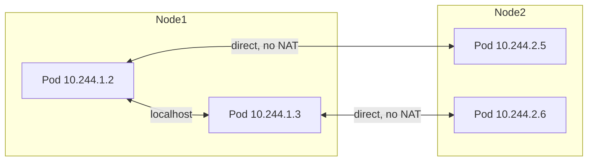
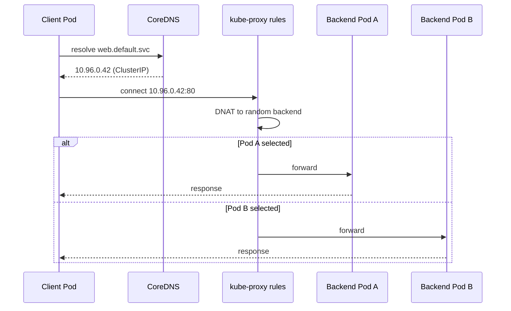

# 📘 Topic 19 — Kubernetes Networking Model

**Official Documentation Reference**
- Cluster networking: https://kubernetes.io/docs/concepts/cluster-administration/networking/
- Services, load balancing, networking: https://kubernetes.io/docs/concepts/services-networking/
- DNS for Services and Pods: https://kubernetes.io/docs/concepts/services-networking/dns-pod-service/
- Network plugins: https://kubernetes.io/docs/concepts/extend-kubernetes/compute-storage-net/network-plugins/
- GKE networking overview: https://cloud.google.com/kubernetes-engine/docs/concepts/network-overview
- EKS networking: https://docs.aws.amazon.com/eks/latest/userguide/pod-networking.html

---

## 🔹 Definition
The Kubernetes networking model requires that every **Pod gets its own IP address**, all pods can communicate with all other pods without NAT, all nodes can communicate with all pods without NAT, and the IP a pod sees for itself is the same IP others see. This is called the **flat network** model.

---

## 🔹 About

### The four networking problems K8s solves
| Problem | Solution |
|---|---|
| Container-to-container (same pod) | `localhost` (shared network namespace) |
| Pod-to-pod (same/different node) | CNI plugin provides flat L3 network |
| Pod-to-Service | kube-proxy / eBPF — ClusterIP virtual IP |
| External-to-Service | NodePort / LoadBalancer / Ingress |

### The CNI contract
Kubernetes delegates the IP assignment and packet forwarding to a **CNI (Container Network Interface)** plugin. K8s itself does not implement any networking — it defines the rules, the plugin implements them.

### How pod-to-pod works across nodes
| Implementation | How |
|---|---|
| Overlay (VXLAN/GENEVE) | Encapsulate pod packets in outer UDP; works anywhere but adds latency/overhead. Calico tunnel, Flannel VXLAN. |
| BGP routing | CNI announces pod CIDR routes via BGP; no encapsulation. Calico native mode. |
| Cloud-native routing | Provider programs VPC routes / ENIs. GKE Dataplane V2 (eBPF), VPC CNI on EKS. |

### Key CIDRs
| CIDR | Controlled by | Holds |
|---|---|---|
| Pod CIDR | `--pod-network-cidr` / CNI | Pod IPs |
| Service CIDR | `--service-cluster-ip-range` | ClusterIP range |
| Node CIDR | Cloud VPC / bare-metal | Node IPs |

### kube-proxy modes
| Mode | Mechanism | Use case |
|---|---|---|
| iptables | iptables DNAT rules per Service | Default on most clusters |
| IPVS | kernel IPVS tables (hashing) | High service count (>1000 services) |
| nftables | nftables (K8s 1.29+ stable) | Modern kernel replacement for iptables |
| eBPF (cilium, GKE DP-v2) | Replaces kube-proxy entirely | Best performance, visibility |

### DNS (CoreDNS)
- Every Service gets `<svc>.<ns>.svc.cluster.local`.
- Pods get `<pod-ip-dashed>.<ns>.pod.cluster.local`.
- Headless Services return per-pod A records.
- CoreDNS config in ConfigMap `coredns` in `kube-system`.

---

## 🔹 How It Integrates With Other Kubernetes Components
| Component | Interaction |
|---|---|
| CNI plugin | Assigns pod IP, programs routes |
| kube-proxy | Programs Service → pod rules |
| CoreDNS | Resolves svc names → ClusterIP |
| Ingress controller | L7 routing, TLS termination |
| NetworkPolicy | CNI enforces (Calico, Cilium, DP-v2) — kube-proxy does not |
| Service mesh (Istio/Linkerd) | Sidecar proxies add mTLS, traffic shaping |

---

## 🏗️ Diagrams

### Flat network model


### Service traffic path


### External traffic via LoadBalancer


---

## 💻 Real-World Examples

### Example 1 — Verify pod-to-pod connectivity
```bash
kubectl run a --image=busybox --rm -it -- sh -c 'wget -qO- http://10.244.2.5'
```

### Example 2 — Inspect CoreDNS
```bash
kubectl get cm coredns -n kube-system -o yaml
kubectl get pods -n kube-system -l k8s-app=kube-dns
kubectl run dns-test --image=busybox --rm -it -- nslookup web.default.svc.cluster.local
```

### Example 3 — Check kube-proxy mode
```bash
kubectl get cm kube-proxy -n kube-system -o yaml | grep mode
# or check kube-proxy logs
kubectl logs -n kube-system -l k8s-app=kube-proxy --tail=5
```

### Example 4 — Inspect iptables Service rules (on a node)
```bash
sudo iptables-save | grep <ClusterIP>
```

---

## 💻 Related Commands

| Command | Flag | Purpose | Example |
|---|---|---|---|
| `kubectl get pods` | `-o wide` | Show pod IPs | `kubectl get pods -o wide` |
| `kubectl get svc` | `-o wide` | Show ClusterIP, ports | `kubectl get svc -o wide` |
| `kubectl run` | `--rm -it -- nslookup` | DNS test | `kubectl run dns --image=busybox --rm -it -- nslookup web` |
| `kubectl exec` | `-- wget -qO-` | HTTP test | `kubectl exec c -- wget -qO- http://web:80` |
| `kubectl get endpoints` | — | Show backend pod IPs | `kubectl get endpoints web` |
| `kubectl get endpointslices` | — | EndpointSlice (scalable) | `kubectl get endpointslice -l kubernetes.io/service-name=web` |
| `kubectl describe svc` | — | See endpoints + events | `kubectl describe svc web` |
| `kubectl get cm coredns` | `-n kube-system -o yaml` | DNS config | see Example 2 |
| `kubectl logs` | `-n kube-system -l k8s-app=kube-dns` | CoreDNS logs | |

---

## 🚨 Scenarios

### Scenario 1 — Pod can't resolve DNS
- **Cause**: CoreDNS crashed, or `resolv.conf` misconfigured, or CNI failure.
- **Diagnose**: `kubectl get pods -n kube-system -l k8s-app=kube-dns`; `kubectl exec <pod> -- cat /etc/resolv.conf`; `kubectl logs -n kube-system <coredns-pod>`.
- **Fix**: restart CoreDNS, check CNI, verify `ndots:5` isn't causing excessive lookups.

### Scenario 2 — Pod-to-pod works inside a node but not across nodes
- **Cause**: CNI overlay not functioning; cloud routes missing; firewall blocking VXLAN UDP 4789.
- **Fix**: verify `kubectl get nodes -o wide` (internal IPs reachable), check security groups / VPC routes, check CNI DaemonSet pods.

### Scenario 3 — Service has ClusterIP but no endpoints
- **Cause**: selector mismatch or pods not Ready.
- **Fix**: `kubectl get endpoints <svc>` → empty. Align labels or fix readinessProbe.

### Scenario 4 — High DNS latency (`ndots` issue)
- **Cause**: default `ndots:5` causes 4 failed queries before absolute resolution for external domains.
- **Fix**: set pod DNS config: `dnsConfig: {options: [{name: ndots, value: "2"}]}` or use FQDNs in config.

### Scenario 5 — Intermittent timeouts connecting to Service
- **Cause**: conntrack table full; or kube-proxy iptables rule count too high.
- **Fix**: increase `net.nf_conntrack_max`, or switch to IPVS/eBPF mode.

---

## ☁️ GCP GKE Perspective
- **GKE Dataplane V2** (default on new clusters) = eBPF-based networking powered by Cilium. Replaces kube-proxy. Provides built-in NetworkPolicy enforcement.
- **VPC-native clusters** (alias IP) = pods get IPs from a secondary range on the VPC subnet. No overlay, native routing.
- **Cloud DNS for GKE** (`--cluster-dns=clouddns`) replaces CoreDNS with a managed service.
- **Private clusters** — nodes have no external IPs; API server is private. Control with `--enable-private-nodes --master-ipv4-cidr=...`.

## 🟧 AWS EKS Perspective
- **VPC CNI** (default) — every pod gets a real ENI secondary IP from the VPC subnet. No overlay; native VPC routing.
- **IP planning** is critical: pods consume VPC IPs. Mitigate with **prefix delegation** (`ENABLE_PREFIX_DELEGATION=true`) or secondary CIDRs.
- **kube-proxy** deployed as a DaemonSet add-on; upgrade with `aws eks update-addon`.
- **CoreDNS** deployed as an EKS add-on.
- **Security groups for pods** — assign SGs directly to pods (VPC CNI feature `ENABLE_POD_ENI`).

---

## 🧪 Hands-On Lab Exercises

### Lab 19.1 — Verify the flat network (Beginner, 30 min)
**Steps**
```bash
kind create cluster --config kind-3.yaml
kubectl run a --image=nginx --labels=app=a
kubectl run b --image=busybox --rm -it -- sh
# inside b:
wget -qO- http://$(kubectl get pod a -o jsonpath='{.status.podIP}')
nslookup kubernetes.default.svc.cluster.local
exit
```
**Verify**: response from pod `a` by IP and by DNS.

**Cleanup**: `kubectl delete pod a && kind delete cluster`.

### Lab 19.2 — DNS debugging deep-dive (Intermediate, 45 min)
**Steps**
1. Deploy `dnsutils` pod:
```bash
kubectl run dns --image=registry.k8s.io/e2e-test-images/agnhost:2.45 -- serve-hostname
kubectl expose pod dns --port=80 --target-port=9376 --name=dns-svc
```
2. From another pod:
```bash
kubectl run tmp --image=busybox --rm -it -- sh
nslookup dns-svc
nslookup dns-svc.default.svc.cluster.local
nslookup google.com                           # external
cat /etc/resolv.conf                          # see ndots:5, search domains
exit
```
3. Check CoreDNS: `kubectl logs -n kube-system -l k8s-app=kube-dns`.

**Bonus**: Change `ndots` on a pod and measure lookup time for external domains.

### Lab 19.3 — Inspect kube-proxy iptables vs IPVS (Advanced, 60 min)
**Prerequisites**: kubeadm or Kind cluster.

**Steps**
1. Check mode: `kubectl get cm kube-proxy -n kube-system -o jsonpath='{.data.config\.conf}' | grep mode`.
2. Create a Service with 3 backend pods.
3. On a node: `sudo iptables-save | grep <ClusterIP>` — see DNAT rules.
4. Switch to IPVS:
```bash
kubectl edit cm kube-proxy -n kube-system    # change mode: "ipvs"
kubectl rollout restart ds kube-proxy -n kube-system
```
5. On a node: `sudo ipvsadm -Ln` → see virtual service + real servers.
6. Compare rule count for 100 Services (iptables: O(n²) rules; IPVS: O(n) entries).

**Cleanup**: delete cluster.

**Bonus**: Install Cilium and observe eBPF replacing both kube-proxy and iptables.

---

## 🎯 Interview Deliverable Answer (60–90 s)
"**What**: The Kubernetes networking model guarantees every pod gets its own routable IP and can communicate with every other pod without NAT — a flat network. This is implemented by a CNI plugin, and service discovery is layered on top with kube-proxy and CoreDNS.  
**Why**: A flat network eliminates the port-mapping complexity of Docker bridge mode. Any pod can talk to any pod by IP, and DNS resolves Service names to stable virtual IPs that kube-proxy maps to backend pods via iptables, IPVS, or eBPF.  
**How**: On GKE I use VPC-native clusters with Dataplane V2 — pods get alias IPs from the VPC, no overlay, and eBPF replaces kube-proxy for both performance and built-in NetworkPolicy. On EKS I use VPC CNI where every pod gets a real ENI IP. IP planning is essential — I enable prefix delegation or secondary CIDRs to avoid exhaustion. For DNS I keep CoreDNS with sensible `ndots` settings and upstream caching.  
**Example**: On a 200-service EKS cluster we migrated from iptables to IPVS mode and cut Service-related p99 latency by 15% — the O(n²) iptables rules were adding measurable overhead."

---

## ❓ Possible Interview Questions

### Basic
**Q1. State the K8s networking rules.** Every pod gets an IP; pods talk to pods without NAT; nodes talk to pods without NAT; pod sees its own IP.  
**Q2. What is CNI?** Container Network Interface — the standard K8s uses to delegate IP management and routing to plugins.  
**Q3. What does kube-proxy do?** Programs iptables/IPVS/nftables/eBPF rules that map Service ClusterIP → backend pod IPs.

### Intermediate
**Q4. Overlay vs native routing?** Overlay encapsulates (VXLAN); native programs host or VPC routes. Native is faster but environment-dependent.  
**Q5. Name 3 popular CNI plugins.** Calico, Cilium, Flannel (or cloud-native: VPC CNI, GKE DP-v2).  
**Q6. What is `ndots:5`?** The default search config that appends `.svc.cluster.local`, etc. to short names before resolving absolutely — can cause 4 extra DNS lookups.

### Advanced
**Q7. How does GKE Dataplane V2 replace kube-proxy?** It uses eBPF programs at the kernel socket layer to intercept Service traffic, bypassing iptables entirely — lower latency, less CPU.  
**Q8. How does VPC CNI assign IPs on EKS?** Each node gets secondary IPs via ENI. Prefix delegation assigns /28 blocks per ENI slot, increasing density.  
**Q9. iptables vs IPVS — when to switch?** IPVS at scale (>1000 Services); iptables O(n) per packet, IPVS O(1) hash lookup. nftables is the next-gen iptables replacement.

### Scenario-based
**Q10. Pods across nodes can't reach each other — steps?** Check CNI DaemonSet running, node firewall / SG rules (allow pod CIDR + VXLAN UDP 4789), VPC routes, `kubectl get nodes -o wide`.

### GKE-specific
**Q11. What's a VPC-native cluster?** Pods use secondary ranges (alias IPs) on the VPC; routes are native GCP; no overlay, seamless peering.

### EKS-specific
**Q12. You ran out of IPs for pods on EKS — options?** Enable prefix delegation, add secondary CIDRs, use smaller pod CIDRs, or move to Calico/Cilium overlay (trade VPC routing for overlayed IPs).

### Hands-on / Lab-based
**Q13. How do you test DNS from inside a pod?** `kubectl run tmp --image=busybox --rm -it -- nslookup <svc>.<ns>.svc.cluster.local`.  
**Q14. How do you inspect iptables rules for a Service?** SSH to node: `sudo iptables-save | grep <ClusterIP>`.  
**Q15. Walk me through what happens when Pod A curls Service B.** A resolves B's name via CoreDNS → gets ClusterIP → kube-proxy's iptables/IPVS DNAT → packet routes to a backend Pod → response follows reverse path.

