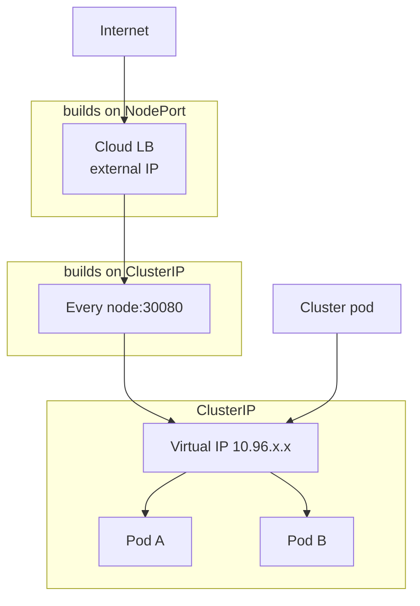
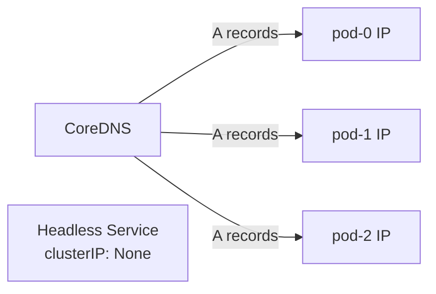
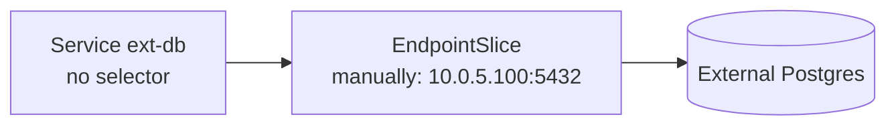
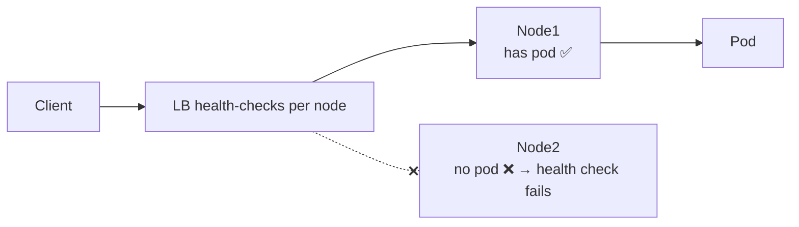

# 📘 Topic 20 — Services (ClusterIP, NodePort, LoadBalancer, ExternalName, Headless)

**Official Documentation Reference**
- Service: https://kubernetes.io/docs/concepts/services-networking/service/
- EndpointSlices: https://kubernetes.io/docs/concepts/services-networking/endpoint-slices/
- Virtual IPs and Service Proxies: https://kubernetes.io/docs/reference/networking/virtual-ips/
- Connecting apps with Services (tutorial): https://kubernetes.io/docs/tutorials/services/connect-applications-service/
- External LB: https://kubernetes.io/docs/tasks/access-application-cluster/create-external-load-balancer/
- GKE Services: https://cloud.google.com/kubernetes-engine/docs/concepts/service
- EKS load balancing: https://docs.aws.amazon.com/eks/latest/userguide/network-load-balancing.html

---

## 🔹 Definition
A **Service** is an abstract way to expose a set of Pods as a network service. It provides a **stable IP** (ClusterIP), **DNS name**, and **load balancing** — decoupling clients from the dynamic lifecycle of pods.

---

## 🔹 About

### Service types
| Type | Scope | How |
|---|---|---|
| **ClusterIP** (default) | Internal | Virtual IP reachable only inside cluster |
| **NodePort** | External via node IP | Allocates port 30000–32767 on every node; builds on ClusterIP |
| **LoadBalancer** | External via cloud LB | Provisions cloud LB (GCLB, NLB, ALB); builds on NodePort |
| **ExternalName** | DNS alias | Returns a CNAME record; no proxying; points to an external DNS |
| **Headless** (`clusterIP: None`) | Direct pod DNS | DNS returns A records for each pod; used by StatefulSets |

### Selector → EndpointSlice
When a Service has `spec.selector`, the EndpointSlice controller creates EndpointSlice objects listing the IPs of matching, Ready pods. kube-proxy watches EndpointSlices to program rules.

### Service without selector
Manually created Endpoints/EndpointSlices — useful for pointing to an external DB or non-K8s host.

### Session affinity
`spec.sessionAffinity: ClientIP` routes all requests from the same source IP to the same pod (default: None = round-robin).

### Traffic policies
- `spec.internalTrafficPolicy: Local` — keeps traffic on the same node.
- `spec.externalTrafficPolicy: Local` — preserves client source IP but only routes to local pods (avoids extra hop).

### Port mapping
```yaml
ports:
- name: http
  port: 80         # Service port (what clients use)
  targetPort: 8080  # Container port (where pod listens)
  protocol: TCP
```
`targetPort` can be a named port referencing the pod's `containerPort.name`.

---

## 🔹 How It Integrates With Other Kubernetes Components
| Component | Interaction |
|---|---|
| Pods | Matched by selector labels → become endpoints |
| kube-proxy | Programs iptables/IPVS for ClusterIP/NodePort |
| CoreDNS | Resolves `<svc>.<ns>.svc.cluster.local` → ClusterIP |
| Ingress / Gateway API | Routes external L7 traffic to Services |
| cloud-controller-manager | Provisions external LB for LoadBalancer type |
| NetworkPolicy | Controls ingress/egress to Services' pod targets |
| HPA | Doesn't scale Services; scales Deployments behind them |
| StatefulSet | Needs headless Service for stable DNS |

---

## 🏗️ Diagrams

### Service types stacked


### Headless Service


### Service without selector


### externalTrafficPolicy: Local


---

## 💻 Real-World Examples

### Example 1 — ClusterIP
```yaml
apiVersion: v1
kind: Service
metadata: { name: backend }
spec:
  selector: { app: api }
  ports:
  - { name: http, port: 80, targetPort: 8080 }
  type: ClusterIP
```

### Example 2 — NodePort
```yaml
apiVersion: v1
kind: Service
metadata: { name: web-np }
spec:
  selector: { app: web }
  ports:
  - { port: 80, targetPort: 80, nodePort: 30080 }
  type: NodePort
```

### Example 3 — LoadBalancer with annotations
```yaml
apiVersion: v1
kind: Service
metadata:
  name: web-lb
  annotations:
    # AWS NLB
    service.beta.kubernetes.io/aws-load-balancer-type: nlb
    service.beta.kubernetes.io/aws-load-balancer-scheme: internet-facing
    # OR GKE Internal LB
    # networking.gke.io/load-balancer-type: Internal
spec:
  selector: { app: web }
  ports: [{ port: 80, targetPort: 80 }]
  type: LoadBalancer
  externalTrafficPolicy: Local
```

### Example 4 — ExternalName
```yaml
apiVersion: v1
kind: Service
metadata: { name: legacy-db }
spec:
  type: ExternalName
  externalName: db.legacy.example.com
```
Pods resolve `legacy-db` → CNAME → `db.legacy.example.com`.

### Example 5 — Headless for StatefulSet
```yaml
apiVersion: v1
kind: Service
metadata: { name: pg }
spec:
  clusterIP: None
  selector: { app: pg }
  ports: [{ port: 5432, name: pg }]
```

### Example 6 — Service without selector (external DB)
```yaml
apiVersion: v1
kind: Service
metadata: { name: ext-db }
spec:
  ports: [{ port: 5432, targetPort: 5432 }]
---
apiVersion: discovery.k8s.io/v1
kind: EndpointSlice
metadata:
  name: ext-db-1
  labels: { kubernetes.io/service-name: ext-db }
addressType: IPv4
ports: [{ port: 5432, protocol: TCP }]
endpoints:
- { addresses: ["10.0.5.100"] }
```

---

## 💻 Related Commands

| Command | Flag | Purpose | Example |
|---|---|---|---|
| `kubectl expose deploy` | `--port --target-port --type` | Quick Service creation | `kubectl expose deploy web --port=80 --target-port=8080 --type=ClusterIP` |
| `kubectl get svc` | `-o wide` | Show selector, ports | `kubectl get svc -o wide` |
| `kubectl describe svc` | — | Endpoints, events, LB status | `kubectl describe svc web-lb` |
| `kubectl get endpoints` | `<svc>` | Show backend IPs | `kubectl get endpoints backend` |
| `kubectl get endpointslice` | `-l kubernetes.io/service-name=<svc>` | Scalable endpoints | `kubectl get endpointslice -l kubernetes.io/service-name=web` |
| `kubectl port-forward svc` | `<svc> local:remote` | Local tunnel | `kubectl port-forward svc/backend 8080:80` |
| `kubectl delete svc` | — | Remove (cloud LB deleted too) | `kubectl delete svc web-lb` |
| `kubectl patch svc` | `-p '{"spec":{"type":"LoadBalancer"}}'` | Change type | `kubectl patch svc web -p '{"spec":{"type":"LoadBalancer"}}'` |
| `kubectl create svc clusterip` | `--tcp=80:8080` | Skeleton | `kubectl create svc clusterip web --tcp=80:8080 --dry-run=client -o yaml` |

---

## 🚨 Scenarios

### Scenario 1 — Service has no endpoints
- **Cause**: selector doesn't match pods; or pods aren't Ready.
- **Fix**: `kubectl get endpoints <svc>` → empty. Compare `svc.spec.selector` with pod labels. Fix readinessProbe.

### Scenario 2 — Client sees wrong source IP behind LoadBalancer
- **Cause**: `externalTrafficPolicy: Cluster` (default) SNAT-s the client IP.
- **Fix**: Set `externalTrafficPolicy: Local` — preserves source IP; pods only receive traffic on nodes where they run.

### Scenario 3 — NodePort service not reachable externally
- **Cause**: firewall / security group blocking the high port.
- **Fix**: open port range 30000–32767 in SG / firewall rules.

### Scenario 4 — LoadBalancer never gets an external IP
- **Cause**: cloud-controller-manager not running; quota exhausted; wrong annotations.
- **Diagnose**: `kubectl describe svc <n>` → events.
- **Fix**: check cloud quota; verify CCM DaemonSet; on bare metal use MetalLB.

### Scenario 5 — DNS returns stale endpoint after scale-down
- **Cause**: EndpointSlice updated, but CoreDNS cache TTL or pod-level `ndots` caching.
- **Fix**: reduce CoreDNS TTL (`template` section), or `dnsConfig: {options: [{name: single-request-reopen}]}`.

---

## ☁️ GCP GKE Perspective
- **GKE Network Endpoint Groups (NEGs)** enable container-native load balancing — the cloud LB routes directly to pod IPs, bypassing kube-proxy + NodePort. Enabled via annotation `cloud.google.com/neg: '{"ingress": true}'`.
- **Internal TCP/UDP LB**: annotation `networking.gke.io/load-balancer-type: Internal`.
- **GKE Gateway API** is the successor to Ingress, providing multi-cluster, traffic splitting, header-based routing.
- **Autopilot** defaults: NEG-based Services; no NodePort access unless explicitly configured.

## 🟧 AWS EKS Perspective
- **AWS Load Balancer Controller** (install separately) provisions NLB for `type: LoadBalancer` and ALB for Ingress.
- **NLB**: annotation `service.beta.kubernetes.io/aws-load-balancer-type: nlb`.
- **IP target mode** = controller routes directly to pod IPs (like GKE NEGs): annotation `service.beta.kubernetes.io/aws-load-balancer-nlb-target-type: ip`.
- **Fargate**: only `type: LoadBalancer` with IP mode works (no NodePort access).
- **Security groups for pods** let you SG-gate traffic at the pod level on VPC CNI.

---

## 🧪 Hands-On Lab Exercises

### Lab 20.1 — All Service types (Beginner, 30 min)
**Steps**
```bash
kubectl create deploy web --image=nginx:1.27 --replicas=3
# ClusterIP
kubectl expose deploy web --port=80 --target-port=80 --name=web-cip
# NodePort
kubectl expose deploy web --port=80 --target-port=80 --type=NodePort --name=web-np
# Access
kubectl run tmp --image=busybox --rm -it -- wget -qO- http://web-cip
minikube service web-np --url | xargs curl -s | head
# Headless
cat <<EOF | kubectl apply -f -
apiVersion: v1
kind: Service
metadata: { name: web-hl }
spec:
  clusterIP: None
  selector: { app: web }
  ports: [{ port: 80 }]
EOF
kubectl run tmp --image=busybox --rm -it -- nslookup web-hl
```
**Verify**: ClusterIP returns one IP; headless returns multiple A records.

**Cleanup**: `kubectl delete deploy web && kubectl delete svc web-cip web-np web-hl`.

### Lab 20.2 — externalTrafficPolicy: Local (Intermediate, 45 min)
**Steps**
1. Deploy nginx with `hostPort: 80` (or use NodePort).
2. Create LoadBalancer Service with `externalTrafficPolicy: Cluster`.
3. From outside: `curl -s <external-ip>` → check access logs for source IP (it's SNAT'd).
4. Switch to `externalTrafficPolicy: Local`.
5. `curl` again → source IP matches your real IP.
6. Scale down to 1 pod; hit the node that has no pod → timeout (LB health-check removes it).

**Bonus**: on GKE, enable container-native LB (NEG) and compare — source IP always preserved, no NodePort hop.

### Lab 20.3 — Service without selector → external database (Advanced, 45 min)
**Steps**
1. Run a Postgres container outside K8s (`docker run -d --name pg -p 5432:5432 postgres:16`).
2. Get its IP (host IP or bridge IP).
3. Create a selectorless Service + EndpointSlice (Example 6) pointing to that IP.
4. Deploy an app pod that connects to `ext-db:5432` using the K8s Service name.
5. Verify connection works: `kubectl exec app -- pg_isready -h ext-db`.

**Cleanup**: stop external Postgres; delete Service + EndpointSlice.

**Bonus**: Replace with `ExternalName` pointing to a DNS name (e.g., `db.example.com`) and verify CNAME resolution.

---

## 🎯 Interview Deliverable Answer (60–90 s)
"**What**: A Kubernetes Service is a stable network abstraction over a dynamic set of pods. It gives you a fixed ClusterIP and DNS name, while kube-proxy load-balances traffic to whichever pods match the selector and pass readinessProbe.  
**Why**: Pods are ephemeral — their IPs change on restarts. Services decouple producers from consumers. ClusterIP for internal, NodePort for dev access, LoadBalancer for production external traffic, ExternalName for DNS aliasing to off-cluster resources, and Headless for StatefulSet direct-pod DNS.  
**How**: I always use ClusterIP for inter-service traffic and expose externally with either a cloud LoadBalancer (NLB on EKS, NEG-based GCLB on GKE) or an Ingress/Gateway for L7. I set `externalTrafficPolicy: Local` when I need client IP preservation. For StatefulSets I pair a headless Service so each pod gets `pod-N.svc.ns.svc.cluster.local`.  
**Example**: On EKS we switched from iptables-mode NodePort to NLB with IP target mode — the LB routes directly to pod IPs. p99 latency dropped 8% and we no longer needed to manage NodePort security groups."

---

## ❓ Possible Interview Questions

### Basic
**Q1. What is a Kubernetes Service?** Stable IP + DNS + load balancing over a set of pods.  
**Q2. Name the Service types.** ClusterIP, NodePort, LoadBalancer, ExternalName, Headless.  
**Q3. Default Service type?** ClusterIP.

### Intermediate
**Q4. NodePort builds on ClusterIP — what does that mean?** A NodePort Service also gets a ClusterIP; the NodePort routes to it.  
**Q5. What is an EndpointSlice?** An API object listing the IPs of Ready pods for a Service; replaces the older Endpoints object for scale.  
**Q6. `externalTrafficPolicy: Local` — trade-offs?** Preserves source IP; but traffic only goes to nodes hosting a pod, so uneven distribution if pods aren't spread.

### Advanced
**Q7. What is a selectorless Service?** A Service with no selector; you manually create EndpointSlice entries pointing to any IP — commonly used for external DBs.  
**Q8. How does headless DNS work?** `clusterIP: None` → CoreDNS returns A records for each Ready pod IP, not a virtual IP.  
**Q9. How does container-native load balancing (NEG/IP-target) skip kube-proxy?** The cloud LB sends traffic directly to pod IPs instead of through NodePort → iptables. Reduces hops, preserves source IP.

### Scenario-based
**Q10. Service works but traffic is uneven — 70% goes to one pod. Why?** Connection-based balancing (not request-based); long-lived HTTP/2 or gRPC connections. Fix: use L7 LB (Ingress/ALB) for request-based; or Service mesh.

### GKE-specific
**Q11. What are NEGs on GKE?** Network Endpoint Groups — the GCLB routes directly to pod endpoints registered in a NEG instead of through NodePort.

### EKS-specific
**Q12. How do you get an NLB instead of a CLB on EKS?** Install the AWS Load Balancer Controller and annotate the Service with `service.beta.kubernetes.io/aws-load-balancer-type: nlb`.

### Hands-on / Lab-based
**Q13. Show me how to test a Service from inside the cluster.** `kubectl run tmp --image=busybox --rm -it -- wget -qO- http://svc-name.namespace.svc.cluster.local`.  
**Q14. How do you check if a Service has endpoints?** `kubectl get endpoints <svc>` or `kubectl get endpointslice -l kubernetes.io/service-name=<svc>`.  
**Q15. How would you expose a legacy VM to pods?** Selectorless Service with an EndpointSlice pointing to the VM's IP, or ExternalName if a DNS name exists.

