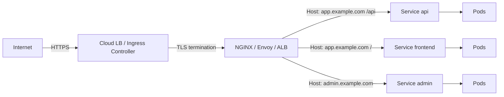
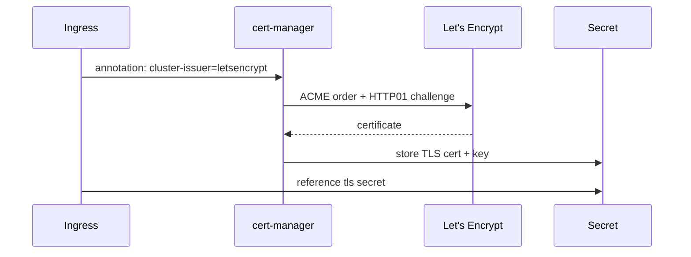
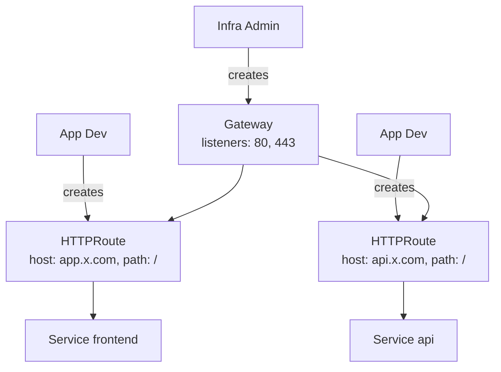

# 📘 Topic 21 — Ingress and Ingress Controllers

**Official Documentation Reference**
- Ingress: https://kubernetes.io/docs/concepts/services-networking/ingress/
- Ingress Controllers: https://kubernetes.io/docs/concepts/services-networking/ingress-controllers/
- Gateway API: https://kubernetes.io/docs/concepts/services-networking/gateway/
- GKE Ingress: https://cloud.google.com/kubernetes-engine/docs/concepts/ingress
- GKE Gateway: https://cloud.google.com/kubernetes-engine/docs/concepts/gateway-api
- EKS ALB Ingress: https://docs.aws.amazon.com/eks/latest/userguide/alb-ingress.html
- AWS LB Controller: https://kubernetes-sigs.github.io/aws-load-balancer-controller/

---

## 🔹 Definition
An **Ingress** is a Kubernetes API object that manages external HTTP/HTTPS access to Services within a cluster — providing host-based and path-based routing, TLS termination, and name-based virtual hosting. An **Ingress Controller** is the component that watches Ingress objects and configures a reverse proxy (NGINX, Envoy, HAProxy, cloud LB) accordingly.

---

## 🔹 About

### The problem Ingress solves
Without Ingress, every public Service needs a cloud LoadBalancer (~$18/month each). Ingress consolidates traffic through one LB with L7 routing rules — one IP, many hosts/paths.

### Key Ingress fields
| Field | Purpose |
|---|---|
| `spec.ingressClassName` | Which controller handles this Ingress |
| `spec.rules[].host` | Hostname matching (`app.example.com`) |
| `spec.rules[].http.paths` | URL path routing |
| `spec.rules[].http.paths[].pathType` | `Prefix`, `Exact`, `ImplementationSpecific` |
| `spec.rules[].http.paths[].backend.service` | Target Service + port |
| `spec.tls[].hosts` + `secretName` | TLS termination |
| `spec.defaultBackend` | Catch-all 404 handler |

### Popular Ingress Controllers
| Controller | Proxy | Best for |
|---|---|---|
| **ingress-nginx** | NGINX | General purpose, on-prem & cloud |
| **GCE Ingress** (gce) | Google Cloud LB | GKE native; provisions GCLB |
| **AWS LB Controller** | ALB | EKS native; provisions ALB |
| **Traefik** | Traefik | Auto-discovery, Let's Encrypt |
| **HAProxy** | HAProxy | High-performance TCP/HTTP |
| **Contour** | Envoy | HTTPProxy CRD, advanced routing |
| **Istio Gateway** | Envoy | Part of Istio mesh |

### Gateway API (successor to Ingress)
Gateway API is the next-generation L4/L7 routing standard — more expressive, role-oriented (infra admin → Gateway, app dev → HTTPRoute), and extensible. GKE and the AWS LB Controller both support it.

### TLS with cert-manager
cert-manager watches Ingress annotations like `cert-manager.io/cluster-issuer: letsencrypt-prod`, creates a Certificate CR, completes ACME challenge, stores cert in a K8s Secret, and Ingress controller serves it.

---

## 🔹 How It Integrates With Other Kubernetes Components
| Component | Interaction |
|---|---|
| Service (ClusterIP) | Backend target of Ingress rules |
| Secret (TLS) | Stores certs referenced by `spec.tls` |
| cert-manager | Automates TLS cert issuance/renewal |
| cloud-controller-manager | GCE Ingress / ALB provisioning |
| NetworkPolicy | Controls which pods can receive Ingress traffic |
| DNS (external) | A/CNAME records pointing to Ingress LB IP |

---

## 🏗️ Diagrams

### Ingress traffic flow


### cert-manager flow


### Gateway API model


---

## 💻 Real-World Examples

### Example 1 — NGINX Ingress with host + path routing
```yaml
apiVersion: networking.k8s.io/v1
kind: Ingress
metadata:
  name: app
  annotations:
    nginx.ingress.kubernetes.io/rewrite-target: /$2
    nginx.ingress.kubernetes.io/ssl-redirect: "true"
spec:
  ingressClassName: nginx
  tls:
  - hosts: [app.example.com]
    secretName: app-tls
  rules:
  - host: app.example.com
    http:
      paths:
      - path: /api(/|$)(.*)
        pathType: ImplementationSpecific
        backend: { service: { name: api, port: { number: 80 } } }
      - path: /
        pathType: Prefix
        backend: { service: { name: frontend, port: { number: 80 } } }
```

### Example 2 — GKE GCE Ingress with managed cert
```yaml
apiVersion: networking.k8s.io/v1
kind: Ingress
metadata:
  name: gke-app
  annotations:
    kubernetes.io/ingress.class: gce
    networking.gke.io/managed-certificates: app-cert
    kubernetes.io/ingress.global-static-ip-name: app-ip
spec:
  rules:
  - host: app.example.com
    http:
      paths:
      - path: /*
        pathType: ImplementationSpecific
        backend: { service: { name: web, port: { number: 80 } } }
---
apiVersion: networking.gke.io/v1
kind: ManagedCertificate
metadata: { name: app-cert }
spec:
  domains: [app.example.com]
```

### Example 3 — AWS ALB Ingress
```yaml
apiVersion: networking.k8s.io/v1
kind: Ingress
metadata:
  name: alb-app
  annotations:
    kubernetes.io/ingress.class: alb
    alb.ingress.kubernetes.io/scheme: internet-facing
    alb.ingress.kubernetes.io/target-type: ip
    alb.ingress.kubernetes.io/certificate-arn: arn:aws:acm:ap-south-1:123:certificate/abc
    alb.ingress.kubernetes.io/listen-ports: '[{"HTTPS":443}]'
    alb.ingress.kubernetes.io/ssl-redirect: "443"
spec:
  rules:
  - host: app.example.com
    http:
      paths:
      - path: /
        pathType: Prefix
        backend: { service: { name: web, port: { number: 80 } } }
```

### Example 4 — Install ingress-nginx on Minikube/Kind
```bash
# Minikube
minikube addons enable ingress

# Kind
kubectl apply -f https://raw.githubusercontent.com/kubernetes/ingress-nginx/main/deploy/static/provider/kind/deploy.yaml

# Helm (any cluster)
helm repo add ingress-nginx https://kubernetes.github.io/ingress-nginx
helm install ingress-nginx ingress-nginx/ingress-nginx -n ingress-nginx --create-namespace
```

---

## 💻 Related Commands

| Command | Flag | Purpose | Example |
|---|---|---|---|
| `kubectl get ingress` | `-A` | List Ingress objects | `kubectl get ingress -A` |
| `kubectl describe ingress` | `<name>` | Rules + endpoints + events | `kubectl describe ingress app` |
| `kubectl get ingressclass` | — | Available controllers | `kubectl get ingressclass` |
| `kubectl create ingress` | `--rule` | Quick Ingress | `kubectl create ingress demo --rule="app.com/*=web:80" --class=nginx` |
| `kubectl logs -n ingress-nginx` | `-l app.kubernetes.io/name=ingress-nginx` | Controller logs | |
| `kubectl get svc -n ingress-nginx` | — | Find LB external IP | `kubectl get svc -n ingress-nginx` |
| `kubectl cert-manager status` | — | cert-manager cert status | `kubectl get certificate` |

---

## 🚨 Scenarios

### Scenario 1 — Ingress created but no external IP
- **Cause**: no Ingress controller installed; or wrong `ingressClassName`.
- **Fix**: install a controller; set `ingressClassName` or annotation.

### Scenario 2 — 404 on all paths
- **Cause**: Service backend has no endpoints; or path regex wrong.
- **Fix**: `kubectl describe ingress` → check backends; verify Service has Ready pods.

### Scenario 3 — TLS certificate not served
- **Cause**: Secret doesn't exist; or cert-manager challenge failing (DNS, firewall).
- **Fix**: `kubectl get certificate`, `kubectl describe certificate`, `kubectl describe order`, `kubectl describe challenge`.

### Scenario 4 — GKE Ingress takes 5–10 minutes
- **Cause**: GCE Ingress provisions a GCLB + health checks + NEGs → slower than NGINX.
- **Fix**: expected behavior. Use NGINX Ingress for faster iteration in dev; GCE Ingress for production.

### Scenario 5 — ALB Ingress returns 502
- **Cause**: health check path returns non-200; target group not registered; security group blocks pod.
- **Fix**: set `alb.ingress.kubernetes.io/healthcheck-path: /healthz`; check SG allows ALB → pod CIDR.

---

## ☁️ GCP GKE Perspective
- **GCE Ingress** (default on GKE) provisions a Google Cloud HTTP(S) LB. Supports ManagedCertificates, Cloud Armor WAF, Cloud CDN.
- **GKE Gateway Controller** implements Gateway API natively — supports multi-cluster Gateway (Fleet Ingress), traffic splitting, header-based routing.
- **Autopilot** uses GCE Ingress or Gateway by default. NGINX Ingress works but needs a `LoadBalancer` Service in front.
- Key annotations: `networking.gke.io/managed-certificates`, `cloud.google.com/backend-config`, `kubernetes.io/ingress.global-static-ip-name`.

## 🟧 AWS EKS Perspective
- **AWS Load Balancer Controller** provisions ALB (Ingress) or NLB (Service). Install separately:
```bash
helm repo add eks https://aws.github.io/eks-charts
helm install aws-load-balancer-controller eks/aws-load-balancer-controller -n kube-system \
  --set clusterName=prod --set serviceAccount.create=false --set serviceAccount.name=aws-lb-sa
```
- ALB supports target-type `ip` (direct to pod) or `instance` (via NodePort).
- **Fargate** requires `target-type: ip` (no NodePort).
- TLS: reference ACM cert via annotation `alb.ingress.kubernetes.io/certificate-arn`.
- **Weighted target groups** for canary: `alb.ingress.kubernetes.io/actions.forward` annotation.

---

## 🧪 Hands-On Lab Exercises

### Lab 21.1 — NGINX Ingress on Minikube (Beginner, 30 min)
**Steps**
```bash
minikube addons enable ingress
kubectl create deploy web --image=nginx --replicas=2
kubectl expose deploy web --port=80
kubectl create deploy api --image=hashicorp/http-echo -- -text="api"
kubectl expose deploy api --port=80 --target-port=5678
cat <<EOF | kubectl apply -f -
apiVersion: networking.k8s.io/v1
kind: Ingress
metadata: { name: demo }
spec:
  ingressClassName: nginx
  rules:
  - host: demo.local
    http:
      paths:
      - { path: /api, pathType: Prefix, backend: { service: { name: api, port: { number: 80 } } } }
      - { path: /,    pathType: Prefix, backend: { service: { name: web, port: { number: 80 } } } }
EOF
echo "$(minikube ip) demo.local" | sudo tee -a /etc/hosts
curl http://demo.local/
curl http://demo.local/api
```
**Cleanup**: `kubectl delete ingress demo && kubectl delete deploy,svc web api`.

### Lab 21.2 — TLS with cert-manager + Let's Encrypt staging (Intermediate, 60 min)
**Prerequisites**: cluster with public IP (GKE/EKS), real domain pointing to the LB IP.

**Steps**
1. Install cert-manager: `kubectl apply -f https://github.com/cert-manager/cert-manager/releases/download/v1.16.0/cert-manager.yaml`.
2. Create ClusterIssuer:
```yaml
apiVersion: cert-manager.io/v1
kind: ClusterIssuer
metadata: { name: letsencrypt-staging }
spec:
  acme:
    server: https://acme-staging-v02.api.letsencrypt.org/directory
    email: you@example.com
    privateKeySecretRef: { name: letsencrypt-staging }
    solvers: [{ http01: { ingress: { class: nginx } } }]
```
3. Create Ingress with annotation `cert-manager.io/cluster-issuer: letsencrypt-staging` and `tls` block.
4. `kubectl get certificate` → should become `Ready=True`.
5. `curl -k https://app.yourdomain.com`.

**Cleanup**: delete Ingress, ClusterIssuer, `kubectl delete -f cert-manager.yaml`.

### Lab 21.3 — GKE GCE Ingress + ALB Ingress side-by-side (Advanced, 90 min)
**Steps**
1. On GKE: apply Example 2 with a ManagedCertificate and static IP.
2. On EKS: install AWS LB Controller, apply Example 3 with ACM cert ARN.
3. Compare: creation time, LB type, health check behavior, WAF/CDN options.
4. Test with `hey -z 60s https://app.example.com`.

**Cleanup**: delete Ingress on both → LBs auto-deleted.

---

## 🎯 Interview Deliverable Answer (60–90 s)
"**What**: An Ingress is a Kubernetes object that defines L7 routing rules — host, path, TLS — for external HTTP/S traffic. An Ingress Controller (NGINX, GCE Ingress, ALB) watches those rules and programs a reverse proxy or cloud load balancer.  
**Why**: Without Ingress, each public service needs its own cloud LB. Ingress consolidates all traffic through one IP with path/host-based routing — saving cost and simplifying DNS and TLS management.  
**How**: On GKE I use GCE Ingress with ManagedCertificates for production and NGINX Ingress for dev — or better, the new Gateway API for multi-cluster routing. On EKS I install the AWS Load Balancer Controller to provision ALBs with ACM certs via annotation. For automatic TLS I pair any controller with cert-manager and a ClusterIssuer pointing to Let's Encrypt.  
**Example**: We consolidated 14 LoadBalancer Services into one ALB Ingress with path routing — saved $250/month in LB costs and simplified our DNS to a single CNAME."

---

## ❓ Possible Interview Questions

### Basic
**Q1. What is an Ingress?** An API object defining L7 routing rules for external HTTP(S) traffic to internal Services.  
**Q2. Why do you need an Ingress Controller?** The Ingress object is just a spec; a controller (NGINX, ALB, GCE) implements it.  
**Q3. What is `ingressClassName`?** Selects which controller should handle the Ingress.

### Intermediate
**Q4. `pathType` values?** `Exact` (match full path), `Prefix` (match path prefix), `ImplementationSpecific` (controller-defined, often regex).  
**Q5. How does TLS work with Ingress?** Ingress references a TLS Secret; the controller terminates TLS before forwarding to backend.  
**Q6. What is Gateway API?** The next-gen routing standard superseding Ingress — more expressive, role-based (Gateway for infra, HTTPRoute for app devs).

### Advanced
**Q7. GCE Ingress vs NGINX Ingress on GKE?** GCE provisions a Google Cloud HTTP(S) LB with global anycast, CDN, Cloud Armor — but slower to set up (~5 min). NGINX is faster, local, more customizable via annotations, but runs in-cluster.  
**Q8. How does the ALB Ingress Controller work?** It watches Ingress objects, creates/updates an ALB via AWS APIs, configures listeners, target groups (IP or instance mode), and health checks.  
**Q9. How does cert-manager automate TLS?** It watches Ingress annotations or Certificate CRs, performs ACME HTTP01/DNS01 challenges with Let's Encrypt, stores certs in Secrets, and renews before expiry.

### Scenario-based
**Q10. Ingress returns 503 — steps?** Check controller pods running; `describe ingress` for backend status; verify Service endpoints; check health check configuration on cloud LB.

### GKE-specific
**Q11. What is a ManagedCertificate on GKE?** Google-managed TLS cert that auto-provisions and auto-renews for domains configured in the CR; referenced via annotation on GCE Ingress.

### EKS-specific
**Q12. `target-type: ip` vs `instance` on ALB Ingress?** `ip` routes to pod IPs directly (required for Fargate, lower latency). `instance` routes via NodePort.

### Hands-on / Lab-based
**Q13. How would you troubleshoot a cert-manager certificate stuck in `False` ready?** `kubectl describe certificate` → `kubectl describe order` → `kubectl describe challenge` → check DNS/firewall for ACME challenge.  
**Q14. Show me path-based routing with NGINX Ingress.** Two Services, one Ingress with `paths: [{path: /api, backend: api}, {path: /, backend: frontend}]`.  
**Q15. How would you do canary with Ingress?** NGINX: `nginx.ingress.kubernetes.io/canary: "true"` + `canary-weight: "10"` annotation on a second Ingress. ALB: weighted target group annotations.

