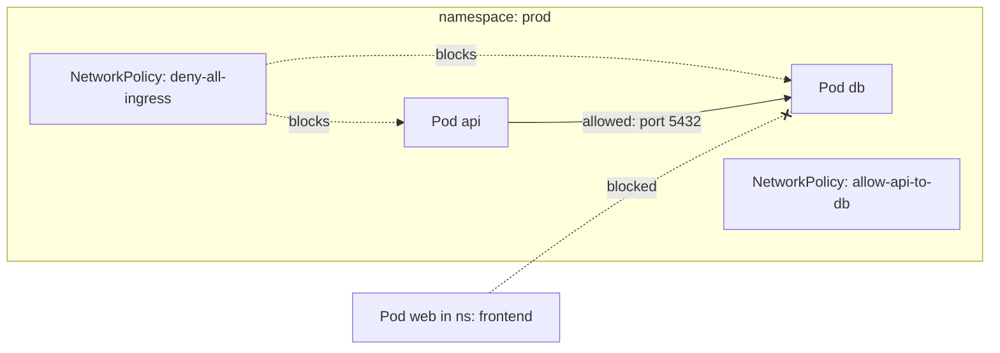
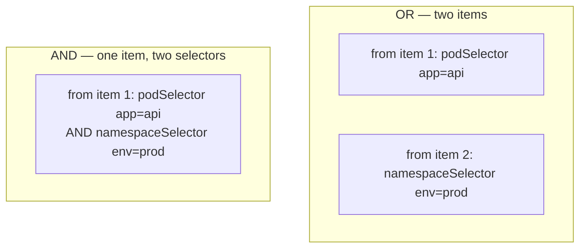
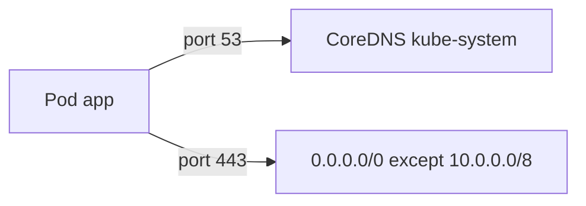

# 📘 Topic 22 — Network Policies

**Official Documentation Reference**
- Network Policies: https://kubernetes.io/docs/concepts/services-networking/network-policies/
- Declare Network Policy: https://kubernetes.io/docs/tasks/administer-cluster/declare-network-policy/
- GKE Network Policy: https://cloud.google.com/kubernetes-engine/docs/how-to/network-policy
- EKS Network Policy (Calico/VPC CNI): https://docs.aws.amazon.com/eks/latest/userguide/cni-network-policy.html

---

## 🔹 Definition
A **NetworkPolicy** is a namespaced Kubernetes object that controls L3/L4 traffic flow (TCP/UDP/SCTP) to and from pods using label selectors, namespace selectors, and IP blocks. Without any policy, all traffic is allowed (default-allow).

---

## 🔹 About

### The zero-trust starting point
By default, every pod can talk to every other pod. NetworkPolicy lets you move to **default-deny** and then explicitly whitelist needed traffic.

### Policy model
- A policy selects pods via `spec.podSelector`.
- It declares `policyTypes: [Ingress]`, `[Egress]`, or `[Ingress, Egress]`.
- An **empty** `spec.podSelector: {}` targets ALL pods in the namespace.
- An **empty** `ingress: []` means deny all ingress. An **omitted** `ingress` field means no change (still allowed unless another policy denies).
- Policies are **additive** — multiple policies union their allows; there is no explicit "deny" rule.

### Rule structure
Each ingress/egress rule has `from`/`to` (peers) and `ports`:
- `podSelector` — match pods by labels (same namespace by default).
- `namespaceSelector` — match pods in namespaces matching labels.
- `ipBlock` — CIDR range + optional `except`.
- `ports` — port + protocol.

### Critical subtlety: AND vs OR
```yaml
ingress:
- from:
  - podSelector: { matchLabels: { app: api } }    # source 1
  - namespaceSelector: { matchLabels: { env: prod } }  # source 2
  ports: [{ port: 80 }]
```
The two `from` entries are **OR** — either match suffices. But:
```yaml
- from:
  - podSelector: { matchLabels: { app: api } }
    namespaceSelector: { matchLabels: { env: prod } }
```
Here podSelector AND namespaceSelector are in the same item → **AND** — must match both.

### CNI requirement
NetworkPolicy is just an API object. Enforcement depends on the CNI plugin. **kube-proxy does NOT enforce NetworkPolicy.** The CNI must support it:
- Calico ✅
- Cilium ✅
- GKE Dataplane V2 ✅
- EKS VPC CNI (native policy, K8s 1.25+) ✅
- Flannel ❌ (no policy enforcement)

---

## 🔹 How It Integrates With Other Kubernetes Components
| Component | Interaction |
|---|---|
| CNI plugin | Enforces the actual iptables/eBPF rules |
| Pods | Selected by `podSelector` |
| Namespaces | Selected by `namespaceSelector` (need labels on NS) |
| Services | Policies target pods, not Services; traffic to Service ClusterIP resolves to pod IPs before policy check |
| Ingress controller | Must be allowed in NetworkPolicy; controller pods live in their own NS |
| DNS (CoreDNS) | Must explicitly allow egress to `kube-system` for DNS resolution |

---

## 🏗️ Diagrams

### Default deny + explicit allow


### AND vs OR in `from`


### Egress DNS + external


---

## 💻 Real-World Examples

### Example 1 — Default deny all ingress
```yaml
apiVersion: networking.k8s.io/v1
kind: NetworkPolicy
metadata: { name: deny-all-ingress, namespace: prod }
spec:
  podSelector: {}
  policyTypes: [Ingress]
```

### Example 2 — Default deny all egress
```yaml
apiVersion: networking.k8s.io/v1
kind: NetworkPolicy
metadata: { name: deny-all-egress, namespace: prod }
spec:
  podSelector: {}
  policyTypes: [Egress]
```

### Example 3 — Allow api → db on port 5432
```yaml
apiVersion: networking.k8s.io/v1
kind: NetworkPolicy
metadata: { name: allow-api-db, namespace: prod }
spec:
  podSelector: { matchLabels: { app: db } }
  policyTypes: [Ingress]
  ingress:
  - from:
    - podSelector: { matchLabels: { app: api } }
    ports: [{ protocol: TCP, port: 5432 }]
```

### Example 4 — Allow DNS egress for all pods
```yaml
apiVersion: networking.k8s.io/v1
kind: NetworkPolicy
metadata: { name: allow-dns, namespace: prod }
spec:
  podSelector: {}
  policyTypes: [Egress]
  egress:
  - to: []                          # any destination
    ports:
    - { protocol: UDP, port: 53 }
    - { protocol: TCP, port: 53 }
```

### Example 5 — Cross-namespace: frontend NS → api in prod NS
```yaml
apiVersion: networking.k8s.io/v1
kind: NetworkPolicy
metadata: { name: allow-frontend, namespace: prod }
spec:
  podSelector: { matchLabels: { app: api } }
  policyTypes: [Ingress]
  ingress:
  - from:
    - namespaceSelector: { matchLabels: { name: frontend } }
      podSelector: { matchLabels: { app: web } }
    ports: [{ port: 8080 }]
```

### Example 6 — Allow egress to external CIDR only
```yaml
spec:
  podSelector: { matchLabels: { app: worker } }
  policyTypes: [Egress]
  egress:
  - to:
    - ipBlock: { cidr: 0.0.0.0/0, except: [10.0.0.0/8, 172.16.0.0/12, 192.168.0.0/16] }
    ports: [{ port: 443 }]
  - ports: [{ protocol: UDP, port: 53 }]     # DNS
```

---

## 💻 Related Commands

| Command | Flag | Purpose | Example |
|---|---|---|---|
| `kubectl get netpol` | `-n <ns>` | List policies | `kubectl get netpol -n prod` |
| `kubectl describe netpol` | `<name>` | Show rules | `kubectl describe netpol allow-api-db -n prod` |
| `kubectl apply -f` | — | Apply policy | `kubectl apply -f deny-all.yaml` |
| `kubectl delete netpol` | `<name>` | Remove (reverts to default-allow) | `kubectl delete netpol deny-all-ingress -n prod` |
| `kubectl label ns` | `key=val` | Label NS for namespaceSelector | `kubectl label ns frontend name=frontend` |
| `kubectl exec` | `-- wget -qO- --timeout=3` | Test connectivity | `kubectl exec api-0 -n prod -- wget -qO- --timeout=3 http://db:5432` |

---

## 🚨 Scenarios

### Scenario 1 — Applied deny-all, now DNS is broken
- **Cause**: deny-all egress blocks port 53 to CoreDNS.
- **Fix**: add an egress rule allowing UDP/TCP 53 (Example 4).

### Scenario 2 — Policy in place but traffic still flows
- **Cause**: CNI doesn't enforce NetworkPolicy (e.g., Flannel, or GKE Standard without DP-v2 / Calico enabled).
- **Fix**: enable a policy-capable CNI or switch to Dataplane V2 / Calico.

### Scenario 3 — Cross-namespace traffic blocked unexpectedly
- **Cause**: namespace doesn't have the label `namespaceSelector` expects.
- **Fix**: `kubectl label ns <ns> name=<ns>` (K8s 1.21+ auto-labels `kubernetes.io/metadata.name`).

### Scenario 4 — Ingress controller can't reach backend pods
- **Cause**: deny-all ingress blocks traffic from `ingress-nginx` namespace.
- **Fix**: add ingress rule with `namespaceSelector: {matchLabels: {kubernetes.io/metadata.name: ingress-nginx}}`.

### Scenario 5 — Network policy makes debugging impossible
- **Cause**: `kubectl exec` still works (it goes through apiserver, not the network), but `curl` from debug pods fails.
- **Fix**: temporarily relax policy for debug, or deploy debug pod in the same namespace with allowed labels.

---

## ☁️ GCP GKE Perspective
- **Dataplane V2** (default on new clusters) enforces NetworkPolicy natively via eBPF. No additional setup.
- **GKE Standard without DP-v2**: enable Calico with `--enable-network-policy` at cluster creation.
- **Autopilot**: DP-v2 is always enabled; NetworkPolicy works out of the box.
- **GKE Enterprise**: **Anthos Network Policy** + **Policy Controller** for fleet-wide enforcement.

## 🟧 AWS EKS Perspective
- **VPC CNI native Network Policy** (K8s 1.25+): enable with add-on parameter `enableNetworkPolicy: true`. Uses eBPF.
- Alternatively install **Calico** as a DaemonSet alongside VPC CNI (Calico handles policy, VPC CNI handles IP assignment).
- **Fargate**: limited NetworkPolicy support (VPC CNI native policy only, K8s 1.25+).
- **Security Groups for Pods** — a VPC-level alternative (or complement) to K8s NetworkPolicy; assigns actual AWS SGs to pods.

---

## 🧪 Hands-On Lab Exercises

### Lab 22.1 — Default deny + whitelist (Beginner, 30 min)
**Steps**
```bash
kubectl create ns lab22
kubectl run web --image=nginx -n lab22 --labels=app=web
kubectl run client --image=busybox -n lab22 --labels=app=client -- sleep 3600
# Before policy
kubectl exec -n lab22 client -- wget -qO- --timeout=3 http://$(kubectl get pod web -n lab22 -o jsonpath='{.status.podIP}')
# → works

# Apply deny-all
kubectl apply -n lab22 -f - <<EOF
apiVersion: networking.k8s.io/v1
kind: NetworkPolicy
metadata: { name: deny-all }
spec:
  podSelector: {}
  policyTypes: [Ingress]
EOF
kubectl exec -n lab22 client -- wget -qO- --timeout=3 http://$(kubectl get pod web -n lab22 -o jsonpath='{.status.podIP}')
# → timeout

# Whitelist client → web
kubectl apply -n lab22 -f - <<EOF
apiVersion: networking.k8s.io/v1
kind: NetworkPolicy
metadata: { name: allow-client }
spec:
  podSelector: { matchLabels: { app: web } }
  policyTypes: [Ingress]
  ingress:
  - from: [{ podSelector: { matchLabels: { app: client } } }]
    ports: [{ port: 80 }]
EOF
kubectl exec -n lab22 client -- wget -qO- --timeout=3 http://$(kubectl get pod web -n lab22 -o jsonpath='{.status.podIP}')
# → works
```
**Cleanup**: `kubectl delete ns lab22`.

### Lab 22.2 — Cross-namespace + egress DNS (Intermediate, 45 min)
**Steps**
1. Create `ns-a` (label: `name=ns-a`) and `ns-b`.
2. Deploy `api` in `ns-b` with deny-all ingress.
3. Allow only pods from `ns-a` with label `role=gateway` to reach `api` on port 8080.
4. Test from `ns-a` pod with `role=gateway` → works.
5. Test from `ns-a` pod without label → blocked.
6. Add egress deny-all to `ns-b` → DNS breaks. Fix with egress DNS rule.

**Cleanup**: `kubectl delete ns ns-a ns-b`.

### Lab 22.3 — Full zero-trust namespace on GKE/EKS (Advanced, 90 min)
**Steps**
1. On GKE (DP-v2) or EKS (VPC CNI native policy enabled).
2. Create namespace `secure` with:
   - deny-all ingress
   - deny-all egress
   - allow DNS egress
   - allow api → db ingress on 5432
   - allow frontend NS → api on 8080
   - allow egress to external HTTPS only (Example 6)
3. Deploy web, api, db pods with correct labels.
4. Verify each path: `kubectl exec` + `wget --timeout=3`.
5. Attempt unauthorized paths → all timeout.

**Cleanup**: delete namespace.

**Bonus**: Install Cilium Hubble (`cilium hubble ui`) and visually observe allowed vs denied flows.

---

## 🎯 Interview Deliverable Answer (60–90 s)
"**What**: A NetworkPolicy is a Kubernetes resource that controls L3/L4 traffic flow using label selectors. By default, all traffic is allowed. Applying a policy creates an implicit deny for the traffic type it covers — you then whitelist specific flows.  
**Why**: Defense in depth. Even if an attacker compromises a frontend pod, a NetworkPolicy prevents it from reaching the database directly. It's the Kubernetes equivalent of a firewall.  
**How**: I start every namespace with a deny-all ingress and deny-all egress policy, then add explicit allows: DNS egress to kube-system, app-to-app on specific ports, Ingress controller to frontend, and external HTTPS for API calls. I label namespaces for cross-namespace selectors and verify with `kubectl exec` connectivity tests. On GKE Dataplane V2 or EKS VPC CNI with native policy, enforcement is automatic — no extra CNI install.  
**Example**: After a pen-test finding that any pod could reach our Postgres database, we rolled out default-deny plus whitelist across all production namespaces in a single sprint. The pen-tester re-tested and confirmed lateral movement was blocked."

---

## ❓ Possible Interview Questions

### Basic
**Q1. What does a NetworkPolicy do?** Controls ingress/egress traffic to/from pods at L3/L4.  
**Q2. Default behavior without any policy?** All traffic allowed.  
**Q3. Does kube-proxy enforce NetworkPolicy?** No — the CNI plugin does.

### Intermediate
**Q4. How do you implement default-deny?** Empty podSelector + policyTypes [Ingress] + no ingress rules.  
**Q5. AND vs OR in `from` rules?** Separate list items = OR. podSelector + namespaceSelector in the same item = AND.  
**Q6. Which CNIs enforce NetworkPolicy?** Calico, Cilium, GKE DP-v2, EKS VPC CNI (native). Flannel does NOT.

### Advanced
**Q7. How do you allow DNS after deny-all egress?** Explicit egress rule for UDP+TCP port 53 to any destination (or to kube-system CoreDNS pods via namespaceSelector).  
**Q8. Can NetworkPolicy filter by Service name?** No — it works at pod IP level. Service resolution happens before policy check.  
**Q9. Are policies additive or subtractive?** Additive — you can only add allows, never explicit denies. Multiple policies union their allows.

### Scenario-based
**Q10. After applying deny-all, DNS broke — what happened?** DNS queries (UDP 53) to CoreDNS blocked by egress deny. Fix: add egress DNS allow rule.

### GKE-specific
**Q11. Does Autopilot enforce NetworkPolicy?** Yes — DP-v2 is always enabled on Autopilot.

### EKS-specific
**Q12. How do you enable native NetworkPolicy on EKS?** Update VPC CNI add-on with `enableNetworkPolicy: true` (K8s 1.25+).

### Hands-on / Lab-based
**Q13. How do you test that a NetworkPolicy works?** `kubectl exec <client> -- wget -qO- --timeout=3 http://<target-ip>:<port>` — should timeout if blocked, return content if allowed.  
**Q14. Show me a cross-namespace policy.** `namespaceSelector: {matchLabels: {name: frontend}}` + `podSelector: {matchLabels: {role: gateway}}` in the ingress rule.  
**Q15. How would you visualize network flows?** Cilium Hubble UI, Calico Flow Logs, or GKE Flow Logs in Cloud Logging.

