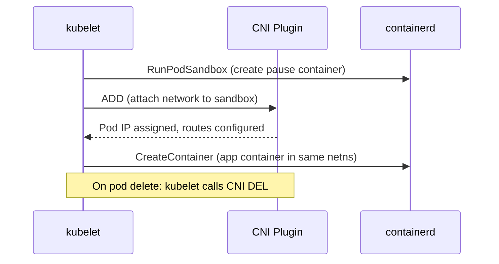
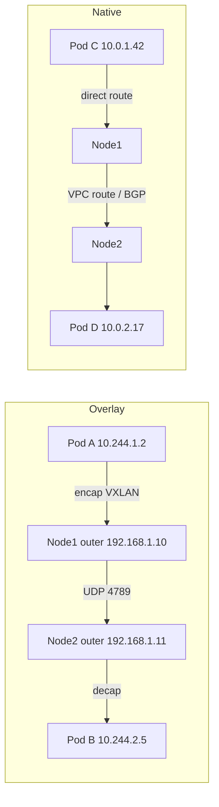
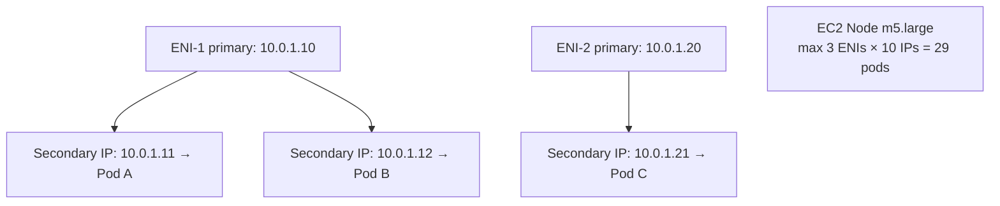

# 📘 Topic 23 — CNI Plugins (Calico, Cilium, VPC CNI, GKE Dataplane V2)

**Official Documentation Reference**
- CNI / Network Plugins: https://kubernetes.io/docs/concepts/extend-kubernetes/compute-storage-net/network-plugins/
- Cluster Networking: https://kubernetes.io/docs/concepts/cluster-administration/networking/
- Calico: https://docs.tigera.io/calico/latest/about/
- Cilium: https://docs.cilium.io/en/stable/overview/intro/
- GKE DP-v2: https://cloud.google.com/kubernetes-engine/docs/concepts/dataplane-v2
- EKS VPC CNI: https://docs.aws.amazon.com/eks/latest/userguide/managing-vpc-cni.html
- Flannel: https://github.com/flannel-io/flannel

---

## 🔹 Definition
A **CNI (Container Network Interface) plugin** is the component that assigns IP addresses to pods, wires their network namespaces, programs routes between nodes, and (optionally) enforces NetworkPolicy. Kubernetes delegates all networking to the CNI — it has no built-in network implementation.

---

## 🔹 About

### Comparison table
| Plugin | Data plane | Overlay | Network Policy | eBPF | Best for |
|---|---|---|---|---|---|
| **Calico** | iptables or eBPF | VXLAN/IPIP/none (BGP native) | ✅ (rich) | Optional | On-prem, multi-cloud, policy-heavy |
| **Cilium** | eBPF | VXLAN/GENEVE/native | ✅ (L3–L7) | Required | Observability, L7 policy, performance |
| **Flannel** | iptables | VXLAN/host-gw | ❌ | No | Simplest setup, learning |
| **GKE Dataplane V2** | eBPF (Cilium) | Native VPC routing | ✅ | Built-in | GKE (default) |
| **VPC CNI (AWS)** | iptables/eBPF | No overlay (native ENI IPs) | ✅ (native, K8s 1.25+) | Optional | EKS default |
| **Azure CNI** | iptables | VNet / overlay | ✅ (Calico or Cilium) | Optional | AKS |
| **Weave Net** | user-space / kernel | VXLAN | ✅ (basic) | No | Legacy |
| **kindnet** | iptables | ptp | ❌ | No | Kind clusters (dev) |

### Overlay vs native routing
- **Overlay (VXLAN/GENEVE/IPIP)**: encapsulates pod packets in outer UDP. Works anywhere (even across cloud VPCs, on-prem). Adds ~50 bytes overhead + slight latency.
- **Native/BGP routing**: no encapsulation. Calico peers with ToR switches via BGP; cloud CNIs use VPC route tables or ENIs. Best performance but requires infrastructure support.

### IP address management (IPAM)
Each CNI manages its own IPAM:
- Calico: `IPPool` CRD defines pod CIDRs.
- Cilium: `CiliumNode` stores pod CIDRs per node.
- VPC CNI: secondary ENI IPs from VPC subnets; `WARM_ENI_TARGET`, `ENABLE_PREFIX_DELEGATION`.
- GKE DP-v2: alias IP ranges from VPC.

### eBPF advantage
eBPF programs run inside the Linux kernel at socket, TC, and XDP hooks. They replace iptables for service routing (kube-proxy replacement), provide L7 visibility (Hubble on Cilium), and enforce NetworkPolicy with lower overhead and better debugging.

---

## 🔹 How It Integrates With Other Kubernetes Components
| Component | Interaction |
|---|---|
| kubelet | Calls CNI binary at pod creation/deletion |
| kube-proxy | Works alongside CNI (or replaced by eBPF) |
| NetworkPolicy | CNI enforces (Calico/Cilium/DP-v2/VPC CNI) |
| CoreDNS | Depends on CNI for pod-to-pod connectivity |
| Service mesh | Runs on top of CNI networking layer |
| Scheduler | Node available only after CNI assigns IP |

---

## 🏗️ Diagrams

### CNI in the pod lifecycle


### Overlay vs native


### VPC CNI IP allocation


---

## 💻 Real-World Examples

### Example 1 — Install Calico on kubeadm
```bash
kubectl apply -f https://raw.githubusercontent.com/projectcalico/calico/v3.28.0/manifests/calico.yaml
kubectl get pods -n calico-system
kubectl get ippool -o yaml            # see CIDR, VXLAN mode
```

### Example 2 — Install Cilium via Helm
```bash
helm repo add cilium https://helm.cilium.io/
helm install cilium cilium/cilium --version 1.16.0 \
  --namespace kube-system \
  --set kubeProxyReplacement=true \
  --set hubble.relay.enabled=true \
  --set hubble.ui.enabled=true
kubectl -n kube-system get pods -l k8s-app=cilium
cilium status
```

### Example 3 — Check GKE Dataplane V2
```bash
gcloud container clusters describe prod --region asia-south1 \
  --format='value(networkPolicy.provider)'    # PROVIDER_UNSPECIFIED means DP-v2
kubectl get pods -n kube-system -l k8s-app=cilium
```

### Example 4 — EKS VPC CNI tuning
```bash
# Enable prefix delegation for more pod IPs
kubectl set env daemonset aws-node -n kube-system \
  ENABLE_PREFIX_DELEGATION=true \
  WARM_PREFIX_TARGET=1

# Check max pods per node
kubectl get node <n> -o jsonpath='{.status.capacity.pods}'
```

---

## 💻 Related Commands

| Command | Flag | Purpose | Example |
|---|---|---|---|
| `kubectl get pods -n kube-system` | `-l k8s-app=calico-node` | Calico agent pods | |
| `kubectl get pods -n kube-system` | `-l k8s-app=cilium` | Cilium agent pods | |
| `calicoctl get ippool` | — | Calico IP pools | `calicoctl get ippool -o yaml` |
| `cilium status` | — | Cilium health | `cilium status` |
| `cilium connectivity test` | — | E2E connectivity | `cilium connectivity test` |
| `hubble observe` | `--follow` | Live flow logs | `hubble observe -n prod --follow` |
| `kubectl get ds aws-node` | `-n kube-system` | VPC CNI DaemonSet | |
| `kubectl describe node` | — | Pod CIDR, addresses | `kubectl describe node worker-1` |
| `kubectl logs -n kube-system` | `<cni-pod>` | CNI agent logs | |

---

## 🚨 Scenarios

### Scenario 1 — Nodes stay NotReady after kubeadm init
- **Cause**: no CNI installed.
- **Fix**: `kubectl apply -f calico.yaml` or install Cilium.

### Scenario 2 — Pod-to-pod across nodes fails, same-node works
- **Cause**: overlay tunnel blocked (UDP 4789 / IP-in-IP protocol 4); or missing VPC routes.
- **Fix**: open firewall ports; on cloud check VPC route table for pod CIDRs.

### Scenario 3 — VPC CNI IP exhaustion on EKS
- **Cause**: many pods per node without prefix delegation.
- **Fix**: enable `ENABLE_PREFIX_DELEGATION=true`; add secondary CIDRs to VPC; use `MINIMUM_IP_TARGET`.

### Scenario 4 — Cilium Hubble shows drops on legitimate traffic
- **Cause**: L7 policy too restrictive or missing `toFQDNs` rule.
- **Fix**: `hubble observe --verdict DROPPED` → identify source/destination, refine CiliumNetworkPolicy.

### Scenario 5 — Calico performance degraded at scale
- **Cause**: iptables mode with thousands of policies.
- **Fix**: switch to Calico eBPF data plane (`calicoctl` patch felixConfiguration).

---

## ☁️ GCP GKE Perspective
- **Dataplane V2** (default since ~2023 on new clusters) = Cilium eBPF data plane managed by Google. Replaces kube-proxy. NetworkPolicy enforced natively. No user install needed.
- **VPC-native clusters** use alias IP ranges for pod CIDRs — no overlay.
- To get Cilium-level features (L7 policy, Hubble): install open-source Cilium alongside DP-v2 is not recommended — use **GKE Enterprise** features or standalone Cilium on Standard.
- On **Autopilot**: DP-v2 always active; no CNI choice.

## 🟧 AWS EKS Perspective
- **VPC CNI** (default) — every pod gets a real VPC IP. No overlay.
- **Native Network Policy** (K8s 1.25+ add-on parameter `enableNetworkPolicy: true`) uses eBPF.
- **Calico** can run alongside VPC CNI for richer policy (Calico handles policy, VPC CNI handles IPAM).
- **Cilium** can replace VPC CNI entirely (with `--set eni.enabled=true` for ENI integration) — gives Hubble, L7 policy, kube-proxy replacement.
- Key tuning: `WARM_ENI_TARGET`, `ENABLE_PREFIX_DELEGATION`, `MINIMUM_IP_TARGET`, `MAX_ENI`.

---

## 🧪 Hands-On Lab Exercises

### Lab 23.1 — Compare Flannel vs Calico on Kind (Beginner, 45 min)
**Steps**
1. Create Kind cluster with default CNI (kindnet). Run `kubectl get pods -A`. Test pod-to-pod.
2. Delete cluster. Create new Kind cluster with `disableDefaultCNI: true`:
```yaml
kind: Cluster
apiVersion: kind.x-k8s.io/v1alpha4
networking: { disableDefaultCNI: true }
nodes: [{ role: control-plane }, { role: worker }]
```
3. Nodes are NotReady. Install Calico: `kubectl apply -f calico.yaml`. Wait for Ready.
4. Apply a NetworkPolicy → enforced (unlike kindnet).

**Cleanup**: `kind delete cluster`.

### Lab 23.2 — Cilium + Hubble observability (Intermediate, 60 min)
**Steps**
1. Kind cluster with `disableDefaultCNI: true`.
2. `helm install cilium ... --set kubeProxyReplacement=true --set hubble.relay.enabled=true --set hubble.ui.enabled=true`.
3. `cilium status` → OK.
4. `cilium connectivity test` → all pass.
5. Deploy web + client. Apply deny-all + whitelist NetworkPolicy.
6. `hubble observe -n default --follow` → see ALLOWED and DROPPED flows.
7. Port-forward Hubble UI: `cilium hubble ui`.

**Cleanup**: `kind delete cluster`.

### Lab 23.3 — VPC CNI prefix delegation on EKS (Advanced, 60 min)
**Steps**
1. Create EKS cluster with `t3.medium` nodes (3 ENIs, 15 IPs default max).
2. Deploy 20 replicas → some Pending (IP exhaustion).
3. Enable prefix delegation:
```bash
kubectl set env ds aws-node -n kube-system ENABLE_PREFIX_DELEGATION=true WARM_PREFIX_TARGET=1
kubectl rollout restart ds aws-node -n kube-system
```
4. `kubectl get node <n> -o jsonpath='{.status.capacity.pods}'` → now higher (110+).
5. Scale to 50 replicas → all Running.

**Cleanup**: `eksctl delete cluster`.

---

## 🎯 Interview Deliverable Answer (60–90 s)
"**What**: A CNI plugin is the component that assigns pod IPs, programs routes between nodes, and optionally enforces NetworkPolicy. Kubernetes has no built-in networking — the CNI contract delegates all of it.  
**Why**: Different environments need different trade-offs. On-prem Calico with BGP gives native routing without overlay overhead. Cilium's eBPF data plane replaces kube-proxy and adds L7 visibility. Cloud-native CNIs like VPC CNI on EKS give every pod a real VPC IP for native security-group integration.  
**How**: On GKE I rely on Dataplane V2 — it's Cilium-based, managed by Google, replaces kube-proxy, and enforces NetworkPolicy out of the box. On EKS I use VPC CNI with prefix delegation enabled so we get 100+ pods per node without IP exhaustion; and I enable native Network Policy. For on-prem kubeadm clusters I install Calico with VXLAN overlay and tight IPPool CIDRs.  
**Example**: On a 50-node EKS cluster we hit pod IP limits at 15 pods per node. Enabling prefix delegation increased capacity to 110 pods per node — we avoided adding 30 extra nodes, saving roughly $8K/month."

---

## ❓ Possible Interview Questions

### Basic
**Q1. What is CNI?** Container Network Interface — the standard Kubernetes uses for pod networking.  
**Q2. Name 3 CNI plugins.** Calico, Cilium, Flannel (or VPC CNI, DP-v2).  
**Q3. Does Flannel enforce NetworkPolicy?** No.

### Intermediate
**Q4. Overlay vs native routing?** Overlay encapsulates (VXLAN); native uses host/VPC routes. Native is faster but needs infra support.  
**Q5. What does VPC CNI do differently?** Assigns real VPC IPs to pods via secondary ENI addresses — no overlay, native VPC routing and SG integration.  
**Q6. What is GKE Dataplane V2?** Google-managed Cilium eBPF data plane that replaces kube-proxy and enforces NetworkPolicy natively.

### Advanced
**Q7. Explain eBPF advantage for networking.** eBPF programs run in-kernel at socket/TC/XDP hooks — replacing iptables with O(1) lookups, providing L7 visibility (Hubble), and eliminating kube-proxy overhead.  
**Q8. How does Calico BGP mode work?** Calico's BIRD daemon peers with infrastructure routers, advertising pod CIDR routes. No encapsulation — packets are routed natively.  
**Q9. What is prefix delegation on VPC CNI?** Instead of one IP per ENI slot, VPC CNI allocates a /28 prefix (16 IPs) per slot — dramatically increasing pod density.

### Scenario-based
**Q10. Nodes NotReady after kubeadm init — first check?** Is a CNI installed? `kubectl get pods -n kube-system` → look for calico/cilium/flannel pods.

### GKE-specific
**Q11. Can you install your own Cilium on Autopilot?** No — Autopilot uses DP-v2 exclusively. On Standard you can install open-source Cilium instead.

### EKS-specific
**Q12. How do you check max pods per node on EKS?** `kubectl get node <n> -o jsonpath='{.status.capacity.pods}'` — determined by ENI count × IPs per ENI (or prefix delegation formula).

### Hands-on / Lab-based
**Q13. How did you enable Hubble?** `helm install cilium ... --set hubble.relay.enabled=true --set hubble.ui.enabled=true`; then `cilium hubble ui` or `hubble observe`.  
**Q14. Walk me through troubleshooting cross-node connectivity.** Check CNI DaemonSet running; check node firewall (VXLAN UDP 4789 or IPIP protocol 4); verify pod CIDR routes; `tcpdump` on node interfaces; check MTU.  
**Q15. How would you migrate from Flannel to Calico?** Install Calico with `--set networking: none` (policy only) alongside Flannel first; then drain nodes, reconfigure to full Calico, uncordon.

