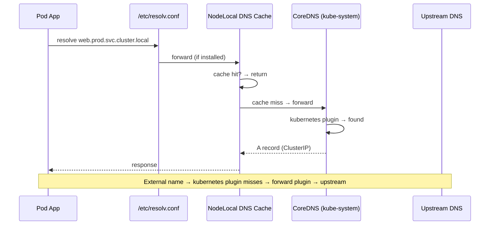
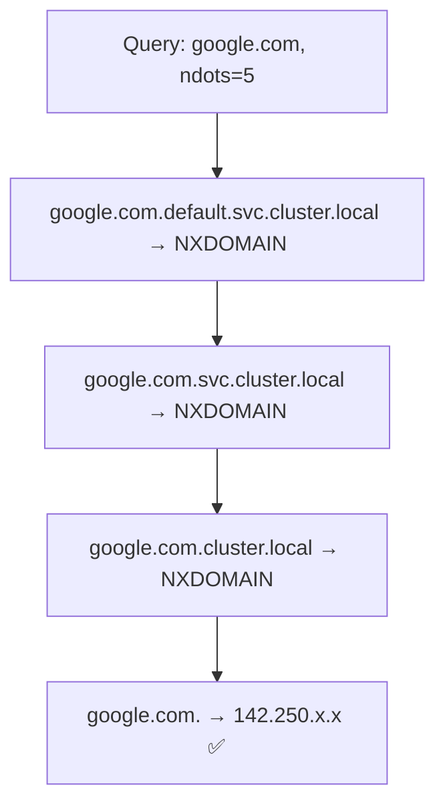

# 📘 Topic 24 — DNS in Kubernetes (CoreDNS)

**Official Documentation Reference**
- DNS for Services and Pods: https://kubernetes.io/docs/concepts/services-networking/dns-pod-service/
- Customizing DNS: https://kubernetes.io/docs/tasks/administer-cluster/dns-custom-nameservers/
- Debugging DNS resolution: https://kubernetes.io/docs/tasks/administer-cluster/dns-debugging-resolution/
- Using CoreDNS: https://kubernetes.io/docs/tasks/administer-cluster/coredns/
- NodeLocal DNSCache: https://kubernetes.io/docs/tasks/administer-cluster/nodelocaldns/
- GKE Cloud DNS: https://cloud.google.com/kubernetes-engine/docs/how-to/cloud-dns
- EKS CoreDNS add-on: https://docs.aws.amazon.com/eks/latest/userguide/managing-coredns.html

---

## 🔹 Definition
**CoreDNS** is the default cluster DNS server in Kubernetes (since 1.13). It resolves Service names, headless pod names, and external hostnames for every pod in the cluster. Every pod's `/etc/resolv.conf` points to CoreDNS.

---

## 🔹 About

### DNS records Kubernetes creates
| Object | DNS record |
|---|---|
| ClusterIP Service | `<svc>.<ns>.svc.cluster.local` → ClusterIP |
| Headless Service | `<svc>.<ns>.svc.cluster.local` → set of pod A records |
| StatefulSet pod | `<pod>.<svc>.<ns>.svc.cluster.local` → pod IP |
| Pod (opt-in) | `<pod-ip-dashed>.<ns>.pod.cluster.local` → pod IP |
| ExternalName Service | CNAME → `spec.externalName` |

### Pod resolv.conf
```
nameserver 10.96.0.10          # CoreDNS ClusterIP
search default.svc.cluster.local svc.cluster.local cluster.local
options ndots:5
```

### The `ndots:5` trap
If a name has fewer than 5 dots, the resolver appends each search domain before trying the absolute name. Querying `google.com` (1 dot) causes 4 failed queries before the absolute one succeeds. This wastes DNS capacity and adds latency.

**Fix**: set `dnsConfig.options: [{name: ndots, value: "2"}]` on pods that make many external calls, or always use FQDNs.

### CoreDNS Corefile
The Corefile (ConfigMap `coredns` in `kube-system`) controls plugins:
- `kubernetes` — handles cluster DNS
- `forward` — upstream forwarder (default `/etc/resolv.conf` of the node)
- `cache` — TTL caching (default 30 s)
- `ready` — readiness endpoint
- `health` — liveness endpoint
- `log` — query logging (for debug)
- `errors` — error logging

### Stub domains / conditional forwarding
Forward `*.corp.example.com` to a corporate DNS:
```
corp.example.com:53 {
  forward . 10.0.0.2
}
```
Add as an entry in the Corefile (edit the ConfigMap).

### NodeLocal DNSCache
A DaemonSet (`node-local-dns`) that runs a local caching DNS on each node at a link-local IP (`169.254.20.10`). Pods resolve via this cache → reduces cross-cluster DNS traffic, eliminates conntrack issues for UDP, and survives CoreDNS restarts.

### DNS policies for pods
| `dnsPolicy` | Behavior |
|---|---|
| `ClusterFirst` (default) | Use CoreDNS; fall back to node DNS for external |
| `Default` | Inherit node's `/etc/resolv.conf` |
| `None` | Entirely custom via `dnsConfig` |
| `ClusterFirstWithHostNet` | ClusterFirst even when `hostNetwork: true` |

---

## 🔹 How It Integrates With Other Kubernetes Components
| Component | Interaction |
|---|---|
| Service | CoreDNS watches Service/EndpointSlice objects to build DNS records |
| StatefulSet | Headless Service → per-pod DNS via CoreDNS |
| kubelet | Writes pod's `/etc/resolv.conf` with CoreDNS ClusterIP |
| NetworkPolicy | Must allow egress to CoreDNS (port 53 UDP/TCP) |
| Ingress / Gateway | External DNS (not CoreDNS) maps `app.example.com` → Ingress LB IP |
| NodeLocal DNSCache | DaemonSet that caches in front of CoreDNS |

---

## 🏗️ Diagrams

### DNS resolution flow


### ndots search expansion


---

## 💻 Real-World Examples

### Example 1 — Debug DNS from a pod
```bash
kubectl run dns-debug --image=registry.k8s.io/e2e-test-images/agnhost:2.45 --rm -it -- \
  /agnhost dns-test --upstream=10.96.0.10 --query=web.default.svc.cluster.local --count=1
# Or simpler
kubectl run tmp --image=busybox --rm -it -- nslookup web.default.svc.cluster.local
```

### Example 2 — Custom Corefile with stub domain
```bash
kubectl edit cm coredns -n kube-system
```
Add after the main `.:53` block:
```
corp.example.com:53 {
    errors
    cache 30
    forward . 10.0.0.2
}
```
Then: `kubectl rollout restart deploy coredns -n kube-system`.

### Example 3 — Pod with custom DNS config
```yaml
spec:
  dnsPolicy: None
  dnsConfig:
    nameservers: ["10.96.0.10"]
    searches: ["prod.svc.cluster.local","svc.cluster.local"]
    options: [{ name: ndots, value: "2" }]
```

### Example 4 — NodeLocal DNSCache install
```bash
kubectl apply -f https://raw.githubusercontent.com/kubernetes/kubernetes/master/cluster/addons/dns/nodelocaldns/nodelocaldns.yaml
```

---

## 💻 Related Commands

| Command | Flag | Purpose | Example |
|---|---|---|---|
| `kubectl get svc -n kube-system` | `kube-dns` | CoreDNS Service ClusterIP | `kubectl get svc kube-dns -n kube-system` |
| `kubectl get pods -n kube-system` | `-l k8s-app=kube-dns` | CoreDNS pods | |
| `kubectl logs -n kube-system` | `<coredns-pod>` | DNS logs | |
| `kubectl get cm coredns` | `-n kube-system -o yaml` | Corefile | |
| `kubectl exec` | `-- nslookup <svc>` | DNS lookup | `kubectl exec tmp -- nslookup web` |
| `kubectl exec` | `-- cat /etc/resolv.conf` | Check resolver config | |
| `kubectl rollout restart` | `deploy coredns -n kube-system` | Reload after Corefile edit | |
| `kubectl top pod` | `-n kube-system -l k8s-app=kube-dns` | CoreDNS resource usage | |

---

## 🚨 Scenarios

### Scenario 1 — All DNS resolution fails
- **Cause**: CoreDNS pods crashed or unschedulable.
- **Fix**: `kubectl get pods -n kube-system -l k8s-app=kube-dns` → check status. Restart: `kubectl rollout restart deploy coredns -n kube-system`.

### Scenario 2 — External DNS slow but internal fast
- **Cause**: `ndots:5` causing 4 wasted queries.
- **Fix**: set `ndots:2` on affected pods, or use FQDNs with trailing dot (`google.com.`).

### Scenario 3 — DNS 5-second delay (conntrack race)
- **Cause**: UDP conntrack race condition in kernel < 5.0.
- **Fix**: install NodeLocal DNSCache (uses TCP or link-local); or upgrade kernel.

### Scenario 4 — Custom stub domain not resolving
- **Cause**: Corefile syntax error; or CoreDNS not restarted.
- **Fix**: validate Corefile; `kubectl rollout restart deploy coredns -n kube-system`.

### Scenario 5 — CoreDNS OOMKilled at scale (thousands of Services)
- **Cause**: too many watches, cache pressure.
- **Fix**: increase CoreDNS memory limits; scale CoreDNS replicas; use dns-autoscaler; enable NodeLocal DNSCache.

---

## ☁️ GCP GKE Perspective
- **Cloud DNS for GKE** (`--cluster-dns=clouddns`): replaces CoreDNS with a fully managed Google Cloud DNS service. Eliminates CoreDNS scaling concerns. Supports cross-cluster DNS with GKE Multi-cluster Services.
- **NodeLocal DNSCache**: enabled with `gcloud container clusters update --update-addons=NodeLocalDNS=ENABLED`.
- **Autopilot**: Cloud DNS is default; CoreDNS not user-visible.

## 🟧 AWS EKS Perspective
- **CoreDNS** is an EKS managed add-on. Upgrade with `aws eks update-addon --addon-name coredns`.
- **Cluster proportional autoscaler** (`dns-autoscaler`) scales CoreDNS replicas based on node/pod count.
- **NodeLocal DNSCache**: not managed by EKS; install manually or via Helm.
- **Route 53 Resolver** can be forwarded to for private hosted zones via Corefile stub domains.
- **ExternalDNS controller** automatically creates Route 53 records for Ingress/Service objects.

---

## 🧪 Hands-On Lab Exercises

### Lab 24.1 — DNS resolution basics (Beginner, 30 min)
**Steps**
```bash
kubectl create deploy web --image=nginx
kubectl expose deploy web --port=80
kubectl run tmp --image=busybox --rm -it -- sh
# inside:
nslookup web
nslookup web.default.svc.cluster.local
nslookup google.com
cat /etc/resolv.conf
exit
```
**Verify**: `web` resolves to ClusterIP; `google.com` to public IP; resolv.conf shows `ndots:5`.

### Lab 24.2 — Fix ndots latency (Intermediate, 45 min)
**Steps**
1. Deploy a pod that curls `api.github.com` in a loop; time each request.
2. Observe 4 NXDOMAIN + 1 success per lookup: `kubectl logs -n kube-system <coredns> | grep github` (enable `log` plugin first).
3. Patch pod `dnsConfig: {options: [{name: ndots, value: "2"}]}`.
4. Time again — faster (1 query instead of 5).

**Bonus**: compare with FQDN `api.github.com.` (trailing dot).

### Lab 24.3 — NodeLocal DNSCache + stub domain (Advanced, 60 min)
**Steps**
1. Install NodeLocal DNSCache.
2. Verify pod resolv.conf points to `169.254.20.10`.
3. `kubectl exec tmp -- nslookup web` → served by local cache.
4. Add a stub domain for `corp.example.com` pointing to a local DNS server (deploy CoreDNS as a "corp" server).
5. Verify `kubectl exec tmp -- nslookup intranet.corp.example.com` resolves via stub.

**Cleanup**: remove NodeLocal DNSCache DaemonSet; revert Corefile.

---

## 🎯 Interview Deliverable Answer (60–90 s)
"**What**: CoreDNS is the default cluster DNS in Kubernetes. It watches Services and EndpointSlices and creates DNS records — `svc.ns.svc.cluster.local` for ClusterIP Services, per-pod records for headless Services. Every pod's `/etc/resolv.conf` points to CoreDNS.  
**Why**: DNS is how pods discover Services without hard-coding IPs. It's also the path for external resolution — pods reach the internet via CoreDNS forwarding to upstream.  
**How**: I tune two things in production. First, `ndots` — the default of 5 causes wasted lookups for external names; I set it to 2 on pods that do heavy external calls. Second, I install NodeLocal DNSCache to eliminate the UDP conntrack race and reduce cross-node DNS traffic. On GKE I use Cloud DNS for zero-ops scaling; on EKS I scale CoreDNS with the proportional autoscaler.  
**Example**: We saw intermittent 5-second DNS delays on a 100-node EKS cluster. Root cause was the UDP conntrack race. Installing NodeLocal DNSCache eliminated it completely — p99 DNS latency dropped from 5 s to 2 ms."

---

## ❓ Possible Interview Questions

### Basic
**Q1. What is CoreDNS?** Kubernetes' default cluster DNS server; resolves Service names to IPs.  
**Q2. What DNS record does a ClusterIP Service get?** `<svc>.<ns>.svc.cluster.local` → ClusterIP.  
**Q3. Where is the CoreDNS config?** ConfigMap `coredns` in `kube-system`.

### Intermediate
**Q4. What is `ndots:5` and why is it a problem?** Names with < 5 dots try all search domains before absolute — 4 wasted queries for external names.  
**Q5. What is a headless Service's DNS record?** Returns A records for each pod IP, not a ClusterIP.  
**Q6. How do you forward queries for `*.corp.com` to a corporate DNS?** Add a stub-domain block in the Corefile.

### Advanced
**Q7. What is NodeLocal DNSCache?** A per-node caching DNS DaemonSet at a link-local IP. Reduces CoreDNS load, eliminates conntrack race for UDP.  
**Q8. What is the 5-second DNS delay on Linux < 5.0?** A conntrack table race where simultaneous A and AAAA queries over the same UDP socket cause a 5 s timeout on one.  
**Q9. How does GKE Cloud DNS differ from CoreDNS?** Managed by Google, auto-scales, supports multi-cluster DNS (MCS), no in-cluster pods to manage.

### Scenario-based
**Q10. DNS works for internal Services but not for `google.com` — steps?** Check CoreDNS `forward` plugin upstream, node DNS config (`/etc/resolv.conf` on host), firewall allowing UDP 53 outbound.

### GKE-specific
**Q11. How do you enable Cloud DNS on GKE?** `gcloud container clusters update <n> --cluster-dns=clouddns --cluster-dns-scope=cluster`.

### EKS-specific
**Q12. How do you auto-scale CoreDNS on EKS?** Install `cluster-proportional-autoscaler` targeting the `coredns` Deployment.

### Hands-on / Lab-based
**Q13. How do you debug DNS from a pod?** `kubectl exec -- nslookup <name>`, `kubectl exec -- cat /etc/resolv.conf`, `kubectl logs <coredns-pod>`.  
**Q14. How would you measure the ndots impact?** Enable CoreDNS `log` plugin; query an external domain; count NXDOMAIN entries.  
**Q15. How do you test a stub-domain change?** Edit Corefile ConfigMap, restart CoreDNS, `nslookup <stub-domain-name>` from a pod.

