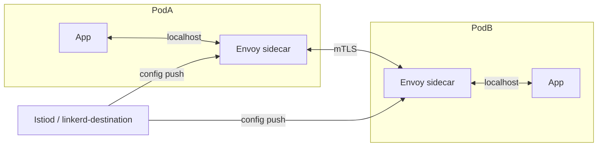
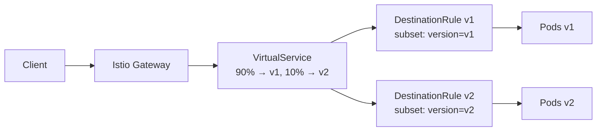
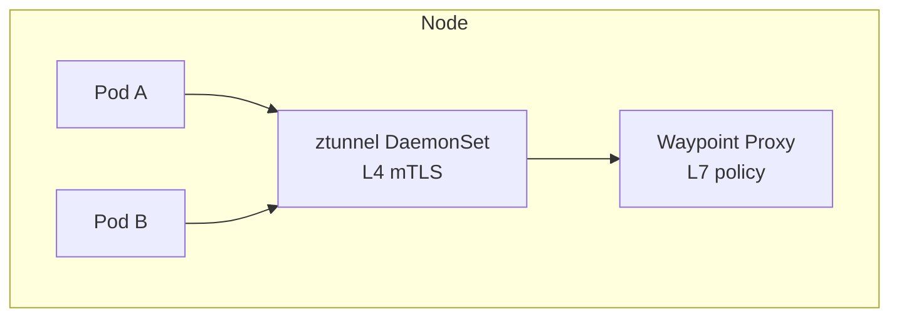

# 📘 Topic 25 — Service Mesh Overview (Istio, Linkerd)

**Official Documentation Reference**
- Istio: https://istio.io/latest/docs/overview/what-is-istio/
- Linkerd: https://linkerd.io/2/overview/
- Kubernetes Service concept: https://kubernetes.io/docs/concepts/services-networking/service/
- GKE Anthos Service Mesh / Istio: https://cloud.google.com/service-mesh/docs/overview
- EKS App Mesh: https://docs.aws.amazon.com/app-mesh/latest/userguide/what-is-app-mesh.html
- EKS + Istio: https://docs.aws.amazon.com/eks/latest/best-practices/service-mesh.html

---

## 🔹 Definition
A **service mesh** is a dedicated infrastructure layer that adds transparent networking capabilities to microservices — **mutual TLS (mTLS)**, **traffic management** (canary, retries, timeouts, circuit breaking), **observability** (distributed tracing, metrics, access logs), and **policy enforcement** — without changing application code. It does this by injecting a **sidecar proxy** (Envoy or linkerd2-proxy) into every pod.

---

## 🔹 About

### What problem does it solve?
Without a mesh, every microservice team must implement retries, timeouts, TLS, tracing headers, and circuit breaking in code (per language). A mesh extracts those cross-cutting concerns into a proxy layer — consistent across Go, Java, Python, Node, etc.

### Comparison
| Feature | Istio | Linkerd | AWS App Mesh |
|---|---|---|---|
| Proxy | Envoy | linkerd2-proxy (Rust) | Envoy |
| mTLS | ✅ auto | ✅ auto | ✅ |
| Traffic mgmt | Rich (VirtualService, DestinationRule) | Basic (HTTPRoute, TrafficSplit) | VirtualNode/VirtualRouter |
| Observability | Prometheus, Jaeger, Kiali | Built-in dashboard, Prometheus | CloudWatch, X-Ray |
| Complexity | High (many CRDs, Envoy config) | Low (opinionated, lightweight) | Medium (AWS-managed CP) |
| Resource overhead | ~100 Mi / sidecar | ~10–20 Mi / sidecar | ~100 Mi / sidecar |
| CNCF status | Graduated | Graduated | AWS proprietary |
| Best for | Enterprise, complex traffic | Simplicity, low overhead | AWS-native shops |

### Sidecar injection
Both Istio and Linkerd use a **mutating admission webhook** that auto-injects a proxy sidecar into every pod in labeled namespaces.

### Key Istio CRDs
| CRD | Purpose |
|---|---|
| `VirtualService` | L7 routing (canary weight, header match, retries) |
| `DestinationRule` | Load balancing policy, connection pool, outlier detection |
| `Gateway` | Ingress point for mesh traffic |
| `PeerAuthentication` | mTLS mode (STRICT / PERMISSIVE) |
| `AuthorizationPolicy` | L7 access control (source, method, path) |

### Key Linkerd CRDs
| CRD | Purpose |
|---|---|
| `HTTPRoute` (Gateway API) | L7 routing |
| `TrafficSplit` (SMI) | Canary weight shift |
| `Server` / `ServerAuthorization` | Fine-grained L4/L7 policy |

### Ambient mesh (Istio 1.22+)
Sidecar-less mode: replaces per-pod Envoy with a **ztunnel** DaemonSet (L4 mTLS) + optional **waypoint proxies** (L7). Reduces resource overhead dramatically.

### When NOT to use a mesh
- < 5 services (overhead > benefit).
- Latency-critical path where even 1 ms sidecar hop matters.
- Team lacks ops capacity for mesh upgrades.
- Simple mTLS-only need → consider SPIFFE/SPIRE or native Cilium mTLS.

---

## 🔹 How It Integrates With Other Kubernetes Components
| Component | Interaction |
|---|---|
| Pods | Sidecar proxy injected via admission webhook |
| Services | Mesh intercepts Service traffic via iptables/eBPF redirect |
| Ingress / Gateway | Mesh Gateway replaces or supplements K8s Ingress |
| NetworkPolicy | Mesh operates at L7 above L3/L4 NetworkPolicy |
| cert-manager | Istio uses its own CA (or integrates with cert-manager / Vault for custom CA) |
| Prometheus | Mesh proxies expose rich metrics (`istio_requests_total`, `response_latency`) |
| Tracing (Jaeger/Zipkin/Tempo) | Mesh propagates trace headers automatically |

---

## 🏗️ Diagrams

### Sidecar model


### Istio traffic management


### Ambient mesh (sidecar-less)


---

## 💻 Real-World Examples

### Example 1 — Install Istio + inject sidecar
```bash
istioctl install --set profile=demo -y
kubectl label namespace default istio-injection=enabled
kubectl apply -f https://raw.githubusercontent.com/istio/istio/release-1.22/samples/bookinfo/platform/kube/bookinfo.yaml
kubectl get pods       # each pod has 2/2 containers (app + envoy)
```

### Example 2 — Canary with VirtualService
```yaml
apiVersion: networking.istio.io/v1beta1
kind: VirtualService
metadata: { name: reviews }
spec:
  hosts: [reviews]
  http:
  - route:
    - destination: { host: reviews, subset: v1 }
      weight: 90
    - destination: { host: reviews, subset: v2 }
      weight: 10
---
apiVersion: networking.istio.io/v1beta1
kind: DestinationRule
metadata: { name: reviews }
spec:
  host: reviews
  subsets:
  - { name: v1, labels: { version: v1 } }
  - { name: v2, labels: { version: v2 } }
```

### Example 3 — Install Linkerd
```bash
linkerd install --crds | kubectl apply -f -
linkerd install | kubectl apply -f -
linkerd check
kubectl annotate namespace default linkerd.io/inject=enabled
kubectl rollout restart deploy/web
linkerd viz dashboard
```

### Example 4 — Strict mTLS (Istio)
```yaml
apiVersion: security.istio.io/v1beta1
kind: PeerAuthentication
metadata: { name: strict, namespace: prod }
spec:
  mtls: { mode: STRICT }
```

### Example 5 — AuthorizationPolicy (Istio)
```yaml
apiVersion: security.istio.io/v1beta1
kind: AuthorizationPolicy
metadata: { name: allow-api, namespace: prod }
spec:
  selector: { matchLabels: { app: db } }
  action: ALLOW
  rules:
  - from: [{ source: { principals: ["cluster.local/ns/prod/sa/api"] } }]
    to: [{ operation: { ports: ["5432"] } }]
```

---

## 💻 Related Commands

| Command | Flag | Purpose | Example |
|---|---|---|---|
| `istioctl install` | `--set profile=` | Install Istio | `istioctl install --set profile=default` |
| `istioctl analyze` | `-n <ns>` | Validate mesh config | `istioctl analyze -n prod` |
| `istioctl proxy-status` | — | Check sidecar sync | `istioctl proxy-status` |
| `istioctl proxy-config` | `routes <pod>` | Inspect Envoy routes | `istioctl proxy-config routes web-0` |
| `istioctl dashboard kiali` | — | Open Kiali UI | `istioctl dashboard kiali` |
| `linkerd install` | — | Install Linkerd | `linkerd install \| kubectl apply -f -` |
| `linkerd check` | — | Health check | `linkerd check` |
| `linkerd viz dashboard` | — | Open dashboard | `linkerd viz dashboard` |
| `linkerd viz stat` | `deploy -n <ns>` | Live metrics | `linkerd viz stat deploy -n prod` |
| `kubectl get vs,dr` | — | Istio routing objects | `kubectl get virtualservice,destinationrule` |

---

## 🚨 Scenarios

### Scenario 1 — Sidecar not injected
- **Cause**: namespace not labeled `istio-injection=enabled` (or `linkerd.io/inject=enabled`).
- **Fix**: label the namespace; restart pods.

### Scenario 2 — mTLS breaks non-meshed service
- **Cause**: strict mTLS enforced; unmeshed pod can't present cert.
- **Fix**: use `PeerAuthentication: PERMISSIVE` during migration; mesh all services before going STRICT.

### Scenario 3 — Canary weight not taking effect
- **Cause**: VirtualService host doesn't match Service name; or DestinationRule subsets don't match pod labels.
- **Fix**: `istioctl analyze` → shows mismatches.

### Scenario 4 — Increased latency after mesh install
- **Cause**: sidecar adds ~1–3 ms per hop; also resource contention if sidecar limits too low.
- **Fix**: set sidecar resource requests/limits; use Linkerd for lower overhead; or consider Istio Ambient for critical paths.

### Scenario 5 — Mesh upgrade breaks traffic
- **Cause**: control-plane/data-plane version mismatch after partial upgrade.
- **Fix**: follow canary upgrade path: upgrade control plane → upgrade sidecars namespace by namespace → verify with `istioctl proxy-status`.

---

## ☁️ GCP GKE Perspective
- **Anthos Service Mesh (ASM)** — Google's managed Istio distribution. `asmcli install` or Fleet API. Includes managed control plane, telemetry → Cloud Monitoring, and multi-cluster mesh via Fleet.
- **GKE Gateway API** can coexist with or replace Istio Gateway.
- **Autopilot** supports ASM (managed Istiod).
- **Cloud Service Mesh** (2024+) rebranding — includes multi-cluster, multi-cloud traffic management.

## 🟧 AWS EKS Perspective
- **AWS App Mesh** — managed Envoy-based mesh. VirtualNode, VirtualService, VirtualRouter CRDs. Integrates with X-Ray for tracing, CloudWatch for metrics.
- **Open-source Istio on EKS** — community-supported; use `istioctl` + Helm. Many teams prefer this over App Mesh for portability.
- **Linkerd on EKS** — lightweight, CNCF graduated, works well with VPC CNI.
- EKS Blueprints addons include Istio and App Mesh patterns.

---

## 🧪 Hands-On Lab Exercises

### Lab 25.1 — Istio Bookinfo with canary (Beginner, 60 min)
**Steps**
1. `istioctl install --set profile=demo -y`.
2. `kubectl label ns default istio-injection=enabled`.
3. Deploy Bookinfo sample.
4. Apply Example 2 VirtualService + DestinationRule.
5. `for i in $(seq 1 100); do curl -s http://$GATEWAY_URL/productpage | grep reviews; done` → 90% v1, 10% v2.
6. Shift to 50/50; then 100% v2.

**Cleanup**: `istioctl uninstall --purge -y && kubectl delete ns istio-system`.

### Lab 25.2 — Linkerd with live dashboard (Intermediate, 45 min)
**Steps**
1. Install Linkerd + viz extension.
2. `linkerd check` → all green.
3. Inject namespace: `kubectl annotate ns default linkerd.io/inject=enabled && kubectl rollout restart deploy`.
4. `linkerd viz dashboard` → see live p50/p99 latency, success rate, RPS per deployment.
5. Simulate failure → observe success rate drop in dashboard.

**Cleanup**: `linkerd viz uninstall | kubectl delete -f - && linkerd uninstall | kubectl delete -f -`.

### Lab 25.3 — mTLS verification + AuthorizationPolicy (Advanced, 90 min)
**Steps**
1. Install Istio (default profile).
2. Set PeerAuthentication to STRICT in `prod` namespace.
3. Deploy `api` and `db`. Verify traffic works (both have sidecars).
4. Deploy `attacker` pod **without** sidecar (`sidecar.istio.io/inject: "false"`).
5. `kubectl exec attacker -- curl db:5432` → **connection refused** (no mTLS cert).
6. Apply AuthorizationPolicy (Example 5) → only `api` SA can reach `db:5432`.
7. Test from another meshed pod with different SA → **denied (403)**.

**Cleanup**: `istioctl uninstall --purge -y`.

---

## 🎯 Interview Deliverable Answer (60–90 s)
"**What**: A service mesh is an infrastructure layer that transparently handles mTLS, traffic management, observability, and policy enforcement between microservices — typically by injecting a sidecar proxy like Envoy (Istio) or linkerd2-proxy (Linkerd) into every pod.  
**Why**: It decouples cross-cutting networking concerns from application code. Every team doesn't need to implement retries, circuit breaking, TLS, and tracing in their language — the proxy does it uniformly. It also enables zero-trust networking via mutual TLS without code changes.  
**How**: For most teams I recommend starting with Linkerd if they want simplicity, or Istio if they need advanced traffic management like weighted canaries, header-based routing, and fine-grained AuthorizationPolicy. On GKE I use Anthos Service Mesh (managed Istio). On EKS, either open-source Istio or Linkerd — App Mesh is an option but less portable. I roll out in stages: install control plane → inject one namespace → verify metrics/latency → expand.  
**Example**: We adopted Istio to implement canary releases for our payment service. Before the mesh, canaries required custom NGINX config. With Istio, a VirtualService weight shift from 5% to 100% replaced a 2-hour manual process with a 30-second `kubectl apply`."

---

## ❓ Possible Interview Questions

### Basic
**Q1. What is a service mesh?** Infrastructure layer adding mTLS, traffic control, observability, and policy via sidecar proxies — without app code changes.  
**Q2. Name two popular meshes.** Istio (Envoy), Linkerd (linkerd2-proxy).  
**Q3. How does the sidecar get injected?** Mutating admission webhook adds a proxy container to the pod spec.

### Intermediate
**Q4. Istio vs Linkerd?** Istio: powerful, complex, Envoy, rich CRDs. Linkerd: lightweight (~10 Mi sidecar), simple, CNCF graduated.  
**Q5. What is mTLS and why does a mesh enable it?** Mutual TLS = both client and server authenticate via certificates. The mesh's control plane issues certs automatically; proxies encrypt pod-to-pod traffic transparently.  
**Q6. What is a VirtualService in Istio?** L7 routing rule — canary weights, header matches, retries, fault injection.

### Advanced
**Q7. Explain Istio Ambient mode.** Replaces per-pod sidecars with a ztunnel DaemonSet (L4 mTLS) + optional waypoint proxies (L7). Reduces memory overhead by ~90%.  
**Q8. How does AuthorizationPolicy differ from NetworkPolicy?** NetworkPolicy is L3/L4 (IP/port). AuthorizationPolicy is L7 (HTTP method, path, source identity/SA).  
**Q9. When would you NOT use a mesh?** < 5 services, latency-critical with no budget for sidecar hop, team can't maintain mesh upgrades, or Cilium mTLS covers the need.

### Scenario-based
**Q10. After enabling strict mTLS, external traffic fails — why?** External callers don't have mesh certs. Fix: use an Istio Gateway (terminates external TLS, presents mesh cert internally) or set PeerAuthentication to PERMISSIVE on the edge service.

### GKE-specific
**Q11. What is Anthos Service Mesh?** Google-managed Istio. Managed control plane, Cloud Monitoring integration, multi-cluster mesh via Fleet.

### EKS-specific
**Q12. Istio or App Mesh on EKS?** Istio for portability and community; App Mesh for tight AWS integration (X-Ray, CloudWatch). Many teams prefer Istio.

### Hands-on / Lab-based
**Q13. How would you verify mTLS is working?** `istioctl proxy-config secret <pod>` shows active certs; or `kubectl exec -c istio-proxy <pod> -- curl localhost:15000/certs`; or check Kiali for padlock icons.  
**Q14. Show me a canary rollout with Istio.** VirtualService with `route: [{destination: {subset: v1}, weight: 90}, {destination: {subset: v2}, weight: 10}]`.  
**Q15. How do you monitor mesh health?** `istioctl proxy-status` for sync status; Prometheus scraping `istio_requests_total`; Kiali/Linkerd viz for topology and success rates.

