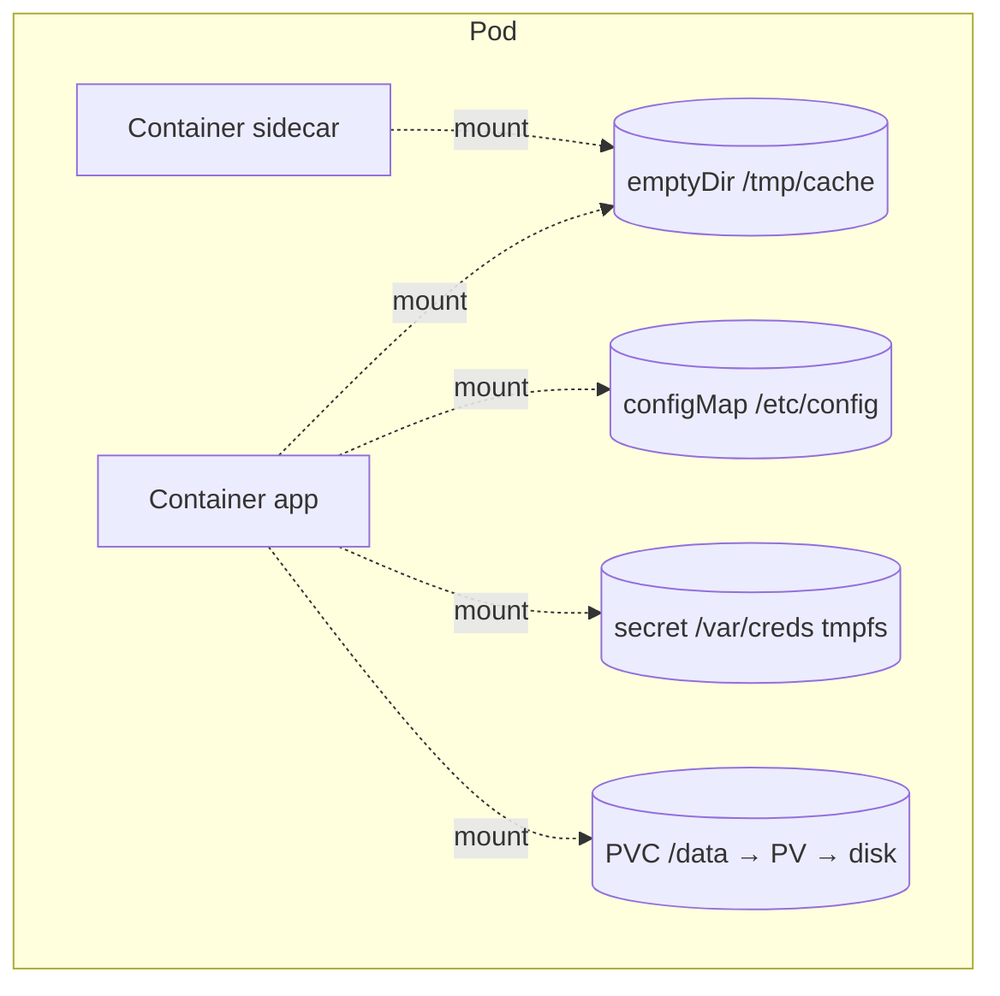
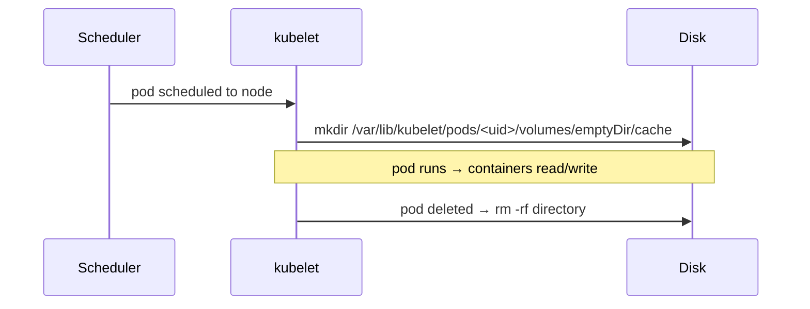

# 📘 Topic 26 — Volumes (emptyDir, hostPath, etc.)

**Official Documentation Reference**
- Volumes: https://kubernetes.io/docs/concepts/storage/volumes/
- Ephemeral volumes: https://kubernetes.io/docs/concepts/storage/ephemeral-volumes/
- Projected volumes: https://kubernetes.io/docs/concepts/storage/projected-volumes/
- Configure volume storage: https://kubernetes.io/docs/tasks/configure-pod-container/configure-volume-storage/
- GKE volumes: https://cloud.google.com/kubernetes-engine/docs/concepts/volumes-overview
- EKS storage: https://docs.aws.amazon.com/eks/latest/userguide/storage.html

---

## 🔹 Definition
A **Volume** in Kubernetes is a directory accessible to containers in a pod. Unlike a container's writable layer (ephemeral, dies with the container), a volume has a lifetime tied to the **pod** (or longer, for persistent volumes). Volumes solve data sharing between containers, crash-safe scratch space, and persistence.

---

## 🔹 About

### Volume types (most common)
| Type | Lifetime | Shared? | Use case |
|---|---|---|---|
| `emptyDir` | Pod | Between containers in same pod | Scratch space, cache, sidecar data exchange |
| `emptyDir` (medium: Memory) | Pod | Yes | tmpfs RAM disk — fast, counts against memory limit |
| `hostPath` | Node | No (node-local) | Access node files — logs, Docker socket, device files |
| `configMap` | Pod | Yes | Mount config as files |
| `secret` | Pod | Yes (tmpfs) | Mount secrets as files |
| `downwardAPI` | Pod | Yes | Expose pod metadata as files |
| `projected` | Pod | Yes | Combine configMap + secret + downwardAPI + SA token |
| `nfs` | External server | Yes (RWX) | Shared filesystem across pods/nodes |
| `persistentVolumeClaim` | PVC lifetime | Depends on access mode | Durable block/file storage |
| `csi` | CSI driver | Depends | Any CSI-backed storage |

### emptyDir deep dive
- Created when pod is scheduled to a node; deleted when pod is removed.
- `sizeLimit` (K8s 1.24+ stable) caps usage; exceeds → pod eviction.
- `medium: Memory` creates a tmpfs — faster but uses pod's memory budget.

### hostPath warnings
- **Never use in production Deployments** — pod can land on any node; data is not portable.
- Security risk: mounting `/` or `/var/run/docker.sock` gives container root-level node access.
- **GKE Autopilot blocks hostPath** by default.
- **EKS Fargate blocks hostPath**.
- Valid uses: DaemonSets reading node logs (`/var/log`), single-node dev clusters.

### projected volumes
Merge multiple sources into one mount:
```yaml
volumes:
- name: all
  projected:
    sources:
    - configMap: { name: app-config }
    - secret: { name: app-secret }
    - downwardAPI: { items: [{ path: labels, fieldRef: { fieldPath: metadata.labels } }] }
    - serviceAccountToken: { path: token, expirationSeconds: 3600, audience: vault }
```

---

## 🔹 How It Integrates With Other Kubernetes Components
| Component | Interaction |
|---|---|
| Pod | `spec.volumes` + container `volumeMounts` |
| ConfigMap / Secret | Special volume types |
| PVC | `persistentVolumeClaim` volume type links to durable storage |
| CSI driver | `csi` volume type for external providers |
| kubelet | Manages mount lifecycle per pod |
| Scheduler | Topology-aware scheduling for zonal volumes |
| SecurityContext | `readOnlyRootFilesystem`, `fsGroup`, `supplementalGroups` affect volume permissions |

---

## 🏗️ Diagrams

### Volume types in a pod


### emptyDir lifecycle


---

## 💻 Real-World Examples

### Example 1 — emptyDir for sidecar data sharing
```yaml
apiVersion: v1
kind: Pod
metadata: { name: share }
spec:
  containers:
  - name: writer
    image: busybox
    command: ["sh","-c","while true; do date >> /data/log.txt; sleep 5; done"]
    volumeMounts: [{ name: shared, mountPath: /data }]
  - name: reader
    image: busybox
    command: ["sh","-c","tail -f /data/log.txt"]
    volumeMounts: [{ name: shared, mountPath: /data }]
  volumes:
  - name: shared
    emptyDir: {}
```

### Example 2 — emptyDir with sizeLimit + memory medium
```yaml
volumes:
- name: cache
  emptyDir:
    medium: Memory
    sizeLimit: 256Mi
```

### Example 3 — hostPath for node-exporter DaemonSet
```yaml
volumes:
- name: rootfs
  hostPath: { path: /, type: Directory }
- name: proc
  hostPath: { path: /proc, type: "" }
- name: sys
  hostPath: { path: /sys, type: "" }
```

### Example 4 — Projected volume (ConfigMap + Secret + SA token)
```yaml
volumes:
- name: all-in-one
  projected:
    sources:
    - configMap: { name: app-config, items: [{ key: config.yaml, path: config.yaml }] }
    - secret:    { name: db-cred,    items: [{ key: PASSWORD, path: db-password }] }
    - serviceAccountToken: { path: token, expirationSeconds: 3600, audience: api }
```

### Example 5 — NFS volume
```yaml
volumes:
- name: nfs-data
  nfs:
    server: 10.0.0.50
    path: /exports/data
    readOnly: false
```

---

## 💻 Related Commands

| Command | Flag | Purpose | Example |
|---|---|---|---|
| `kubectl describe pod` | — | See volume mounts + events | `kubectl describe pod share` |
| `kubectl exec` | `-- ls /data` | List mounted files | `kubectl exec share -c reader -- ls /data` |
| `kubectl exec` | `-- df -h /data` | Check disk usage | `kubectl exec share -- df -h /data` |
| `kubectl get pod` | `-o jsonpath='{.spec.volumes}'` | Extract volumes | |
| `kubectl explain pod.spec.volumes` | `--recursive` | Field reference | |

---

## 🚨 Scenarios

### Scenario 1 — emptyDir fills up → pod evicted
- **Cause**: no `sizeLimit`; app writes unbounded logs/cache.
- **Fix**: set `sizeLimit`; rotate/truncate within the app; monitor with `container_fs_usage_bytes`.

### Scenario 2 — hostPath breaks on multi-node
- **Cause**: pod rescheduled to different node; data gone.
- **Fix**: replace hostPath with PVC + StorageClass for durable storage.

### Scenario 3 — Secret volume writable by root only
- **Cause**: default mode is 0644; app runs as non-root UID.
- **Fix**: `defaultMode: 0400` or set `fsGroup` in pod securityContext to match app GID.

### Scenario 4 — Config file not updating (subPath)
- **Cause**: `subPath` mounts bypass the symlink-based update mechanism.
- **Fix**: mount full directory (drop subPath) or use Reloader.

---

## ☁️ GCP GKE Perspective
- **Autopilot**: `hostPath` blocked. `emptyDir` capped at pod ephemeral storage request.
- **GKE CSI ephemeral volumes**: use `csi` volume type with `pd.csi.storage.gke.io` for ephemeral local SSD.
- **Filestore CSI**: for NFS-like ReadWriteMany.

## 🟧 AWS EKS Perspective
- **Fargate**: `hostPath` blocked. `emptyDir` limited to 20 GiB (pod storage). EFS CSI for shared.
- **Instance store (NVMe)**: access via `hostPath` on `i3`/`d3` instances for DaemonSet caches.
- **EFS CSI** replaces raw NFS mounts with K8s-native PVC flow.

---

## 🧪 Hands-On Lab Exercises

### Lab 26.1 — emptyDir data sharing (Beginner, 20 min)
**Steps**: Apply Example 1. `kubectl logs share -c reader -f` — see timestamps from writer.  
**Cleanup**: `kubectl delete pod share`.  
**Bonus**: Delete the pod; recreate → data is gone (ephemeral).

### Lab 26.2 — emptyDir sizeLimit eviction (Intermediate, 30 min)
**Steps**:
```yaml
volumes: [{ name: tmp, emptyDir: { sizeLimit: 10Mi } }]
```
Container writes: `dd if=/dev/zero of=/tmp/data/big bs=1M count=20`. Pod gets evicted.  
**Cleanup**: delete pod.

### Lab 26.3 — Projected volume combining 3 sources (Advanced, 45 min)
**Steps**: Apply Example 4. Exec into pod → `ls /mnt/all-in-one` → see `config.yaml`, `db-password`, `token`. Decode SA token: `cat /mnt/all-in-one/token | jwt decode -`.  
**Cleanup**: delete pod.

---

## 🎯 Interview Deliverable Answer (60–90 s)
"**What**: A Kubernetes Volume is a directory available to containers in a pod. Unlike the container's writable layer, a volume's lifetime is at least the pod's lifetime — and for PVCs, it outlives the pod entirely. Types include emptyDir for scratch space, hostPath for node access, configMap/secret for config injection, projected for combining multiple sources, and PVC for durable storage.  
**Why**: Containers are ephemeral — their filesystem dies on restart. Volumes solve three problems: sharing data between containers in a pod, surviving container restarts, and persisting data beyond the pod's life.  
**How**: For inter-container sharing I use emptyDir with a sizeLimit. For config and secrets I mount configMap/secret volumes (or projected to combine them with an SA token). For persistent data I use PVC backed by a CSI StorageClass. I never use hostPath in production Deployments — only in DaemonSets accessing node-level resources.  
**Example**: Our log sidecar pattern uses an emptyDir at `/var/log/app` — the app writes structured JSON logs, and Fluent Bit reads them from the same volume without any filesystem coupling."

---

## ❓ Possible Interview Questions

### Basic
**Q1. What is a Volume in K8s?** A directory accessible to containers, with lifetime ≥ pod lifetime.  
**Q2. Difference between emptyDir and hostPath?** emptyDir is pod-scoped scratch; hostPath maps a node directory into the pod.  
**Q3. When is emptyDir deleted?** When the pod is removed from the node.

### Intermediate
**Q4. What is `medium: Memory`?** Mounts a tmpfs (RAM-backed) emptyDir; faster but counts against memory limit.  
**Q5. Why is hostPath dangerous?** Data is node-local (not portable), and mounting sensitive paths gives host access.  
**Q6. What is a projected volume?** Merges configMap + secret + downwardAPI + SA token into one mount.

### Advanced
**Q7. How does `sizeLimit` on emptyDir work?** kubelet monitors usage; if exceeded, pod is evicted.  
**Q8. Why doesn't subPath update on ConfigMap change?** subPath uses a bind mount to a specific file, not the symlink tree kubelet refreshes.  
**Q9. What `fsGroup` does for volumes?** Sets the group ownership of volume files so non-root containers can read/write.

### Scenario-based
**Q10. Pod evicted for ephemeral storage — where do you look?** `kubectl describe pod` → `Evicted` reason; `kubectl describe node` → ephemeral storage pressure; check emptyDir sizeLimit.

### GKE-specific
**Q11. Why does Autopilot reject hostPath?** Security — hostPath can expose node filesystem. Use PVC or emptyDir.

### EKS-specific
**Q12. What's the emptyDir size limit on Fargate?** ~20 GiB pod ephemeral storage.

### Hands-on
**Q13. How do you share data between two containers?** emptyDir mounted in both at different or same paths.  
**Q14. Show me a projected volume.** See Example 4 — configMap + secret + SA token in one mount.  
**Q15. When would you use NFS volume type vs PVC?** Legacy in-line NFS for quick mounts; PVC + NFS CSI / Filestore CSI / EFS CSI for managed lifecycle.

