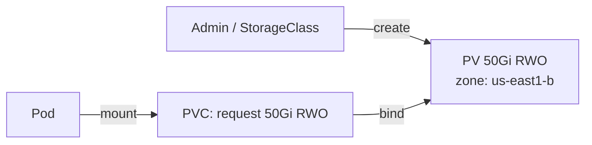
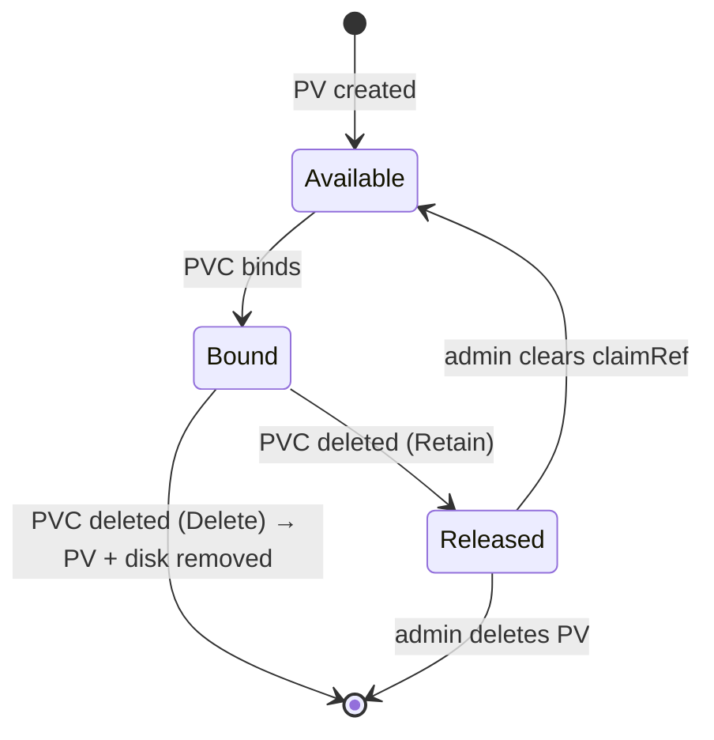

# 📘 Topic 27 — Persistent Volumes (PV)

**Official Documentation Reference**
- Persistent Volumes: https://kubernetes.io/docs/concepts/storage/persistent-volumes/
- GKE persistent disks: https://cloud.google.com/kubernetes-engine/docs/concepts/persistent-volumes
- EKS EBS: https://docs.aws.amazon.com/eks/latest/userguide/ebs-csi.html

---

## 🔹 Definition
A **PersistentVolume (PV)** is a cluster-scoped piece of storage provisioned by an admin or dynamically by a StorageClass. It abstracts the underlying storage — a cloud disk, NFS share, or local SSD — from the pod consuming it.

---

## 🔹 About

### PV is the "supply" side of storage
| Concept | Analogy |
|---|---|
| PV | A pre-provisioned disk sitting in a rack |
| PVC | A purchase order requesting "I need 50 Gi RWO SSD" |
| StorageClass | The catalog of available disk types |

### Key PV fields
| Field | Purpose |
|---|---|
| `capacity.storage` | Size (e.g., `50Gi`) |
| `accessModes` | `ReadWriteOnce (RWO)`, `ReadOnlyMany (ROX)`, `ReadWriteMany (RWX)`, `ReadWriteOncePod (RWOP)` |
| `persistentVolumeReclaimPolicy` | `Retain`, `Delete`, `Recycle` (deprecated) |
| `storageClassName` | Link to a StorageClass (empty string = no class) |
| `volumeMode` | `Filesystem` (default) or `Block` |
| `nodeAffinity` | Pin PV to specific node/zone (for local/zonal disks) |
| `csi` / `nfs` / `hostPath` | Backend-specific config |

### Access modes explained
| Mode | Short | Meaning |
|---|---|---|
| ReadWriteOnce | RWO | One node can mount read-write |
| ReadOnlyMany | ROX | Many nodes mount read-only |
| ReadWriteMany | RWX | Many nodes mount read-write (NFS/EFS/Filestore) |
| ReadWriteOncePod | RWOP | Only one pod can mount read-write (K8s 1.29+ stable) |

### Reclaim policies
| Policy | What happens when PVC is deleted |
|---|---|
| `Retain` | PV kept with data; admin manually reclaims |
| `Delete` | PV and underlying storage deleted (cloud disk removed) |
| `Recycle` | Deprecated — `rm -rf` on volume |

### PV phases
`Available` → `Bound` (to a PVC) → `Released` (PVC deleted, data retained) → `Failed`.

### Static vs Dynamic provisioning
- **Static**: admin pre-creates PV objects; PVC binds to a matching one.
- **Dynamic**: PVC references a StorageClass; the provisioner automatically creates a PV + disk.

---

## 🔹 How It Integrates With Other Kubernetes Components
| Component | Interaction |
|---|---|
| PVC | Claims a PV based on size, access mode, class |
| StorageClass | Template for dynamic PV creation |
| CSI driver | Provisions/attaches/mounts the actual disk |
| Scheduler | Topology-aware: places pod near the PV's zone |
| StatefulSet | `volumeClaimTemplates` → one PVC/PV per pod |
| Node | PV attachment is per-node (RWO) or cross-node (RWX) |

---

## 🏗️ Diagrams

### PV ↔ PVC binding


### PV lifecycle


---

## 💻 Real-World Examples

### Example 1 — Static PV (NFS)
```yaml
apiVersion: v1
kind: PersistentVolume
metadata: { name: nfs-data }
spec:
  capacity: { storage: 100Gi }
  accessModes: [ReadWriteMany]
  persistentVolumeReclaimPolicy: Retain
  storageClassName: ""               # no class = static
  nfs:
    server: 10.0.0.50
    path: /exports/data
```

### Example 2 — Static PV (GCE PD)
```yaml
apiVersion: v1
kind: PersistentVolume
metadata: { name: gce-disk }
spec:
  capacity: { storage: 50Gi }
  accessModes: [ReadWriteOnce]
  persistentVolumeReclaimPolicy: Retain
  storageClassName: standard-rwo
  csi:
    driver: pd.csi.storage.gke.io
    volumeHandle: projects/myproj/zones/us-east1-b/disks/my-disk
  nodeAffinity:
    required:
      nodeSelectorTerms:
      - matchExpressions:
        - { key: topology.gke.io/zone, operator: In, values: [us-east1-b] }
```

### Example 3 — Static PV (EBS)
```yaml
apiVersion: v1
kind: PersistentVolume
metadata: { name: ebs-disk }
spec:
  capacity: { storage: 50Gi }
  accessModes: [ReadWriteOnce]
  persistentVolumeReclaimPolicy: Retain
  csi:
    driver: ebs.csi.aws.com
    volumeHandle: vol-0abcdef1234567890
  nodeAffinity:
    required:
      nodeSelectorTerms:
      - matchExpressions:
        - { key: topology.ebs.csi.aws.com/zone, operator: In, values: [ap-south-1a] }
```

### Example 4 — Change reclaim policy on existing PV
```bash
kubectl patch pv gce-disk -p '{"spec":{"persistentVolumeReclaimPolicy":"Retain"}}'
```

---

## 💻 Related Commands

| Command | Flag | Purpose | Example |
|---|---|---|---|
| `kubectl get pv` | `-o wide` | List PVs + status + claim | `kubectl get pv -o wide` |
| `kubectl describe pv` | `<name>` | See binding, events | `kubectl describe pv gce-disk` |
| `kubectl patch pv` | `-p` | Change reclaim policy | see Example 4 |
| `kubectl delete pv` | `<name>` | Remove PV (data untouched if Retain) | `kubectl delete pv nfs-data` |
| `kubectl get pv -o jsonpath` | `'{.items[*].spec.claimRef}'` | Find which PVC bound | |

---

## 🚨 Scenarios

### Scenario 1 — PV stuck in `Released`, not `Available`
- **Cause**: after PVC deletion with Retain policy, PV keeps `claimRef`.
- **Fix**: `kubectl patch pv <name> -p '{"spec":{"claimRef":null}}'` — PV becomes Available.

### Scenario 2 — PVC Pending — no matching PV
- **Cause**: PVC requests 100Gi but only 50Gi PV exists; or access mode mismatch; or class mismatch.
- **Fix**: create matching PV or use dynamic provisioning.

### Scenario 3 — Data loss after PVC delete
- **Cause**: reclaim policy was `Delete` (default for many dynamic StorageClasses).
- **Fix**: always `Retain` for production data. Take snapshots before deletes.

---

## ☁️ GCP GKE Perspective
- Static PVs referencing GCE PDs use `pd.csi.storage.gke.io` driver.
- **Regional PD**: replicated across two zones; excellent for HA StatefulSets.
- Default reclaim for `standard-rwo` SC is `Delete` — change to `Retain` for prod.

## 🟧 AWS EKS Perspective
- Static PVs for EBS use `ebs.csi.aws.com` driver + `volumeHandle`.
- EBS is zonal; PV + pod must be in same AZ.
- **EFS** PVs are `ReadWriteMany` + cross-AZ.
- Ensure EBS CSI driver add-on is installed.

---

## 🧪 Hands-On Lab Exercises

### Lab 27.1 — Static PV + PVC binding (Beginner, 30 min)
**Steps**
```yaml
# pv.yaml
apiVersion: v1
kind: PersistentVolume
metadata: { name: lab-pv }
spec:
  capacity: { storage: 1Gi }
  accessModes: [ReadWriteOnce]
  persistentVolumeReclaimPolicy: Retain
  storageClassName: manual
  hostPath: { path: /mnt/data }
---
apiVersion: v1
kind: PersistentVolumeClaim
metadata: { name: lab-pvc }
spec:
  accessModes: [ReadWriteOnce]
  resources: { requests: { storage: 1Gi } }
  storageClassName: manual
```
```bash
kubectl apply -f pv.yaml
kubectl get pv,pvc     # Bound
```
**Cleanup**: `kubectl delete pvc lab-pvc && kubectl delete pv lab-pv`.

### Lab 27.2 — Reclaim policy behavior (Intermediate, 30 min)
1. Create PV with `Delete` policy + PVC.
2. Delete PVC → PV disappears (and disk if cloud).
3. Recreate with `Retain` → delete PVC → PV remains in `Released`.
4. Clear claimRef → PV becomes `Available`.

### Lab 27.3 — Static GCE PD PV on GKE (Advanced, 45 min)
1. `gcloud compute disks create lab-disk --size=10Gi --zone=asia-south1-a`.
2. Create PV referencing `pd.csi.storage.gke.io` + volumeHandle.
3. Create PVC + pod. Write data. Delete pod. Recreate → data persists.
4. Delete PVC → PV Released (Retain). Patch claimRef → Available.

**Cleanup**: `gcloud compute disks delete lab-disk`.

---

## 🎯 Interview Deliverable Answer (60–90 s)
"**What**: A PersistentVolume is a cluster-scoped storage resource — the 'supply' side. It represents a physical disk, NFS share, or cloud volume. A PVC is the 'demand' side — a pod's request for storage. The PV controller binds them by matching size, access mode, and StorageClass.  
**Why**: Pods are ephemeral; PVs decouple storage lifecycle from pod lifecycle. Data survives pod restarts, rescheduling, and even cluster upgrades.  
**How**: In production I almost always use dynamic provisioning via StorageClass — the CSI driver creates the PV and disk automatically when a PVC is applied. I set reclaimPolicy to Retain for databases so a PVC delete doesn't wipe data, and I take VolumeSnapshots before any destructive operation.  
**Example**: We had an incident where a junior engineer deleted a namespace. The StatefulSet PVCs were deleted and, because the StorageClass was `Delete`, the EBS volumes vanished. After that we patched every StorageClass to `Retain` and added a Kyverno policy blocking PVC deletion without a `approved-deletion=true` label."

---

## ❓ Possible Interview Questions

### Basic
**Q1. PV vs PVC?** PV = storage resource (supply). PVC = storage request (demand).  
**Q2. Is PV namespaced?** No — cluster-scoped.  
**Q3. What are access modes?** RWO, ROX, RWX, RWOP.

### Intermediate
**Q4. Reclaim policies?** Retain (keep data), Delete (remove disk), Recycle (deprecated).  
**Q5. Static vs dynamic provisioning?** Static: admin creates PV. Dynamic: PVC triggers StorageClass provisioner to create PV+disk.  
**Q6. What is `volumeMode: Block`?** Exposes the volume as a raw block device instead of a filesystem.

### Advanced
**Q7. How do you make a Released PV Available again?** Patch `spec.claimRef` to null.  
**Q8. What is `ReadWriteOncePod` (RWOP)?** Only one pod — not just one node — can mount RW. Prevents multi-attach bugs (K8s 1.29+ stable).  
**Q9. How does topology affect PV binding?** `WaitForFirstConsumer` delays binding until a pod is scheduled, ensuring PV is created in the right zone.

### Scenario-based
**Q10. PVC stuck Pending — steps?** Check PV exists with matching size/access/class. Check StorageClass provisioner. Check events: `kubectl describe pvc`.

### GKE-specific
**Q11. What is a regional PD?** A persistent disk replicated across two zones — survives a single-zone outage.

### EKS-specific
**Q12. EBS volume stuck attaching after node crash — fix?** Force-detach via `aws ec2 detach-volume --force` or wait for node cleanup timeout.

### Hands-on
**Q13. How do you verify PV data survives pod deletion?** Write file → delete pod → recreate pod with same PVC → read file.  
**Q14. Show me how to change reclaim policy.** `kubectl patch pv <n> -p '{"spec":{"persistentVolumeReclaimPolicy":"Retain"}}'`.  
**Q15. When would you use static PVs?** Pre-existing disks, NFS exports, or environments without CSI dynamic provisioning.

