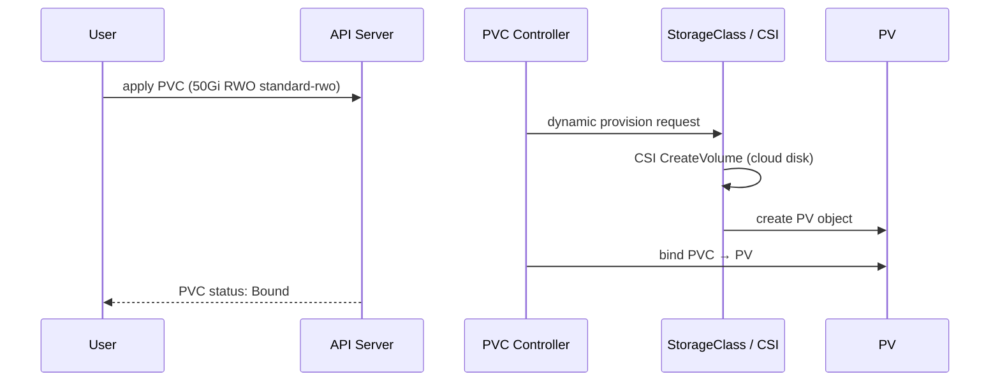
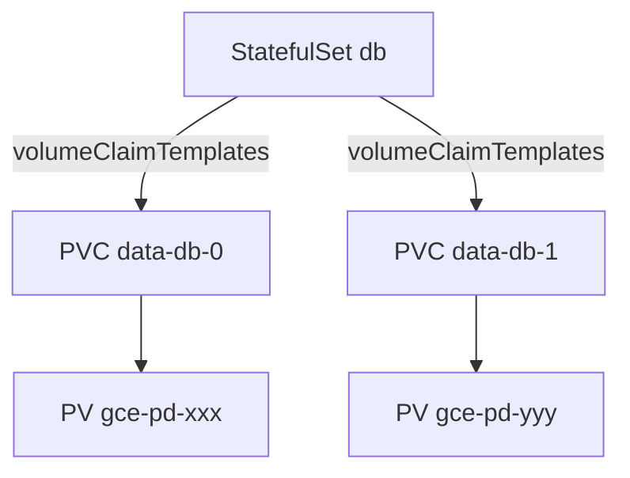

# 📘 Topic 28 — Persistent Volume Claims (PVC)

**Official Documentation Reference**
- PVC: https://kubernetes.io/docs/concepts/storage/persistent-volumes/#persistentvolumeclaims
- Configure PV storage tutorial: https://kubernetes.io/docs/tutorials/configuration/configure-persistent-volume-storage/
- GKE PVC: https://cloud.google.com/kubernetes-engine/docs/concepts/persistent-volumes
- EKS EBS PVC: https://docs.aws.amazon.com/eks/latest/userguide/ebs-csi.html

---

## 🔹 Definition
A **PersistentVolumeClaim (PVC)** is a namespaced request for storage. It specifies how much, what access mode, and which StorageClass — then the PV controller binds it to a matching PersistentVolume (static or dynamically provisioned).

---

## 🔹 About

### PVC spec fields
| Field | Purpose |
|---|---|
| `accessModes` | RWO / ROX / RWX / RWOP |
| `resources.requests.storage` | Minimum size (e.g., `50Gi`) |
| `storageClassName` | Which StorageClass to use (empty = default) |
| `volumeMode` | `Filesystem` or `Block` |
| `selector` | Label selector for static PV matching |
| `dataSource` / `dataSourceRef` | Clone from VolumeSnapshot or PVC |

### PVC phases
`Pending` → `Bound` → (deleted → PV goes to Released/Deleted based on reclaim policy).

### PVC in a Pod
```yaml
spec:
  volumes:
  - name: data
    persistentVolumeClaim:
      claimName: my-pvc
  containers:
  - volumeMounts:
    - { name: data, mountPath: /data }
```

### PVC expansion (online resize)
If StorageClass has `allowVolumeExpansion: true`:
```bash
kubectl patch pvc my-pvc -p '{"spec":{"resources":{"requests":{"storage":"100Gi"}}}}'
```
CSI driver expands the underlying volume; filesystem expansion happens automatically (ext4/xfs).

### PVC cloning & snapshots
- **Clone**: `dataSource: { kind: PersistentVolumeClaim, name: source-pvc }` — creates a new PV from an existing PVC.
- **Snapshot restore**: `dataSource: { kind: VolumeSnapshot, name: snap-1 }` — provisions PV from a snapshot.

---

## 🔹 How It Integrates With Other Kubernetes Components
| Component | Interaction |
|---|---|
| PV | PVC binds to a matching PV |
| StorageClass | Triggers dynamic provisioning |
| Pod | References PVC by `claimName` |
| StatefulSet | `volumeClaimTemplates` auto-creates PVCs |
| VolumeSnapshot | PVC can be source or restored from snapshot |
| ResourceQuota | Caps total PVC count / storage per namespace |

---

## 🏗️ Diagrams

### PVC binding flow


### PVC in StatefulSet


---

## 💻 Real-World Examples

### Example 1 — Basic PVC with dynamic provisioning
```yaml
apiVersion: v1
kind: PersistentVolumeClaim
metadata: { name: app-data }
spec:
  accessModes: [ReadWriteOnce]
  resources: { requests: { storage: 20Gi } }
  storageClassName: standard-rwo
```

### Example 2 — Pod using PVC
```yaml
apiVersion: v1
kind: Pod
metadata: { name: writer }
spec:
  containers:
  - name: app
    image: busybox
    command: ["sh","-c","echo persist > /data/test.txt; sleep 3600"]
    volumeMounts: [{ name: data, mountPath: /data }]
  volumes:
  - name: data
    persistentVolumeClaim: { claimName: app-data }
```

### Example 3 — Expand PVC online
```bash
kubectl patch pvc app-data -p '{"spec":{"resources":{"requests":{"storage":"50Gi"}}}}'
kubectl get pvc app-data    # CAPACITY updates after resize
```

### Example 4 — Clone PVC
```yaml
apiVersion: v1
kind: PersistentVolumeClaim
metadata: { name: app-data-clone }
spec:
  accessModes: [ReadWriteOnce]
  resources: { requests: { storage: 20Gi } }
  storageClassName: standard-rwo
  dataSource:
    kind: PersistentVolumeClaim
    name: app-data
```

### Example 5 — Restore from VolumeSnapshot
```yaml
apiVersion: v1
kind: PersistentVolumeClaim
metadata: { name: app-data-restored }
spec:
  accessModes: [ReadWriteOnce]
  resources: { requests: { storage: 20Gi } }
  storageClassName: standard-rwo
  dataSource:
    kind: VolumeSnapshot
    name: snap-app-data-2024
```

---

## 💻 Related Commands

| Command | Flag | Purpose | Example |
|---|---|---|---|
| `kubectl get pvc` | `-o wide` | List PVCs + bound PV | `kubectl get pvc -o wide` |
| `kubectl describe pvc` | `<name>` | Events, capacity | `kubectl describe pvc app-data` |
| `kubectl delete pvc` | `<name>` | Delete claim (triggers reclaim) | `kubectl delete pvc app-data` |
| `kubectl patch pvc` | `-p` | Expand | see Example 3 |
| `kubectl get volumesnapshot` | — | List snapshots | `kubectl get volumesnapshot` |

---

## 🚨 Scenarios

### Scenario 1 — PVC stuck Pending
- **Cause**: no matching PV (static); StorageClass provisioner failing (dynamic); `WaitForFirstConsumer` waiting for a pod.
- **Fix**: `kubectl describe pvc` → events. Check SC provisioner, CSI driver DaemonSet, quota.

### Scenario 2 — Pod stuck ContainerCreating — "unable to attach volume"
- **Cause**: EBS/PD still attached to old node after crash. Multi-attach not allowed for RWO.
- **Fix**: wait for kubelet cleanup or force-detach cloud volume; delete stale VolumeAttachment object.

### Scenario 3 — PVC expansion fails
- **Cause**: StorageClass doesn't have `allowVolumeExpansion: true`.
- **Fix**: patch SC, or create new SC with expansion and migrate.

---

## ☁️ GCP GKE Perspective
- Default StorageClass: `standard-rwo` (PD balanced), `premium-rwo` (PD SSD).
- `allowVolumeExpansion: true` enabled on defaults.
- **Autopilot**: PVC works; ephemeral storage has separate billing.

## 🟧 AWS EKS Perspective
- Ensure EBS CSI add-on installed.
- Default SC: `gp2` (legacy) or `gp3` (recommended).
- EFS CSI: `ReadWriteMany` PVC across AZs.
- **Fargate**: only EFS PVC supported (no EBS).

---

## 🧪 Hands-On Lab Exercises

### Lab 28.1 — PVC lifecycle (Beginner, 30 min)
Apply Example 1+2. Write data, delete pod, recreate, verify data persists.

### Lab 28.2 — Online PVC expansion (Intermediate, 30 min)
Create 5Gi PVC, fill 4Gi, expand to 20Gi online, verify with `df -h`.

### Lab 28.3 — Clone + snapshot restore (Advanced, 60 min)
1. Create PVC, write data.
2. Create VolumeSnapshot.
3. Create clone PVC from snapshot (Example 5).
4. Mount clone in new pod; verify data matches.

---

## 🎯 Interview Deliverable Answer (60–90 s)
"**What**: A PVC is a namespaced request for storage — size, access mode, and StorageClass. The PV controller binds it to a matching PersistentVolume, either pre-created or dynamically provisioned.  
**Why**: PVCs decouple pod specs from infrastructure details. A developer asks for '50Gi RWO SSD' without knowing whether it's GCE PD, EBS, or NFS — the StorageClass handles the rest.  
**How**: I set every production PVC via a StorageClass with `reclaimPolicy: Retain` and `allowVolumeExpansion: true`. For StatefulSets I use `volumeClaimTemplates` so each pod gets its own PVC. I take VolumeSnapshots before destructive operations and automate backup with Velero or Backup for GKE.  
**Example**: When our Postgres database needed more space, we expanded the PVC from 50Gi to 200Gi with a single `kubectl patch` — zero downtime, the filesystem resized automatically."

---

## ❓ Possible Interview Questions

**Q1. What is a PVC?** Namespaced storage request that binds to a PV.  
**Q2. How does PVC bind to PV?** By matching size, accessModes, storageClassName, and optionally label selector.  
**Q3. Can you expand a PVC?** Yes, if SC has `allowVolumeExpansion: true`.  
**Q4. What happens to the PV when PVC is deleted?** Depends on reclaimPolicy: Delete removes it, Retain keeps it.  
**Q5. PVC Pending — troubleshooting?** `kubectl describe pvc` → events → check SC provisioner, CSI driver, node zones, quota.  
**Q6. How does StatefulSet create PVCs?** `volumeClaimTemplates` in the STS spec auto-generates one PVC per pod.  
**Q7. What is a VolumeSnapshot?** A point-in-time copy of a PVC's data; can be used to restore a new PVC.  
**Q8. PVC clone vs snapshot?** Clone duplicates a live PVC. Snapshot is a frozen copy you restore from.  
**Q9. RWO vs RWOP?** RWO: one node. RWOP: one pod (stricter).  
**Q10. Why is `WaitForFirstConsumer` important?** Delays PV creation until pod is scheduled, ensuring volume and pod land in the same zone.

