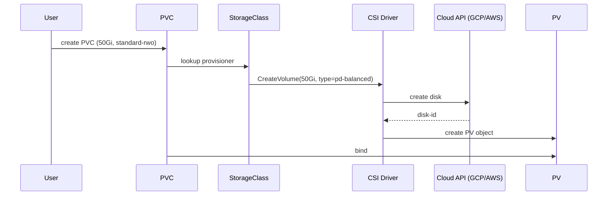
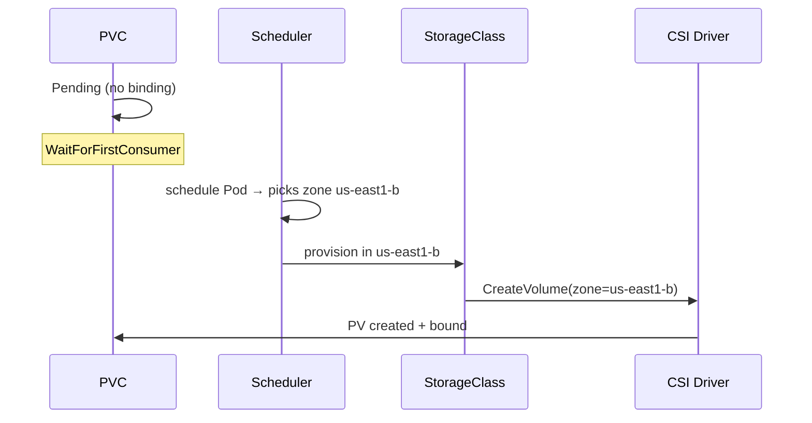

# 📘 Topic 29 — Storage Classes and Dynamic Provisioning

**Official Documentation Reference**
- StorageClass: https://kubernetes.io/docs/concepts/storage/storage-classes/
- Dynamic provisioning: https://kubernetes.io/docs/concepts/storage/dynamic-provisioning/
- Change default SC: https://kubernetes.io/docs/tasks/administer-cluster/change-default-storage-class/
- GKE SC: https://cloud.google.com/kubernetes-engine/docs/concepts/persistent-volumes#storageclasses
- EKS SC: https://docs.aws.amazon.com/eks/latest/userguide/storage-classes.html

---

## 🔹 Definition
A **StorageClass** is a cluster-scoped object that defines a "class" of storage — provisioner, parameters, reclaim policy, and volume binding mode. When a PVC references a StorageClass, the provisioner dynamically creates a PV and the underlying disk.

---

## 🔹 About

### Key fields
| Field | Purpose |
|---|---|
| `provisioner` | Which CSI driver creates volumes (e.g., `pd.csi.storage.gke.io`, `ebs.csi.aws.com`) |
| `parameters` | Driver-specific (disk type, IOPS, throughput, encryption key) |
| `reclaimPolicy` | `Delete` (default) or `Retain` |
| `volumeBindingMode` | `Immediate` or `WaitForFirstConsumer` |
| `allowVolumeExpansion` | `true` / `false` |
| `mountOptions` | Filesystem mount flags |

### volumeBindingMode
| Mode | When PV/disk is created | Use case |
|---|---|---|
| `Immediate` | As soon as PVC is created | Single-zone clusters, NFS |
| `WaitForFirstConsumer` | When a pod using the PVC is scheduled | Multi-zone clusters (ensures disk + pod co-locate) |

### Default StorageClass
Annotated with `storageclass.kubernetes.io/is-default-class: "true"`. PVCs with no `storageClassName` use it. Only one default at a time is recommended.

### Common GKE StorageClasses
| Name | Provisioner | Disk type |
|---|---|---|
| `standard-rwo` (default) | `pd.csi.storage.gke.io` | PD balanced |
| `premium-rwo` | `pd.csi.storage.gke.io` | PD SSD |
| `standard-rwx` | `filestore.csi.storage.gke.io` | Filestore basic |

### Common EKS StorageClasses
| Name | Provisioner | Disk type |
|---|---|---|
| `gp2` (legacy default) | `kubernetes.io/aws-ebs` (in-tree) | gp2 |
| `gp3` (recommended) | `ebs.csi.aws.com` | gp3 (create manually) |
| `efs-sc` | `efs.csi.aws.com` | EFS (RWX) |

---

## 🔹 How It Integrates With Other Kubernetes Components
| Component | Interaction |
|---|---|
| PVC | References `storageClassName` → triggers provisioning |
| PV | Created dynamically by SC provisioner |
| CSI driver | The actual backend that creates/deletes/expands volumes |
| Scheduler | `WaitForFirstConsumer` defers binding until scheduling |
| VolumeSnapshot | SC parameters may affect snapshot support |

---

## 🏗️ Diagrams

### Dynamic provisioning flow


### WaitForFirstConsumer


---

## 💻 Real-World Examples

### Example 1 — Custom gp3 StorageClass on EKS
```yaml
apiVersion: storage.k8s.io/v1
kind: StorageClass
metadata:
  name: gp3
  annotations:
    storageclass.kubernetes.io/is-default-class: "true"
provisioner: ebs.csi.aws.com
parameters:
  type: gp3
  iops: "3000"
  throughput: "125"
  encrypted: "true"
  kmsKeyId: arn:aws:kms:ap-south-1:123:key/abc
reclaimPolicy: Retain
volumeBindingMode: WaitForFirstConsumer
allowVolumeExpansion: true
```

### Example 2 — GKE PD SSD with regional replication
```yaml
apiVersion: storage.k8s.io/v1
kind: StorageClass
metadata: { name: regional-ssd }
provisioner: pd.csi.storage.gke.io
parameters:
  type: pd-ssd
  replication-type: regional-pd
reclaimPolicy: Retain
volumeBindingMode: WaitForFirstConsumer
allowVolumeExpansion: true
```

### Example 3 — EFS StorageClass (ReadWriteMany)
```yaml
apiVersion: storage.k8s.io/v1
kind: StorageClass
metadata: { name: efs }
provisioner: efs.csi.aws.com
parameters:
  provisioningMode: efs-ap
  fileSystemId: fs-0abc123
  directoryPerms: "700"
```

### Example 4 — Change default StorageClass
```bash
# Remove default from old
kubectl patch sc gp2 -p '{"metadata":{"annotations":{"storageclass.kubernetes.io/is-default-class":"false"}}}'
# Set new default
kubectl patch sc gp3 -p '{"metadata":{"annotations":{"storageclass.kubernetes.io/is-default-class":"true"}}}'
kubectl get sc    # (default) marker moves
```

---

## 💻 Related Commands

| Command | Flag | Purpose | Example |
|---|---|---|---|
| `kubectl get sc` | — | List StorageClasses | `kubectl get sc` |
| `kubectl describe sc` | `<name>` | Provisioner + params | `kubectl describe sc gp3` |
| `kubectl patch sc` | `-p` | Change default / reclaim | see Example 4 |
| `kubectl delete sc` | `<name>` | Remove class | `kubectl delete sc old-class` |

---

## 🚨 Scenarios

### Scenario 1 — PVC uses wrong SC → expensive disk
- **Cause**: no SC specified; default SC is `premium-rwo` (SSD).
- **Fix**: set `storageClassName` explicitly on PVC; review default SC.

### Scenario 2 — Volume provisioned in wrong zone
- **Cause**: `volumeBindingMode: Immediate`.
- **Fix**: switch to `WaitForFirstConsumer`.

### Scenario 3 — Two defaults — unpredictable binding
- **Cause**: both `gp2` and `gp3` annotated as default.
- **Fix**: only one default SC at a time.

---

## ☁️ GCP GKE Perspective
- Autopilot default: `standard-rwo` (PD balanced). Premium: `premium-rwo`.
- Regional PD: `replication-type: regional-pd` for cross-zone HA.
- Filestore: `filestore.csi.storage.gke.io` for RWX.

## 🟧 AWS EKS Perspective
- EBS CSI: create `gp3` SC manually (gp2 is legacy in-tree default).
- EFS CSI: `efs-ap` provisioning mode creates access points per PVC.
- Fargate: only EFS SC works.

---

## 🧪 Hands-On Lab Exercises

### Lab 29.1 — Create custom SC + PVC (Beginner, 30 min)
Create hostPath SC on Minikube. Apply PVC. Verify binding + data persistence.

### Lab 29.2 — WaitForFirstConsumer on Kind (Intermediate, 45 min)
Create SC with `WaitForFirstConsumer`. Apply PVC → stays Pending. Apply pod → PVC binds. Verify correct node via `kubectl describe pv`.

### Lab 29.3 — Encrypted gp3 on EKS (Advanced, 60 min)
1. Create KMS key. 2. Create gp3 SC (Example 1). 3. PVC + pod. 4. `aws ec2 describe-volumes` → verify encryption + type.

---

## 🎯 Interview Deliverable Answer (60–90 s)
"**What**: A StorageClass is the template for dynamic volume provisioning. It defines which CSI provisioner to use, what disk type and parameters, the reclaim policy, and when to bind — Immediate or WaitForFirstConsumer.  
**Why**: Without StorageClass, admins must pre-create every PV. Dynamic provisioning scales — a developer writes a PVC, the SC does the rest. `WaitForFirstConsumer` ensures the disk lands in the same zone as the pod, critical for multi-AZ clusters.  
**How**: I create tailored StorageClasses: gp3 encrypted for EKS databases, pd-ssd regional for GKE HA, efs-ap for shared workloads. I always set `reclaimPolicy: Retain` and `allowVolumeExpansion: true` for production, and mark exactly one SC as the default.  
**Example**: After switching the EKS default from gp2 to gp3, our database IOPS tripled (3000 base) while storage cost dropped 20% — gp3 is cheaper per GB than gp2."

---

## ❓ Possible Interview Questions

**Q1. What does a StorageClass do?** Defines how dynamic PVs are provisioned — provisioner, parameters, reclaim, binding mode.  
**Q2. Immediate vs WaitForFirstConsumer?** Immediate creates disk on PVC create. WaitForFirstConsumer waits for pod scheduling to pick the zone.  
**Q3. How do you set the default SC?** Annotation `storageclass.kubernetes.io/is-default-class: "true"`.  
**Q4. Can you change a SC's reclaim policy after PVs exist?** SC change only affects new PVs. Existing PVs must be patched individually.  
**Q5. How does EFS SC provision per-PVC storage?** `provisioningMode: efs-ap` creates an EFS access point per PVC — separate directory + auth.  
**Q6. What is `allowVolumeExpansion`?** Enables online PVC resize via `kubectl patch pvc`.  
**Q7. What is a regional PD on GKE?** PD replicated synchronously across two zones — survives single-zone failure.  
**Q8. How many defaults should there be?** Exactly one (or zero). Multiple defaults → undefined behavior.  
**Q9. When would you use static PV over SC?** Pre-existing disks, external NFS, or environments without CSI.  
**Q10. How do you encrypt EBS volumes via SC?** `parameters: { encrypted: "true", kmsKeyId: arn:aws:kms:... }`.

