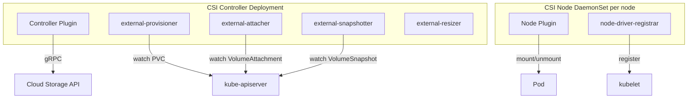
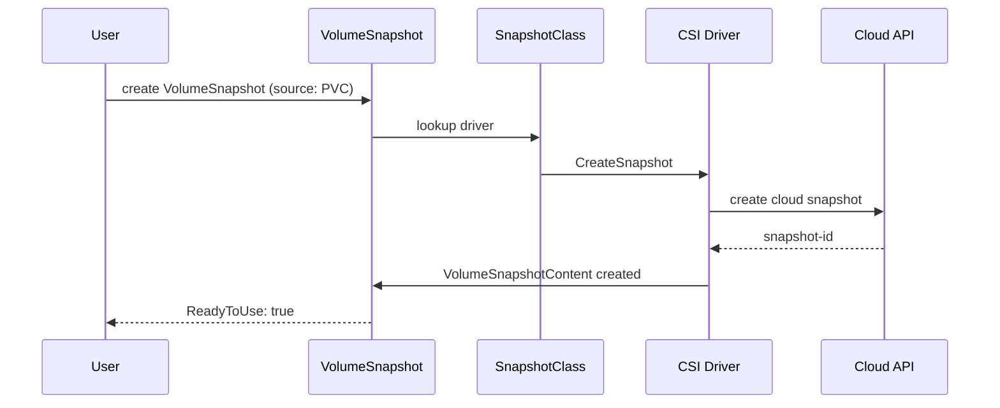

# 📘 Topic 30 — CSI Drivers (GCE PD, EBS, EFS, Filestore)

**Official Documentation Reference**
- CSI overview: https://kubernetes.io/docs/concepts/storage/volumes/#csi
- CSI driver list: https://kubernetes-csi.github.io/docs/drivers.html
- Volume snapshots: https://kubernetes.io/docs/concepts/storage/volume-snapshots/
- GCE PD CSI: https://cloud.google.com/kubernetes-engine/docs/how-to/persistent-volumes/gce-pd-csi-driver
- EBS CSI: https://docs.aws.amazon.com/eks/latest/userguide/ebs-csi.html
- EFS CSI: https://docs.aws.amazon.com/eks/latest/userguide/efs-csi.html
- Filestore CSI: https://cloud.google.com/kubernetes-engine/docs/how-to/persistent-volumes/filestore-csi-driver

---

## 🔹 Definition
**CSI (Container Storage Interface)** is the standard that decouples Kubernetes from storage backends. A **CSI driver** is a plugin that implements volume operations — create, delete, attach, detach, mount, unmount, snapshot, expand — for a specific storage system.

---

## 🔹 About

### CSI architecture
| Component | Where it runs | Role |
|---|---|---|
| **Controller plugin** | Deployment (1–3 replicas) | CreateVolume, DeleteVolume, Snapshot |
| **Node plugin** | DaemonSet (every node) | NodeStageVolume, NodePublishVolume (mount) |
| **Sidecar containers** | With controller | external-provisioner, external-attacher, external-snapshotter, external-resizer |

### Key CSI drivers for GKE + EKS
| Driver | Provisioner string | Storage | Access | Platform |
|---|---|---|---|---|
| **GCE PD** | `pd.csi.storage.gke.io` | Block (PD balanced/SSD/extreme) | RWO, ROX | GKE |
| **Filestore** | `filestore.csi.storage.gke.io` | File (NFS) | RWX | GKE |
| **EBS** | `ebs.csi.aws.com` | Block (gp2/gp3/io1/io2) | RWO | EKS |
| **EFS** | `efs.csi.aws.com` | File (NFS) | RWX | EKS |
| **FSx for Lustre** | `fsx.csi.aws.com` | File (Lustre) | RWX | EKS |

### VolumeSnapshots
CSI drivers that support snapshots implement `CreateSnapshot` / `DeleteSnapshot`. K8s objects:
- **VolumeSnapshotClass** — defines which CSI driver handles snapshots.
- **VolumeSnapshot** — user request: "snapshot PVC X now".
- **VolumeSnapshotContent** — the actual snapshot resource (cloud snapshot ID).

### Migration from in-tree to CSI
Kubernetes deprecated in-tree volume plugins (e.g., `kubernetes.io/aws-ebs`, `kubernetes.io/gce-pd`). CSI migration translates in-tree calls to CSI calls transparently. Fully migrated by K8s 1.29+.

---

## 🔹 How It Integrates With Other Kubernetes Components
| Component | Interaction |
|---|---|
| StorageClass | `provisioner` field points to CSI driver |
| PVC | Triggers `CreateVolume` via external-provisioner sidecar |
| kubelet | Calls `NodeStageVolume` + `NodePublishVolume` to mount |
| Scheduler | Topology keys from CSI topology → zone-aware scheduling |
| VolumeSnapshot controller | Coordinates snapshot lifecycle |

---

## 🏗️ Diagrams

### CSI driver architecture


### Snapshot flow


---

## 💻 Real-World Examples

### Example 1 — Install EBS CSI on EKS
```bash
eksctl create iamserviceaccount \
  --cluster=prod --name=ebs-csi-controller-sa --namespace=kube-system \
  --attach-policy-arn=arn:aws:iam::aws:policy/service-role/AmazonEBSCSIDriverPolicy \
  --approve
aws eks create-addon --cluster-name=prod --addon-name=aws-ebs-csi-driver \
  --service-account-role-arn=arn:aws:iam::<acct>:role/AmazonEKS_EBS_CSI_DriverRole
```

### Example 2 — VolumeSnapshot on GKE
```yaml
apiVersion: snapshot.storage.k8s.io/v1
kind: VolumeSnapshotClass
metadata: { name: pd-snap }
driver: pd.csi.storage.gke.io
deletionPolicy: Retain
---
apiVersion: snapshot.storage.k8s.io/v1
kind: VolumeSnapshot
metadata: { name: db-snap }
spec:
  volumeSnapshotClassName: pd-snap
  source: { persistentVolumeClaimName: data-db-0 }
```

### Example 3 — Restore PVC from snapshot
```yaml
apiVersion: v1
kind: PersistentVolumeClaim
metadata: { name: db-restored }
spec:
  accessModes: [ReadWriteOnce]
  resources: { requests: { storage: 50Gi } }
  storageClassName: standard-rwo
  dataSource:
    kind: VolumeSnapshot
    name: db-snap
    apiGroup: snapshot.storage.k8s.io
```

### Example 4 — EFS PVC (ReadWriteMany)
```yaml
apiVersion: v1
kind: PersistentVolumeClaim
metadata: { name: shared-data }
spec:
  accessModes: [ReadWriteMany]
  resources: { requests: { storage: 5Gi } }
  storageClassName: efs
```

### Example 5 — GKE Filestore PVC
```yaml
apiVersion: v1
kind: PersistentVolumeClaim
metadata: { name: shared-files }
spec:
  accessModes: [ReadWriteMany]
  resources: { requests: { storage: 1Ti } }   # Filestore min 1Ti basic
  storageClassName: standard-rwx
```

---

## 💻 Related Commands

| Command | Flag | Purpose | Example |
|---|---|---|---|
| `kubectl get csidrivers` | — | Installed drivers | `kubectl get csidrivers` |
| `kubectl get csinodes` | — | Per-node CSI info | `kubectl get csinodes` |
| `kubectl get volumesnapshot` | — | Snapshots | `kubectl get volumesnapshot` |
| `kubectl get volumesnapshotcontent` | — | Cloud snapshot details | `kubectl get vsc` |
| `kubectl get volumesnapshotclass` | — | Snapshot classes | `kubectl get vsclass` |
| `kubectl describe volumesnapshot` | `<name>` | Ready status | `kubectl describe vs db-snap` |
| `aws eks describe-addon` | `--addon-name aws-ebs-csi-driver` | EBS CSI status | |
| `gcloud container clusters describe` | `--format='value(addonsConfig)'` | GKE driver status | |

---

## 🚨 Scenarios

### Scenario 1 — PVC Pending: "no CSI driver"
- **Cause**: CSI driver not installed or crashed.
- **Fix**: `kubectl get csidrivers` + check DaemonSet/Deployment in `kube-system`.

### Scenario 2 — Snapshot stuck ReadyToUse: false
- **Cause**: snapshot-controller not installed; or cloud API quota hit.
- **Fix**: install snapshot CRDs + controller; check cloud quota.

### Scenario 3 — Volume attach timeout
- **Cause**: previous node still holding attachment (RWO). Max-attach-limit reached.
- **Fix**: force detach old node; or wait. Check `kubectl get volumeattachment`.

### Scenario 4 — Filestore PVC needs 1 TiB minimum
- **Cause**: Filestore basic HDD minimum is 1 TiB.
- **Fix**: use Filestore Enterprise (256 GiB min) or Cloud Volumes Service.

---

## ☁️ GCP GKE Perspective
- **PD CSI**: enabled by default on GKE Standard and Autopilot.
- **Filestore CSI**: enable via `--addons=GcpFilestoreCsiDriver`.
- **Snapshot support**: install VolumeSnapshot CRDs + controller (GKE does this automatically on 1.24+).
- **Backup for GKE**: layer on top of snapshots for full application backup.

## 🟧 AWS EKS Perspective
- **EBS CSI**: install as EKS add-on + IRSA. Required for gp3/dynamic provisioning.
- **EFS CSI**: separate add-on; needs security group allowing NFS (2049).
- **Snapshot controller**: not installed by default on EKS; install separately.
- **FSx CSI**: for Lustre HPC workloads.

---

## 🧪 Hands-On Lab Exercises

### Lab 30.1 — Install EBS CSI + gp3 SC (Beginner, 45 min)
Install driver, create gp3 SC, PVC, pod. Write data. `aws ec2 describe-volumes` confirms gp3.

### Lab 30.2 — VolumeSnapshot + restore on GKE (Intermediate, 60 min)
Create PVC, write data, create VolumeSnapshot (Example 2), restore to new PVC (Example 3), verify data.

### Lab 30.3 — EFS RWX across pods on EKS (Advanced, 60 min)
1. Create EFS file system + SG. 2. Install EFS CSI. 3. Create SC + PVC (RWX). 4. Deploy 3 pods mounting same PVC. 5. Write in one, read from another.

---

## 🎯 Interview Deliverable Answer (60–90 s)
"**What**: CSI is the standard interface between Kubernetes and storage providers. A CSI driver has a controller component for provisioning/snapshot and a node component for mounting. On GKE the PD and Filestore CSI drivers are built-in; on EKS you install EBS and EFS CSI as add-ons.  
**Why**: CSI replaced the monolithic in-tree volume plugins, letting storage vendors ship drivers independently of K8s releases and enabling features like volume snapshots, online expansion, and topology-aware provisioning.  
**How**: On EKS I install EBS CSI with IRSA for least-privilege, create a gp3 StorageClass with encryption, and take VolumeSnapshots for point-in-time recovery. On GKE PD CSI is already enabled; I add Filestore CSI for RWX workloads and use Backup for GKE for application-level backups.  
**Example**: We needed a shared filesystem for a 10-pod ML training job. On EKS, I provisioned an EFS PVC with ReadWriteMany — all pods mounted the same dataset. On GKE the equivalent was a Filestore PVC. Zero code changes across clouds because the CSI abstraction handled the backend."

---

## ❓ Possible Interview Questions

**Q1. What is CSI?** Container Storage Interface — standard for K8s storage plugins.  
**Q2. Controller vs node plugin?** Controller: provision/delete/snapshot (Deployment). Node: mount/unmount (DaemonSet).  
**Q3. How do you install EBS CSI on EKS?** `aws eks create-addon --addon-name aws-ebs-csi-driver` + IRSA role.  
**Q4. What is a VolumeSnapshot?** Point-in-time copy of PVC data via CSI snapshot.  
**Q5. EFS vs EBS?** EBS: block, RWO, zonal. EFS: file (NFS), RWX, multi-AZ.  
**Q6. Filestore vs PD on GKE?** PD: block, RWO. Filestore: NFS, RWX, min 1 TiB basic.  
**Q7. How does CSI migration work?** In-tree plugin calls are transparently translated to CSI calls. Fully migrated by K8s 1.29+.  
**Q8. What sidecar containers run with the CSI controller?** external-provisioner, external-attacher, external-snapshotter, external-resizer.  
**Q9. How do you encrypt EBS at rest?** SC parameter `encrypted: "true"` + optional `kmsKeyId`.  
**Q10. Can Fargate use EBS?** No — only EFS (no block device attachment on Firecracker microVMs).

