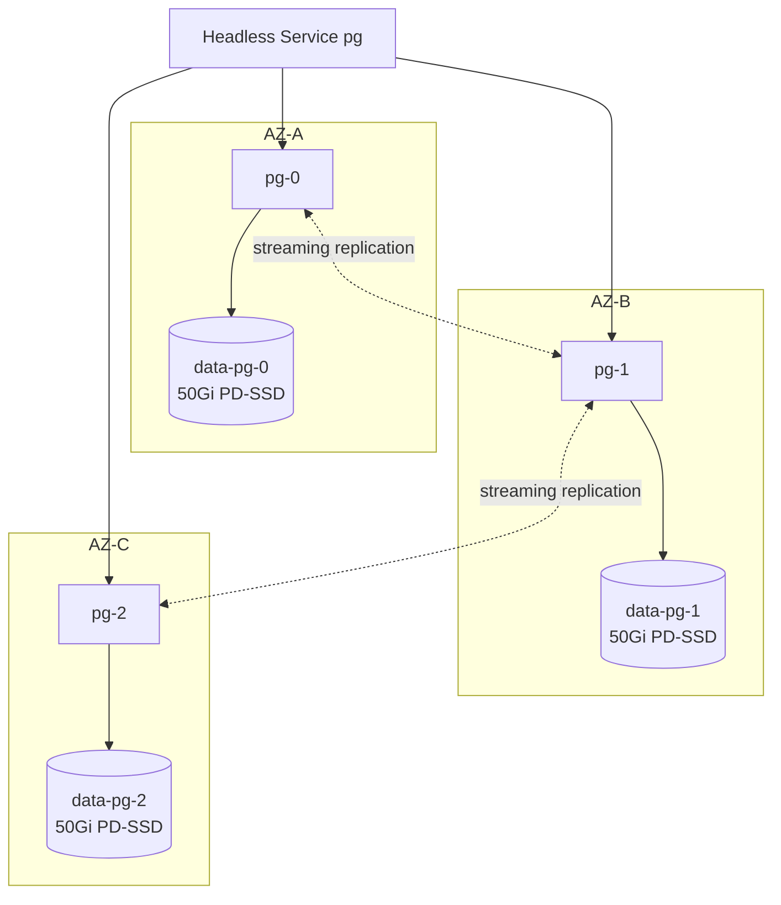
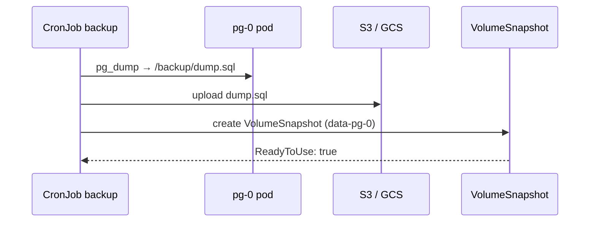
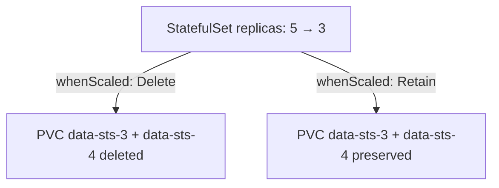

# 📘 Topic 31 — StatefulSet Storage Patterns

**Official Documentation Reference**
- StatefulSet: https://kubernetes.io/docs/concepts/workloads/controllers/statefulset/
- volumeClaimTemplates: https://kubernetes.io/docs/concepts/workloads/controllers/statefulset/#stable-storage
- persistentVolumeClaimRetentionPolicy: https://kubernetes.io/docs/concepts/workloads/controllers/statefulset/#persistentvolumeclaim-retention
- Run replicated stateful app: https://kubernetes.io/docs/tasks/run-application/run-replicated-stateful-application/
- GKE stateful apps: https://cloud.google.com/kubernetes-engine/docs/how-to/stateful-apps
- EKS storage best practices: https://docs.aws.amazon.com/eks/latest/best-practices/storage.html

---

## 🔹 Definition
**StatefulSet storage patterns** describe how to pair StatefulSets with per-pod PersistentVolumeClaims, zonal/regional disks, backup strategies, and multi-AZ layout — the building blocks for running databases, message queues, and distributed systems on Kubernetes.

---

## 🔹 About

### Core pattern: volumeClaimTemplates
Every StatefulSet pod gets its own PVC, named `<template-name>-<sts-name>-<ordinal>` (e.g., `data-pg-0`). The PVC persists even if the pod is deleted or the STS is scaled down — data is always recoverable.

### Storage topology
| Scenario | Recommendation |
|---|---|
| Single-zone dev | `Immediate` binding, standard PD/gp3 |
| Multi-zone prod | `WaitForFirstConsumer` + `topologySpreadConstraints` |
| HA database (GKE) | Regional PD (cross-zone replication) |
| HA database (EKS) | Application-level replication (Patroni, Stolon) + zonal EBS |
| Shared dataset (ML) | EFS / Filestore `ReadWriteMany` PVC (not per-pod) |

### PVC retention (K8s 1.27+ stable)
```yaml
spec:
  persistentVolumeClaimRetentionPolicy:
    whenDeleted: Retain     # keep PVCs if STS deleted
    whenScaled:  Delete     # delete PVCs on scale-down
```
Default behavior: PVCs are **never deleted** — you must clean up manually.

### Backup strategies
| Layer | Tool | What it captures |
|---|---|---|
| Application | pg_dump, mongodump, Redis BGSAVE | Consistent logical backup |
| Volume snapshot | VolumeSnapshot CRD + CSI | Block-level point-in-time |
| Cluster backup | Velero / Backup for GKE | Manifests + volume data |

### Zonal pinning problem
EBS and standard PD are zonal. Once `data-pg-0` is created in `us-east1-b`, pod `pg-0` must always schedule there. If that zone goes down, `pg-0` is stuck Pending until the zone recovers. Mitigations:
- **App-level replication** (replicas in different zones).
- **Regional PD** on GKE (synchronous cross-zone).
- **EFS** on EKS for RWX (but unsuitable for databases due to latency).
- **Velero cross-region restore** as disaster recovery.

### Common database patterns on K8s
| Database | Operator | Storage |
|---|---|---|
| PostgreSQL | CloudNativePG, Zalando, CrunchyData | RWO SSD per pod |
| MySQL | MySQL Operator (Oracle), Vitess | RWO per pod |
| MongoDB | MongoDB Community Operator | RWO per pod |
| Kafka | Strimzi | RWO per broker |
| Elasticsearch | ECK (Elastic) | RWO per data node |
| Redis | Redis Operator (Spotahome) | RWO or emptyDir (ephemeral cache) |

---

## 🔹 How It Integrates With Other Kubernetes Components
| Component | Interaction |
|---|---|
| StatefulSet | `volumeClaimTemplates` creates PVCs |
| StorageClass | Determines disk type, zone, encryption |
| Scheduler | `WaitForFirstConsumer` + `topologySpreadConstraints` |
| Headless Service | Stable DNS per pod for replication topology |
| PodDisruptionBudget | Protect during drains + upgrades |
| VolumeSnapshot | Point-in-time backup per PVC |
| Operators | Manage replication, failover, backup around the STS |

---

## 🏗️ Diagrams

### Multi-AZ StatefulSet layout


### Backup flow


### PVC retention on scale-down


---

## 💻 Real-World Examples

### Example 1 — Production Postgres STS with backup CronJob
```yaml
apiVersion: apps/v1
kind: StatefulSet
metadata: { name: pg }
spec:
  serviceName: pg
  replicas: 3
  selector: { matchLabels: { app: pg } }
  template:
    metadata: { labels: { app: pg } }
    spec:
      topologySpreadConstraints:
      - maxSkew: 1
        topologyKey: topology.kubernetes.io/zone
        whenUnsatisfiable: DoNotSchedule
        labelSelector: { matchLabels: { app: pg } }
      containers:
      - name: pg
        image: postgres:16
        ports: [{ containerPort: 5432 }]
        env: [{ name: PGDATA, value: /var/lib/postgresql/data/pgdata }]
        envFrom: [{ secretRef: { name: pg-cred } }]
        volumeMounts: [{ name: data, mountPath: /var/lib/postgresql/data }]
        readinessProbe:
          exec: { command: ["pg_isready","-U","postgres"] }
          periodSeconds: 5
        resources:
          requests: { cpu: 500m, memory: 1Gi }
          limits:   { cpu: 2,    memory: 4Gi }
  volumeClaimTemplates:
  - metadata: { name: data }
    spec:
      accessModes: [ReadWriteOnce]
      resources: { requests: { storage: 50Gi } }
      storageClassName: gp3     # or standard-rwo on GKE
  persistentVolumeClaimRetentionPolicy:
    whenDeleted: Retain
    whenScaled:  Retain
---
apiVersion: batch/v1
kind: CronJob
metadata: { name: pg-backup }
spec:
  schedule: "0 2 * * *"
  timeZone: "Asia/Kolkata"
  concurrencyPolicy: Forbid
  jobTemplate:
    spec:
      template:
        spec:
          restartPolicy: OnFailure
          containers:
          - name: dump
            image: postgres:16
            command: ["sh","-c","pg_dump -h pg-0.pg -U postgres mydb | gzip > /backup/$(date +%Y%m%d).sql.gz && aws s3 cp /backup/*.gz s3://backups/pg/"]
            envFrom: [{ secretRef: { name: pg-cred } }]
```

### Example 2 — VolumeSnapshot before upgrade
```bash
kubectl apply -f - <<EOF
apiVersion: snapshot.storage.k8s.io/v1
kind: VolumeSnapshot
metadata: { name: pre-upgrade-pg-0 }
spec:
  volumeSnapshotClassName: pd-snap
  source: { persistentVolumeClaimName: data-pg-0 }
EOF
kubectl wait --for=jsonpath='{.status.readyToUse}'=true vs/pre-upgrade-pg-0
# now safe to upgrade
kubectl set image sts/pg pg=postgres:17
```

### Example 3 — Restore a single pod's data from snapshot
```bash
# Delete the corrupted PVC
kubectl delete pvc data-pg-1
# Recreate from snapshot
kubectl apply -f - <<EOF
apiVersion: v1
kind: PersistentVolumeClaim
metadata: { name: data-pg-1 }
spec:
  accessModes: [ReadWriteOnce]
  resources: { requests: { storage: 50Gi } }
  storageClassName: gp3
  dataSource: { kind: VolumeSnapshot, name: snap-pg-1-20240101, apiGroup: snapshot.storage.k8s.io }
EOF
# STS recreates pg-1 pod; it mounts the restored PVC
```

---

## 💻 Related Commands

| Command | Flag | Purpose | Example |
|---|---|---|---|
| `kubectl get pvc -l app=pg` | — | List STS PVCs | `kubectl get pvc -l app=pg` |
| `kubectl get volumesnapshot` | — | List snapshots | `kubectl get vs` |
| `kubectl describe sts` | — | volumeClaimTemplates | `kubectl describe sts pg` |
| `kubectl scale sts` | `--replicas=` | Scale (PVCs retained by default) | `kubectl scale sts pg --replicas=5` |
| `kubectl delete pvc` | `data-pg-3 data-pg-4` | Clean up scaled-down PVCs | |
| `velero backup create` | `--include-namespaces=prod` | Full backup | `velero backup create pg-full --include-namespaces=prod --snapshot-volumes` |

---

## 🚨 Scenarios

### Scenario 1 — Zone failure; primary pod stuck Pending
- **Cause**: zonal disk can't move to another AZ.
- **Fix**: promote a replica in another zone (app-level failover). Long-term: regional PD (GKE) or cross-AZ app replication.

### Scenario 2 — Scale-down left orphan PVCs consuming cost
- **Cause**: default retention = Retain; PVCs kept after scale-down.
- **Fix**: set `whenScaled: Delete` or manually `kubectl delete pvc data-pg-3`.

### Scenario 3 — Snapshot inconsistent for active DB
- **Cause**: block-level snapshot during write → data on disk may be inconsistent.
- **Fix**: use `CHECKPOINT` / `pg_start_backup()` before snapshot; or rely on WAL replay on restore. Application-level dump is always consistent.

### Scenario 4 — PVC disk full → DB read-only
- **Cause**: PVC capacity exhausted.
- **Fix**: `kubectl patch pvc data-pg-0 -p '{"spec":{"resources":{"requests":{"storage":"100Gi"}}}}'` (online expansion); then `ALTER SYSTEM SET default_transaction_read_only = off;` inside Postgres.

### Scenario 5 — Velero restore creates duplicate PVCs
- **Cause**: restoring to same namespace without cleanup.
- **Fix**: delete old resources first; or restore to a new namespace and switch DNS.

---

## ☁️ GCP GKE Perspective
- **Regional PD** for HA: `replication-type: regional-pd` in SC. Synchronous cross-zone replication.
- **Backup for GKE**: scheduled, application-consistent backups of STS + PVCs + manifests. Restore to same or different cluster.
- **Autopilot**: STS works; charges per pod + PVC storage.

## 🟧 AWS EKS Perspective
- EBS is zonal → app-level replication (Patroni, Strimzi MirrorMaker) is the HA pattern.
- **EFS** for RWX shared datasets (not for DB primary).
- **Velero + EBS snapshots** for DR; cross-region with `velero backup-location create --bucket=...`.
- **Karpenter** can provision specific instance types (storage-optimized) for data-heavy STS pods.

---

## 🧪 Hands-On Lab Exercises

### Lab 31.1 — STS PVC persistence through delete/recreate (Beginner, 30 min)
1. Deploy 3-replica STS with `volumeClaimTemplates` (1Gi each).
2. Write `hostname > /data/id.txt` in each pod.
3. `kubectl delete sts pg --cascade=orphan` → pods remain.
4. Recreate STS → pods reattach PVCs → `cat /data/id.txt` shows same hostname.

### Lab 31.2 — Snapshot + restore single pod (Intermediate, 60 min)
1. Write data to `pg-1`.
2. Create VolumeSnapshot of `data-pg-1`.
3. Corrupt data in `pg-1`: `kubectl exec pg-1 -- rm /data/pgdata -rf`.
4. Delete PVC `data-pg-1`, create from snapshot (Example 3).
5. Verify `pg-1` comes back with original data.

### Lab 31.3 — Multi-AZ Postgres with Patroni on EKS (Advanced, 120 min)
1. Install Zalando Postgres Operator: `kubectl apply -k github.com/zalando/postgres-operator/manifests`.
2. Create `postgresql` CR with 3 replicas, `topologySpreadConstraints`, gp3 SC.
3. Verify pods spread across 3 AZs: `kubectl get pods -o wide`.
4. Simulate AZ failure: cordon all nodes in one AZ.
5. Observe Patroni failover: `kubectl exec pg-0 -- patronictl list` → new leader in healthy AZ.
6. Uncordon → follower catches up via streaming replication.

**Cleanup**: delete postgresql CR + operator; `eksctl delete cluster`.

---

## 🎯 Interview Deliverable Answer (60–90 s)
"**What**: StatefulSet storage patterns describe how to give each database or stateful pod its own persistent disk using `volumeClaimTemplates`, handle zonal constraints, and implement backup/recovery.  
**Why**: A database pod needs stable identity AND stable storage. The volumeClaimTemplate guarantees that `data-pg-0` is always the same PVC, on the same disk, with the same data — even if the pod restarts or reschedules to the same zone.  
**How**: I use a StorageClass with `WaitForFirstConsumer` so the disk is created in the zone the scheduler picks. I spread pods across zones with `topologySpreadConstraints`. For HA I rely on app-level replication — Patroni for Postgres, Strimzi for Kafka — rather than hoping for cross-zone disk magic. I back up two ways: a nightly CronJob running `pg_dump` to object storage, and hourly VolumeSnapshots for point-in-time block-level recovery. The `persistentVolumeClaimRetentionPolicy` is set to Retain on delete and Retain on scale, so accidental deletions never wipe data.  
**Example**: On EKS we ran a 5-node Kafka cluster with Strimzi. Each broker had a 500Gi gp3 PVC. When we needed to expand to 1TB, we patched each PVC — online expansion took 30 seconds per broker with zero downtime."

---

## ❓ Possible Interview Questions

**Q1. What is `volumeClaimTemplates`?** STS field that auto-creates one PVC per pod from a template.  
**Q2. What happens to PVCs when STS is deleted?** They are retained by default (not deleted).  
**Q3. How do you handle zonal storage in multi-AZ?** `WaitForFirstConsumer` SC + `topologySpreadConstraints` on STS.  
**Q4. Can you expand an STS PVC?** Yes — `kubectl patch pvc` if SC has `allowVolumeExpansion: true`.  
**Q5. How do you back up a StatefulSet DB?** App-level dump (consistent) + VolumeSnapshot (fast, block-level) + Velero / Backup for GKE (full cluster).  
**Q6. What is `persistentVolumeClaimRetentionPolicy`?** Controls auto-deletion of PVCs on STS delete (`whenDeleted`) or scale-down (`whenScaled`).  
**Q7. Regional PD on GKE — what is it?** PD replicated across two zones; pod can reschedule to the other zone and reattach.  
**Q8. Why can't EBS do cross-AZ?** EBS is zonal block storage. Cross-AZ requires app-level replication.  
**Q9. How do you restore a single pod's PVC from snapshot?** Delete PVC → recreate with `dataSource: VolumeSnapshot` → STS recreates pod → mounts restored PVC.  
**Q10. Name a Postgres operator for K8s.** CloudNativePG, Zalando Postgres Operator, CrunchyData PGO.  
**Q11. How does Patroni handle failover?** Leader election via DCS (K8s Endpoints/ConfigMap/etcd); promotes a replica if leader unreachable.  
**Q12. What's the risk of a block-level snapshot on an active DB?** May capture inconsistent on-disk state. Mitigate with `CHECKPOINT` / freeze before snapshot, or rely on WAL replay.

