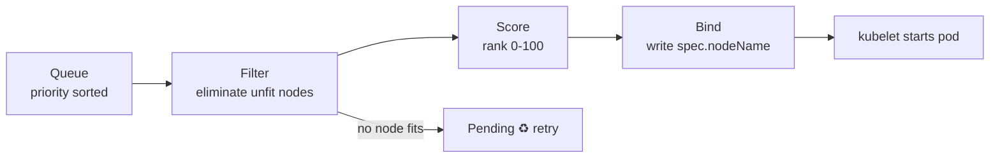
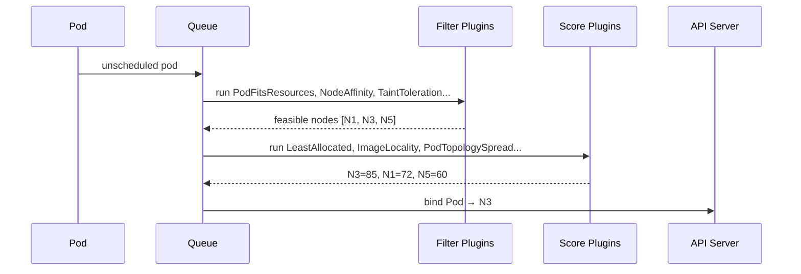
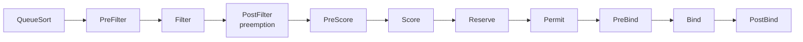

# 📘 Topic 32 — Scheduler Deep Dive

**Official Documentation Reference**
- Kubernetes Scheduler: https://kubernetes.io/docs/concepts/scheduling-eviction/kube-scheduler/
- Scheduling framework: https://kubernetes.io/docs/concepts/scheduling-eviction/scheduling-framework/
- Scheduler performance tuning: https://kubernetes.io/docs/concepts/scheduling-eviction/scheduler-perf-tuning/
- Assigning Pods to Nodes: https://kubernetes.io/docs/concepts/scheduling-eviction/assign-pod-node/
- GKE scheduling: https://cloud.google.com/kubernetes-engine/docs/concepts/scheduling
- EKS scheduling: https://docs.aws.amazon.com/eks/latest/best-practices/scheduling.html

---

## 🔹 Definition
The **kube-scheduler** is the control-plane component that watches for newly created Pods with no assigned node, selects the best node for each Pod, and writes the binding. It uses a two-phase process: **filtering** (which nodes can run the pod?) then **scoring** (which node is best?).

---

## 🔹 About

### Scheduling cycle
1. **Queue** — new unscheduled pod enters the scheduling queue (priority-sorted).
2. **Filter (Predicates)** — eliminate nodes that can't run the pod:
   - `PodFitsResources` — enough CPU/memory?
   - `PodFitsHostPorts` — host ports available?
   - `NodeAffinity` / `NodeSelector` — labels match?
   - `TaintToleration` — pod tolerates node taints?
   - `PodTopologySpread` — maxSkew respected?
   - `VolumeBinding` — volume zone compatible?
   - `NodeUnschedulable` — node cordoned?
3. **Score (Priorities)** — rank surviving nodes 0–100:
   - `NodeResourcesFit` (LeastAllocated, MostPacked, RequestedToCapacityRatio)
   - `InterPodAffinity` — prefers nodes satisfying pod affinity
   - `ImageLocality` — prefers nodes that already have the image
   - `TaintToleration` — prefers nodes with fewer taints
   - `NodeResourcesBalancedAllocation` — balances CPU/mem ratio
   - `PodTopologySpread` — spreads across domains
4. **Select** — highest-scoring node wins (ties broken randomly).
5. **Bind** — scheduler writes `spec.nodeName` on the pod.

### Scheduling framework (extension points)
The scheduler is built on a plugin framework with extension points:
`QueueSort → PreFilter → Filter → PostFilter → PreScore → Score → Reserve → Permit → PreBind → Bind → PostBind`

### percentageOfNodesToScore
On large clusters (5000+ nodes), the scheduler doesn't score all feasible nodes — it scores a percentage (default scales down with cluster size). Tune with `percentageOfNodesToScore` in scheduler config.

### Scheduling profiles
Multiple profiles can be configured on a single scheduler, each with different plugins. Pods reference a profile via `spec.schedulerName`.

### Unschedulable pods
If no node passes filtering, the pod stays `Pending` with events like `0/5 nodes are available: 2 Insufficient cpu, 3 node(s) had taint ...`. The scheduler retries when conditions change (new node, freed resources).

---

## 🔹 How It Integrates With Other Kubernetes Components
| Component | Interaction |
|---|---|
| API server | Scheduler watches unscheduled pods; writes `spec.nodeName` |
| kubelet | Picks up bound pods and runs them |
| Nodes | Supply capacity and labels for filter/score |
| PriorityClass | Determines queue ordering and preemption |
| Cluster Autoscaler / Karpenter | Trigger node creation when scheduler can't place pods |
| CSI (WaitForFirstConsumer) | Scheduler coordinates volume binding |
| PDB | Preemption respects PDB |

---

## 🏗️ Diagrams

### Scheduling cycle


### Filter + Score in detail


### Extension points


---

## 💻 Real-World Examples

### Example 1 — See why a pod is Pending
```bash
kubectl describe pod stuck-pod | tail -20
# Events:
#   Warning  FailedScheduling  0/5 nodes are available:
#     2 Insufficient cpu, 3 node(s) had taint {dedicated: gpu} that the pod didn't tolerate.
```

### Example 2 — Force a pod to a specific node (bypass scheduler)
```yaml
spec:
  nodeName: worker-3           # skips scheduler entirely — rarely used
```

### Example 3 — Scheduler config (KubeSchedulerConfiguration)
```yaml
apiVersion: kubescheduler.config.k8s.io/v1
kind: KubeSchedulerConfiguration
profiles:
- schedulerName: default-scheduler
  plugins:
    score:
      enabled:
      - { name: NodeResourcesFit, weight: 2 }
      - { name: ImageLocality, weight: 1 }
  pluginConfig:
  - name: NodeResourcesFit
    args:
      scoringStrategy:
        type: LeastAllocated
        resources:
        - { name: cpu, weight: 1 }
        - { name: memory, weight: 1 }
percentageOfNodesToScore: 50
```

---

## 💻 Related Commands

| Command | Flag | Purpose | Example |
|---|---|---|---|
| `kubectl describe pod` | — | See scheduling events | `kubectl describe pod stuck` |
| `kubectl get pods` | `--field-selector spec.nodeName=""` | Find unscheduled pods | |
| `kubectl get nodes` | `-o custom-columns=NAME:.metadata.name,CPU:.status.allocatable.cpu,MEM:.status.allocatable.memory` | Node capacity | |
| `kubectl describe node` | `<n>` | Allocated resources section | `kubectl describe node worker-1` |
| `kubectl cordon` | `<n>` | Mark unschedulable | `kubectl cordon worker-1` |
| `kubectl uncordon` | `<n>` | Mark schedulable | `kubectl uncordon worker-1` |
| `kubectl get events` | `--field-selector reason=FailedScheduling` | Scheduling failures | |

---

## 🚨 Scenarios

### Scenario 1 — Pod Pending: Insufficient CPU
- **Cause**: sum of existing requests + new pod exceeds node allocatable.
- **Fix**: scale cluster (add nodes), right-size existing pods, or set higher PriorityClass to preempt.

### Scenario 2 — Pod scheduled to wrong zone (volume mismatch)
- **Cause**: `Immediate` binding created disk in zone A; scheduler picked zone B.
- **Fix**: use `WaitForFirstConsumer` StorageClass.

### Scenario 3 — Scheduler latency spikes on 2000-node cluster
- **Cause**: scoring all nodes per pod.
- **Fix**: tune `percentageOfNodesToScore` down; or use scheduling profiles with fewer score plugins.

### Scenario 4 — Pod keeps bouncing between Pending and Running
- **Cause**: preemption cycle — lower-priority pod evicted, higher placed, then lower can't find a home.
- **Fix**: review PriorityClasses; add PDB; use Cluster Autoscaler for capacity.

---

## ☁️ GCP GKE Perspective
- **Autopilot** handles scheduling transparently; pods may trigger node provisioning (Node Auto-Provisioning).
- **Standard**: default scheduler; customize with node pools + taints + affinities.
- GKE does NOT expose scheduler config customization — use a custom scheduler Deployment if needed.

## 🟧 AWS EKS Perspective
- EKS runs the managed scheduler — no access to `KubeSchedulerConfiguration`.
- **Karpenter** bypasses the scheduler's node selection by provisioning right-sized nodes for pending pods.
- **Fargate**: the AWS Fargate scheduler (not kube-scheduler) places pods into microVMs.

---

## 🧪 Hands-On Lab Exercises

### Lab 32.1 — Understand Pending (Beginner, 30 min)
Create a pod requesting 100 CPUs. Observe Pending. `kubectl describe pod` → events. Reduce to 100m → schedules.

### Lab 32.2 — Scoring: LeastAllocated vs MostPacked (Intermediate, 60 min)
1. Kind 3-worker cluster. Deploy 3 pods with 200m CPU each.
2. Deploy 3 more → observe spread (default: LeastAllocated scores empty nodes higher).
3. Change scheduler config to `MostPacked` (requires deploying a second scheduler on Kind).
4. Re-test — pods now pack onto fewer nodes.

### Lab 32.3 — Custom scheduler profile (Advanced, 90 min)
1. Deploy a second scheduler as a Deployment with a custom `KubeSchedulerConfiguration`.
2. Create pods with `schedulerName: my-scheduler`.
3. Verify different placement from default scheduler via `kubectl get pods -o wide`.

---

## 🎯 Interview Deliverable Answer (60–90 s)
"**What**: The kube-scheduler watches for unscheduled pods, runs them through a filter phase that eliminates unfit nodes — checking resources, taints, affinity, topology — and a score phase that ranks the survivors by criteria like least-allocated resources and image locality. It then binds the pod to the highest-scoring node.  
**Why**: Smart scheduling is what turns a cluster into more than a bag of VMs. It ensures pods land where they can run, resources are balanced, topology constraints are met, and higher-priority pods can preempt lower ones.  
**How**: I influence scheduling through nodeSelector, node/pod affinity, taints+tolerations, topologySpreadConstraints, and PriorityClasses — rather than modifying the scheduler itself, which is managed on GKE/EKS. On EKS, Karpenter complements the scheduler by provisioning exactly the right node type for pending pods.  
**Example**: We had pods that sat Pending for minutes because the scheduler scored all 500 nodes. After tuning `percentageOfNodesToScore` to 30% (via a custom scheduler on our kubeadm cluster), scheduling latency dropped from 8 seconds to under 1 second."

---

## ❓ Possible Interview Questions

### Basic
**Q1. What does the scheduler do?** Assigns unscheduled pods to nodes via filter + score.  
**Q2. What happens if no node passes filtering?** Pod stays Pending.  
**Q3. Where is the binding written?** `spec.nodeName` on the Pod object.

### Intermediate
**Q4. Name 3 filter plugins.** PodFitsResources, TaintToleration, NodeAffinity.  
**Q5. Name 3 scoring plugins.** NodeResourcesFit (LeastAllocated), ImageLocality, PodTopologySpread.  
**Q6. What is `percentageOfNodesToScore`?** Controls how many feasible nodes get scored — tuning for large clusters.

### Advanced
**Q7. Explain the scheduling framework extension points.** QueueSort → PreFilter → Filter → PostFilter (preemption) → PreScore → Score → Reserve → Permit → PreBind → Bind → PostBind.  
**Q8. What is PostFilter?** Runs when no node passes Filter; implements preemption logic.  
**Q9. How do scheduling profiles work?** One scheduler binary can host multiple profiles with different plugin configs; pods select via `spec.schedulerName`.

### Scenario-based
**Q10. Pod Pending: "0/10 nodes are available: 10 node(s) didn't match Pod's node affinity/selector" — fix?** Node labels don't match pod's nodeAffinity/nodeSelector. Label nodes or relax affinity.

### GKE-specific
**Q11. Can you customize the scheduler on GKE?** Not the managed one. Deploy a custom scheduler as a Deployment alongside.

### EKS-specific
**Q12. How does Karpenter interact with the scheduler?** Karpenter watches Pending pods, provisions right-sized nodes, and the scheduler then binds pods to those nodes.

### Hands-on
**Q13. How do you debug scheduling?** `kubectl describe pod` → events; `kubectl get nodes -o custom-columns` for capacity; `kubectl get events --field-selector reason=FailedScheduling`.  
**Q14. Show me how to force a pod to a node.** `spec.nodeName: worker-3` (bypasses scheduler — not recommended for production).  
**Q15. What is the difference between `nodeName` and `nodeSelector`?** `nodeName` bypasses the scheduler. `nodeSelector` is evaluated by the scheduler's filter phase.

