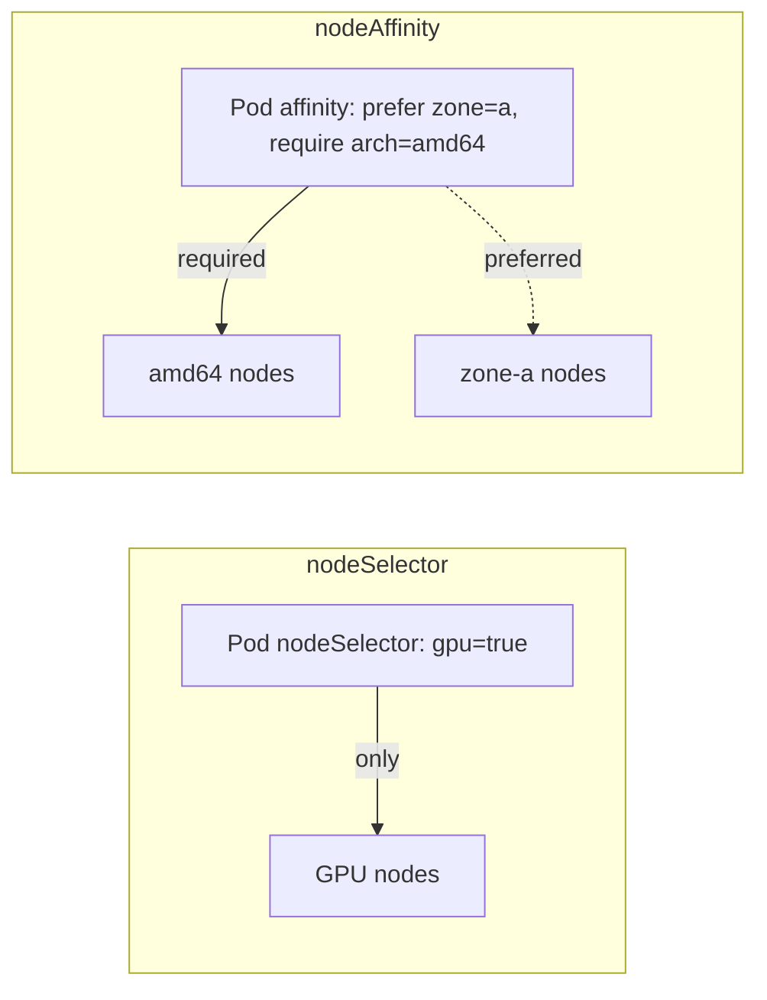
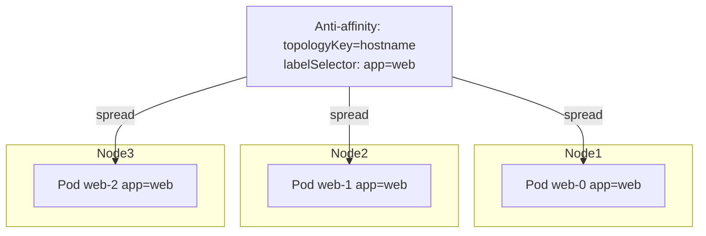

# 📘 Topic 33 — Node Selectors, Node Affinity, Anti-Affinity

**Official Documentation Reference**
- Assign pods to nodes: https://kubernetes.io/docs/concepts/scheduling-eviction/assign-pod-node/
- Node affinity: https://kubernetes.io/docs/tasks/configure-pod-container/assign-pods-nodes-using-node-affinity/
- GKE node affinity: https://cloud.google.com/kubernetes-engine/docs/concepts/node-affinity
- EKS scheduling: https://docs.aws.amazon.com/eks/latest/best-practices/scheduling.html

---

## 🔹 Definition
- **nodeSelector** — simplest way to constrain a pod to nodes matching specific labels (equality match).
- **Node Affinity** — expressive rules (required or preferred, set-based operators) that attract pods to specific nodes.
- **Pod Affinity / Anti-Affinity** — attract or repel pods relative to other pods' locations.

---

## 🔹 About

### nodeSelector (simplest)
```yaml
spec:
  nodeSelector:
    disktype: ssd
```
Pod only runs on nodes labeled `disktype=ssd`. Hard requirement — no matching node = Pending.

### Node Affinity
Two flavors:
| Type | Behavior | Use case |
|---|---|---|
| `requiredDuringSchedulingIgnoredDuringExecution` | Hard — must match | GPU workloads, zonal pinning |
| `preferredDuringSchedulingIgnoredDuringExecution` | Soft — prefer, not require | Spread across cheaper nodes |

`IgnoredDuringExecution` = if node label changes after scheduling, pod is NOT evicted (today's only mode).

Operators: `In`, `NotIn`, `Exists`, `DoesNotExist`, `Gt`, `Lt`.

### Pod Affinity / Anti-Affinity
Attract or repel pods relative to other pods on the same topology domain (node, zone, region).

| Type | Behavior | Example |
|---|---|---|
| Pod affinity (required) | Must co-locate with matching pods | Cache pod near app pod |
| Pod affinity (preferred) | Prefer co-location | |
| Pod anti-affinity (required) | Must NOT be on same topology as matching pods | Spread replicas across nodes |
| Pod anti-affinity (preferred) | Prefer spreading | |

`topologyKey` defines the domain: `kubernetes.io/hostname` (per-node), `topology.kubernetes.io/zone` (per-zone).

### Performance warning
Pod anti-affinity with `requiredDuringScheduling` and `topologyKey: kubernetes.io/hostname` scans all pods on every node — expensive at scale. Prefer `topologySpreadConstraints` (Topic 35) for even spread.

---

## 🏗️ Diagrams

### nodeSelector vs node affinity


### Pod anti-affinity across nodes


---

## 💻 Real-World Examples

### Example 1 — nodeSelector
```yaml
spec:
  nodeSelector:
    accelerator: nvidia-tesla-t4
```

### Example 2 — Node affinity (required + preferred)
```yaml
spec:
  affinity:
    nodeAffinity:
      requiredDuringSchedulingIgnoredDuringExecution:
        nodeSelectorTerms:
        - matchExpressions:
          - { key: kubernetes.io/arch, operator: In, values: [amd64] }
      preferredDuringSchedulingIgnoredDuringExecution:
      - weight: 80
        preference:
          matchExpressions:
          - { key: topology.kubernetes.io/zone, operator: In, values: [ap-south-1a] }
```

### Example 3 — Pod anti-affinity (spread across nodes)
```yaml
spec:
  affinity:
    podAntiAffinity:
      requiredDuringSchedulingIgnoredDuringExecution:
      - labelSelector:
          matchLabels: { app: web }
        topologyKey: kubernetes.io/hostname
```

### Example 4 — Pod affinity (co-locate cache with app)
```yaml
spec:
  affinity:
    podAffinity:
      requiredDuringSchedulingIgnoredDuringExecution:
      - labelSelector:
          matchLabels: { app: api }
        topologyKey: kubernetes.io/hostname
```

### Example 5 — Preferred anti-affinity across zones
```yaml
spec:
  affinity:
    podAntiAffinity:
      preferredDuringSchedulingIgnoredDuringExecution:
      - weight: 100
        podAffinityTerm:
          labelSelector: { matchLabels: { app: web } }
          topologyKey: topology.kubernetes.io/zone
```

---

## 💻 Related Commands

| Command | Flag | Purpose | Example |
|---|---|---|---|
| `kubectl label node` | `key=val` | Add node label | `kubectl label node w1 disktype=ssd` |
| `kubectl label node` | `key-` | Remove label | `kubectl label node w1 disktype-` |
| `kubectl get nodes` | `--show-labels` | Show all labels | `kubectl get nodes --show-labels` |
| `kubectl get nodes` | `-L key1,key2` | Show specific labels | `kubectl get nodes -L zone,disktype` |
| `kubectl get pods` | `-o wide` | See which node each pod landed on | `kubectl get pods -o wide` |
| `kubectl describe pod` | — | See affinity + scheduling events | `kubectl describe pod web-0` |

---

## 🚨 Scenarios

### Scenario 1 — Pod Pending: node affinity has no matches
- **Cause**: `required` affinity uses label that no node carries.
- **Fix**: label nodes, or switch to `preferred`.

### Scenario 2 — Anti-affinity blocks scaling beyond node count
- **Cause**: `required` anti-affinity on hostname = 1 pod/node. 3 nodes → max 3 pods.
- **Fix**: switch to `preferred`, or use `topologySpreadConstraints` with `whenUnsatisfiable: ScheduleAnyway`.

### Scenario 3 — Pod affinity creates hotspot
- **Cause**: all pods co-located on one node; node fails → all pods down.
- **Fix**: combine affinity with anti-affinity or topology spread to balance.

---

## ☁️ GCP GKE Perspective
- Common node labels: `cloud.google.com/gke-nodepool`, `topology.kubernetes.io/zone`, `cloud.google.com/gke-accelerator`.
- **Autopilot**: node labels set by Google; use `cloud.google.com/compute-class` for workload separation.

## 🟧 AWS EKS Perspective
- Common labels: `topology.kubernetes.io/zone`, `node.kubernetes.io/instance-type`, `karpenter.sh/capacity-type` (spot/on-demand).
- **Karpenter**: reads pod affinity/nodeSelector requirements and provisions matching instance types.

---

## 🧪 Hands-On Lab Exercises

### Lab 33.1 — nodeSelector (Beginner, 20 min)
Label one node `tier=frontend`. Deploy pod with `nodeSelector: {tier: frontend}`. Verify pod lands there.

### Lab 33.2 — Pod anti-affinity spread (Intermediate, 45 min)
Deploy 3-replica Deployment with `requiredDuringScheduling` anti-affinity on hostname. Verify one pod per node. Try scaling to 4 → Pending.

### Lab 33.3 — Mixed affinity: co-locate cache + spread app (Advanced, 60 min)
1. Deploy `app` with anti-affinity across zones.
2. Deploy `cache` with pod affinity to `app` on hostname.
3. Verify cache lands on same node as app, but app pods are in different zones.

---

## 🎯 Interview Deliverable Answer (60–90 s)
"**What**: nodeSelector is the simplest way to pin a pod to labeled nodes. Node affinity gives required or preferred rules with set-based operators. Pod affinity and anti-affinity attract or repel pods relative to other pods' locations on a topology domain — node, zone, or region.  
**Why**: These controls let you match workloads to hardware (GPU nodes, SSD nodes), separate tenants, co-locate latency-sensitive pairs, and spread replicas for high availability.  
**How**: I use nodeSelector for simple cases (GPU workloads). For multi-zone HA I combine preferred node affinity with required pod anti-affinity on the zone topology key. For co-located caches I use pod affinity on hostname. I'm moving toward topologySpreadConstraints for most spread use cases — they're more predictable and performant than pod anti-affinity.  
**Example**: Our ML inference pods needed T4 GPUs. We labeled the GPU pool nodes `accelerator=nvidia-tesla-t4` and set `nodeSelector` — pods never land on CPU-only nodes, and Karpenter provisions GPU instances only when inference pods are pending."

---

## ❓ Possible Interview Questions

**Q1. nodeSelector vs node affinity?** nodeSelector: equality only, hard. Affinity: set-based operators, required or preferred.  
**Q2. What does `requiredDuringSchedulingIgnoredDuringExecution` mean?** Must match at scheduling time; pod not evicted if label changes later.  
**Q3. Pod affinity `topologyKey` — what is it?** The node label defining the topology domain (e.g., hostname, zone).  
**Q4. When would you use pod affinity?** Co-locate tightly coupled services (app + cache) on the same node/zone for low latency.  
**Q5. Why is pod anti-affinity expensive at scale?** Scheduler must check all existing pods on every candidate node — O(pods × nodes).  
**Q6. `preferred` with weight — how does it work?** Each matching preferred term adds its weight to the node's score; highest total wins.  
**Q7. Can you combine node affinity and pod anti-affinity?** Yes — both are in `spec.affinity`; evaluated independently.  
**Q8. What replaces pod anti-affinity for even spread?** `topologySpreadConstraints` (Topic 35).  
**Q9. What `Gt` / `Lt` operators do in node affinity?** Compare numeric label values (e.g., `nvidia.com/gpu.count Gt 2`).  
**Q10. How does Karpenter use pod affinity?** Reads pod requirements (affinity, nodeSelector, resources) and provisions matching instance types/zones.

