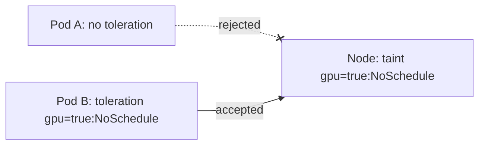
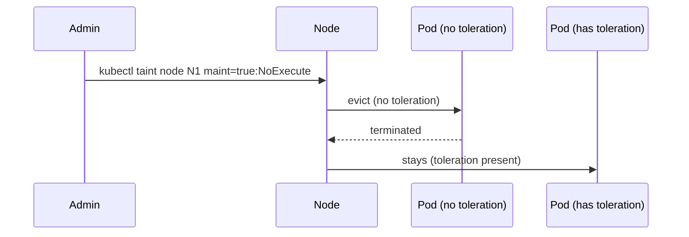

# 📘 Topic 34 — Taints and Tolerations

**Official Documentation Reference**
- Taints and Tolerations: https://kubernetes.io/docs/concepts/scheduling-eviction/taint-and-toleration/
- Well-known taints: https://kubernetes.io/docs/reference/labels-annotations-taints/
- GKE taints: https://cloud.google.com/kubernetes-engine/docs/how-to/node-taints
- EKS taints: https://docs.aws.amazon.com/eks/latest/userguide/node-taints-managed-node-groups.html

---

## 🔹 Definition
A **taint** is applied to a node to repel pods that don't explicitly tolerate it. A **toleration** is applied to a pod to allow scheduling on tainted nodes. Together they ensure only specific workloads run on designated nodes.

---

## 🔹 About

### Taint = node-level repellent
```
key=value:effect
```

### Effects
| Effect | Behavior |
|---|---|
| `NoSchedule` | New pods without toleration won't be scheduled; existing stay |
| `PreferNoSchedule` | Scheduler avoids, but may still place if no other option |
| `NoExecute` | New pods rejected AND existing pods without toleration are evicted |

### Toleration = pod-level permission
```yaml
tolerations:
- key: dedicated
  operator: Equal
  value: gpu
  effect: NoSchedule
```

Operators:
- `Equal` — key + value + effect must all match.
- `Exists` — key + effect match (value ignored). If key is empty + `Exists` → matches all taints.

### `tolerationSeconds` (NoExecute only)
How long to keep the pod before eviction after taint is added. Omit = tolerate forever.

### Built-in taints (auto-added by K8s)
| Taint | When |
|---|---|
| `node.kubernetes.io/not-ready` | Node condition Ready=False |
| `node.kubernetes.io/unreachable` | Node condition Ready=Unknown |
| `node.kubernetes.io/disk-pressure` | Disk pressure |
| `node.kubernetes.io/memory-pressure` | Memory pressure |
| `node.kubernetes.io/pid-pressure` | PID pressure |
| `node.kubernetes.io/unschedulable` | `kubectl cordon` |
| `node.kubernetes.io/network-unavailable` | Network not ready |

Default tolerations on every pod (added by DefaultTolerationSeconds admission plugin):
- `not-ready`: tolerationSeconds=300
- `unreachable`: tolerationSeconds=300

### Common patterns
| Pattern | How |
|---|---|
| Dedicated node pool | Taint nodes `dedicated=team-x:NoSchedule`; only team-x pods have toleration |
| GPU nodes | Taint `nvidia.com/gpu=present:NoSchedule`; GPU pods tolerate |
| Infra nodes (monitoring/logging) | Taint `role=infra:NoSchedule` |
| Spot/preemptible nodes | Taint `cloud.google.com/gke-preemptible=true:NoSchedule` |

---

## 🏗️ Diagrams

### Taint + toleration gate


### NoExecute eviction


---

## 💻 Real-World Examples

### Example 1 — Taint a node
```bash
kubectl taint node worker-1 dedicated=ml:NoSchedule
kubectl describe node worker-1 | grep Taint
```

### Example 2 — Remove a taint
```bash
kubectl taint node worker-1 dedicated=ml:NoSchedule-    # trailing minus
```

### Example 3 — Pod with toleration
```yaml
spec:
  tolerations:
  - { key: dedicated, operator: Equal, value: ml, effect: NoSchedule }
  nodeSelector: { dedicated: ml }      # pair with selector to ATTRACT
  containers: [{ name: train, image: myrepo/ml:1.0 }]
```

### Example 4 — Tolerate everything (DaemonSet pattern)
```yaml
tolerations:
- operator: Exists
```

### Example 5 — NoExecute with grace period
```yaml
tolerations:
- key: node.kubernetes.io/not-ready
  operator: Exists
  effect: NoExecute
  tolerationSeconds: 60          # evict after 60s
```

### Example 6 — GKE node pool with taint
```bash
gcloud container node-pools create gpu-pool \
  --cluster=prod --zone=asia-south1-a \
  --machine-type=n1-standard-8 --accelerator=type=nvidia-tesla-t4,count=1 \
  --node-taints=nvidia.com/gpu=present:NoSchedule \
  --num-nodes=2
```

### Example 7 — EKS managed NG with taint
```bash
eksctl create nodegroup --cluster=prod --name=gpu \
  --node-type=g4dn.xlarge --nodes=2 \
  --node-taints="nvidia.com/gpu=present:NoSchedule"
```

---

## 💻 Related Commands

| Command | Flag | Purpose | Example |
|---|---|---|---|
| `kubectl taint node` | `key=val:effect` | Add taint | `kubectl taint node w1 dedicated=ml:NoSchedule` |
| `kubectl taint node` | `key=val:effect-` | Remove taint | `kubectl taint node w1 dedicated=ml:NoSchedule-` |
| `kubectl taint node` | `key:effect-` | Remove by key+effect | `kubectl taint node w1 dedicated:NoSchedule-` |
| `kubectl describe node` | — | See taints section | `kubectl describe node w1` |
| `kubectl get nodes` | `-o jsonpath='{.items[*].spec.taints}'` | List all taints | |

---

## 🚨 Scenarios

### Scenario 1 — All pods evicted from node after taint
- **Cause**: `NoExecute` taint applied; existing pods lacked toleration.
- **Fix**: intended behavior for maintenance drain. For gradual: use `NoSchedule` first, then drain.

### Scenario 2 — DaemonSet pod not running on tainted node
- **Cause**: DS pod template missing toleration.
- **Fix**: add `tolerations: [{operator: Exists}]` (wide) or specific key match.

### Scenario 3 — Dedicated node pool empty even though workloads exist
- **Cause**: taint applied, but nodeSelector/affinity missing — pods tolerate but don't attract.
- **Fix**: always pair toleration with nodeSelector or node affinity.

### Scenario 4 — Pod evicted too fast on node flap
- **Cause**: default `tolerationSeconds: 300` for `not-ready` too short for network glitch.
- **Fix**: increase `tolerationSeconds` on critical pods or set PDB.

---

## ☁️ GCP GKE Perspective
- GKE auto-taints preemptible/Spot nodes: `cloud.google.com/gke-preemptible=true:NoSchedule`.
- GPU node pools auto-tainted: `nvidia.com/gpu=present:NoSchedule`.
- **Autopilot**: Google manages taints; you can't taint Autopilot nodes directly.

## 🟧 AWS EKS Perspective
- Managed NG supports taints via `eksctl` or `aws eks create-nodegroup --taints`.
- Karpenter: taints defined in `NodePool` spec; Karpenter provisions tainted nodes only for pods that tolerate them.
- Spot nodes: Karpenter adds `karpenter.sh/capacity-type=spot` but doesn't auto-taint by default — configure via NodePool.

---

## 🧪 Hands-On Lab Exercises

### Lab 34.1 — Taint + tolerate (Beginner, 20 min)
1. Taint a node. 2. Deploy pod without toleration → Pending. 3. Add toleration → schedules.

### Lab 34.2 — NoExecute eviction (Intermediate, 30 min)
1. Deploy pod on node. 2. `kubectl taint node <n> maint=true:NoExecute`. 3. Pod evicted. 4. Deploy pod with toleration + `tolerationSeconds: 30`. 5. After 30s → evicted.

### Lab 34.3 — Dedicated GPU pool on GKE/EKS (Advanced, 60 min)
1. Create tainted GPU node pool (Example 6 or 7).
2. Deploy ML pod with toleration + nodeSelector.
3. Deploy regular pod → stays on default pool.
4. Verify with `kubectl get pods -o wide`.

---

## 🎯 Interview Deliverable Answer (60–90 s)
"**What**: Taints are node-level labels that repel pods; tolerations are pod-level declarations that let pods tolerate specific taints. Effects control severity: NoSchedule prevents new scheduling, PreferNoSchedule is soft, NoExecute also evicts existing pods.  
**Why**: Taints enforce node specialization. GPU nodes, Spot nodes, infra-only nodes — taints ensure only the right workloads land there. Kubernetes also auto-taints nodes under pressure (disk, memory, not-ready) to protect the cluster.  
**How**: I pair every taint with a toleration AND a nodeSelector or affinity — toleration only opens the gate, it doesn't attract. For DaemonSets I use `operator: Exists` to tolerate everything. For maintenance I add `NoExecute` with `tolerationSeconds` so pods drain gracefully.  
**Example**: We created a dedicated GPU node pool on EKS tainted `nvidia.com/gpu=present:NoSchedule`. ML pods carry the toleration and nodeSelector; nothing else runs there. This cut our GPU costs 35% because non-GPU pods no longer wasted GPU-instance resources."

---

## ❓ Possible Interview Questions

**Q1. Taint vs nodeSelector?** Taint repels (on node). nodeSelector attracts (on pod). Use both together.  
**Q2. Three taint effects?** NoSchedule, PreferNoSchedule, NoExecute.  
**Q3. NoExecute vs NoSchedule?** NoExecute also evicts running pods. NoSchedule only prevents new scheduling.  
**Q4. What does `operator: Exists` do?** Matches any taint with that key (value ignored). Empty key + Exists = match all taints.  
**Q5. What is `tolerationSeconds`?** How long a pod stays on a NoExecute-tainted node before eviction.  
**Q6. Name 3 built-in taints.** `not-ready`, `unreachable`, `disk-pressure`.  
**Q7. Why do DaemonSets need `operator: Exists`?** To run on every node including tainted ones (infra, GPU, Spot).  
**Q8. How do you drain a node for maintenance?** `kubectl drain <n> --ignore-daemonsets --delete-emptydir-data` — adds `NoSchedule` + evicts pods.  
**Q9. How does Karpenter handle taints?** NodePool spec includes taints; Karpenter provisions tainted nodes only when pending pods tolerate them.  
**Q10. Can you taint the control plane?** Yes — kubeadm auto-taints CP: `node-role.kubernetes.io/control-plane:NoSchedule`. Remove to schedule user pods on CP (not recommended in prod).

