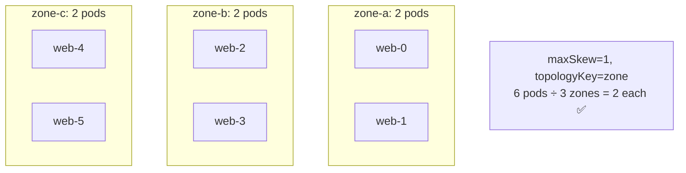
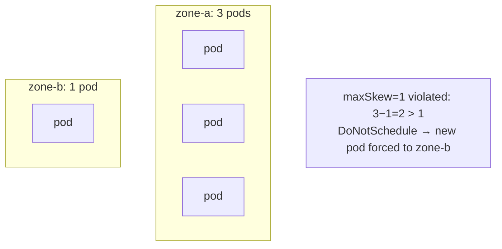

# 📘 Topic 35 — Topology Spread Constraints

**Official Documentation Reference**
- Topology Spread Constraints: https://kubernetes.io/docs/concepts/scheduling-eviction/topology-spread-constraints/
- GKE topology: https://cloud.google.com/kubernetes-engine/docs/concepts/topology-spread-constraints
- EKS best practices: https://docs.aws.amazon.com/eks/latest/best-practices/scheduling.html

---

## 🔹 Definition
**TopologySpreadConstraints** control how pods are distributed across failure domains — nodes, zones, or regions — ensuring even spread for high availability. They're the recommended replacement for pod anti-affinity for most spread use cases.

---

## 🔹 About

### Key fields
| Field | Purpose |
|---|---|
| `maxSkew` | Maximum allowed difference in pod count between any two topology domains |
| `topologyKey` | Node label defining the domain (`kubernetes.io/hostname`, `topology.kubernetes.io/zone`) |
| `whenUnsatisfiable` | `DoNotSchedule` (hard) or `ScheduleAnyway` (soft + minimize skew) |
| `labelSelector` | Which pods count toward the constraint |
| `minDomains` | Minimum number of domains required (K8s 1.30+ stable) |
| `matchLabelKeys` | Use pod label values at scheduling time (K8s 1.27+ beta) |
| `nodeAffinityPolicy` / `nodeTaintsPolicy` | Whether filtered-out nodes are included in skew calculation |

### Why better than pod anti-affinity
- Anti-affinity is binary (co-locate or not); spread constraints are quantitative (`maxSkew`).
- Anti-affinity is O(pods × nodes) in computation; TSC is more efficient.
- TSC works across any topology key, with soft or hard enforcement.

### Multiple constraints
You can stack multiple TSC entries — all must be satisfied.
```yaml
topologySpreadConstraints:
- maxSkew: 1
  topologyKey: topology.kubernetes.io/zone
  whenUnsatisfiable: DoNotSchedule
  labelSelector: { matchLabels: { app: web } }
- maxSkew: 1
  topologyKey: kubernetes.io/hostname
  whenUnsatisfiable: ScheduleAnyway
  labelSelector: { matchLabels: { app: web } }
```
This says: "hard spread across zones (max skew 1), soft spread across nodes."

### Cluster-level defaults
Since K8s 1.24, cluster-wide default constraints can be set in the scheduler config:
```yaml
profiles:
- pluginConfig:
  - name: PodTopologySpread
    args:
      defaultConstraints:
      - maxSkew: 1
        topologyKey: topology.kubernetes.io/zone
        whenUnsatisfiable: ScheduleAnyway
```

---

## 🏗️ Diagrams

### Even spread across zones


### Skew violation


---

## 💻 Real-World Examples

### Example 1 — Spread Deployment across zones
```yaml
apiVersion: apps/v1
kind: Deployment
metadata: { name: web }
spec:
  replicas: 6
  selector: { matchLabels: { app: web } }
  template:
    metadata: { labels: { app: web } }
    spec:
      topologySpreadConstraints:
      - maxSkew: 1
        topologyKey: topology.kubernetes.io/zone
        whenUnsatisfiable: DoNotSchedule
        labelSelector: { matchLabels: { app: web } }
      containers: [{ name: c, image: nginx:1.27 }]
```

### Example 2 — Spread across nodes (soft) + zones (hard)
```yaml
topologySpreadConstraints:
- maxSkew: 1
  topologyKey: topology.kubernetes.io/zone
  whenUnsatisfiable: DoNotSchedule
  labelSelector: { matchLabels: { app: web } }
- maxSkew: 1
  topologyKey: kubernetes.io/hostname
  whenUnsatisfiable: ScheduleAnyway
  labelSelector: { matchLabels: { app: web } }
```

### Example 3 — minDomains
```yaml
topologySpreadConstraints:
- maxSkew: 1
  topologyKey: topology.kubernetes.io/zone
  whenUnsatisfiable: DoNotSchedule
  minDomains: 3
  labelSelector: { matchLabels: { app: web } }
```
Scheduler won't place until at least 3 zones have nodes.

---

## 💻 Related Commands

| Command | Flag | Purpose | Example |
|---|---|---|---|
| `kubectl get pods` | `-o wide` | See pod-to-node mapping | `kubectl get pods -o wide -l app=web` |
| `kubectl get nodes` | `-L topology.kubernetes.io/zone` | Show zone labels | |
| `kubectl describe pod` | — | See TSC events | `kubectl describe pod web-0` |
| `kubectl get events` | `--field-selector reason=FailedScheduling` | TSC failures | |

---

## 🚨 Scenarios

### Scenario 1 — Skew violated; new pod Pending
- **Cause**: `DoNotSchedule` and the only zone with capacity would increase skew beyond maxSkew.
- **Fix**: scale the cluster in the under-populated zone; or use `ScheduleAnyway`.

### Scenario 2 — After node failure, pods bunch up in surviving zones
- **Cause**: rescheduled pods all go to one zone; existing pods already there → skew worsens.
- **Fix**: `maxSkew: 2` for more flexibility during failures; or add capacity in all zones.

### Scenario 3 — TSC + PDB conflict
- **Cause**: PDB prevents eviction needed to rebalance; TSC prevents scheduling to maintain balance.
- **Fix**: loosen PDB or set TSC to `ScheduleAnyway`.

---

## ☁️ GCP GKE Perspective
- **Autopilot** may auto-spread pods with built-in defaults. Node labels `topology.kubernetes.io/zone` set automatically.
- **Regional clusters** have nodes across 3 zones → TSC `maxSkew: 1` across zones is ideal.

## 🟧 AWS EKS Perspective
- EKS nodes get `topology.kubernetes.io/zone` from EC2 metadata.
- **Karpenter** reads TSC and provisions nodes in under-represented zones to satisfy the constraint.
- Fargate: TSC works, but you can't control which AZ a Fargate node lands in — AWS decides.

---

## 🧪 Hands-On Lab Exercises

### Lab 35.1 — Zone spread on Kind (Beginner, 30 min)
1. Create Kind cluster with 3 workers. Label each worker with a fake zone: `zone-a`, `zone-b`, `zone-c`.
2. Deploy 6-replica Deployment with TSC `maxSkew: 1, topologyKey: zone, DoNotSchedule`.
3. `kubectl get pods -o wide` → 2 per zone.

### Lab 35.2 — ScheduleAnyway fallback (Intermediate, 30 min)
1. Same setup. Scale to 9 replicas but only 2 nodes in `zone-c`.
2. With `DoNotSchedule`: 3rd pod in zone-c Pending.
3. Switch to `ScheduleAnyway`: pod schedules, skew > 1 but cluster runs.

### Lab 35.3 — TSC + Karpenter on EKS (Advanced, 60 min)
1. Deploy Karpenter with NodePool across 3 AZs.
2. Deploy Deployment with TSC across zones.
3. Scale up → Karpenter provisions nodes in under-represented AZs.
4. Drain one AZ's nodes → TSC forces rescheduling to remaining AZs.

---

## 🎯 Interview Deliverable Answer (60–90 s)
"**What**: TopologySpreadConstraints control how pods distribute across failure domains — zones, nodes, or custom topology keys — using a `maxSkew` parameter that caps the imbalance.  
**Why**: High availability requires spreading replicas across zones. Pod anti-affinity can do this but is binary and expensive. TSC is quantitative — `maxSkew: 1` means the difference between any two zones is at most 1 pod — and more efficient.  
**How**: I stack two constraints: a hard spread across zones (`maxSkew: 1, DoNotSchedule`) for HA, and a soft spread across nodes (`ScheduleAnyway`) for balance within a zone. On EKS, Karpenter reads TSC and provisions nodes in under-represented zones. I pair TSC with PDB so drains and zone failures don't collapse availability.  
**Example**: We ran 12 replicas of an API behind a LoadBalancer. Without TSC, 8 landed in zone-a. When zone-a had a 10-minute outage, we served at 33% capacity. After adding TSC `maxSkew: 1`, pods spread 4-4-4 across zones — the same outage now leaves us at 66% capacity."

---

## ❓ Possible Interview Questions

**Q1. What is a TopologySpreadConstraint?** Controls pod distribution across topology domains with a max skew.  
**Q2. `maxSkew: 1` means what?** The difference in pod count between any two matching topology domains is at most 1.  
**Q3. TSC vs pod anti-affinity?** TSC is quantitative (skew); anti-affinity is binary (co-locate or not). TSC is more performant.  
**Q4. `DoNotSchedule` vs `ScheduleAnyway`?** Hard vs soft. ScheduleAnyway still tries to minimize skew but won't block the pod.  
**Q5. What is `minDomains`?** Minimum number of topology domains required before scheduling begins.  
**Q6. Can you stack multiple TSCs?** Yes — all must be satisfied for the pod to schedule.  
**Q7. What `topologyKey` values are common?** `kubernetes.io/hostname` (node), `topology.kubernetes.io/zone` (zone).  
**Q8. How does Karpenter interact with TSC?** It reads pending pod TSC requirements and provisions nodes in under-represented zones/domains.  
**Q9. What happens to skew during a zone failure?** Surviving zones absorb rescheduled pods; skew may temporarily exceed maxSkew if `ScheduleAnyway`.  
**Q10. Where do you set cluster-wide default TSC?** In `KubeSchedulerConfiguration` under `PodTopologySpread.defaultConstraints`.

