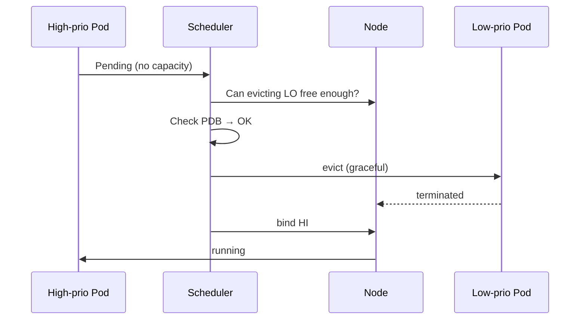
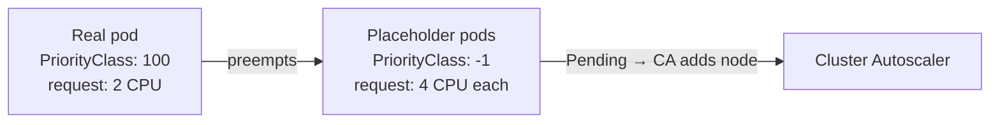

# 📘 Topic 36 — Pod Priority and Preemption

**Official Documentation Reference**
- Pod Priority and Preemption: https://kubernetes.io/docs/concepts/scheduling-eviction/pod-priority-preemption/
- PriorityClass API: https://kubernetes.io/docs/reference/kubernetes-api/scheduling/priority-class-v1/
- GKE priority: https://cloud.google.com/kubernetes-engine/docs/concepts/priority-classes
- EKS best practices: https://docs.aws.amazon.com/eks/latest/best-practices/scheduling.html

---

## 🔹 Definition
**Pod Priority** assigns an integer priority to pods via a `PriorityClass`. **Preemption** is the scheduler's ability to evict lower-priority pods from a node to make room for a higher-priority pending pod.

---

## 🔹 About

### PriorityClass object (cluster-scoped)
```yaml
apiVersion: scheduling.k8s.io/v1
kind: PriorityClass
metadata: { name: high }
value: 1000000
globalDefault: false
preemptionPolicy: PreemptLowerPriority    # or Never
description: "High priority workloads"
```

### Built-in system classes
| Class | Value | Purpose |
|---|---|---|
| `system-cluster-critical` | 2000000000 | Cluster-critical add-ons (CoreDNS, kube-proxy) |
| `system-node-critical` | 2000001000 | Node-critical daemons (kubelet, CNI) |

User-defined priority values must be < 1,000,000,000 (1 billion).

### How preemption works
1. Pod `high-prio` can't schedule (no resources).
2. Scheduler runs PostFilter → finds a node where evicting `low-prio` pods frees enough capacity.
3. Respects PDB — won't preempt if it violates a PodDisruptionBudget.
4. Evicts selected pods (graceful termination).
5. Schedules `high-prio` on the freed node.

### `preemptionPolicy: Never`
Pod still has high priority in the queue (scheduled before lower-priority pending pods) but does NOT evict running pods. Useful for batch jobs that should go first when capacity frees up but shouldn't kill prod services.

### `globalDefault: true`
One PriorityClass can be the default for all pods that don't specify one. At most one can be default.

### Priority + Cluster Autoscaler
- CA adds nodes when pods are Pending.
- Priority doesn't change CA's scale-up behavior directly — but higher-priority pods trigger scale-up before lower ones are considered.
- **Overprovisioning pattern**: deploy low-priority "placeholder" pods that waste resources. When a real pod arrives, placeholders are preempted → real pod runs immediately while CA adds capacity in the background.

---

## 🔹 How It Integrates With Other Kubernetes Components
| Component | Interaction |
|---|---|
| Scheduler | Queue ordering + preemption |
| PDB | Preemption respects PDB; won't violate minAvailable |
| Cluster Autoscaler | Triggers scale-up for Pending pods by priority order |
| Karpenter | Reads priority; provisions nodes for highest-priority pending first |
| Eviction | kubelet eviction order considers priority |

---

## 🏗️ Diagrams

### Preemption flow


### Overprovisioning pattern


---

## 💻 Real-World Examples

### Example 1 — PriorityClasses
```yaml
apiVersion: scheduling.k8s.io/v1
kind: PriorityClass
metadata: { name: critical }
value: 900000
preemptionPolicy: PreemptLowerPriority
---
apiVersion: scheduling.k8s.io/v1
kind: PriorityClass
metadata: { name: batch }
value: 100
preemptionPolicy: Never
globalDefault: false
---
apiVersion: scheduling.k8s.io/v1
kind: PriorityClass
metadata: { name: placeholder }
value: -1
preemptionPolicy: Never
```

### Example 2 — Use in a Deployment
```yaml
spec:
  template:
    spec:
      priorityClassName: critical
      containers: [{ name: api, image: myrepo/api:2.0 }]
```

### Example 3 — Overprovisioning with placeholders
```yaml
apiVersion: apps/v1
kind: Deployment
metadata: { name: overprovisioner }
spec:
  replicas: 5
  selector: { matchLabels: { app: placeholder } }
  template:
    metadata: { labels: { app: placeholder } }
    spec:
      priorityClassName: placeholder
      containers:
      - name: pause
        image: registry.k8s.io/pause:3.9
        resources: { requests: { cpu: 2, memory: 4Gi } }
```
When a real pod with priority > -1 arrives, placeholders are preempted instantly → real pod runs while CA provisions replacement node.

---

## 💻 Related Commands

| Command | Flag | Purpose | Example |
|---|---|---|---|
| `kubectl get priorityclass` | — | List classes | `kubectl get pc` |
| `kubectl describe priorityclass` | `<name>` | Details | `kubectl describe pc critical` |
| `kubectl get pods` | `-o custom-columns=NAME:.metadata.name,PRIO:.spec.priority` | Show priority values | |
| `kubectl get events` | `--field-selector reason=Preempted` | See preemption events | |

---

## 🚨 Scenarios

### Scenario 1 — Batch jobs preempt production
- **Cause**: batch given higher priority than production.
- **Fix**: review PriorityClass values. Production > batch always. Set batch `preemptionPolicy: Never`.

### Scenario 2 — Preemption cascade
- **Cause**: high-priority pod preempts mid-priority; mid-priority preempts low — chain reaction.
- **Fix**: limit the number of priority tiers. Use PDB on mid-priority. Add Cluster Autoscaler capacity.

### Scenario 3 — Overprovisioner wastes money
- **Cause**: placeholders running 24/7 on expensive nodes.
- **Fix**: right-size placeholder count and requests. Use Spot/preemptible nodes for placeholders.

---

## ☁️ GCP GKE Perspective
- GKE system pods use `system-cluster-critical` / `system-node-critical`.
- **Autopilot** supports user-defined PriorityClasses.
- **Node Auto-Provisioning** (NAP) considers priority when deciding which node pool to create.

## 🟧 AWS EKS Perspective
- EKS supports PriorityClasses natively.
- **Karpenter** provisions nodes based on highest-priority pending pods first.
- **Spot interruption**: Karpenter handles graceful migration; combine with PDB for zero-downtime.

---

## 🧪 Hands-On Lab Exercises

### Lab 36.1 — See preemption in action (Beginner, 30 min)
1. Create `low` PC (value 10) and `high` PC (value 1000).
2. Fill a 2-node Kind cluster with `low` pods (exhaust all CPU).
3. Deploy a `high` pod → scheduler evicts a `low` pod → `high` runs.
4. `kubectl get events --field-selector reason=Preempted`.

### Lab 36.2 — preemptionPolicy: Never (Intermediate, 30 min)
1. Same setup but `high` PC has `preemptionPolicy: Never`.
2. `high` pod stays Pending — doesn't evict anyone.
3. Delete a `low` pod manually → `high` pod schedules (it was queued first).

### Lab 36.3 — Overprovisioning pattern (Advanced, 60 min)
1. Deploy placeholder pods (Example 3) on a 3-node EKS/GKE cluster.
2. Deploy a real app pod with priority > -1 → placeholder preempted → real pod runs in < 5s.
3. CA/Karpenter provisions new node for the now-Pending placeholder.
4. Measure time-to-running for the real pod with and without overprovisioning.

---

## 🎯 Interview Deliverable Answer (60–90 s)
"**What**: Pod Priority assigns an integer value via a PriorityClass. Preemption is the scheduler's ability to evict lower-priority pods to make room for higher-priority ones — respecting PDBs.  
**Why**: In a shared cluster, production API pods must never wait behind batch jobs. Priority ensures the scheduler queues and places critical pods first, and preemption frees capacity when the cluster is full.  
**How**: I define three tiers: `critical` (900K), `default` (0, globalDefault), `batch` (-100, preemptionPolicy: Never). Batch pods can't preempt production but get leftover capacity. For instant scaling I use the overprovisioning pattern — low-priority pause pods hold capacity that real workloads preempt immediately while the Cluster Autoscaler adds nodes in the background.  
**Example**: On Black Friday, our API pods had priority 900K and batch-ML had priority 100 with `preemptionPolicy: Never`. When traffic spiked, the scheduler preempted non-critical dashboard pods (priority 500) — the API scaled from 10 to 50 replicas in under 30 seconds. Batch pods ran later when nodes scaled up."

---

## ❓ Possible Interview Questions

**Q1. What is a PriorityClass?** Cluster-scoped object mapping a name to an integer priority value.  
**Q2. How does preemption work?** Scheduler evicts lower-priority pods to free resources for a higher-priority Pending pod, respecting PDB.  
**Q3. What is `preemptionPolicy: Never`?** Pod gets queue priority (scheduled before lower) but does NOT evict running pods.  
**Q4. Built-in critical classes?** `system-cluster-critical` (2B), `system-node-critical` (2B+1K).  
**Q5. What is the overprovisioning pattern?** Low-priority placeholder pods hold capacity. Real pods preempt them instantly; CA replaces the placeholder's capacity in the background.  
**Q6. Does preemption respect PDB?** Yes — won't violate minAvailable / maxUnavailable.  
**Q7. Can preemption cascade?** Yes — careful with many priority tiers. Keep tiers minimal.  
**Q8. `globalDefault: true`?** That PriorityClass is used when a pod doesn't specify one.  
**Q9. Priority affects kubelet eviction?** Yes — under memory pressure, kubelet evicts BestEffort first, then by priority within QoS.  
**Q10. How does Karpenter use priority?** Provisions nodes for highest-priority pending pods first; may deprioritize lower-priority pods for Spot interruption handling.

