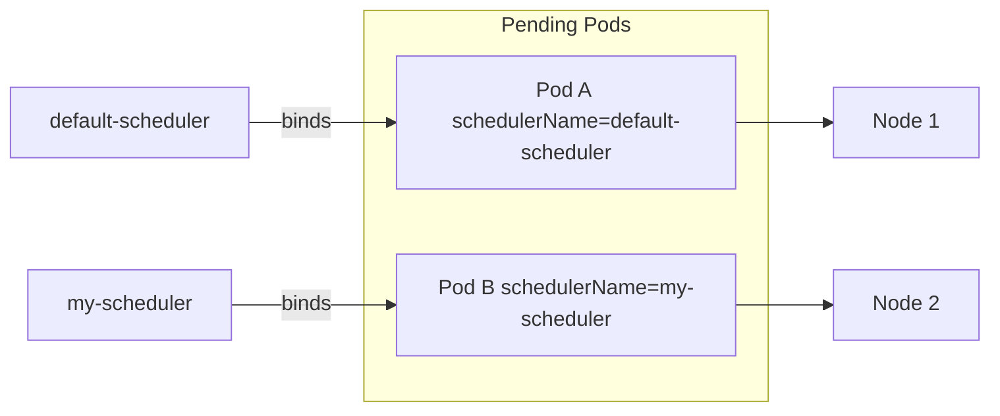
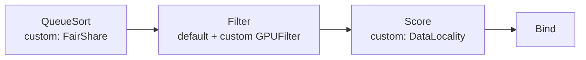
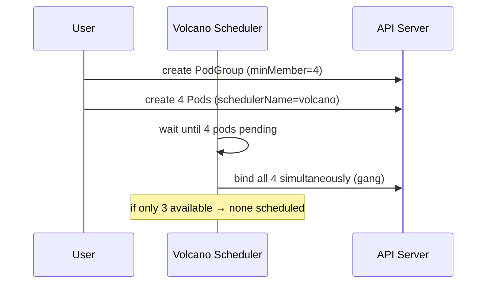

# 📘 Topic 37 — Custom Schedulers

**Official Documentation Reference**
- Configure multiple schedulers: https://kubernetes.io/docs/tasks/extend-kubernetes/configure-multiple-schedulers/
- Scheduling framework: https://kubernetes.io/docs/concepts/scheduling-eviction/scheduling-framework/
- Scheduler profiles: https://kubernetes.io/docs/reference/scheduling/config/
- GKE scheduling: https://cloud.google.com/kubernetes-engine/docs/concepts/scheduling
- EKS scheduling: https://docs.aws.amazon.com/eks/latest/best-practices/scheduling.html

---

## 🔹 Definition
A **custom scheduler** is a separate scheduler binary (or profile within the default scheduler) that implements scheduling logic different from the built-in defaults. Pods select their scheduler via `spec.schedulerName`.

---

## 🔹 About

### Why use a custom scheduler?
- **Specialized workloads**: gang scheduling (all-or-nothing for distributed ML), co-scheduling, GPU bin-packing.
- **Custom scoring**: prefer nodes with specific hardware, data locality, network topology.
- **Multi-tenant fairness**: weighted fair queuing across teams.
- **Research/experimentation**: prototype new scheduling algorithms.

### Two approaches
| Approach | How |
|---|---|
| **Scheduling profiles** | Configure multiple profiles in the same `kube-scheduler` binary with different plugin sets. No extra Deployment. |
| **Separate scheduler Deployment** | Deploy a second `kube-scheduler` binary (or a Go binary implementing the scheduler framework) as a Deployment in `kube-system`. |

### Writing a custom scheduler
1. **Simplest**: fork `kube-scheduler`, change plugin weights or add a custom Score plugin.
2. **Scheduler framework**: write a Go plugin implementing one or more extension points (Filter, Score, Permit, etc.).
3. **Webhook-based extender** (legacy): configure the default scheduler to call an HTTP endpoint for filter/score. Slower, deprecated in favor of framework plugins.

### Notable open-source custom schedulers
| Scheduler | Purpose |
|---|---|
| **Volcano** | Batch / HPC / gang scheduling (CNCF Sandbox) |
| **Koordinator** | Colocation / QoS-aware scheduling (Alibaba) |
| **Yunikorn** | Multi-tenant resource queuing (Apache, used by Databricks on K8s) |
| **Scheduler Plugins (sigs)** | Community plugins: Coscheduling, Trimaran (load-aware), CapacityScheduling |

### Deploying a second scheduler
```yaml
apiVersion: apps/v1
kind: Deployment
metadata: { name: my-scheduler, namespace: kube-system }
spec:
  replicas: 1
  selector: { matchLabels: { component: my-scheduler } }
  template:
    metadata: { labels: { component: my-scheduler } }
    spec:
      serviceAccountName: my-scheduler
      containers:
      - name: scheduler
        image: registry.k8s.io/kube-scheduler:v1.31.0
        command:
        - kube-scheduler
        - --config=/etc/kubernetes/scheduler-config.yaml
        - --leader-elect=false
        volumeMounts:
        - { name: config, mountPath: /etc/kubernetes/scheduler-config.yaml, subPath: scheduler-config.yaml }
      volumes:
      - name: config
        configMap: { name: my-scheduler-config }
```

### Pod selecting the custom scheduler
```yaml
spec:
  schedulerName: my-scheduler
  containers: [{ name: app, image: myrepo/app:1 }]
```
If `schedulerName` doesn't match any running scheduler, the pod stays Pending indefinitely.

### RBAC for a custom scheduler
The scheduler SA needs permissions to watch/patch Pods, Nodes, PVs, PVCs, Events, Leases, and more. Use the `system:kube-scheduler` ClusterRole as a starting point.

---

## 🔹 How It Integrates With Other Kubernetes Components
| Component | Interaction |
|---|---|
| API server | Custom scheduler watches + binds pods like the default |
| Default scheduler | Ignores pods with a different `schedulerName` |
| Cluster Autoscaler | Only aware of the default scheduler's Pending pods by default; configure CA to consider other schedulers |
| Karpenter | Works with any scheduler — reacts to Pending pods regardless of `schedulerName` |
| PDB | Respected by any scheduler's preemption logic |

---

## 🏗️ Diagrams

### Two schedulers side by side


### Scheduling framework plugin example


### Volcano gang scheduling


---

## 💻 Real-World Examples

### Example 1 — Scheduling profile with different scoring
```yaml
apiVersion: kubescheduler.config.k8s.io/v1
kind: KubeSchedulerConfiguration
profiles:
- schedulerName: default-scheduler
  plugins:
    score:
      enabled: [{ name: NodeResourcesFit, weight: 1 }]
  pluginConfig:
  - name: NodeResourcesFit
    args: { scoringStrategy: { type: LeastAllocated } }
- schedulerName: pack-scheduler
  plugins:
    score:
      enabled: [{ name: NodeResourcesFit, weight: 1 }]
  pluginConfig:
  - name: NodeResourcesFit
    args: { scoringStrategy: { type: MostAllocated } }
```
One binary, two profiles: `default-scheduler` spreads; `pack-scheduler` packs.

### Example 2 — Install Volcano for gang scheduling
```bash
kubectl apply -f https://raw.githubusercontent.com/volcano-sh/volcano/master/installer/volcano-development.yaml
kubectl get pods -n volcano-system
```
```yaml
apiVersion: batch.volcano.sh/v1alpha1
kind: Job
metadata: { name: gang-job }
spec:
  schedulerName: volcano
  minAvailable: 4
  tasks:
  - replicas: 4
    name: worker
    template:
      spec:
        containers: [{ name: w, image: myrepo/worker:1 }]
```

### Example 3 — Pod with custom scheduler
```yaml
apiVersion: v1
kind: Pod
metadata: { name: packed }
spec:
  schedulerName: pack-scheduler
  containers: [{ name: c, image: nginx:1.27 }]
```

---

## 💻 Related Commands

| Command | Flag | Purpose | Example |
|---|---|---|---|
| `kubectl get pods -A` | `-o custom-columns=NAME:.metadata.name,SCHEDULER:.spec.schedulerName` | See which scheduler per pod | |
| `kubectl logs -n kube-system` | `<my-scheduler-pod>` | Custom scheduler logs | |
| `kubectl get leases -n kube-system` | — | Check leader election | |
| `kubectl describe pod` | — | See scheduling events from custom scheduler | |

---

## 🚨 Scenarios

### Scenario 1 — Pod Pending: no scheduler matches `schedulerName`
- **Cause**: custom scheduler not deployed; or name typo.
- **Fix**: deploy the scheduler Deployment; verify it's running; check `schedulerName` spelling.

### Scenario 2 — Two schedulers race for the same pod
- **Cause**: both default and custom scheduler configured to handle same `schedulerName`.
- **Fix**: each scheduler must have a unique `schedulerName`. Disable leader-elect on custom scheduler if only one replica.

### Scenario 3 — Gang scheduling: not enough nodes for full gang
- **Cause**: Volcano waits for `minAvailable` pods to be schedulable simultaneously.
- **Fix**: add nodes or reduce gang size. Karpenter can help by provisioning right-sized nodes.

### Scenario 4 — Cluster Autoscaler ignores custom-scheduler pods
- **Cause**: CA only watches pods scheduled by `default-scheduler` by default.
- **Fix**: configure CA `--expandable-pod-groups` or use Karpenter (scheduler-agnostic).

---

## ☁️ GCP GKE Perspective
- GKE does NOT expose the managed scheduler's config. To use custom scheduling, deploy a second scheduler as a Deployment.
- **Autopilot**: custom schedulers are NOT supported (Google controls scheduling).
- **Standard**: full support for additional schedulers.
- **Batch on GKE**: Google's batch API handles gang-like semantics without a custom scheduler.

## 🟧 AWS EKS Perspective
- EKS managed scheduler cannot be customized. Deploy a custom scheduler Deployment.
- **Volcano on EKS** is a common choice for ML/HPC batch workloads.
- **Karpenter** is scheduler-agnostic — provisions nodes for any Pending pod regardless of `schedulerName`.
- **AWS Batch on EKS**: managed queue + priority without a custom scheduler.

---

## 🧪 Hands-On Lab Exercises

### Lab 37.1 — Two scheduling profiles (Beginner, 45 min)
1. On a kubeadm or Kind cluster, modify scheduler config to add a `pack-scheduler` profile (Example 1).
2. Deploy pods with `schedulerName: pack-scheduler` → observe packing.
3. Deploy pods with `schedulerName: default-scheduler` → observe spreading.
4. Compare with `kubectl get pods -o wide`.

### Lab 37.2 — Deploy a separate custom scheduler (Intermediate, 60 min)
1. Create ServiceAccount + ClusterRoleBinding (clone `system:kube-scheduler`).
2. Deploy second `kube-scheduler` as a Deployment with custom config (Example above).
3. Create pods with `schedulerName: my-scheduler`.
4. `kubectl describe pod` → events from `my-scheduler`.

### Lab 37.3 — Volcano gang scheduling (Advanced, 90 min)
1. Install Volcano (Example 2).
2. Create a Volcano Job with `minAvailable: 4` and 4 worker tasks.
3. Only 3 nodes available → all 4 pods stay Pending (gang semantics).
4. Add a 4th node → all 4 schedule simultaneously.
5. Kill one worker → Volcano reschedules the full gang.

**Cleanup**: `kubectl delete -f volcano.yaml`.

---

## 🎯 Interview Deliverable Answer (60–90 s)
"**What**: A custom scheduler is an alternative to the default kube-scheduler — either a separate profile within the same binary or a standalone Deployment. Pods opt in via `spec.schedulerName`.  
**Why**: The default scheduler is great for general workloads but doesn't cover specialized needs like gang scheduling (all-or-nothing for distributed training), data-locality-aware scoring, or multi-tenant fair queuing.  
**How**: For simple customization I use scheduling profiles — one default-scheduler profile with LeastAllocated and one pack-scheduler profile with MostAllocated, both in the same binary. For advanced use cases like ML batch I deploy Volcano alongside the default scheduler. On managed clusters (GKE Standard, EKS) I deploy the custom scheduler as a Deployment in kube-system with its own RBAC.  
**Example**: Our ML team needed 8-GPU gang scheduling — all 8 pods had to start simultaneously or not at all. The default scheduler placed them one by one, causing partial starts and wasted GPU time. Volcano's PodGroup with `minAvailable: 8` solved it — either all 8 start or none do, and training jobs became 40% more efficient."

---

## ❓ Possible Interview Questions

**Q1. How does a pod select its scheduler?** `spec.schedulerName` field.  
**Q2. What happens if `schedulerName` doesn't match any running scheduler?** Pod stays Pending indefinitely.  
**Q3. Scheduling profiles vs separate scheduler?** Profiles run in one binary with different configs. Separate scheduler is a full Deployment.  
**Q4. What is gang scheduling?** All-or-nothing: all pods in a group must be schedulable simultaneously or none are placed.  
**Q5. Name a gang scheduler.** Volcano (CNCF Sandbox).  
**Q6. Can you run a custom scheduler on GKE Autopilot?** No — Autopilot controls scheduling.  
**Q7. What RBAC does a custom scheduler need?** Watch/patch Pods, Nodes, PVs, PVCs, Events, Leases — similar to `system:kube-scheduler`.  
**Q8. What is a scheduler extender?** Legacy webhook approach: default scheduler calls HTTP endpoint for filter/score. Deprecated in favor of framework plugins.  
**Q9. Does Cluster Autoscaler work with custom schedulers?** By default CA only watches `default-scheduler` pods. Karpenter is scheduler-agnostic.  
**Q10. When would you NOT use a custom scheduler?** When the default scheduler + affinity/taints/TSC covers the need. Custom schedulers add operational complexity.

