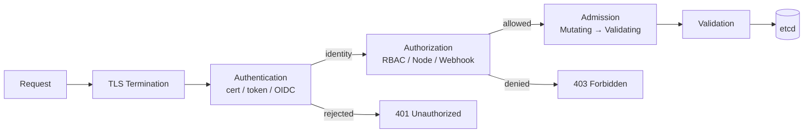
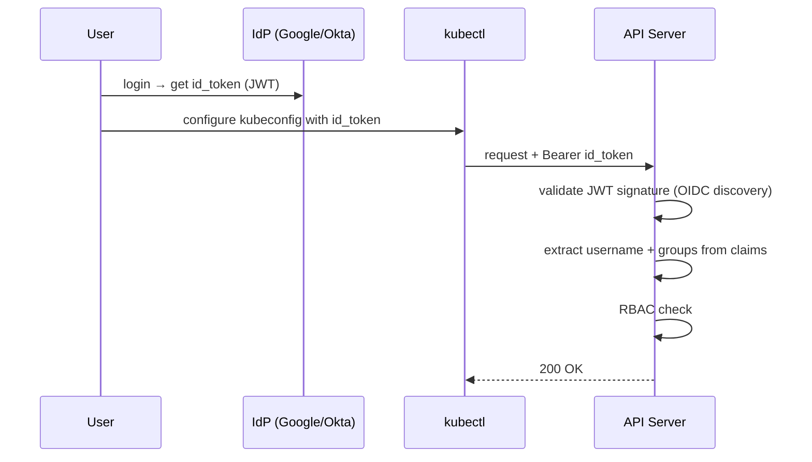
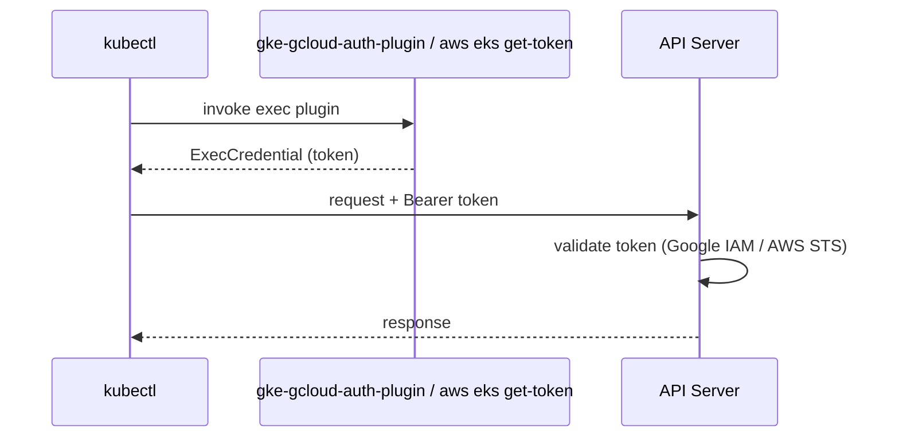

# 📘 Topic 38 — Authentication and Authorization

**Official Documentation Reference**
- Controlling access: https://kubernetes.io/docs/concepts/security/controlling-access/
- Authenticating: https://kubernetes.io/docs/reference/access-authn-authz/authentication/
- Authorization: https://kubernetes.io/docs/reference/access-authn-authz/authorization/
- GKE access control: https://cloud.google.com/kubernetes-engine/docs/concepts/access-control
- EKS access: https://docs.aws.amazon.com/eks/latest/userguide/cluster-auth.html

---

## 🔹 Definition
**Authentication (AuthN)** answers "Who are you?" — verifying the identity of a request. **Authorization (AuthZ)** answers "Are you allowed to do this?" — deciding if the authenticated identity can perform the requested action on the requested resource.

---

## 🔹 About

### Request flow through the API server
```
Client → TLS → Authentication → Authorization → Admission → Validation → etcd
```

### Authentication methods (AuthN)
| Method | How | Used by |
|---|---|---|
| **Client certificates** (X.509) | CN=user, O=group in cert signed by cluster CA | kubeadm default |
| **Bearer tokens** | Static token file / ServiceAccount token | SAs, legacy users |
| **OIDC** | External IdP (Google, Okta, Dex) issues JWT | Enterprise SSO |
| **Exec plugins** | kubectl calls external binary for creds | GKE (`gke-gcloud-auth-plugin`), EKS (`aws eks get-token`) |
| **Webhook token** | API server calls external webhook for validation | Custom identity providers |
| **Bootstrap tokens** | Short-lived tokens for cluster bootstrap | `kubeadm join` |
| **Anonymous** | Unauthenticated — maps to `system:anonymous` | Usually disabled or tightly scoped |

Key fact: Kubernetes has **no user database**. Users are external (certs, IdP). Only ServiceAccounts are native K8s objects.

### Authorization modes (AuthZ)
| Mode | How | When |
|---|---|---|
| **RBAC** | Role + RoleBinding (namespace) / ClusterRole + ClusterRoleBinding (cluster) | Default on all modern clusters |
| **ABAC** | JSON policy file on API server | Legacy, not recommended |
| **Node** | Authorizes kubelet requests | Always enabled alongside RBAC |
| **Webhook** | External HTTP service decides allow/deny | Custom policies, OPA |
| **AlwaysAllow / AlwaysDeny** | Testing only | Never in prod |

Multiple modes run in chain: first "allow" or "deny" wins (except deny-only modes that just skip).

### Audit logging
API server records every request to an audit log (or webhook sink). Configure with `--audit-policy-file` and `--audit-log-path`.

Audit levels: `None`, `Metadata`, `Request`, `RequestResponse`.

---

## 🔹 How It Integrates With Other Kubernetes Components
| Component | Interaction |
|---|---|
| kubectl | Sends creds from kubeconfig (cert, token, exec plugin) |
| ServiceAccount | Auto-mounted projected token used for in-cluster auth |
| Admission controllers | Run after AuthZ — can mutate or reject |
| kubelet | Authenticates via Node auth mode |
| Cloud IAM (GCP/AWS) | Maps cloud identity to K8s identity via OIDC/exec plugin |
| RBAC objects | Stored in etcd; evaluated by API server |

---

## 🏗️ Diagrams

### API request lifecycle


### OIDC flow


### GKE / EKS exec plugin flow


---

## 💻 Real-World Examples

### Example 1 — Check current identity
```bash
kubectl auth whoami                     # K8s 1.27+ stable
kubectl config view --minify -o jsonpath='{.users[0].user}'
```

### Example 2 — Test authorization
```bash
kubectl auth can-i create deployments                # yes/no
kubectl auth can-i delete pods -n prod               # namespace-scoped
kubectl auth can-i '*' '*'                           # cluster-admin check
kubectl auth can-i list pods --as=system:serviceaccount:default:app-sa   # impersonate
```

### Example 3 — OIDC setup (Dex example)
```yaml
# apiserver flags
--oidc-issuer-url=https://dex.example.com
--oidc-client-id=kubernetes
--oidc-username-claim=email
--oidc-groups-claim=groups
```

### Example 4 — Audit policy
```yaml
apiVersion: audit.k8s.io/v1
kind: Policy
rules:
- level: Metadata
  resources: [{ group: "", resources: ["secrets"] }]
  verbs: ["get","list","watch"]
- level: RequestResponse
  resources: [{ group: "", resources: ["pods"] }]
  verbs: ["create","delete"]
- level: None
  resources: [{ group: "", resources: ["events"] }]
```

### Example 5 — EKS Access Entries (2024+)
```bash
aws eks create-access-entry --cluster-name prod \
  --principal-arn arn:aws:iam::123:user/alice
aws eks associate-access-policy \
  --cluster-name prod \
  --principal-arn arn:aws:iam::123:user/alice \
  --policy-arn arn:aws:eks::aws:cluster-access-policy/AmazonEKSViewPolicy \
  --access-scope type=namespace,namespaces=dev
```

---

## 💻 Related Commands

| Command | Flag | Purpose | Example |
|---|---|---|---|
| `kubectl auth whoami` | — | Show authenticated identity | `kubectl auth whoami` |
| `kubectl auth can-i` | `<verb> <resource>` | Check permission | `kubectl auth can-i create pods` |
| `kubectl auth can-i` | `--as=<user>` | Impersonate | `kubectl auth can-i get secrets --as=alice` |
| `kubectl auth can-i` | `--list` | List all permissions | `kubectl auth can-i --list -n prod` |
| `kubectl config view` | `--minify` | Current context details | `kubectl config view --minify` |
| `kubectl get clusterrolebinding` | — | List bindings | `kubectl get clusterrolebinding` |
| `kubectl create clusterrolebinding` | `--clusterrole= --user=` | Bind role | `kubectl create clusterrolebinding alice-admin --clusterrole=admin --user=alice` |

---

## 🚨 Scenarios

### Scenario 1 — 403 Forbidden on a command that worked yesterday
- **Cause**: RBAC binding removed; or token expired; or IAM role changed.
- **Fix**: `kubectl auth can-i <verb> <resource> --as=<identity>`. Check RoleBinding. On GKE/EKS verify cloud IAM role.

### Scenario 2 — New team member can't access cluster
- **Cause**: no kubeconfig; or no RBAC binding; or OIDC not configured.
- **Fix**: generate kubeconfig (`gcloud get-credentials` / `aws eks update-kubeconfig`); create RoleBinding.

### Scenario 3 — ServiceAccount token leaked in logs
- **Cause**: app printed auth header.
- **Fix**: rotate SA token (`kubectl delete secret`; or use bound projected tokens that expire). Restrict SA RBAC to minimum.

### Scenario 4 — Audit log shows unknown identity accessing secrets
- **Cause**: potential credential compromise.
- **Fix**: identify the identity, revoke certs/tokens, rotate secrets, tighten RBAC.

---

## ☁️ GCP GKE Perspective
- **AuthN**: `gke-gcloud-auth-plugin` → Google OAuth token. Identity = Google Cloud IAM user/SA.
- **AuthZ**: GKE layers **IAM** (at the GKE API level: `container.clusters.get`) on top of **RBAC** (inside the cluster: `get pods`). Both must allow.
- **Workload Identity**: binds KSA → GSA for pod-level GCP access without keys.
- **GKE RBAC audit**: `gcloud logging read 'resource.type="k8s_cluster"'`.

## 🟧 AWS EKS Perspective
- **AuthN**: `aws eks get-token` → STS token. Identity = IAM user/role/SSO.
- **AuthZ**: Legacy `aws-auth` ConfigMap maps IAM → K8s users/groups. New: **EKS Access Entries** (API-based, no ConfigMap).
- **IRSA / Pod Identity**: pod-level IAM role binding for SA.
- **Control-plane logging**: enable `api`, `audit`, `authenticator` → CloudWatch Logs.

---

## 🧪 Hands-On Lab Exercises

### Lab 38.1 — AuthN + AuthZ basics (Beginner, 30 min)
```bash
kubectl auth whoami
kubectl auth can-i create pods
kubectl auth can-i create pods --as=system:serviceaccount:default:default
kubectl auth can-i --list -n default
```

### Lab 38.2 — Create a user with limited access (Intermediate, 60 min)
1. Generate client cert: `openssl genrsa -out alice.key 2048 && openssl req -new -key alice.key -out alice.csr -subj "/CN=alice/O=dev-team"`.
2. Create CertificateSigningRequest in K8s.
3. Approve: `kubectl certificate approve alice`.
4. Create kubeconfig entry for alice.
5. Create Role + RoleBinding in `dev` namespace with only `get,list pods`.
6. Test: `kubectl --context=alice get pods -n dev` → works. `kubectl --context=alice delete pod -n dev` → forbidden.

### Lab 38.3 — EKS Access Entries (Advanced, 45 min)
1. Create IAM user `bob`.
2. `aws eks create-access-entry` with ViewPolicy scoped to `dev` namespace.
3. `aws eks update-kubeconfig --name prod` as bob.
4. Verify bob can list pods in `dev` but not `prod`.

---

## 🎯 Interview Deliverable Answer (60–90 s)
"**What**: Authentication identifies who you are — via client certs, OIDC tokens, ServiceAccount tokens, or cloud exec plugins. Authorization decides if you can do what you're asking — primarily RBAC in production.  
**Why**: Zero-trust requires both. Authentication without authorization is an open door. Authorization without authentication is meaningless — you don't know who to authorize.  
**How**: On GKE I rely on Google IAM for cluster-level access and RBAC for namespace-level. On EKS I use Access Entries (replacing the aws-auth ConfigMap) to map IAM identities to K8s groups, then bind groups to Roles. For pod-level access to cloud APIs, I use Workload Identity on GKE and IRSA/Pod Identity on EKS — no static keys. I always enable audit logging so every secret access and privilege escalation attempt is traceable.  
**Example**: After a security audit flagged 12 users with cluster-admin, we migrated to group-based RBAC with namespaced Roles. Each team got a RoleBinding to `edit` in their namespace only. Cluster-admin was restricted to 2 break-glass identities with MFA."

---

## ❓ Possible Interview Questions

**Q1. AuthN vs AuthZ?** AuthN = who are you. AuthZ = are you allowed.  
**Q2. Does K8s have a user database?** No — users are external (certs, IdP). Only ServiceAccounts are native.  
**Q3. What is RBAC?** Role-Based Access Control — Roles define permissions, RoleBindings assign them.  
**Q4. Name 3 auth methods.** Client certs, OIDC, ServiceAccount tokens.  
**Q5. How does GKE authenticate kubectl?** `gke-gcloud-auth-plugin` fetches a Google OAuth token.  
**Q6. What replaced `aws-auth` ConfigMap on EKS?** Access Entries (API-based, no ConfigMap editing).  
**Q7. What is `kubectl auth can-i --as=`?** Impersonation — test permissions for another identity.  
**Q8. What are audit levels?** None, Metadata, Request, RequestResponse.  
**Q9. What does Node authorization mode do?** Restricts kubelet to only access resources bound to its node.  
**Q10. How do you revoke a compromised SA token?** Delete the secret (legacy) or rely on bound projected tokens that expire. Recreate the SA.

