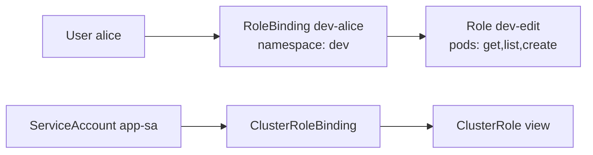
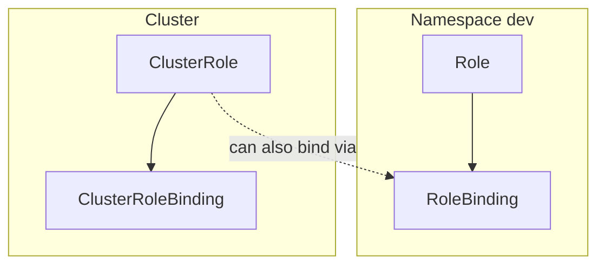

# 📘 Topic 39 — RBAC (Roles, ClusterRoles, RoleBindings, ClusterRoleBindings)

**Official Documentation Reference**
- RBAC: https://kubernetes.io/docs/reference/access-authn-authz/rbac/
- RBAC good practices: https://kubernetes.io/docs/concepts/security/rbac-good-practices/
- GKE RBAC: https://cloud.google.com/kubernetes-engine/docs/how-to/role-based-access-control
- EKS RBAC: https://docs.aws.amazon.com/eks/latest/userguide/security_iam_id-based-policy-examples.html

---

## 🔹 Definition
**RBAC (Role-Based Access Control)** is the authorization mode that grants permissions to identities (users, groups, ServiceAccounts) by binding them to Roles or ClusterRoles that define allowed API verbs on specific resources.

---

## 🔹 About

### Four objects
| Object | Scope | Purpose |
|---|---|---|
| **Role** | Namespace | Defines permissions in one namespace |
| **ClusterRole** | Cluster | Defines permissions cluster-wide OR reusable across namespaces |
| **RoleBinding** | Namespace | Binds a Role/ClusterRole to subjects in one namespace |
| **ClusterRoleBinding** | Cluster | Binds a ClusterRole to subjects cluster-wide |

### Permission model: allow-only
RBAC is additive — you can only grant, never deny. Multiple bindings union their permissions.

### Verbs
`get`, `list`, `watch`, `create`, `update`, `patch`, `delete`, `deletecollection`; wildcard `*` = all.

### Resource scoping
```yaml
rules:
- apiGroups: [""]                   # core group
  resources: ["pods", "pods/log"]   # sub-resource
  verbs: ["get", "list"]
- apiGroups: ["apps"]
  resources: ["deployments"]
  verbs: ["*"]
  resourceNames: ["web"]            # optional — specific object
```

### Built-in ClusterRoles
| ClusterRole | Permissions |
|---|---|
| `cluster-admin` | Everything (superuser) |
| `admin` | Full namespace access (no quota/namespace changes) |
| `edit` | Read/write pods, deployments, configmaps, secrets — no RBAC |
| `view` | Read-only (no secrets) |

### Aggregated ClusterRoles
```yaml
aggregationRule:
  clusterRoleSelectors:
  - matchLabels: { rbac.example.com/aggregate-to-monitoring: "true" }
```
Any ClusterRole with that label auto-merges into this one. Used by built-in `admin`, `edit`, `view` (CRD authors add rules via label).

### Subjects
```yaml
subjects:
- kind: User
  name: alice
  apiGroup: rbac.authorization.k8s.io
- kind: Group
  name: dev-team
  apiGroup: rbac.authorization.k8s.io
- kind: ServiceAccount
  name: app-sa
  namespace: prod
```

---

## 🔹 How It Integrates With Other Kubernetes Components
| Component | Interaction |
|---|---|
| API server | Evaluates RBAC rules on every request |
| ServiceAccount | Bound via RoleBinding/ClusterRoleBinding |
| Admission (OPA/Kyverno) | Runs after RBAC allows — can still deny |
| kubectl | `kubectl auth can-i` tests RBAC |
| Helm | Needs RBAC to install CRDs, Deployments |
| Operators | Need ClusterRole for CRD management |

---

## 🏗️ Diagrams

### RBAC binding model


### Namespace vs cluster scope


---

## 💻 Real-World Examples

### Example 1 — Role + RoleBinding
```yaml
apiVersion: rbac.authorization.k8s.io/v1
kind: Role
metadata: { name: pod-reader, namespace: dev }
rules:
- apiGroups: [""]
  resources: ["pods", "pods/log"]
  verbs: ["get", "list", "watch"]
---
apiVersion: rbac.authorization.k8s.io/v1
kind: RoleBinding
metadata: { name: alice-pod-reader, namespace: dev }
subjects:
- { kind: User, name: alice, apiGroup: rbac.authorization.k8s.io }
roleRef:
  kind: Role
  name: pod-reader
  apiGroup: rbac.authorization.k8s.io
```

### Example 2 — ClusterRole bound to namespace
```yaml
apiVersion: rbac.authorization.k8s.io/v1
kind: RoleBinding
metadata: { name: dev-edit, namespace: dev }
subjects:
- { kind: Group, name: dev-team, apiGroup: rbac.authorization.k8s.io }
roleRef: { kind: ClusterRole, name: edit, apiGroup: rbac.authorization.k8s.io }
```
Reuses built-in `edit` ClusterRole but scoped to `dev` namespace only.

### Example 3 — ServiceAccount ClusterRoleBinding
```yaml
apiVersion: rbac.authorization.k8s.io/v1
kind: ClusterRoleBinding
metadata: { name: prometheus-reader }
subjects:
- { kind: ServiceAccount, name: prometheus, namespace: monitoring }
roleRef: { kind: ClusterRole, name: view, apiGroup: rbac.authorization.k8s.io }
```

### Example 4 — Imperative RBAC commands
```bash
kubectl create role pod-reader --verb=get,list --resource=pods -n dev
kubectl create rolebinding alice-reader --role=pod-reader --user=alice -n dev
kubectl create clusterrolebinding admin-alice --clusterrole=cluster-admin --user=alice
kubectl auth can-i list pods -n dev --as=alice     # yes
kubectl auth can-i delete pods -n dev --as=alice   # no
```

---

## 💻 Related Commands

| Command | Flag | Purpose | Example |
|---|---|---|---|
| `kubectl get roles` | `-n <ns>` | List Roles | `kubectl get roles -n dev` |
| `kubectl get clusterroles` | — | List ClusterRoles | `kubectl get clusterroles` |
| `kubectl get rolebindings` | `-n <ns>` | List bindings | `kubectl get rolebindings -n dev` |
| `kubectl describe role` | `<name>` | See rules | `kubectl describe role pod-reader -n dev` |
| `kubectl create role` | `--verb= --resource=` | Create | `kubectl create role r --verb=get --resource=pods -n dev` |
| `kubectl create rolebinding` | `--role= --user=` | Bind | `kubectl create rolebinding rb --role=r --user=alice -n dev` |
| `kubectl create clusterrolebinding` | `--clusterrole= --group=` | Cluster bind | `kubectl create clusterrolebinding cb --clusterrole=view --group=viewers` |
| `kubectl auth can-i` | `--as= --list` | Test | `kubectl auth can-i --list --as=alice -n dev` |
| `kubectl auth reconcile` | `-f rbac.yaml` | Apply without conflict | `kubectl auth reconcile -f rbac.yaml` |

---

## 🚨 Scenarios

### Scenario 1 — Developer can read but not create deployments
- **Cause**: bound to `view` not `edit`.
- **Fix**: bind to `edit` or create custom Role with `deployments: create,update,patch`.

### Scenario 2 — Helm install fails with RBAC errors
- **Cause**: SA used by Helm/Tiller/CI lacks permissions for CRDs or cluster-scoped resources.
- **Fix**: create ClusterRoleBinding for the CI SA with appropriate ClusterRole.

### Scenario 3 — Privilege escalation: user creates RoleBinding granting themselves cluster-admin
- **Cause**: user has `create rolebindings` permission without `escalate` verb or `bind` restriction.
- **Fix**: K8s prevents escalation by default — you can only bind a role if you already have all its permissions. But review carefully.

### Scenario 4 — Too many ClusterRoleBindings → hard to audit
- **Fix**: adopt group-based bindings (bind groups, not individual users). Use `kubectl auth can-i --list --as=` for audit. Tools: `rbac-lookup`, `rakkess`.

---

## ☁️ GCP GKE Perspective
- GKE layers IAM (cluster-level: `roles/container.developer`) + RBAC (namespace-level). Both must allow.
- `gcloud projects add-iam-policy-binding` gives cluster access; RoleBinding gives namespace access.
- **Autopilot** pre-creates restrictive RBAC; some operations blocked.

## 🟧 AWS EKS Perspective
- Legacy: `aws-auth` ConfigMap maps IAM users/roles → K8s groups → RBAC.
- **Access Entries** (2024+): `aws eks create-access-entry` + `associate-access-policy` replaces ConfigMap.
- Built-in EKS access policies: `AmazonEKSClusterAdminPolicy`, `AmazonEKSAdminPolicy`, `AmazonEKSEditPolicy`, `AmazonEKSViewPolicy`.

---

## 🧪 Hands-On Lab Exercises

### Lab 39.1 — Create Role + RoleBinding (Beginner, 30 min)
Create a `pod-reader` Role in `dev` namespace. Bind to user alice. Test with `kubectl auth can-i`.

### Lab 39.2 — Least-privilege SA for an app (Intermediate, 45 min)
1. Create SA `app-sa` in `prod`.
2. Create Role allowing only `get,list configmaps` and `get secrets` (specific name).
3. Bind. Deploy pod with SA. Exec and test with `curl` to API server.

### Lab 39.3 — Audit RBAC with rbac-lookup (Advanced, 45 min)
1. Install `rbac-lookup`: `brew install rbac-lookup`.
2. `rbac-lookup alice` → see all bindings.
3. `rbac-lookup --kind=serviceaccount` → audit SA permissions.
4. Identify overly permissive bindings; remediate.

---

## 🎯 Interview Deliverable Answer (60–90 s)
"**What**: RBAC is Kubernetes' primary authorization mode. It uses four objects: Roles and ClusterRoles define permissions — API groups, resources, verbs — and RoleBindings and ClusterRoleBindings assign those permissions to users, groups, or ServiceAccounts.  
**Why**: Least-privilege is a security fundamental. RBAC lets me give a developer `edit` in their namespace without touching production, give a monitoring SA read-only cluster-wide, and give CI/CD exactly `create deployments` in staging.  
**How**: I standardize on group-based bindings — map OIDC/IAM groups to K8s groups, then bind groups to the built-in `view`, `edit`, or `admin` ClusterRoles at the namespace level. I never give `cluster-admin` to individuals — only to break-glass accounts with MFA. For ServiceAccounts I create custom Roles with the minimum verbs on the minimum resources.  
**Example**: After a security review found 15 users with `cluster-admin`, we migrated to 4 groups: `platform-admins` (admin in all NS), `dev-team-X` (edit in their NS), `readonly` (view), and `ci-deploy` (custom Role: create/update deployments + secrets). Audit with `rbac-lookup` confirmed no privilege creep."

---

## ❓ Possible Interview Questions

**Q1. Four RBAC objects?** Role, ClusterRole, RoleBinding, ClusterRoleBinding.  
**Q2. Role vs ClusterRole?** Role = namespaced. ClusterRole = cluster-wide or reusable.  
**Q3. Can a RoleBinding reference a ClusterRole?** Yes — scopes it to the binding's namespace.  
**Q4. RBAC is allow-only — meaning?** No deny rules. Multiple bindings union permissions.  
**Q5. How do you test RBAC?** `kubectl auth can-i <verb> <resource> --as=<identity>`.  
**Q6. What is aggregation?** ClusterRoles with matching labels auto-merge into an aggregated ClusterRole.  
**Q7. What are sub-resources?** `pods/log`, `pods/exec`, `deployments/scale` — scoped verbs.  
**Q8. How do you prevent privilege escalation?** K8s prevents binding a Role you don't already have permissions for. Also restrict `escalate` and `bind` verbs.  
**Q9. GKE: IAM vs RBAC?** IAM gates cluster-level access. RBAC gates resource-level access inside the cluster. Both must allow.  
**Q10. EKS: aws-auth vs Access Entries?** aws-auth is legacy ConfigMap. Access Entries is the new API-based mapping of IAM → K8s RBAC.

