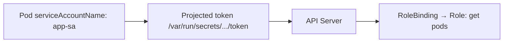
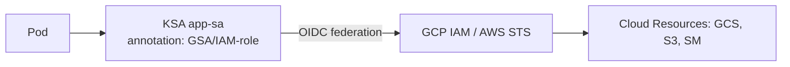

# 📘 Topic 40 — Service Accounts

**Official Documentation Reference**
- Service Accounts: https://kubernetes.io/docs/concepts/security/service-accounts/
- Configure SA for pods: https://kubernetes.io/docs/tasks/configure-pod-container/configure-service-account/
- Token request API: https://kubernetes.io/docs/reference/kubernetes-api/authentication-resources/token-request-v1/
- GKE Workload Identity: https://cloud.google.com/kubernetes-engine/docs/how-to/workload-identity
- EKS IRSA: https://docs.aws.amazon.com/eks/latest/userguide/iam-roles-for-service-accounts.html

---

## 🔹 Definition
A **ServiceAccount (SA)** is a namespaced Kubernetes identity for pods and system components. Every pod runs as a ServiceAccount, which determines its API permissions (via RBAC) and, on managed clouds, its cloud IAM identity (via Workload Identity / IRSA).

---

## 🔹 About

### Default SA
Every namespace has a `default` SA. Pods that don't specify `serviceAccountName` run as `default`.

### Projected token (modern, K8s 1.22+)
- Bound to a specific audience and expiration (default 1 hour, auto-refreshed by kubelet).
- Mounted via projected volume at `/var/run/secrets/kubernetes.io/serviceaccount/token`.
- Replaces the legacy non-expiring Secret-based token.

### `automountServiceAccountToken`
```yaml
apiVersion: v1
kind: ServiceAccount
metadata: { name: no-api }
automountServiceAccountToken: false
```
Pods using this SA won't get a token mounted — useful when the pod never talks to the API server.

### imagePullSecrets on SA
```yaml
imagePullSecrets:
- name: regcred
```
All pods using this SA automatically pull from private registries.

### Token request API
```bash
kubectl create token app-sa --audience=vault --expiration=3600s
```
Returns a short-lived JWT for external use (e.g., authenticating to Vault).

---

## 🔹 How It Integrates
| Component | Interaction |
|---|---|
| RBAC | RoleBinding binds SA to a Role |
| Pod | `spec.serviceAccountName` assigns SA |
| kubelet | Mounts projected SA token |
| Workload Identity (GKE) | Annotation maps KSA → GCP SA |
| IRSA / Pod Identity (EKS) | Annotation maps KSA → IAM Role |
| Admission | PSA can restrict SA capabilities |

---

## 🏗️ Diagrams

### SA → RBAC → API


### Workload Identity / IRSA


---

## 💻 Real-World Examples

### Example 1 — Dedicated SA with RBAC
```yaml
apiVersion: v1
kind: ServiceAccount
metadata: { name: app-sa, namespace: prod }
---
apiVersion: rbac.authorization.k8s.io/v1
kind: RoleBinding
metadata: { name: app-rb, namespace: prod }
subjects: [{ kind: ServiceAccount, name: app-sa, namespace: prod }]
roleRef: { kind: Role, name: pod-reader, apiGroup: rbac.authorization.k8s.io }
```

### Example 2 — Disable automount
```yaml
apiVersion: v1
kind: ServiceAccount
metadata: { name: no-api }
automountServiceAccountToken: false
```

### Example 3 — GKE Workload Identity SA
```yaml
apiVersion: v1
kind: ServiceAccount
metadata:
  name: gcs-reader
  namespace: prod
  annotations:
    iam.gke.io/gcp-service-account: gcs-reader@myproj.iam.gserviceaccount.com
```

### Example 4 — EKS IRSA SA
```yaml
apiVersion: v1
kind: ServiceAccount
metadata:
  name: s3-reader
  namespace: prod
  annotations:
    eks.amazonaws.com/role-arn: arn:aws:iam::123:role/s3-reader
```

---

## 💻 Related Commands

| Command | Flag | Purpose | Example |
|---|---|---|---|
| `kubectl create sa` | `<name>` | Create SA | `kubectl create sa app-sa -n prod` |
| `kubectl get sa` | `-n <ns>` | List SAs | `kubectl get sa -n prod` |
| `kubectl create token` | `<sa> --audience= --expiration=` | Generate token | `kubectl create token app-sa --audience=vault` |
| `kubectl set sa` | `deploy/<n> <sa>` | Assign SA to Deployment | `kubectl set sa deploy/web app-sa` |
| `kubectl describe sa` | `<name>` | Secrets, imagePullSecrets | `kubectl describe sa app-sa` |

---

## 🚨 Scenarios

### Scenario 1 — Pod can't call API: "forbidden"
- **Cause**: default SA has no RBAC binding.
- **Fix**: create dedicated SA + RoleBinding with minimum permissions.

### Scenario 2 — Token expired but pod still running
- **Cause**: projected token auto-rotates; app caches old token.
- **Fix**: app should re-read token file on each request (K8s client libraries do this automatically).

### Scenario 3 — ImagePullBackOff on private registry
- **Fix**: add `imagePullSecrets` to SA or pod spec.

---

## ☁️ GCP GKE Perspective
- **Workload Identity Federation**: KSA annotated → projected OIDC token → Google STS → GCP SA credentials. No keys.
- GKE recommends disabling automount for pods that don't need API access.

## 🟧 AWS EKS Perspective
- **IRSA**: OIDC provider trusts EKS cluster; IAM role trusts KSA via condition. Auto-injects `AWS_WEB_IDENTITY_TOKEN_FILE`.
- **Pod Identity** (2023+): simpler — `aws eks create-pod-identity-association`. DaemonSet agent provides creds.

---

## 🧪 Labs

### Lab 40.1 — Dedicated SA + RBAC (Beginner, 30 min)
Create SA, Role (get pods), RoleBinding, deploy pod with SA, exec into pod and test API access.

### Lab 40.2 — Workload Identity on GKE (Intermediate, 60 min)
Bind KSA to GSA. Deploy pod. Verify it can list GCS buckets without keys.

### Lab 40.3 — IRSA on EKS (Advanced, 60 min)
`eksctl create iamserviceaccount`. Deploy pod. Verify it reads from S3.

---

## 🎯 Interview Deliverable Answer (60–90 s)
"**What**: A ServiceAccount is a K8s-native identity for pods. Every pod runs as one. Modern K8s mounts a short-lived, audience-bound projected token that auto-rotates — replacing the old non-expiring Secret token.  
**Why**: Pods need identity for API access (RBAC), image pulling (imagePullSecrets), and cloud access (Workload Identity / IRSA). Least-privilege means every app gets its own SA with minimum permissions.  
**How**: I create a dedicated SA per microservice, bind it to a Role with only the verbs and resources it needs, and disable automount on SAs that never call the API. On GKE I annotate the SA for Workload Identity so the pod authenticates to GCP APIs without static keys. On EKS I use IRSA or Pod Identity.  
**Example**: Our payment service needed access to AWS Secrets Manager. I created an IRSA-bound SA with a policy allowing only `GetSecretValue` on one ARN. Zero static credentials, automatic token rotation, principle of least privilege."

---

## ❓ Possible Interview Questions

**Q1. What is a ServiceAccount?** Namespaced identity for pods. **Q2. What token do pods get?** Projected bound token (K8s 1.22+) — short-lived, audience-scoped, auto-refreshed. **Q3. How do you disable token mounting?** `automountServiceAccountToken: false` on SA or pod. **Q4. Workload Identity — what is it?** KSA→GSA mapping via OIDC federation for keyless GCP access. **Q5. IRSA vs Pod Identity?** IRSA: OIDC-based per SA. Pod Identity: simpler API + DaemonSet agent. **Q6. How do you create a short-lived token for Vault?** `kubectl create token <sa> --audience=vault --expiration=600s`. **Q7. What happens if SA doesn't exist?** Pod fails to create (admission rejects). **Q8. imagePullSecrets on SA — what does it do?** Auto-adds registry credentials to every pod using that SA. **Q9. Best practice for default SA?** Don't use it for workloads. Create dedicated SAs. Disable automount on `default`. **Q10. How do you verify pod identity?** `kubectl exec <pod> -- cat /var/run/secrets/kubernetes.io/serviceaccount/token | jwt decode -`.

