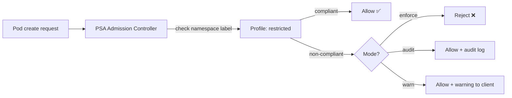
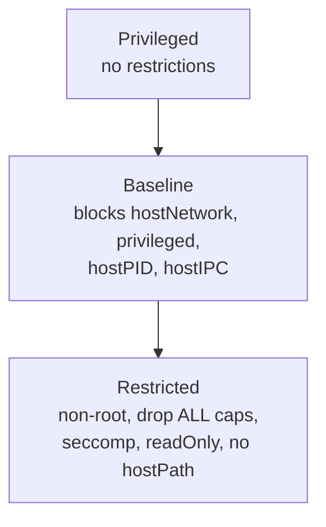

# 📘 Topic 41 — Pod Security Standards / Pod Security Admission

**Official Documentation Reference**
- Pod Security Standards: https://kubernetes.io/docs/concepts/security/pod-security-standards/
- Pod Security Admission: https://kubernetes.io/docs/concepts/security/pod-security-admission/
- Enforce PSS: https://kubernetes.io/docs/tasks/configure-pod-container/enforce-standards-admission-controller/
- GKE PSS: https://cloud.google.com/kubernetes-engine/docs/how-to/podsecurityadmission
- EKS PSS: https://docs.aws.amazon.com/eks/latest/best-practices/pod-security.html

---

## 🔹 Definition
**Pod Security Standards (PSS)** define three security profiles — Privileged, Baseline, Restricted — for pod configurations. **Pod Security Admission (PSA)** is the built-in admission controller that enforces PSS at the namespace level via labels.

---

## 🔹 About

### Three profiles
| Profile | What it allows | Target |
|---|---|---|
| **Privileged** | Everything — no restrictions | System/infra workloads |
| **Baseline** | Blocks known privilege escalations (hostNetwork, hostPID, privileged containers) | Default for most workloads |
| **Restricted** | Strictest — non-root, drop ALL capabilities, readOnlyRootFilesystem, seccomp RuntimeDefault | Hardened production |

### PSA modes (per namespace)
| Mode | Behavior |
|---|---|
| `enforce` | Reject non-compliant pods |
| `audit` | Allow but log violations to audit log |
| `warn` | Allow but return warnings to kubectl client |

### Namespace labels
```yaml
metadata:
  labels:
    pod-security.kubernetes.io/enforce: restricted
    pod-security.kubernetes.io/enforce-version: v1.31
    pod-security.kubernetes.io/audit: restricted
    pod-security.kubernetes.io/warn: restricted
```

### PSP → PSA migration
PodSecurityPolicy was removed in K8s 1.25. PSA is the built-in replacement. For richer policy (mutating, image allowlists), use Kyverno or OPA/Gatekeeper alongside PSA.

### Restricted profile requirements
- `runAsNonRoot: true`
- No `privileged: true`
- No `hostNetwork`, `hostPID`, `hostIPC`
- Drop `ALL` capabilities; may add only `NET_BIND_SERVICE`
- `seccompProfile.type: RuntimeDefault` or `Localhost`
- `allowPrivilegeEscalation: false`
- No `hostPath` volumes
- `runAsUser` must not be 0

---

## 🔹 How It Integrates
| Component | Interaction |
|---|---|
| Namespace labels | Configure PSA mode + profile |
| Admission controller | Built-in, always available (K8s 1.25+) |
| Kyverno / OPA | Complementary policy engines for richer rules |
| SecurityContext | Pod/container fields that PSA validates |
| DaemonSets | May need Privileged or Baseline for node access |

---

## 🏗️ Diagrams

### PSA enforcement flow


### Profile comparison


---

## 💻 Real-World Examples

### Example 1 — Label a namespace for restricted
```bash
kubectl label namespace prod \
  pod-security.kubernetes.io/enforce=restricted \
  pod-security.kubernetes.io/audit=restricted \
  pod-security.kubernetes.io/warn=restricted
```

### Example 2 — Compliant pod
```yaml
apiVersion: v1
kind: Pod
metadata: { name: safe, namespace: prod }
spec:
  securityContext:
    runAsNonRoot: true
    runAsUser: 1000
    fsGroup: 2000
    seccompProfile: { type: RuntimeDefault }
  containers:
  - name: app
    image: myrepo/app:1
    securityContext:
      allowPrivilegeEscalation: false
      readOnlyRootFilesystem: true
      capabilities: { drop: ["ALL"] }
```

### Example 3 — Non-compliant pod → rejected
```bash
kubectl run priv --image=nginx --overrides='{"spec":{"containers":[{"name":"priv","image":"nginx","securityContext":{"privileged":true}}]}}' -n prod
# Error: pods "priv" is forbidden: violates PodSecurity "restricted:v1.31"
```

### Example 4 — Dry-run namespace migration
```bash
kubectl label --dry-run=server --overwrite ns dev \
  pod-security.kubernetes.io/enforce=baseline
# Shows warnings for existing non-compliant pods
```

---

## 💻 Related Commands

| Command | Flag | Purpose | Example |
|---|---|---|---|
| `kubectl label ns` | `pod-security.kubernetes.io/enforce=<profile>` | Set PSA | see Example 1 |
| `kubectl label ns` | `--dry-run=server` | Preview violations | see Example 4 |
| `kubectl get ns` | `--show-labels` | See PSA labels | `kubectl get ns --show-labels` |
| `kubectl describe ns` | — | Labels section | `kubectl describe ns prod` |

---

## 🚨 Scenarios

### Scenario 1 — System DaemonSet rejected in restricted namespace
- **Fix**: `kube-system` stays Privileged. Create separate namespace for infra with Baseline.

### Scenario 2 — Migrating from PSP to PSA
- **Steps**: 1. Enable PSA in `warn`+`audit` mode. 2. Fix violations. 3. Switch to `enforce`. 4. Remove PSP.

### Scenario 3 — Third-party Helm chart fails in restricted NS
- **Cause**: chart doesn't set securityContext.
- **Fix**: override values (`securityContext.runAsNonRoot=true`), or use Kyverno to mutate defaults.

---

## ☁️ GCP GKE Perspective
- **Autopilot** enforces a Baseline-equivalent by default; some Restricted fields enforced.
- **Standard**: PSA available; label namespaces manually.
- **Policy Controller** (GKE Enterprise): OPA-based, richer than PSA alone.

## 🟧 AWS EKS Perspective
- PSA available by default (K8s 1.25+). EKS doesn't label namespaces by default — you must apply labels.
- **EKS Best Practices Guide** recommends Baseline as minimum, Restricted for sensitive workloads.
- Complement with **Kyverno** or **OPA/Gatekeeper** for image allowlists and custom policies.

---

## 🧪 Labs

### Lab 41.1 — Enforce Restricted (Beginner, 30 min)
Label namespace, try compliant + non-compliant pods. Verify rejection.

### Lab 41.2 — Audit + warn before enforce (Intermediate, 45 min)
1. Label `audit` + `warn` on a namespace with existing workloads.
2. `kubectl get events --field-selector reason=FailedCreate` + check audit logs.
3. Fix violations. 4. Switch to `enforce`.

### Lab 41.3 — PSA + Kyverno combined (Advanced, 60 min)
1. PSA `enforce: baseline`. 2. Kyverno policy: mutate pods to add `seccompProfile: RuntimeDefault` if missing. 3. Deploy without seccomp → Kyverno mutates → PSA allows.

---

## 🎯 Interview Deliverable Answer (60–90 s)
"**What**: Pod Security Standards define three profiles — Privileged, Baseline, Restricted — that codify which pod security settings are required. Pod Security Admission is the built-in controller that enforces these profiles per namespace via labels, in enforce, audit, or warn mode.  
**Why**: PSP was complex and removed in 1.25. PSA is simpler — just label a namespace. It prevents the top privilege-escalation vectors: privileged containers, host namespaces, running as root, missing seccomp.  
**How**: I set every production namespace to `enforce: restricted`, `audit: restricted`, `warn: restricted`. Infra namespaces like `kube-system` stay Privileged. During migration I start with `warn` + `audit` to identify violations, fix pods, then flip to `enforce`. For anything PSA can't cover — like image registry allowlists or label requirements — I layer Kyverno on top.  
**Example**: We migrated 40 namespaces from PSP to PSA. First week in `warn` mode surfaced 23 non-compliant Deployments. After fixing securityContext on each, we switched to `enforce: restricted` with zero pod rejections."

---

## ❓ Interview Questions

**Q1. Three PSS profiles?** Privileged, Baseline, Restricted. **Q2. Three PSA modes?** enforce, audit, warn. **Q3. How do you apply PSA?** Labels on the namespace. **Q4. What replaced PSP?** PSA (built-in) + optional Kyverno/OPA for richer policy. **Q5. What does Restricted require?** runAsNonRoot, drop ALL caps, seccomp RuntimeDefault, no hostPath, no privileged, allowPrivilegeEscalation false. **Q6. Can PSA mutate pods?** No — it only validates. Use Kyverno for mutation. **Q7. How to test before enforcing?** `--dry-run=server` on label, or start with `warn`+`audit`. **Q8. GKE Autopilot PSA?** Enforced by default (Baseline-equivalent). **Q9. How to exempt system DaemonSets?** Keep `kube-system` as Privileged; or use PSA exemptions in the admission config. **Q10. PSA version pinning?** `enforce-version: v1.31` locks validation rules to a specific K8s version.

