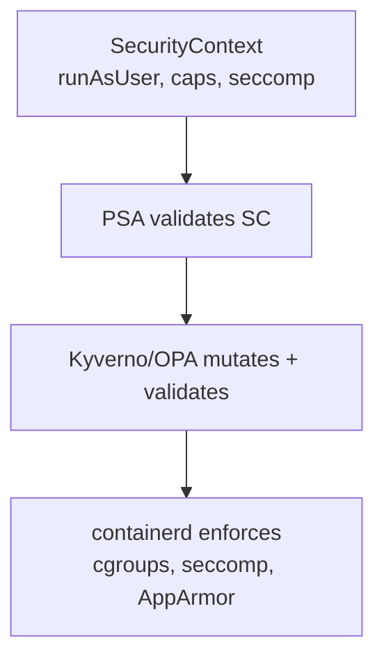

# 📘 Topic 42 — Security Contexts

**Official Documentation Reference**
- Security context: https://kubernetes.io/docs/tasks/configure-pod-container/security-context/
- Linux kernel security: https://kubernetes.io/docs/concepts/security/linux-kernel-security-constraints/
- Seccomp: https://kubernetes.io/docs/reference/node/seccomp/

---

## 🔹 Definition
A **Security Context** defines privilege and access control settings for a pod or container — user/group IDs, Linux capabilities, filesystem permissions, seccomp profiles, AppArmor profiles, and SELinux labels. It's the low-level knob that PSA validates at a higher level.

---

## 🔹 About

### Pod-level vs container-level
| Field | Pod-level (`spec.securityContext`) | Container-level (`spec.containers[].securityContext`) |
|---|---|---|
| `runAsUser` | ✅ | ✅ (overrides pod) |
| `runAsNonRoot` | ✅ | ✅ |
| `runAsGroup` | ✅ | ✅ |
| `fsGroup` | ✅ (sets GID on volumes) | — |
| `supplementalGroups` | ✅ | — |
| `seccompProfile` | ✅ | ✅ |
| `capabilities` | — | ✅ |
| `allowPrivilegeEscalation` | — | ✅ |
| `readOnlyRootFilesystem` | — | ✅ |
| `privileged` | — | ✅ |

### Key fields explained
| Field | What it does |
|---|---|
| `runAsUser: 1000` | Container runs as UID 1000 |
| `runAsNonRoot: true` | Reject if image has USER root |
| `runAsGroup: 3000` | Primary GID |
| `fsGroup: 2000` | All volume files owned by GID 2000 |
| `allowPrivilegeEscalation: false` | Prevent `setuid` / `setgid` binaries |
| `readOnlyRootFilesystem: true` | Container can't write to `/`; use emptyDir for tmp |
| `privileged: true` | Full host access — almost never in prod |
| `capabilities.drop: ["ALL"]` | Drop all Linux capabilities |
| `capabilities.add: ["NET_BIND_SERVICE"]` | Allow binding to ports < 1024 |
| `seccompProfile.type: RuntimeDefault` | Apply containerd's default seccomp profile |
| `seccompProfile.type: Localhost` | Custom seccomp profile on node |

### Hardened template
```yaml
spec:
  securityContext:
    runAsNonRoot: true
    runAsUser: 65534          # nobody
    runAsGroup: 65534
    fsGroup: 65534
    seccompProfile: { type: RuntimeDefault }
  containers:
  - name: app
    securityContext:
      allowPrivilegeEscalation: false
      readOnlyRootFilesystem: true
      capabilities: { drop: ["ALL"] }
    volumeMounts:
    - { name: tmp, mountPath: /tmp }
  volumes:
  - { name: tmp, emptyDir: {} }
```

### AppArmor
```yaml
metadata:
  annotations:
    container.apparmor.security.beta.kubernetes.io/app: runtime/default
```
K8s 1.30+ supports `securityContext.appArmorProfile` field (GA).

---

## 🔹 How It Integrates
| Component | Interaction |
|---|---|
| PSA | Validates securityContext fields against PSS profile |
| Container runtime | Applies cgroups, namespaces, seccomp, AppArmor |
| Volumes | `fsGroup` sets GID on mounted volume files |
| Admission (Kyverno) | Can mutate missing securityContext |
| Image | `USER` directive in Dockerfile sets default UID |

---

## 🏗️ Diagrams

### Security layers


---

## 💻 Real-World Examples

### Example 1 — Verify UID inside container
```bash
kubectl apply -f hardened.yaml
kubectl exec safe -- id
# uid=65534(nobody) gid=65534(nogroup) groups=65534(nogroup)
```

### Example 2 — readOnlyRootFilesystem + tmp emptyDir
```yaml
securityContext:
  readOnlyRootFilesystem: true
volumeMounts: [{ name: tmp, mountPath: /tmp }]
volumes: [{ name: tmp, emptyDir: {} }]
```

### Example 3 — Custom seccomp profile
```yaml
securityContext:
  seccompProfile:
    type: Localhost
    localhostProfile: profiles/custom.json
```

---

## 💻 Related Commands

| Command | Flag | Purpose | Example |
|---|---|---|---|
| `kubectl exec` | `-- id` | Check UID/GID | `kubectl exec safe -- id` |
| `kubectl exec` | `-- cat /proc/1/status \| grep Cap` | Check capabilities | |
| `kubectl describe pod` | — | See security context | `kubectl describe pod safe` |
| `kubectl get pod` | `-o jsonpath='{.spec.securityContext}'` | Extract | |

---

## 🚨 Scenarios

### Scenario 1 — App can't write to `/var/log`
- **Cause**: `readOnlyRootFilesystem: true`.
- **Fix**: mount emptyDir at `/var/log`.

### Scenario 2 — Container needs port 80 but runs as non-root
- **Cause**: ports < 1024 need `CAP_NET_BIND_SERVICE`.
- **Fix**: add `capabilities: { add: ["NET_BIND_SERVICE"] }`. Or use port > 1024 and let the Service map.

### Scenario 3 — `fsGroup` slow on large volumes
- **Cause**: `fsGroup` recursively `chown`s on mount.
- **Fix**: `fsGroupChangePolicy: OnRootMismatch` (K8s 1.26+ stable) — only changes if root GID doesn't match.

---

## ☁️ GKE Perspective
- **Autopilot** enforces much of the Restricted profile. `privileged: true` blocked.
- **GKE Sandbox** (gVisor) adds kernel-level isolation on top of securityContext.

## 🟧 EKS Perspective
- No enforcement by default — you must set securityContext + PSA labels.
- **Fargate**: `privileged` blocked. `hostNetwork/PID/IPC` blocked.
- **Bottlerocket AMI**: read-only OS + SELinux enforced on nodes.

---

## 🧪 Labs

### Lab 42.1 — Hardened pod (Beginner, 20 min)
Apply hardened template. `kubectl exec -- id`, `kubectl exec -- touch /test` (fails — readOnly).

### Lab 42.2 — Drop ALL + add NET_BIND_SERVICE (Intermediate, 30 min)
Deploy nginx on port 80 as non-root with `drop: ALL, add: NET_BIND_SERVICE`. Verify it serves traffic.

### Lab 42.3 — Custom seccomp profile (Advanced, 60 min)
1. Write a seccomp JSON blocking `chmod`. 2. Place on node. 3. Deploy pod with `Localhost` profile. 4. `kubectl exec -- chmod 777 /tmp` → blocked.

---

## 🎯 Interview Deliverable Answer (60–90 s)
"**What**: A Security Context sets pod and container-level privilege controls — UID/GID, capabilities, filesystem permissions, seccomp, AppArmor. Pod Security Admission validates these at a namespace level; the container runtime enforces them.  
**Why**: Defense in depth. Even if an attacker gets code execution, they're running as non-root, can't escalate privileges, can't write to the filesystem, and are confined by a seccomp profile that blocks dangerous syscalls.  
**How**: My template for every production container: `runAsNonRoot: true, runAsUser: 65534, allowPrivilegeEscalation: false, readOnlyRootFilesystem: true, capabilities: {drop: [ALL]}, seccompProfile: RuntimeDefault`. If the app needs `/tmp`, I mount an emptyDir. If it needs port 80, I add `NET_BIND_SERVICE`. I set `fsGroupChangePolicy: OnRootMismatch` to avoid slow volume mounts.  
**Example**: A pen-test on our EKS cluster exploited a log4j RCE. Because the container ran as non-root with readOnlyRootFilesystem and dropped capabilities, the attacker couldn't install tools, escalate, or pivot — the blast radius was one read-only container."

---

## ❓ Interview Questions

**Q1. Pod-level vs container-level securityContext?** Pod sets defaults (UID, fsGroup, seccomp). Container overrides (caps, readOnly, privileged). **Q2. What does `runAsNonRoot: true` do?** Rejects the pod if the container image runs as UID 0. **Q3. `capabilities: drop: [ALL]` — why?** Drops all Linux capabilities. Minimum-privilege baseline. **Q4. `readOnlyRootFilesystem` — why?** Prevents writing to container filesystem — attacker can't install tools. Mount emptyDir for writable dirs. **Q5. What is fsGroup?** Sets GID ownership on all mounted volume files so non-root can read/write. **Q6. What's `allowPrivilegeEscalation: false`?** Prevents setuid/setgid binaries from escalating privileges. **Q7. seccomp RuntimeDefault vs Localhost?** RuntimeDefault = containerd's built-in profile. Localhost = custom JSON on the node. **Q8. When would you set `privileged: true`?** Almost never in prod. Only for node-level agents (CNI, CSI node plugin) that need full host access. **Q9. `fsGroupChangePolicy: OnRootMismatch`?** Only chowns if root directory GID doesn't match fsGroup — avoids slow recursive chown on large volumes. **Q10. AppArmor in K8s?** `securityContext.appArmorProfile` (GA 1.30+) or annotation. Confines file access and program execution.

