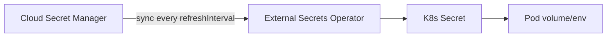
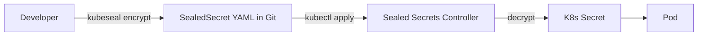
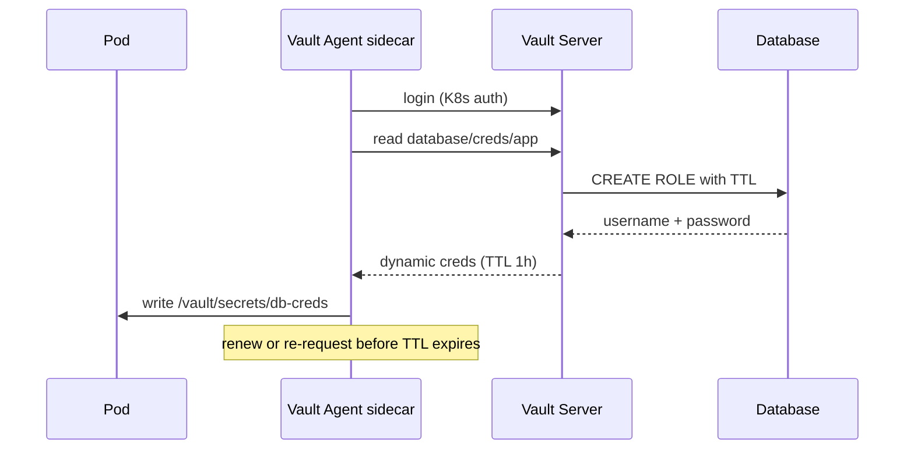

# 📘 Topic 43 — Secrets Management Deep Dive (Sealed Secrets, External Secrets, Vault, Workload Identity, IRSA)

**Official Documentation Reference**
- Secrets good practices: https://kubernetes.io/docs/concepts/security/secrets-good-practices/
- Encryption at rest: https://kubernetes.io/docs/tasks/administer-cluster/encrypt-data/
- External Secrets Operator: https://external-secrets.io/latest/
- Sealed Secrets: https://github.com/bitnami-labs/sealed-secrets
- HashiCorp Vault: https://developer.hashicorp.com/vault/docs/platform/k8s
- CSI Secrets Store: https://secrets-store-csi-driver.sigs.k8s.io/
- GKE Workload Identity: https://cloud.google.com/kubernetes-engine/docs/how-to/workload-identity
- GKE Secret Manager add-on: https://cloud.google.com/kubernetes-engine/docs/how-to/secret-manager
- EKS IRSA: https://docs.aws.amazon.com/eks/latest/userguide/iam-roles-for-service-accounts.html
- EKS Pod Identity: https://docs.aws.amazon.com/eks/latest/userguide/pod-identities.html

---

## 🔹 Definition
**Secrets management** in Kubernetes covers the full lifecycle of sensitive data — creation, storage, delivery to pods, rotation, and auditing — using a combination of K8s Secrets, encryption-at-rest, external secret stores, and cloud identity federation.

---

## 🔹 About

### Maturity levels
| Level | Pattern | Security | Ops burden |
|---|---|---|---|
| 1 | K8s Secret in YAML, committed to Git | ❌ Plaintext in Git + etcd | Low |
| 2 | K8s Secret + encryption at rest (KMS) | ⚠️ Encrypted in etcd | Low |
| 3 | SealedSecrets in Git → controller decrypts | ✅ Encrypted in Git + etcd | Medium |
| 4 | ExternalSecrets Operator → cloud SM | ✅ Secret never in Git | Medium |
| 5 | CSI Secrets Store → mount at pod start | ✅ Secret never in etcd | Medium |
| 6 | Vault with dynamic secrets + TTL | ✅✅ Short-lived, audited | High |

### Tool comparison
| Tool | Source of truth | How secret reaches pod | Rotation | GitOps-safe |
|---|---|---|---|---|
| **Sealed Secrets** | Git (encrypted) | K8s Secret (controller decrypts) | Manual re-seal | ✅ |
| **External Secrets Operator** | Cloud SM / Vault | K8s Secret (synced by ESO) | `refreshInterval` | ✅ |
| **CSI Secrets Store** | Cloud SM / Vault | Mounted file (no K8s Secret) | `rotationPollInterval` | ✅ |
| **Vault Agent Injector** | Vault | Sidecar writes to shared volume | Vault TTL | ✅ |
| **Vault CSI Provider** | Vault | CSI mount | Vault TTL | ✅ |

### Cloud identity (keyless access to secret stores)
| Cloud | Mechanism | How |
|---|---|---|
| **GKE** | Workload Identity Federation | KSA annotation → OIDC → GCP SA → Secret Manager |
| **EKS** | IRSA | KSA annotation → OIDC → STS → IAM Role → Secrets Manager |
| **EKS** | Pod Identity (2023+) | Association API → DaemonSet agent → IAM Role |

### Rotation strategies
| Strategy | When |
|---|---|
| **Volume-based + file watcher** | App reloads config file; works with ESO/CSI |
| **Reloader controller** | Triggers rollout restart on Secret change; for env consumption |
| **Vault dynamic secrets** | DB creds generated per-lease; auto-expire |
| **Immutable Secret + kustomize hash** | New Secret name → Deployment rolls |

---

## 🔹 How It Integrates
| Component | Interaction |
|---|---|
| K8s Secret | Target object ESO/SealedSecrets sync into |
| CSI driver | Mounts secret as tmpfs without K8s Secret |
| ServiceAccount | Identity for OIDC federation (WLI/IRSA) |
| RBAC | Controls who can `get secrets` |
| Audit log | Records Secret access |
| Kyverno / OPA | Can enforce no-inline-secrets, require external refs |

---

## 🏗️ Diagrams

### ESO flow


### Sealed Secrets flow


### CSI Secrets Store flow
```mermaid
flowchart LR
  SM[Cloud SM / Vault]
  CSI[CSI Secrets Store Driver<br/>+ Provider]
  POD[Pod /mnt/secrets/]
  SM -->|mount at pod start| CSI --> POD
  Note over CSI,POD: No K8s Secret created (unless syncSecret enabled)
```

### Vault dynamic secrets


---

## 💻 Real-World Examples

### Example 1 — Sealed Secrets end-to-end
```bash
# Install controller
helm repo add sealed-secrets https://bitnami-labs.github.io/sealed-secrets
helm install sealed-secrets sealed-secrets/sealed-secrets -n kube-system

# Seal a secret
kubectl create secret generic db-cred --from-literal=PASSWORD=S3cure! --dry-run=client -o yaml | \
  kubeseal --format yaml > sealed-db-cred.yaml

# Commit to Git
git add sealed-db-cred.yaml && git commit -m "sealed db cred"

# Apply — controller decrypts → K8s Secret created
kubectl apply -f sealed-db-cred.yaml
kubectl get secret db-cred -o yaml
```

### Example 2 — ESO with GCP Secret Manager
```yaml
apiVersion: external-secrets.io/v1beta1
kind: ClusterSecretStore
metadata: { name: gcp-sm }
spec:
  provider:
    gcpsm:
      projectID: my-project
---
apiVersion: external-secrets.io/v1beta1
kind: ExternalSecret
metadata: { name: db-cred, namespace: prod }
spec:
  refreshInterval: 1h
  secretStoreRef: { name: gcp-sm, kind: ClusterSecretStore }
  target: { name: db-cred }
  data:
  - { secretKey: PASSWORD, remoteRef: { key: prod-db-password } }
```

### Example 3 — CSI Secrets Store with AWS provider
```yaml
apiVersion: secrets-store.csi.x-k8s.io/v1
kind: SecretProviderClass
metadata: { name: aws-secrets }
spec:
  provider: aws
  parameters:
    objects: |
      - objectName: "prod/api-key"
        objectType: "secretsmanager"
---
spec:
  containers:
  - name: app
    volumeMounts: [{ name: secrets, mountPath: /mnt/secrets, readOnly: true }]
  volumes:
  - name: secrets
    csi:
      driver: secrets-store.csi.k8s.io
      readOnly: true
      volumeAttributes: { secretProviderClass: aws-secrets }
```

### Example 4 — Vault Agent Injector
```yaml
metadata:
  annotations:
    vault.hashicorp.com/agent-inject: "true"
    vault.hashicorp.com/agent-inject-secret-db: "database/creds/app"
    vault.hashicorp.com/role: "app"
spec:
  serviceAccountName: app-sa
```

---

## 💻 Related Commands

| Command | Purpose | Example |
|---|---|---|
| `kubeseal --format yaml` | Encrypt Secret | `kubeseal < secret.yaml > sealed.yaml` |
| `kubectl get externalsecret` | Check ESO sync | `kubectl get es -n prod` |
| `kubectl describe externalsecret` | Sync status + errors | `kubectl describe es db-cred` |
| `kubectl get secretproviderclass` | CSI store config | `kubectl get spc` |
| `vault kv get secret/data/app` | Read Vault secret | |

---

## 🚨 Scenarios

### Scenario 1 — ESO shows `SecretSyncedError`
- **Cause**: SA lacks IAM permission on secret store; or secret name wrong.
- **Fix**: check ESO controller logs; verify IRSA/WLI; verify remote key name.

### Scenario 2 — Sealed Secret decryption fails after cluster recreate
- **Cause**: sealing key (certificate) differs between old and new cluster.
- **Fix**: backup the sealed-secrets key pair. Restore before applying sealed secrets.

### Scenario 3 — Vault lease expired; app fails
- **Cause**: Vault agent didn't renew; or max TTL exceeded.
- **Fix**: tune `default_lease_ttl` and `max_lease_ttl` in Vault; ensure agent sidecar is healthy.

---

## ☁️ GKE Perspective
- **Secret Manager add-on** (`--enable-secret-manager`): mounts GSM secrets as volumes without CSI driver install.
- **Workload Identity**: recommended identity mechanism for ESO/CSI accessing GSM.
- **Binary Authorization**: can attest that only containers with verified secrets are deployed.

## 🟧 EKS Perspective
- **IRSA** or **Pod Identity** for ESO/CSI authenticating to AWS SM/SSM.
- **AWS Secrets Manager**: versioning + rotation lambda.
- **SSM Parameter Store**: cheaper; good for non-rotating config.
- CSI + ESO both supported; ESO is more flexible (multiple backends, refresh sync).

---

## 🧪 Labs

### Lab 43.1 — Sealed Secrets end-to-end (Beginner, 45 min)
Install controller, seal a secret, commit, apply, verify K8s Secret created.

### Lab 43.2 — ESO with AWS Secrets Manager + IRSA (Intermediate, 90 min)
Install ESO, create IRSA SA, store secret in ASM, apply ExternalSecret, verify K8s Secret synced, mount in pod.

### Lab 43.3 — Vault dynamic database credentials (Advanced, 120 min)
1. Deploy Vault via Helm. 2. Enable database secrets engine. 3. Configure Postgres dynamic role. 4. Deploy app with Vault Agent Injector. 5. Verify pod receives unique DB creds that auto-expire.

---

## 🎯 Interview Deliverable Answer (60–90 s)
"**What**: Secrets management in Kubernetes spans from basic K8s Secrets to enterprise-grade patterns: encryption at rest with KMS, Sealed Secrets for GitOps, External Secrets Operator for continuous sync from cloud managers, and CSI Secrets Store for mount-only secrets that never touch etcd.  
**Why**: The default K8s Secret is base64, not encrypted. Real security requires the secret to never exist in Git, to be encrypted at rest in etcd, to rotate automatically, and to be audited. External stores like GCP Secret Manager, AWS Secrets Manager, or Vault provide all of that.  
**How**: My standard pattern is ESO + Workload Identity (GKE) or IRSA (EKS). Secrets live in the cloud secret manager — versioned, rotation-capable, IAM-gated. ESO syncs them into K8s Secrets at a refresh interval. For ultra-sensitive workloads I use Vault with dynamic credentials — the database password is generated per-pod-lease and expires automatically. For GitOps I use Sealed Secrets so the encrypted blob can be committed safely.  
**Example**: We migrated 200 K8s Secrets from inline YAML to External Secrets Operator backed by AWS Secrets Manager. Rotation went from a manual Jira ticket to an automated `aws secretsmanager rotate-secret` call. Our last audit showed zero stale credentials."

---

## ❓ Interview Questions

**Q1. Why is base64 not secure?** Anyone with `kubectl get secret` can decode. It's encoding, not encryption. **Q2. Sealed Secrets vs External Secrets?** SealedSecrets: source in Git (encrypted). ESO: source in external store (never in Git). **Q3. CSI Secrets Store vs ESO?** CSI mounts files directly (no K8s Secret object). ESO creates a K8s Secret (usable as env/volume). **Q4. What is Vault dynamic secrets?** Vault generates unique, time-limited credentials per consumer — e.g., a new DB user per pod lease. **Q5. How does Workload Identity avoid static keys?** KSA → OIDC token → Google STS → GCP SA credentials. No key file. **Q6. IRSA vs Pod Identity?** IRSA: OIDC + role trust policy per SA. Pod Identity: simpler API + DaemonSet agent, no OIDC setup. **Q7. How do you rotate a secret with ESO?** Rotate in cloud SM; ESO re-syncs at `refreshInterval`. Volume mount updates; env needs restart. **Q8. How do you backup Sealed Secrets keys?** `kubectl get secret -n kube-system -l sealedsecrets.bitnami.com/sealed-secrets-key -o yaml > backup.yaml`. **Q9. Encryption at rest on EKS?** `aws eks create-cluster --encryption-config resources=[secrets],provider={keyArn=...}`. **Q10. Best practice: env vs volume for secrets?** Volume — auto-updates, no leak via `kubectl describe`.

