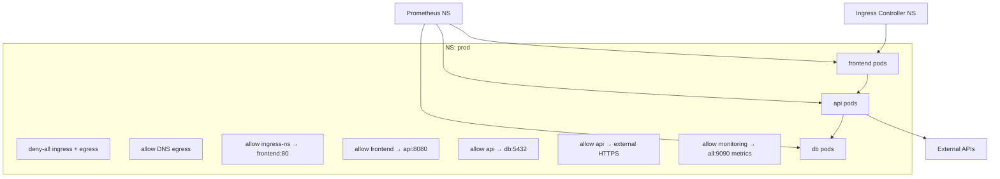
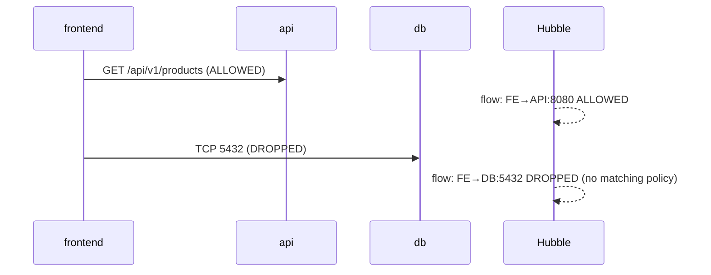

# 📘 Topic 44 — Network Policies (Deep Dive)

**Official Documentation Reference**
- Network Policies: https://kubernetes.io/docs/concepts/services-networking/network-policies/
- Cilium Network Policy: https://docs.cilium.io/en/stable/security/policy/
- Calico Network Policy: https://docs.tigera.io/calico/latest/network-policy/
- GKE DP-v2 policy: https://cloud.google.com/kubernetes-engine/docs/how-to/network-policy
- EKS VPC CNI network policy: https://docs.aws.amazon.com/eks/latest/userguide/cni-network-policy.html

---

## 🔹 Definition
This deep dive covers **advanced Network Policy patterns**: multi-tier microsegmentation, egress control with FQDN rules, L7 policies (Cilium), audit/logging of policy decisions, and production rollout strategies.

---

## 🔹 About — Advanced Patterns

### Pattern 1 — Full zero-trust namespace
```yaml
# 1. Default deny all ingress + egress
# 2. Allow DNS egress (UDP/TCP 53)
# 3. Allow app → db on specific port
# 4. Allow ingress-controller → frontend
# 5. Allow egress to external HTTPS (0.0.0.0/0 except RFC1918)
# 6. Allow monitoring scrape from Prometheus NS
```

### Pattern 2 — FQDN-based egress (Cilium only)
Standard K8s NetworkPolicy only supports `ipBlock` for egress. **CiliumNetworkPolicy** adds `toFQDNs`:
```yaml
apiVersion: cilium.io/v2
kind: CiliumNetworkPolicy
metadata: { name: allow-github }
spec:
  endpointSelector: { matchLabels: { app: ci } }
  egress:
  - toFQDNs: [{ matchPattern: "*.github.com" }]
    toPorts: [{ ports: [{ port: "443", protocol: TCP }] }]
  - toEndpoints: [{ matchLabels: { k8s:io.kubernetes.pod.namespace: kube-system, k8s-app: kube-dns } }]
    toPorts: [{ ports: [{ port: "53", protocol: ANY }] }]
```

### Pattern 3 — L7 HTTP policy (Cilium)
```yaml
apiVersion: cilium.io/v2
kind: CiliumNetworkPolicy
metadata: { name: l7-api }
spec:
  endpointSelector: { matchLabels: { app: api } }
  ingress:
  - fromEndpoints: [{ matchLabels: { app: frontend } }]
    toPorts:
    - ports: [{ port: "8080", protocol: TCP }]
      rules:
        http:
        - method: GET
          path: "/api/v1/.*"
        - method: POST
          path: "/api/v1/orders"
```

### Pattern 4 — Calico GlobalNetworkPolicy
Cluster-scoped policy (not namespaced):
```yaml
apiVersion: projectcalico.org/v3
kind: GlobalNetworkPolicy
metadata: { name: deny-egress-to-metadata }
spec:
  selector: all()
  types: [Egress]
  egress:
  - action: Deny
    destination:
      nets: ["169.254.169.254/32"]     # block IMDS
```

### Pattern 5 — Policy audit mode (Calico)
```yaml
spec:
  types: [Ingress]
  ingress:
  - action: Log          # Calico: Log + Allow for audit before enforce
```

### Policy rollout strategy
1. **Audit/log only** — deploy policies with `Log` action (Calico) or use `warn` PSA.
2. **Allow existing + deny new** — use `default-deny` + explicit allows matching current traffic.
3. **Gradual enforcement** — one namespace at a time, monitoring for dropped traffic (Hubble/Flow Logs).
4. **Full enforcement** — all namespaces, default-deny, explicit allows.

### Observability tools for policy
| Tool | What it shows |
|---|---|
| **Cilium Hubble** | Real-time flow logs: allowed/dropped, source/dest, verdict |
| **Calico Flow Logs** | Structured logs of policy decisions |
| **GKE Flow Logs** | VPC-level flow logs + DP-v2 policy logs |
| **Network Policy Editor (cilium.io)** | Visual policy builder |

---

## 🏗️ Diagrams

### Multi-tier microsegmentation


### Hubble flow visibility


---

## 💻 Real-World Examples

### Example 1 — Complete zero-trust namespace
```yaml
# deny-all.yaml
apiVersion: networking.k8s.io/v1
kind: NetworkPolicy
metadata: { name: deny-all, namespace: prod }
spec:
  podSelector: {}
  policyTypes: [Ingress, Egress]
---
# allow-dns.yaml
apiVersion: networking.k8s.io/v1
kind: NetworkPolicy
metadata: { name: allow-dns, namespace: prod }
spec:
  podSelector: {}
  policyTypes: [Egress]
  egress:
  - ports: [{ protocol: UDP, port: 53 }, { protocol: TCP, port: 53 }]
---
# allow-frontend-ingress.yaml
apiVersion: networking.k8s.io/v1
kind: NetworkPolicy
metadata: { name: allow-ingress-to-frontend, namespace: prod }
spec:
  podSelector: { matchLabels: { app: frontend } }
  policyTypes: [Ingress]
  ingress:
  - from: [{ namespaceSelector: { matchLabels: { kubernetes.io/metadata.name: ingress-nginx } } }]
    ports: [{ port: 80 }]
---
# allow-frontend-to-api.yaml
apiVersion: networking.k8s.io/v1
kind: NetworkPolicy
metadata: { name: allow-frontend-to-api, namespace: prod }
spec:
  podSelector: { matchLabels: { app: api } }
  policyTypes: [Ingress]
  ingress:
  - from: [{ podSelector: { matchLabels: { app: frontend } } }]
    ports: [{ port: 8080 }]
---
# allow-api-to-db.yaml
apiVersion: networking.k8s.io/v1
kind: NetworkPolicy
metadata: { name: allow-api-to-db, namespace: prod }
spec:
  podSelector: { matchLabels: { app: db } }
  policyTypes: [Ingress]
  ingress:
  - from: [{ podSelector: { matchLabels: { app: api } } }]
    ports: [{ port: 5432 }]
---
# allow-external-egress.yaml
apiVersion: networking.k8s.io/v1
kind: NetworkPolicy
metadata: { name: allow-external-https, namespace: prod }
spec:
  podSelector: { matchLabels: { app: api } }
  policyTypes: [Egress]
  egress:
  - to: [{ ipBlock: { cidr: 0.0.0.0/0, except: [10.0.0.0/8, 172.16.0.0/12, 192.168.0.0/16] } }]
    ports: [{ port: 443, protocol: TCP }]
  - ports: [{ protocol: UDP, port: 53 }]
---
# allow-prometheus-scrape.yaml
apiVersion: networking.k8s.io/v1
kind: NetworkPolicy
metadata: { name: allow-prometheus, namespace: prod }
spec:
  podSelector: {}
  policyTypes: [Ingress]
  ingress:
  - from: [{ namespaceSelector: { matchLabels: { kubernetes.io/metadata.name: monitoring } } }]
    ports: [{ port: 9090 }]
```

---

## 💻 Related Commands

| Command | Purpose | Example |
|---|---|---|
| `kubectl get netpol -n prod` | List policies | |
| `hubble observe -n prod --verdict DROPPED` | See dropped flows | |
| `hubble observe -n prod --to-label app=db` | Filter by destination | |
| `calicoctl get networkpolicy -n prod` | Calico-specific policies | |
| `cilium policy get -n prod` | Cilium-specific | |
| `kubectl exec <client> -- wget -qO- --timeout=3 http://db:5432` | Test connectivity | |

---

## 🚨 Scenarios

### Scenario 1 — Policy deployed but egress to payment gateway broken
- **Cause**: external IP changed; ipBlock didn't include new CIDR.
- **Fix**: use Cilium `toFQDNs` instead of ipBlock for dynamic external IPs.

### Scenario 2 — Monitoring broken after deny-all
- **Cause**: Prometheus scrape ingress not allowed.
- **Fix**: add allow rule for monitoring namespace on metrics port (9090/9100).

### Scenario 3 — Cilium L7 policy blocks valid POST
- **Cause**: HTTP path regex too restrictive.
- **Fix**: `hubble observe` → see exact path denied → fix regex.

---

## ☁️ GKE Perspective
- **Dataplane V2** enforces K8s NetworkPolicy natively + provides GKE-specific flow logging via Cloud Logging.
- **GKE Enterprise**: Anthos Network Policy for fleet-wide policies.

## 🟧 EKS Perspective
- **VPC CNI native policy** (K8s 1.25+, eBPF-based).
- **Calico** as overlay for richer policy (GlobalNetworkPolicy, DNS policy).
- **Security Groups for Pods**: VPC-level ACL complement to K8s NetworkPolicy.

---

## 🧪 Labs

### Lab 44.1 — Full zero-trust namespace (Intermediate, 60 min)
Apply Example 1 (all 7 policies). Deploy frontend, api, db. Test every path with `wget --timeout=3`. Verify allowed paths work, unauthorized paths timeout.

### Lab 44.2 — Cilium FQDN + L7 policy (Advanced, 90 min)
1. Install Cilium + Hubble. 2. Apply FQDN egress for `*.github.com:443`. 3. Apply L7 HTTP policy allowing only `GET /api/v1/*`. 4. `hubble observe --verdict DROPPED` → see blocked POST.

### Lab 44.3 — Calico GlobalNetworkPolicy block IMDS (Advanced, 45 min)
1. Install Calico. 2. Apply GlobalNetworkPolicy blocking `169.254.169.254/32` egress. 3. Verify pod can't reach metadata endpoint. 4. Exemption: add `pass` rule for `kube-system` pods.

---

## 🎯 Interview Deliverable Answer (60–90 s)
"**What**: Advanced Network Policy goes beyond basic allow/deny — it includes multi-tier microsegmentation, FQDN-based egress (Cilium), L7 HTTP policy, cluster-wide GlobalNetworkPolicy (Calico), and flow-level observability via Hubble or Calico Flow Logs.  
**Why**: A flat default-allow network means a compromised frontend pod can reach the database directly. Microsegmentation limits blast radius — frontend can only talk to the API on port 8080, API can only talk to DB on 5432, nothing else.  
**How**: I deploy 7 policies per namespace: deny-all ingress+egress, allow DNS, allow ingress-controller → frontend, allow frontend → API, allow API → DB, allow API → external HTTPS (ipBlock or toFQDNs), allow Prometheus scrape. I roll out in audit mode first (Cilium Hubble or Calico Log action), fix any legitimate drops, then enforce. For external APIs with dynamic IPs I use Cilium's `toFQDNs` instead of fragile ipBlock.  
**Example**: After a pen-test found lateral movement from a compromised pod to our database, we implemented the full zero-trust pattern across 12 production namespaces in two weeks. Re-test confirmed the attack path was eliminated."

---

## ❓ Interview Questions

**Q1. Standard K8s NetworkPolicy limitations?** L3/L4 only; no FQDN; no L7; no cluster-scoped; no deny rule; no audit mode. **Q2. How does Cilium extend NetworkPolicy?** `CiliumNetworkPolicy` adds toFQDNs, L7 HTTP rules, DNS-aware egress, cluster-wide `CiliumClusterwideNetworkPolicy`. **Q3. How does Calico extend?** `GlobalNetworkPolicy` (cluster-scoped), `action: Log` for audit, DNS policy, ICMP rules. **Q4. What is the IMDS attack vector?** Pods can reach `169.254.169.254` for instance metadata (IAM creds on EC2). Block with NetworkPolicy egress ipBlock deny. **Q5. How do you audit before enforcing?** Cilium Hubble `--verdict DROPPED` in audit mode; Calico `action: Log`; GKE DP-v2 flow logs. **Q6. FQDN egress — why not just ipBlock?** External service IPs change; FQDN resolves dynamically. **Q7. L7 policy use case?** Allow `GET /api/v1/public` but block `DELETE /api/v1/admin`. **Q8. How do you allow Prometheus scrape through deny-all?** Ingress rule: `from: namespaceSelector matching monitoring NS` on metrics port. **Q9. What is `except` in ipBlock?** Exclude CIDRs from the allowed range (e.g., allow all public IPs except RFC1918). **Q10. How do you test policies?** `kubectl exec <pod> -- wget -qO- --timeout=3 http://target:port` — timeout = blocked, content = allowed.

