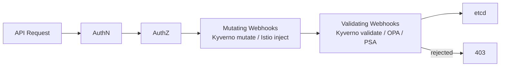
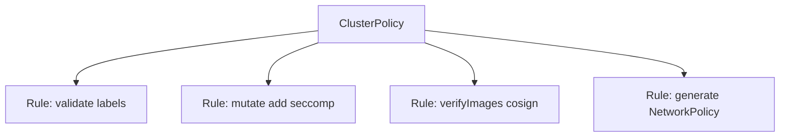
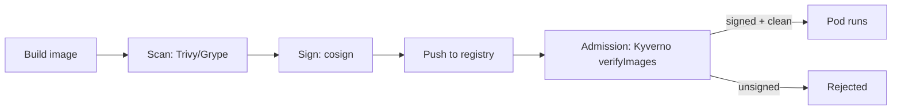

# 📘 Topic 45 — Image Security and Admission Controllers (OPA/Gatekeeper, Kyverno)

**Official Documentation Reference**
- Admission controllers: https://kubernetes.io/docs/reference/access-authn-authz/admission-controllers/
- Dynamic admission: https://kubernetes.io/docs/reference/access-authn-authz/extensible-admission-controllers/
- ValidatingAdmissionPolicy (K8s native): https://kubernetes.io/docs/reference/access-authn-authz/validating-admission-policy/
- OPA Gatekeeper: https://open-policy-agent.github.io/gatekeeper/
- Kyverno: https://kyverno.io/docs/
- GKE Binary Authorization: https://cloud.google.com/binary-authorization/docs/overview
- GKE Policy Controller: https://cloud.google.com/kubernetes-engine/docs/concepts/policy-controller
- EKS image scanning: https://docs.aws.amazon.com/AmazonECR/latest/userguide/image-scanning.html
- Sigstore / cosign: https://docs.sigstore.dev/

---

## 🔹 Definition
**Image security** ensures only trusted, scanned, signed container images run in the cluster. **Admission controllers** intercept API requests before persistence — **mutating** webhooks modify objects, **validating** webhooks accept/reject them. **OPA/Gatekeeper** and **Kyverno** are the two dominant policy engines that implement admission control as code.

---

## 🔹 About

### Image security lifecycle
| Stage | Tool | What it does |
|---|---|---|
| **Build** | Multi-stage Dockerfile, distroless base | Minimize attack surface |
| **Scan** | Trivy, Grype, Snyk, ECR scanning, Artifact Analysis (GCP) | Find CVEs |
| **Sign** | cosign (Sigstore), Notation | Cryptographic proof of origin |
| **Admit** | Kyverno / OPA / Binary Authorization / Connaisseur | Block unsigned/unscanned images |
| **Runtime** | Falco, Sysdig, KubeArmor | Detect anomalous behavior |

### Admission controller types
| Type | Phase | Purpose |
|---|---|---|
| **Mutating** | Before validation | Add defaults (labels, sidecar injection, resource limits) |
| **Validating** | After mutation | Reject non-compliant resources |

Order: Mutating → Validating → Persist. A single webhook can be both.

### Built-in admission controllers (selected)
`NamespaceLifecycle`, `LimitRanger`, `ResourceQuota`, `PodSecurity`, `ServiceAccount`, `DefaultStorageClass`, `MutatingAdmissionWebhook`, `ValidatingAdmissionWebhook`.

### ValidatingAdmissionPolicy (K8s native, 1.30+ stable)
Write validation rules in CEL (Common Expression Language) directly — no webhook server needed:
```yaml
apiVersion: admissionregistration.k8s.io/v1
kind: ValidatingAdmissionPolicy
metadata: { name: require-labels }
spec:
  matchConstraints:
    resourceRules: [{ apiGroups: ["apps"], apiVersions: ["v1"], resources: ["deployments"], operations: ["CREATE","UPDATE"] }]
  validations:
  - expression: "has(object.metadata.labels) && 'team' in object.metadata.labels"
    message: "Deployment must have 'team' label"
```

### OPA / Gatekeeper
- OPA is the general-purpose policy engine (Rego language).
- Gatekeeper is the K8s-native wrapper: `ConstraintTemplate` (defines the policy in Rego) + `Constraint` (applies it to specific resources).
- Supports both audit (report violations on existing resources) and enforcement (reject new resources).

### Kyverno
- K8s-native policy engine — policies are YAML, no Rego.
- Supports **validate**, **mutate**, **generate**, **verifyImages**.
- `ClusterPolicy` for cluster-wide; `Policy` for namespaced.
- `validationFailureAction: Enforce` or `Audit`.

### Comparison
| Feature | Kyverno | OPA/Gatekeeper | ValidatingAdmissionPolicy |
|---|---|---|---|
| Language | YAML (K8s-native) | Rego | CEL |
| Mutate | ✅ | ✅ (with assign) | ❌ (MutatingAdmissionPolicy in 1.32) |
| Generate | ✅ | ❌ | ❌ |
| Image verification | ✅ (`verifyImages`) | via OCI plugin | ❌ |
| Audit existing | ✅ (PolicyReport) | ✅ (audit) | ✅ |
| Complexity | Low | High (Rego) | Low |
| External data | ✅ | ✅ | Limited |

### Image signature verification
```yaml
# Kyverno
apiVersion: kyverno.io/v1
kind: ClusterPolicy
metadata: { name: verify-images }
spec:
  validationFailureAction: Enforce
  rules:
  - name: verify-cosign
    match: { any: [{ resources: { kinds: ["Pod"] } }] }
    verifyImages:
    - imageReferences: ["myrepo/*"]
      attestors:
      - entries:
        - keys: { publicKeys: "-----BEGIN PUBLIC KEY-----\n..." }
```

### GKE Binary Authorization
Google-managed image attestation service. Only images with a valid attestation (from Cloud Build, Artifact Analysis, or manual) are admitted.
```bash
gcloud container binauthz policy export > policy.yaml
# edit to require attestation
gcloud container binauthz policy import policy.yaml
```

### ECR Image Scanning
```bash
aws ecr describe-image-scan-findings --repository-name myrepo --image-id imageTag=latest
```
Combine with an admission webhook (Kyverno/OPA) that checks scan results before admitting.

---

## 🔹 How It Integrates
| Component | Interaction |
|---|---|
| API server | Calls mutating then validating webhooks |
| Kyverno/OPA | Deployed as Deployments; registered as webhooks |
| Image registry | Source of images; scan results; signatures |
| CI/CD | Signs images with cosign; pushes attestations |
| PSA | Complementary — PSA validates securityContext; Kyverno/OPA validate everything else |

---

## 🏗️ Diagrams

### Admission flow


### Kyverno policy model


### Image security pipeline


---

## 💻 Real-World Examples

### Example 1 — Kyverno: require labels
```yaml
apiVersion: kyverno.io/v1
kind: ClusterPolicy
metadata: { name: require-labels }
spec:
  validationFailureAction: Enforce
  rules:
  - name: check
    match: { any: [{ resources: { kinds: ["Deployment","StatefulSet","DaemonSet"] } }] }
    validate:
      message: "Labels 'team' and 'env' are required."
      pattern:
        metadata:
          labels:
            team: "?*"
            env: "?*"
```

### Example 2 — Kyverno: mutate add seccomp default
```yaml
apiVersion: kyverno.io/v1
kind: ClusterPolicy
metadata: { name: add-seccomp }
spec:
  rules:
  - name: add-seccomp
    match: { any: [{ resources: { kinds: ["Pod"] } }] }
    mutate:
      patchStrategicMerge:
        spec:
          securityContext:
            seccompProfile:
              type: RuntimeDefault
```

### Example 3 — Kyverno: restrict image registries
```yaml
apiVersion: kyverno.io/v1
kind: ClusterPolicy
metadata: { name: restrict-registries }
spec:
  validationFailureAction: Enforce
  rules:
  - name: allowed-registries
    match: { any: [{ resources: { kinds: ["Pod"] } }] }
    validate:
      message: "Images must come from approved registries."
      pattern:
        spec:
          containers:
          - image: "gcr.io/myproj/* | asia-south1-docker.pkg.dev/myproj/* | *.dkr.ecr.ap-south-1.amazonaws.com/*"
```

### Example 4 — OPA Gatekeeper: require resource limits
```yaml
apiVersion: templates.gatekeeper.sh/v1
kind: ConstraintTemplate
metadata: { name: k8srequiredlimits }
spec:
  crd: { spec: { names: { kind: K8sRequiredLimits } } }
  targets:
  - target: admission.k8s.gatekeeper.sh
    rego: |
      package k8srequiredlimits
      violation[{"msg": msg}] {
        container := input.review.object.spec.containers[_]
        not container.resources.limits.cpu
        msg := sprintf("Container %v must have CPU limits", [container.name])
      }
---
apiVersion: constraints.gatekeeper.sh/v1beta1
kind: K8sRequiredLimits
metadata: { name: require-limits }
spec:
  match: { kinds: [{ apiGroups: [""], kinds: ["Pod"] }] }
```

### Example 5 — Sign + verify with cosign
```bash
# Sign
cosign sign --key cosign.key myrepo/app:1.0

# Verify (Kyverno does this automatically via verifyImages)
cosign verify --key cosign.pub myrepo/app:1.0
```

---

## 💻 Related Commands

| Command | Purpose | Example |
|---|---|---|
| `kubectl get clusterpolicy` | List Kyverno policies | `kubectl get cpol` |
| `kubectl get policyreport -A` | Kyverno audit results | |
| `kubectl get constraint` | OPA Gatekeeper constraints | `kubectl get constraint` |
| `kubectl get constrainttemplate` | Gatekeeper templates | |
| `kubectl describe cpol require-labels` | See policy status | |
| `kubectl get validatingwebhookconfiguration` | Active webhooks | |
| `kubectl get mutatingwebhookconfiguration` | Active mutation hooks | |
| `gcloud container binauthz policy export` | GKE Binary Auth | |
| `cosign sign --key <k> <image>` | Sign image | |

---

## 🚨 Scenarios

### Scenario 1 — Kyverno webhook down → all pod creation fails
- **Cause**: validating webhook has `failurePolicy: Fail`.
- **Fix**: set `failurePolicy: Ignore` for non-critical policies; monitor webhook health; set `webhookTimeoutSeconds`.

### Scenario 2 — Developer deploys unsigned image
- **Cause**: CI pipeline didn't run cosign step; Kyverno `verifyImages` rejects.
- **Fix**: fix CI pipeline to sign after push. For emergency: exempt namespace temporarily.

### Scenario 3 — OPA Rego policy has a bug → legitimate pods rejected
- **Fix**: test policies with `gator test` or `conftest` before applying. Use `dryRun: true` on constraints.

### Scenario 4 — Binary Authorization blocks emergency hotfix
- **Cause**: hotfix image not attested by Cloud Build.
- **Fix**: use break-glass annotation: `alpha.image-policy.k8s.io/break-glass: "true"` (GKE-specific).

---

## ☁️ GCP GKE Perspective
- **Binary Authorization**: Google-managed attestation. Integrates with Cloud Build, Artifact Analysis.
- **Policy Controller** (GKE Enterprise): OPA-based with a library of pre-built policy bundles.
- **Artifact Analysis**: auto-scans images pushed to Artifact Registry.

## 🟧 AWS EKS Perspective
- **ECR image scanning**: on-push or on-demand via Inspector.
- **Kyverno/OPA**: install manually; no EKS-managed equivalent.
- **AWS Signer + Notation**: alternative to cosign for image signing.
- **GuardDuty EKS Protection**: runtime anomaly detection (complements admission).

---

## 🧪 Labs

### Lab 45.1 — Kyverno require labels + restrict registries (Beginner, 45 min)
1. Install Kyverno: `kubectl apply -f https://raw.githubusercontent.com/kyverno/kyverno/main/config/install.yaml`.
2. Apply Examples 1 + 3.
3. Try deploying without `team` label → rejected.
4. Try deploying from `docker.io` → rejected.
5. Deploy compliant pod → accepted.

### Lab 45.2 — OPA Gatekeeper require limits (Intermediate, 60 min)
1. Install Gatekeeper: `kubectl apply -f https://raw.githubusercontent.com/open-policy-agent/gatekeeper/master/deploy/gatekeeper.yaml`.
2. Apply Example 4 ConstraintTemplate + Constraint.
3. Deploy pod without limits → rejected.
4. `kubectl get constraint require-limits -o yaml` → see violations.

### Lab 45.3 — cosign sign + Kyverno verifyImages (Advanced, 90 min)
1. Generate cosign key pair: `cosign generate-key-pair`.
2. Build + push image. Sign: `cosign sign --key cosign.key <image>`.
3. Apply Kyverno verifyImages policy with public key.
4. Deploy signed image → allowed. Deploy unsigned → rejected.

---

## 🎯 Interview Deliverable Answer (60–90 s)
"**What**: Image security covers scanning, signing, and admitting container images. Admission controllers — mutating and validating webhooks — are the enforcement point. Kyverno and OPA/Gatekeeper are the two main policy engines; ValidatingAdmissionPolicy with CEL is the emerging K8s-native option.  
**Why**: Running an unscanned or unsigned image in production is like deploying unreviewed code. Admission controllers are the last gate before etcd — they enforce that every pod meets the org's security standards: approved registries, signed images, required labels, resource limits, security context.  
**How**: I use Kyverno for its simplicity — YAML policies for validation, mutation, image verification, and resource generation. My baseline policies: require `team`+`env` labels, restrict registries to our private Artifact Registry/ECR, verify cosign signatures, mutate missing seccomp profiles. On GKE I complement with Binary Authorization for build-pipeline attestation. On EKS I combine Kyverno with ECR image scanning.  
**Example**: After a CVE in a base image caused a production incident, we added two controls: Trivy in CI that blocks builds with Critical CVEs, and a Kyverno `verifyImages` policy that rejects any image not signed by our CI pipeline. Since then, zero unsigned images have reached production."

---

## ❓ Interview Questions

**Q1. Mutating vs validating admission?** Mutating modifies the request (add labels, inject sidecar). Validating accepts/rejects. Mutating runs first. **Q2. Kyverno vs OPA?** Kyverno: YAML-native, validate+mutate+generate+verifyImages. OPA: Rego language, more powerful but steeper learning curve. **Q3. What is `failurePolicy: Fail` vs `Ignore`?** Fail = if webhook is down, reject all requests (safer but can block cluster). Ignore = allow if webhook unreachable (less safe). **Q4. What is Binary Authorization?** GKE service that only admits images with valid attestations from trusted authorities. **Q5. How do you sign images?** `cosign sign --key <key> <image>`. Stores signature as an OCI artifact alongside the image. **Q6. ValidatingAdmissionPolicy — what is it?** K8s-native admission rules in CEL. No webhook server needed. GA in 1.30. **Q7. How do you audit existing violations?** Kyverno: `kubectl get policyreport -A`. Gatekeeper: `kubectl get constraint -o yaml` (violations section). **Q8. What is `verifyImages` in Kyverno?** A rule type that checks cosign/Notation signatures and attestations on images before admitting pods. **Q9. How do you prevent webhook from blocking the cluster?** `failurePolicy: Ignore` for non-critical; `namespaceSelector` to exclude `kube-system`; health checks + PDB on webhook pods. **Q10. Name 3 built-in admission controllers.** NamespaceLifecycle, LimitRanger, PodSecurity (PSA).

