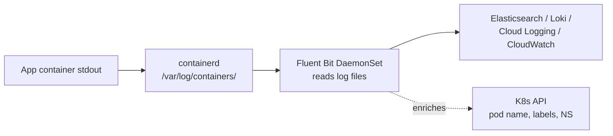
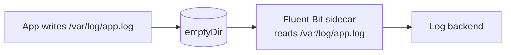
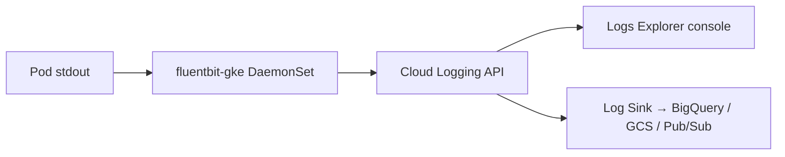

# 📘 Topic 46 — Logging (kubectl logs, EFK, Cloud Logging, CloudWatch)

**Official Documentation Reference**
- Logging architecture: https://kubernetes.io/docs/concepts/cluster-administration/logging/
- kubectl logs: https://kubernetes.io/docs/reference/kubectl/generated/kubectl_logs/
- GKE Cloud Logging: https://cloud.google.com/kubernetes-engine/docs/how-to/logging
- EKS CloudWatch: https://docs.aws.amazon.com/eks/latest/userguide/logging-monitoring.html

---

## 🔹 Definition
**Logging** in Kubernetes captures container stdout/stderr, node-level system logs, and cluster component logs. Kubernetes does not ship a built-in log aggregation system — it relies on the container runtime to write logs to files on the node, and on external stacks (EFK, Loki, Cloud Logging, CloudWatch) to collect, store, and query them.

---

## 🔹 About

### Where logs live
| Source | Location on node | Who writes |
|---|---|---|
| Container stdout/stderr | `/var/log/containers/*.log` (symlinks to `/var/log/pods/`) | containerd log driver |
| kubelet | `journalctl -u kubelet` | systemd |
| kube-apiserver, etcd, scheduler | `/var/log/` or `journalctl` (kubeadm: container logs) | static pods |
| Audit logs | `--audit-log-path` or audit webhook | API server |

### Log rotation
containerd rotates container logs when they exceed `--container-log-max-size` (default 10Mi) and keeps `--container-log-max-files` (default 5). On GKE/EKS the runtime manages this.

### Aggregation patterns
| Pattern | How |
|---|---|
| **Node-level agent (DaemonSet)** | Fluent Bit / Fluentd / Filebeat reads `/var/log/containers/` → ships to backend |
| **Sidecar streaming** | Sidecar reads app log file → streams to stdout (captured by node agent) |
| **Sidecar shipping** | Sidecar (Fluent Bit) reads log file → ships directly to backend |
| **Direct push** | App sends logs via API (e.g., OTLP) — bypasses files |

### Popular stacks
| Stack | Components | Best for |
|---|---|---|
| **EFK** | Elasticsearch + Fluent Bit/Fluentd + Kibana | Self-hosted, full-text search |
| **PLG (Grafana Loki)** | Promtail/Fluent Bit + Loki + Grafana | Lightweight, label-indexed (like Prometheus for logs) |
| **Cloud Logging (GCP)** | Built-in on GKE; auto-collects | GKE zero-ops |
| **CloudWatch (AWS)** | Fluent Bit DaemonSet → CloudWatch Logs | EKS native |
| **Datadog / Splunk / New Relic** | Agent DaemonSet → SaaS | Enterprise observability |

### Structured logging best practices
- Write JSON to stdout (not plain text).
- Include `timestamp`, `level`, `message`, `service`, `trace_id`.
- Avoid multi-line logs (or configure parser for stack traces).
- Use K8s metadata (pod name, namespace) injected by the log agent.

---

## 🔹 How It Integrates
| Component | Interaction |
|---|---|
| containerd | Writes container logs to `/var/log/containers/` |
| DaemonSet agent | Reads node logs, enriches with K8s metadata, ships |
| CoreDNS | Agent needs DNS to reach log backend |
| NetworkPolicy | Must allow agent egress to log backend |
| RBAC | Agent SA needs `get/list/watch pods/namespaces` for metadata enrichment |
| PriorityClass | Agent DaemonSet should be `system-node-critical` to survive eviction |

---

## 🏗️ Diagrams

### Node-level agent pattern


### Sidecar pattern


### GKE Cloud Logging


---

## 💻 Real-World Examples

### Example 1 — kubectl log commands
```bash
kubectl logs web-0                           # current container
kubectl logs web-0 -c sidecar               # specific container
kubectl logs web-0 --previous                # prior crash
kubectl logs -f web-0                        # follow (stream)
kubectl logs -l app=web --all-containers     # all pods matching label
kubectl logs -l app=web --tail=100           # last 100 lines per pod
kubectl logs -l app=web --since=1h           # last hour
kubectl logs job/db-migrate                  # aggregate job pod logs
```

### Example 2 — stern (multi-pod tailing)
```bash
stern web -n prod                            # tail all pods matching "web"
stern . -n prod --since 5m                   # all pods, last 5 min
stern web -n prod -o json                    # JSON output
```

### Example 3 — Fluent Bit DaemonSet (basic)
```yaml
apiVersion: apps/v1
kind: DaemonSet
metadata: { name: fluent-bit, namespace: logging }
spec:
  selector: { matchLabels: { app: fluent-bit } }
  template:
    metadata: { labels: { app: fluent-bit } }
    spec:
      serviceAccountName: fluent-bit
      tolerations: [{ operator: Exists }]
      priorityClassName: system-node-critical
      containers:
      - name: fb
        image: fluent/fluent-bit:3.1
        volumeMounts:
        - { name: varlog, mountPath: /var/log, readOnly: true }
        - { name: config, mountPath: /fluent-bit/etc }
      volumes:
      - { name: varlog, hostPath: { path: /var/log } }
      - { name: config, configMap: { name: fluent-bit-config } }
```

### Example 4 — GKE: query logs in Cloud Logging
```bash
gcloud logging read 'resource.type="k8s_container" AND resource.labels.namespace_name="prod" AND resource.labels.container_name="api"' --limit=20 --format=json
```

### Example 5 — EKS: CloudWatch with Fluent Bit
```bash
# Install via EKS add-on or Helm
helm repo add aws https://aws.github.io/eks-charts
helm install aws-for-fluent-bit aws/aws-for-fluent-bit \
  -n logging --create-namespace \
  --set cloudWatch.region=ap-south-1 \
  --set cloudWatch.logGroupName=/eks/prod
```

---

## 💻 Related Commands

| Command | Flag | Purpose | Example |
|---|---|---|---|
| `kubectl logs` | `<pod>` | View logs | `kubectl logs web-0` |
| `kubectl logs` | `-f` | Follow/stream | `kubectl logs -f web-0` |
| `kubectl logs` | `-c <container>` | Specific container | `kubectl logs web-0 -c sidecar` |
| `kubectl logs` | `--previous` | Prior crash | `kubectl logs web-0 --previous` |
| `kubectl logs` | `-l app=web` | Label selector | `kubectl logs -l app=web --all-containers` |
| `kubectl logs` | `--since=1h` | Time window | `kubectl logs web-0 --since=1h` |
| `kubectl logs` | `--tail=100` | Last N lines | `kubectl logs web-0 --tail=100` |
| `stern` | `<pattern>` | Multi-pod tail | `stern web -n prod` |
| `kubectl logs` | `job/<name>` | Job pod logs | `kubectl logs job/migrate` |

---

## 🚨 Scenarios

### Scenario 1 — `kubectl logs` shows nothing
- **Cause**: pod not writing to stdout/stderr (logging to a file instead).
- **Fix**: redirect app logs to stdout; or add sidecar to tail the log file to stdout.

### Scenario 2 — Logs lost after pod restart
- **Cause**: `--previous` shows last crash only; older logs rotated off node.
- **Fix**: centralize logs to EFK/Loki/CloudWatch before rotation.

### Scenario 3 — Fluent Bit OOMKilled
- **Cause**: parsing spike or large log burst.
- **Fix**: increase memory limits; tune `Mem_Buf_Limit`; rate-limit noisy namespaces.

### Scenario 4 — Cloud Logging costs too high on GKE
- **Cause**: verbose debug logging from all pods.
- **Fix**: use log exclusion filters; set `--logging=NONE` on non-critical node pools; route to cheaper sinks (GCS).

### Scenario 5 — CloudWatch log group missing on EKS
- **Cause**: Fluent Bit doesn't auto-create log groups by default.
- **Fix**: set `autoCreateGroup: true` in Fluent Bit CloudWatch config; or pre-create with `aws logs create-log-group`.

---

## ☁️ GCP GKE Perspective
- **Auto-logging**: GKE installs `fluentbit-gke` DaemonSet by default. Logs appear in Cloud Logging automatically.
- **System vs workload logs**: configurable at cluster level (`--logging=SYSTEM,WORKLOAD`).
- **Log sinks**: route to BigQuery (analytics), GCS (archive), Pub/Sub (streaming).
- **Autopilot**: logging always on; no DaemonSet management.
- **Cloud Logging pricing**: first 50 GiB/month free; then ~$0.50/GiB.

## 🟧 AWS EKS Perspective
- **Control-plane logs**: enable api/audit/authenticator/controllerManager/scheduler → CloudWatch `/aws/eks/<cluster>/cluster`.
- **Container logs**: install Fluent Bit DaemonSet → CloudWatch Logs.
- **Container Insights**: enhanced metrics + logs for EKS (enable via `aws eks create-addon --addon-name amazon-cloudwatch-observability`).
- **Fargate**: built-in Fluent Bit sidecar support; configure via `fluentbit.conf` in a ConfigMap.
- **CloudWatch Logs pricing**: ~$0.50/GiB ingestion; $0.03/GiB storage/month.

---

## 🧪 Hands-On Lab Exercises

### Lab 46.1 — kubectl logs mastery (Beginner, 20 min)
```bash
kubectl create deploy web --image=nginx --replicas=3
kubectl logs -l app=web --all-containers --tail=5
kubectl logs -l app=web -f
# Force a crash
kubectl set image deploy/web nginx=nginx:not-real
kubectl logs -l app=web --previous
```

### Lab 46.2 — Grafana Loki stack (Intermediate, 60 min)
1. `helm install loki grafana/loki-stack --set grafana.enabled=true -n logging --create-namespace`.
2. Port-forward Grafana: `kubectl port-forward svc/loki-grafana 3000:80 -n logging`.
3. Add Loki data source. Query: `{namespace="default", container="nginx"}`.
4. Deploy an app that writes JSON logs → query by JSON fields.

### Lab 46.3 — Fluent Bit → CloudWatch on EKS (Advanced, 60 min)
1. Install Fluent Bit Helm chart (Example 5).
2. Verify: `aws logs describe-log-groups --log-group-name-prefix=/eks/prod`.
3. Query: `aws logs filter-log-events --log-group-name=/eks/prod --filter-pattern="ERROR"`.
4. Set up CloudWatch Insights query: `fields @timestamp, @message | filter @message like /ERROR/ | sort @timestamp desc`.

---

## 🎯 Interview Deliverable Answer (60–90 s)
"**What**: Kubernetes logging captures container stdout/stderr via the container runtime, stores them as files on the node, and relies on external stacks to aggregate, store, and query them. kubectl logs is the quick tool; production uses EFK, Grafana Loki, Cloud Logging, or CloudWatch.  
**Why**: Containers are ephemeral — logs disappear on restart. Centralized logging is non-negotiable for debugging, auditing, and compliance. Structured JSON logs with trace IDs enable correlation across microservices.  
**How**: On GKE, Cloud Logging works out of the box — I tune exclusion filters and sinks. On EKS I deploy Fluent Bit as a DaemonSet shipping to CloudWatch or Loki. I always set the agent's priorityClass to `system-node-critical` and tune `Mem_Buf_Limit` to survive log bursts. Apps write structured JSON to stdout with `level`, `service`, `trace_id`.  
**Example**: We moved from EFK (self-managed Elasticsearch) to Grafana Loki on EKS. Log storage costs dropped 60% because Loki stores only labels + compressed chunks instead of full-text indexing. Query performance was fine for our use case."

---

## ❓ Interview Questions

**Q1. Where do container logs live on a node?** `/var/log/containers/` (symlinks to `/var/log/pods/`). **Q2. `kubectl logs --previous` — what does it show?** Logs from the prior container instance (last crash). **Q3. K8s ships a log stack?** No — you must deploy one (EFK, Loki, CloudWatch, etc.). **Q4. DaemonSet vs sidecar for logging?** DaemonSet: one agent per node, reads all containers. Sidecar: per-pod, reads specific files — more isolation. **Q5. Why structured JSON logs?** Enables field-based querying, alerting, and correlation without regex. **Q6. What is stern?** CLI that tails logs from multiple pods matching a pattern with color coding. **Q7. GKE default logging?** `fluentbit-gke` DaemonSet ships to Cloud Logging automatically. **Q8. EKS control-plane logs?** Disabled by default; enable per log type → CloudWatch. **Q9. How do you handle multi-line logs?** Configure parser (e.g., Fluent Bit `Multiline` parser for Java stack traces). **Q10. How do you reduce log costs?** Exclusion filters, sampling, shorter retention, cheaper sinks (GCS/S3), log levels (no DEBUG in prod).

