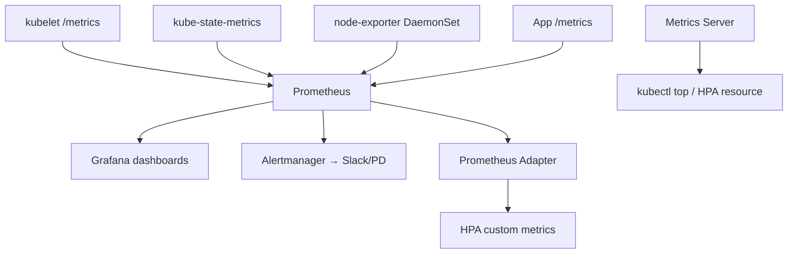
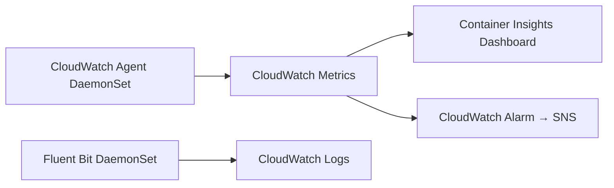

# 📘 Topic 47 — Monitoring (Metrics Server, Prometheus, Grafana, GKE Managed Prometheus, CloudWatch Container Insights)

**Official Documentation Reference**
- Metrics server: https://kubernetes.io/docs/tasks/debug/debug-cluster/resource-metrics-pipeline/
- Resource monitoring tools: https://kubernetes.io/docs/tasks/debug/debug-cluster/resource-usage-monitoring/
- System metrics: https://kubernetes.io/docs/concepts/cluster-administration/system-metrics/
- GKE Managed Prometheus: https://cloud.google.com/stackdriver/docs/managed-prometheus
- EKS Container Insights: https://docs.aws.amazon.com/AmazonCloudWatch/latest/monitoring/Container-Insights-EKS.html

---

## 🔹 Definition
**Monitoring** in Kubernetes collects, stores, and visualizes metrics — CPU, memory, network, custom application metrics — to enable autoscaling (HPA/VPA), alerting, capacity planning, and debugging.

---

## 🔹 About

### Metrics pipeline layers
| Layer | Component | Metrics |
|---|---|---|
| **Resource metrics** | Metrics Server | CPU/memory per pod/node (for HPA/VPA/`kubectl top`) |
| **Full metrics** | Prometheus / cloud monitoring | Everything: container, node, app, kube-state, etcd |
| **Custom metrics** | Prometheus Adapter / Stackdriver Adapter | App-defined metrics for HPA |
| **Dashboards** | Grafana / Cloud Monitoring / CloudWatch | Visualization + alerting |
| **Alerting** | Alertmanager / PagerDuty / Cloud Alerting | Page on SLO breach |

### Metrics Server
- In-memory, lightweight aggregator of kubelet `/metrics/resource` endpoint.
- Required for `kubectl top`, HPA, VPA.
- NOT a monitoring solution — no storage, no history.
```bash
kubectl apply -f https://github.com/kubernetes-sigs/metrics-server/releases/latest/download/components.yaml
kubectl top pods -A
kubectl top nodes
```

### Prometheus stack
| Component | Purpose |
|---|---|
| **Prometheus** | Scrapes + stores time-series metrics (pull model) |
| **kube-state-metrics** | Exports K8s object state (deployment replicas, pod status) as metrics |
| **node-exporter** | Exports node hardware/OS metrics |
| **Alertmanager** | Routes alerts to Slack/PagerDuty/email |
| **Grafana** | Dashboards + visualization |
| **Prometheus Adapter** | Expose custom metrics for HPA via `custom.metrics.k8s.io` API |

### Install (kube-prometheus-stack Helm chart)
```bash
helm repo add prometheus-community https://prometheus-community.github.io/helm-charts
helm install kube-prom prometheus-community/kube-prometheus-stack -n monitoring --create-namespace
```

### Key PromQL queries
```promql
# CPU usage per pod
rate(container_cpu_usage_seconds_total{namespace="prod"}[5m])

# Memory usage
container_memory_working_set_bytes{namespace="prod"}

# CPU throttling
rate(container_cpu_cfs_throttled_seconds_total[5m])

# Pod restart count
kube_pod_container_status_restarts_total

# Node capacity vs allocatable
kube_node_status_capacity - kube_node_status_allocatable
```

### ServiceMonitor / PodMonitor (Prometheus Operator)
```yaml
apiVersion: monitoring.coreos.com/v1
kind: ServiceMonitor
metadata: { name: api-monitor, namespace: monitoring }
spec:
  selector: { matchLabels: { app: api } }
  namespaceSelector: { matchNames: [prod] }
  endpoints:
  - { port: metrics, interval: 15s, path: /metrics }
```

---

## 🔹 How It Integrates
| Component | Interaction |
|---|---|
| HPA | Reads from Metrics Server (resource) or Prometheus Adapter (custom) |
| VPA | Reads from Metrics Server |
| kubelet | Exposes `/metrics`, `/metrics/resource`, `/metrics/cadvisor` |
| Grafana | Queries Prometheus for dashboards |
| Alertmanager | Fires alerts based on Prometheus rules |
| Application | Exposes `/metrics` endpoint (Prometheus client library) |

---

## 🏗️ Diagrams

### Monitoring architecture


### GKE Managed Prometheus
```mermaid
flowchart LR
  APP[App /metrics] --> COL[GMP Collector DaemonSet]
  COL --> GCMP[Google Cloud Managed Prometheus]
  GCMP --> GRAF[Grafana (Cloud or self)]
  GCMP --> ALERT[Cloud Alerting]
```

### EKS Container Insights


---

## 💻 Real-World Examples

### Example 1 — Install Metrics Server on Minikube
```bash
minikube addons enable metrics-server
kubectl top nodes
kubectl top pods -A
```

### Example 2 — kube-prometheus-stack
```bash
helm install kube-prom prometheus-community/kube-prometheus-stack \
  -n monitoring --create-namespace \
  --set grafana.adminPassword=admin \
  --set prometheus.prometheusSpec.retention=7d
kubectl port-forward svc/kube-prom-grafana 3000:80 -n monitoring
```

### Example 3 — GKE Managed Prometheus
```bash
gcloud container clusters update prod --region=asia-south1 --enable-managed-prometheus
# Prometheus targets auto-discovered via PodMonitoring CRD
kubectl apply -f - <<EOF
apiVersion: monitoring.googleapis.com/v1
kind: PodMonitoring
metadata: { name: api, namespace: prod }
spec:
  selector: { matchLabels: { app: api } }
  endpoints: [{ port: metrics, interval: 30s }]
EOF
```

### Example 4 — EKS Container Insights
```bash
aws eks create-addon --cluster-name prod --addon-name amazon-cloudwatch-observability
```

### Example 5 — App exposing /metrics (Go)
```go
import "github.com/prometheus/client_golang/prometheus/promhttp"
http.Handle("/metrics", promhttp.Handler())
```

---

## 💻 Related Commands

| Command | Purpose | Example |
|---|---|---|
| `kubectl top nodes` | Node CPU/mem | `kubectl top nodes` |
| `kubectl top pods` | Pod CPU/mem | `kubectl top pods -A --containers` |
| `kubectl get --raw /apis/metrics.k8s.io/v1beta1/pods` | Raw metrics API | |
| `kubectl port-forward svc/kube-prom-grafana 3000:80 -n monitoring` | Open Grafana | |
| `kubectl get servicemonitor -A` | List scrape targets | |
| `kubectl get prometheusrule -A` | List alert rules | |
| `promtool check rules rules.yaml` | Validate alert rules | |

---

## 🚨 Scenarios

### Scenario 1 — `kubectl top` returns "Metrics API not available"
- **Cause**: Metrics Server not installed.
- **Fix**: install Metrics Server.

### Scenario 2 — HPA not scaling despite high CPU
- **Cause**: Metrics Server installed but pod has no `resources.requests` → utilization = actual/0 = undefined.
- **Fix**: set CPU requests on all HPA-target pods.

### Scenario 3 — Prometheus OOMKilled
- **Cause**: too many series (cardinality explosion from high-cardinality labels).
- **Fix**: drop unused metrics via `metric_relabel_configs`; reduce scrape targets; increase memory; shard.

### Scenario 4 — Alert fatigue from noisy alerts
- **Fix**: tune thresholds (burn-rate alerts for SLOs); add inhibition rules; group related alerts.

---

## ☁️ GCP GKE Perspective
- **GKE Managed Prometheus (GMP)**: Google runs Prometheus for you. Use `PodMonitoring` CRD instead of `ServiceMonitor`. Query via Cloud Monitoring PromQL UI or Grafana with Prometheus data source pointing to GMP.
- **Cloud Monitoring**: auto-collects system metrics (CPU, mem, disk) from GKE nodes.
- **Autopilot**: GMP supported; system metrics auto-collected.

## 🟧 AWS EKS Perspective
- **Container Insights**: CloudWatch add-on; collects node/pod/container metrics.
- **Amazon Managed Service for Prometheus (AMP)**: AWS-managed Prometheus. Write via remote-write; query via PromQL.
- **Amazon Managed Grafana (AMG)**: managed Grafana with AMP/CloudWatch data sources.
- **ADOT (AWS Distro for OpenTelemetry)**: alternative collector for metrics + traces → AMP/X-Ray/CloudWatch.

---

## 🧪 Labs

### Lab 47.1 — Metrics Server + kubectl top (Beginner, 20 min)
Install Metrics Server. `kubectl top nodes`, `kubectl top pods`. Deploy stress pod, observe CPU spike.

### Lab 47.2 — kube-prometheus-stack + Grafana (Intermediate, 60 min)
1. Helm install. 2. Port-forward Grafana. 3. Explore built-in dashboards (K8s cluster, node, pod). 4. Create ServiceMonitor for a custom app. 5. Write a PromQL query for p99 latency.

### Lab 47.3 — GKE Managed Prometheus + custom metrics HPA (Advanced, 90 min)
1. Enable GMP on GKE. 2. Deploy app exposing `/metrics` with `http_requests_total`. 3. Apply PodMonitoring. 4. Verify metrics in Cloud Monitoring. 5. Configure HPA with custom metric via Stackdriver Adapter.

---

## 🎯 Interview Deliverable Answer (60–90 s)
"**What**: Kubernetes monitoring has two layers. Metrics Server provides lightweight CPU/memory for kubectl top and HPA. Prometheus provides full observability — scraping kubelet, kube-state-metrics, node-exporter, and application endpoints — with Grafana for dashboards and Alertmanager for alerts.  
**Why**: Without monitoring you're flying blind. Autoscaling (HPA/VPA) depends on Metrics Server. Capacity planning, SLO tracking, and incident response depend on Prometheus or a cloud equivalent.  
**How**: On GKE I use Managed Prometheus (GMP) with PodMonitoring CRDs and query via Cloud Monitoring or Grafana. On EKS I deploy kube-prometheus-stack or use Amazon Managed Service for Prometheus. I expose application metrics via `/metrics` endpoints with Prometheus client libraries and define ServiceMonitors to scrape them. Alerting rules follow the Google SRE burn-rate model — multi-window alerts that page only on meaningful SLO burn.  
**Example**: We set up a Grafana dashboard showing p99 latency, error rate, and CPU throttling per service. When p99 crossed 500ms, Alertmanager paged the on-call. The dashboard traced the issue to CPU throttling — we raised limits and latency dropped within minutes."

---

## ❓ Interview Questions

**Q1. Metrics Server vs Prometheus?** Metrics Server: in-memory, resource metrics for top/HPA. Prometheus: persistent, full metrics, alerting, custom queries. **Q2. What does kube-state-metrics export?** K8s object state: deployment replicas, pod status, node conditions — not resource usage. **Q3. How does HPA get custom metrics?** Prometheus Adapter exposes custom metrics via `custom.metrics.k8s.io` API. **Q4. What is a ServiceMonitor?** Prometheus Operator CRD that tells Prometheus to scrape specific Services. **Q5. PromQL for CPU throttling?** `rate(container_cpu_cfs_throttled_seconds_total[5m])`. **Q6. GKE Managed Prometheus vs self-hosted?** GMP: Google runs Prometheus, no storage management. Use `PodMonitoring` CRD. Integrates with Cloud Alerting. **Q7. EKS Container Insights?** CloudWatch add-on collecting node/pod metrics + logs. **Q8. How do you reduce Prometheus cardinality?** Drop high-cardinality labels via `metric_relabel_configs`; aggregate in recording rules. **Q9. Alertmanager grouping/inhibition?** Group: batch related alerts into one notification. Inhibition: suppress lower-severity when higher fires. **Q10. How do you monitor the monitor?** Prometheus self-monitoring + `watchdog` alert (fires if Alertmanager is alive); dead-man's switch via PagerDuty.

