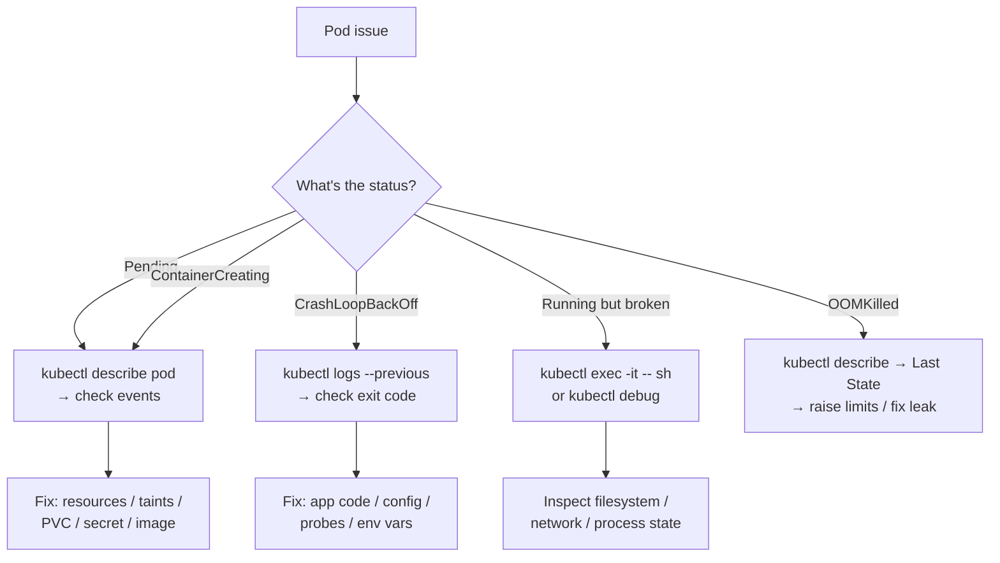
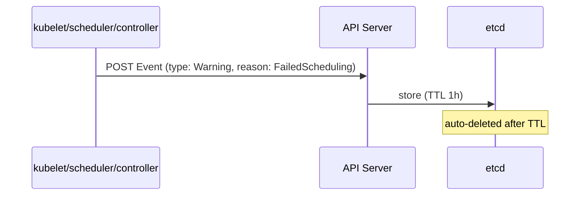

# 📘 Topic 48 — Events and Debugging

**Official Documentation Reference**
- Debug pods: https://kubernetes.io/docs/tasks/debug/debug-application/debug-pods/
- Debug running pods: https://kubernetes.io/docs/tasks/debug/debug-application/debug-running-pod/
- Get shell to running container: https://kubernetes.io/docs/tasks/debug/debug-application/get-shell-running-container/
- Determine reason for pod failure: https://kubernetes.io/docs/tasks/debug/debug-application/determine-reason-pod-failure/
- Events API: https://kubernetes.io/docs/reference/kubernetes-api/events/event-v1/

---

## 🔹 Definition
**Events** are short-lived Kubernetes objects that record state changes and errors — scheduling decisions, image pulls, probe failures, OOM kills, volume attach/detach. **Debugging** is the practice of using events, logs, describe, exec, debug, and port-forward to diagnose issues.

---

## 🔹 About

### Events
- Stored in etcd with a default TTL of **1 hour**.
- Types: `Normal`, `Warning`.
- Key fields: `reason`, `message`, `involvedObject`, `count`, `firstTimestamp`, `lastTimestamp`.
- Not a monitoring system — use for immediate triage; persist via log sink for history.

### Debugging toolkit
| Tool | Use |
|---|---|
| `kubectl describe` | Object spec + events |
| `kubectl logs` | Container stdout/stderr (current + `--previous`) |
| `kubectl exec` | Shell into running container |
| `kubectl debug` | Ephemeral container into running pod or node |
| `kubectl port-forward` | Tunnel traffic to a pod/service |
| `kubectl cp` | Copy files to/from a pod |
| `kubectl events` | Better event viewer (K8s 1.26+) |
| `kubectl get --raw /debug/pprof/` | Profile API server |
| `crictl` | Debug at container runtime level on a node |

### Common error patterns
| Error | Meaning | Debug path |
|---|---|---|
| `CrashLoopBackOff` | Container keeps exiting | `logs --previous` → exit code → fix app |
| `ImagePullBackOff` | Can't pull image | `describe` → image name, registry auth, network |
| `OOMKilled` | Memory exceeded limit | `describe` → Last State OOMKilled; raise limit or fix leak |
| `Pending` | Can't schedule | `describe` → events → resource/taint/affinity issue |
| `ContainerCreating` | Stuck mounting | `describe` → PVC/Secret/ConfigMap not found, CNI failure |
| `ErrImagePull` | Image doesn't exist | Check tag, registry, imagePullSecrets |
| `CreateContainerConfigError` | Bad env ref | Missing ConfigMap/Secret key |
| `FailedScheduling` | No fit node | Resource/taint/affinity mismatch |

### `kubectl debug` modes
| Mode | Command | Use |
|---|---|---|
| Ephemeral container | `kubectl debug -it <pod> --image=busybox --target=<container>` | Debug running pod without restart |
| Copy pod | `kubectl debug <pod> --copy-to=debug-pod --container=debug --image=busybox` | Debug with modified spec |
| Node debug | `kubectl debug node/<node> -it --image=busybox` | Privileged pod on node (chroot `/host`) |

---

## 🔹 How It Integrates
| Component | Interaction |
|---|---|
| API server | Stores events; exposes debug endpoints |
| kubelet | Generates pod lifecycle events |
| Scheduler | Generates FailedScheduling events |
| kube-proxy | Generates Service sync events |
| Controllers | Generate events for owned objects |

---

## 🏗️ Diagrams

### Debugging decision tree


### Event lifecycle


---

## 💻 Real-World Examples

### Example 1 — Full debug flow for CrashLoopBackOff
```bash
kubectl get pods -n prod          # STATUS: CrashLoopBackOff
kubectl describe pod web-0 -n prod | tail -30    # events + last state
kubectl logs web-0 -n prod --previous            # see crash output
kubectl logs web-0 -n prod -c init-migrate       # check init container
kubectl get events -n prod --sort-by=.lastTimestamp | head -20
kubectl debug -it web-0 -n prod --image=busybox --target=web  # inspect
```

### Example 2 — Debug a node
```bash
kubectl debug node/worker-1 -it --image=ubuntu
# inside:
chroot /host
journalctl -u kubelet --since "10 min ago"
crictl ps -a
crictl logs <container-id>
df -h
free -m
exit
```

### Example 3 — Events viewer (K8s 1.26+)
```bash
kubectl events -n prod --types=Warning
kubectl events -n prod --for=pod/web-0
kubectl events -A --types=Warning --sort-by=lastTimestamp
```

### Example 4 — terminationMessagePath
```yaml
spec:
  containers:
  - name: app
    terminationMessagePath: /dev/termination-log
    terminationMessagePolicy: FallbackToLogsOnError
```
```bash
kubectl get pod web-0 -o jsonpath='{.status.containerStatuses[0].state.terminated.message}'
```

### Example 5 — Port-forward for local debugging
```bash
kubectl port-forward pod/web-0 8080:80          # pod
kubectl port-forward svc/web 8080:80             # service (any backend)
kubectl port-forward deploy/web 8080:80          # deployment (any pod)
```

---

## 💻 Related Commands

| Command | Purpose | Example |
|---|---|---|
| `kubectl describe pod` | Spec + events + status | `kubectl describe pod web-0` |
| `kubectl events` | Better event viewer | `kubectl events -n prod --types=Warning` |
| `kubectl get events` | Raw events list | `kubectl get events --sort-by=.lastTimestamp` |
| `kubectl logs` | Container logs | `kubectl logs web-0 --previous` |
| `kubectl exec -it` | Shell into container | `kubectl exec -it web-0 -- sh` |
| `kubectl debug -it` | Ephemeral debug container | `kubectl debug -it web-0 --image=busybox --target=web` |
| `kubectl debug node/` | Node debug pod | `kubectl debug node/worker-1 -it --image=ubuntu` |
| `kubectl port-forward` | Local tunnel | `kubectl port-forward svc/web 8080:80` |
| `kubectl cp` | Copy files | `kubectl cp web-0:/var/log/app.log ./app.log` |
| `kubectl get pod -o jsonpath` | Extract status | `kubectl get pod web-0 -o jsonpath='{.status.phase}'` |

---

## 🚨 Scenarios

### Scenario 1 — Pod in `CrashLoopBackOff` with exit code 137
- **Meaning**: 137 = 128 + 9 (SIGKILL) = OOMKilled.
- **Fix**: raise `resources.limits.memory`; check `kubectl describe pod` for OOMKilled in Last State.

### Scenario 2 — Pod in `CrashLoopBackOff` with exit code 1
- **Meaning**: application error.
- **Fix**: `kubectl logs --previous` → read error message → fix config/code.

### Scenario 3 — `CreateContainerConfigError`
- **Meaning**: ConfigMap or Secret referenced in env/volume doesn't exist.
- **Fix**: `kubectl describe pod` → events → create the missing CM/Secret.

### Scenario 4 — Events show "Back-off restarting failed container" but logs are empty
- **Cause**: container exits before writing to stdout.
- **Fix**: use `terminationMessagePolicy: FallbackToLogsOnError`; or `kubectl debug` to inspect filesystem.

### Scenario 5 — Need to debug a distroless image (no shell)
- **Fix**: `kubectl debug -it <pod> --image=busybox --target=<container>` — ephemeral container joins namespaces.

---

## ☁️ GKE Perspective
- Events visible in Cloud Console → Workloads → Events tab.
- **Cloud Logging** persists events beyond 1 hour: `resource.type="k8s_cluster" AND protoPayload.methodName="io.k8s.core.v1.events.create"`.
- `kubectl debug node/` works on Standard. Not available on Autopilot (no node SSH).

## 🟧 EKS Perspective
- Events visible via `kubectl events` or CloudWatch if control-plane logging enabled.
- `kubectl debug node/` works on managed NG nodes. Not on Fargate (no node access).
- **EKS Pod Identity troubleshooting**: `kubectl describe pod` → check IRSA/Pod Identity annotations + injected env vars.

---

## 🧪 Labs

### Lab 48.1 — Debug CrashLoopBackOff (Beginner, 30 min)
Deploy a pod with a bad command. Use `describe`, `logs --previous`, `events` to diagnose. Fix and redeploy.

### Lab 48.2 — Ephemeral debug container (Intermediate, 30 min)
Deploy a distroless pod. `kubectl debug -it <pod> --image=busybox --target=<c>`. Run `ps`, `wget`, `ls /proc/1/root/`.

### Lab 48.3 — Node-level debug (Advanced, 45 min)
`kubectl debug node/<n> -it --image=ubuntu`. Inside: `chroot /host`, `journalctl -u kubelet`, `crictl ps -a`, `df -h`, `free -m`.

---

## 🎯 Interview Deliverable Answer (60–90 s)
"**What**: Events are short-lived K8s objects that record what happened — scheduling, pulling, probing, killing. Debugging uses events plus logs, describe, exec, debug, and port-forward to triage issues.  
**Why**: When a pod misbehaves, events are the first clue — they tell you *what* happened. Logs tell you *why*. exec and debug let you inspect the live state.  
**How**: My debug flow: 1) `kubectl get pods` → status. 2) `kubectl describe pod` → events section for scheduling/mount/pull errors. 3) `kubectl logs --previous` → crash output. 4) `kubectl debug -it` with a busybox image for distroless containers. 5) `kubectl port-forward` to hit the app locally. For node issues: `kubectl debug node/` → `chroot /host` → `journalctl -u kubelet`.  
**Example**: A pod was CrashLooping with exit code 1. `logs --previous` showed a missing env var. `describe` showed the ConfigMap existed but the key was misspelled. Fixed the key → pod healthy in 10 seconds."

---

## ❓ Interview Questions

**Q1. How long do events last?** Default 1 hour (TTL in etcd). **Q2. Exit code 137?** 128+9 = SIGKILL = likely OOMKilled. **Q3. Exit code 1?** Application error. **Q4. `CrashLoopBackOff` vs `Error`?** CrashLoopBackOff = K8s is backing off on restarts after repeated failures. Error = container terminated with error. **Q5. How do you debug a distroless image?** `kubectl debug -it <pod> --image=busybox --target=<c>` — ephemeral container. **Q6. `kubectl debug node/` — what does it do?** Creates a privileged pod on the node with `chroot /host` access. **Q7. `terminationMessagePolicy: FallbackToLogsOnError`?** If termination message file is empty, use last chunk of container log as termination message. **Q8. Events say "Back-off pulling image" — steps?** Check image name, tag, registry auth (imagePullSecrets), network access to registry. **Q9. `CreateContainerConfigError`?** Missing ConfigMap/Secret referenced in env or volume. **Q10. How do you persist events beyond 1 hour?** Ship to Cloud Logging, CloudWatch, or Elasticsearch via event exporter.

