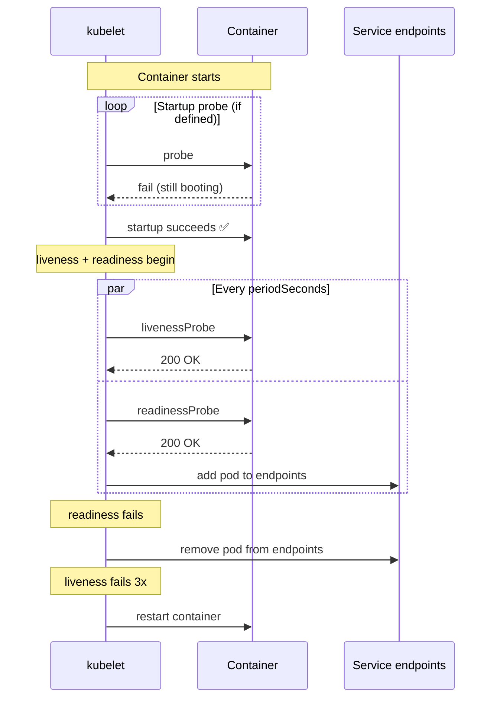
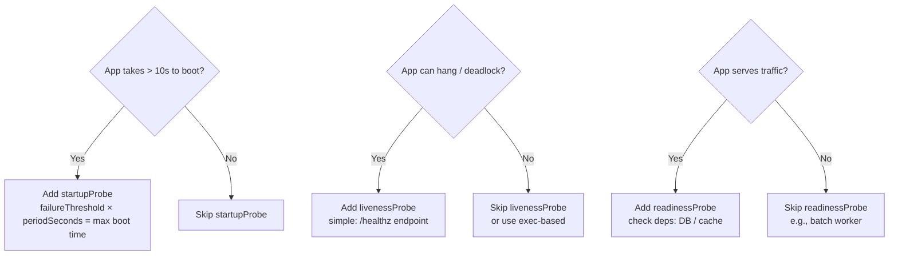

# 📘 Topic 49 — Liveness, Readiness, Startup Probes

**Official Documentation Reference**
- Probes: https://kubernetes.io/docs/concepts/workloads/pods/probes/
- Configure probes: https://kubernetes.io/docs/tasks/configure-pod-container/configure-liveness-readiness-startup-probes/
- GKE probes: https://cloud.google.com/kubernetes-engine/docs/concepts/probe
- EKS best practices: https://docs.aws.amazon.com/eks/latest/best-practices/reliability.html

---

## 🔹 Definition
**Probes** are periodic health checks kubelet runs against containers. **Liveness** restarts a hung container. **Readiness** gates traffic to a ready container. **Startup** delays liveness/readiness until a slow-booting app is initialized.

---

## 🔹 About

### Three probe types
| Probe | Question | Action on failure | Added to Service endpoints? |
|---|---|---|---|
| **Startup** | "Has the app finished booting?" | Restart container | No (not yet ready) |
| **Liveness** | "Is the app alive?" | Restart container | N/A |
| **Readiness** | "Can the app serve traffic?" | Remove from Service endpoints | No |

### Probe mechanisms
| Mechanism | How |
|---|---|
| `httpGet` | HTTP GET to `path:port`. Success = 200–399 |
| `tcpSocket` | TCP connect to `port`. Success = connection established |
| `exec` | Run a command in container. Success = exit code 0 |
| `grpc` | gRPC health check (K8s 1.27+ stable). Success = `SERVING` |

### Timing parameters
| Parameter | Default | Meaning |
|---|---|---|
| `initialDelaySeconds` | 0 | Wait before first probe |
| `periodSeconds` | 10 | Interval between probes |
| `timeoutSeconds` | 1 | Probe must respond within |
| `successThreshold` | 1 | Consecutive successes for healthy |
| `failureThreshold` | 3 | Consecutive failures before action |

### Critical rules
1. **Always add readinessProbe** — without it, pods receive traffic before they're ready.
2. **Add startupProbe for slow-boot apps** (Java, ML model loading) — it prevents liveness from killing a healthy but slow app during init.
3. **Liveness should check simple things** — don't call external dependencies. A DB-down shouldn't restart your app.
4. **Readiness should check dependencies** — if DB is down, mark unready so traffic stops.
5. **Don't set `initialDelaySeconds` too high** — use startupProbe instead.

### Probe flow
1. **Startup probe runs first** (if defined): liveness and readiness are disabled until startup succeeds.
2. Once startup succeeds (or if no startup probe), **liveness** and **readiness** run in parallel at `periodSeconds`.

---

## 🔹 How It Integrates
| Component | Interaction |
|---|---|
| kubelet | Executes probes |
| Service / EndpointSlice | Readiness gates traffic |
| Deployment rollout | `minReadySeconds` + readiness determine rollout speed |
| HPA | Only Ready pods count toward utilization |
| PDB | Readiness affects disruption calculations |

---

## 🏗️ Diagrams

### Probe lifecycle


### Decision matrix


---

## 💻 Real-World Examples

### Example 1 — All three probes (HTTP)
```yaml
spec:
  containers:
  - name: api
    image: myrepo/api:2.0
    ports: [{ containerPort: 8080 }]
    startupProbe:
      httpGet: { path: /healthz, port: 8080 }
      failureThreshold: 30        # 30 × 2s = 60s max boot
      periodSeconds: 2
    livenessProbe:
      httpGet: { path: /healthz, port: 8080 }
      periodSeconds: 10
      timeoutSeconds: 3
      failureThreshold: 3
    readinessProbe:
      httpGet: { path: /ready, port: 8080 }
      periodSeconds: 5
      timeoutSeconds: 2
      failureThreshold: 2
```

### Example 2 — gRPC probe
```yaml
livenessProbe:
  grpc:
    port: 50051
    service: ""          # empty = overall health
  periodSeconds: 10
```

### Example 3 — exec probe (database check)
```yaml
readinessProbe:
  exec:
    command: ["pg_isready", "-U", "postgres"]
  periodSeconds: 5
```

### Example 4 — TCP probe (Redis)
```yaml
readinessProbe:
  tcpSocket: { port: 6379 }
  periodSeconds: 5
```

### Example 5 — Separate liveness vs readiness endpoints
```python
# /healthz — simple (no external deps)
@app.get("/healthz")
def healthz():
    return {"status": "alive"}

# /ready — checks dependencies
@app.get("/ready")
def ready():
    if not db.is_connected():
        raise HTTPException(503, "DB not ready")
    return {"status": "ready"}
```

---

## 💻 Related Commands

| Command | Purpose | Example |
|---|---|---|
| `kubectl describe pod` | See probe config + failure events | `kubectl describe pod api-0` |
| `kubectl get pods` | READY column (0/1 = readiness failing) | `kubectl get pods` |
| `kubectl get endpoints` | See which pods are in endpoints | `kubectl get endpoints web` |
| `kubectl logs` | App logs during probe failure | `kubectl logs api-0` |
| `kubectl exec -- curl localhost:8080/healthz` | Manually test probe endpoint | |

---

## 🚨 Scenarios

### Scenario 1 — Liveness kills healthy slow-boot app
- **Cause**: no startupProbe; liveness `initialDelaySeconds` too short.
- **Fix**: add startupProbe with `failureThreshold × periodSeconds ≥ max boot time`.

### Scenario 2 — Pod marked Ready before app is warm → 503 errors
- **Cause**: readinessProbe too lenient (succeeds before app loads cache).
- **Fix**: readiness checks a real functional endpoint; or add `minReadySeconds`.

### Scenario 3 — Liveness probe depends on external DB → cascading restarts
- **Cause**: DB briefly down → liveness fails → all pods restart simultaneously.
- **Fix**: liveness should be self-contained (process alive, no deadlock). Readiness checks deps.

### Scenario 4 — Pod oscillates between Ready and Not Ready
- **Cause**: readinessProbe flapping (intermittent dependency).
- **Fix**: increase `failureThreshold` and `successThreshold`; add jitter; fix dependency.

### Scenario 5 — Deployment rollout stuck at 1 new pod
- **Cause**: new pod's readinessProbe never passes → Deployment won't continue.
- **Fix**: debug probe endpoint; check container logs; `kubectl port-forward` and test manually.

---

## ☁️ GKE Perspective
- Probes work identically on Autopilot and Standard.
- **NEG health checks** (container-native LB): GKE uses readinessProbe config to create GCLB health checks automatically. Ensure probe path/port match.

## 🟧 EKS Perspective
- Probes work identically on managed NG and Fargate.
- **ALB target group health checks**: AWS LB Controller derives health check from readinessProbe. Override with annotations if needed.

---

## 🧪 Labs

### Lab 49.1 — Liveness restart demo (Beginner, 20 min)
```yaml
apiVersion: v1
kind: Pod
metadata: { name: liveness-demo }
spec:
  containers:
  - name: app
    image: busybox
    command: ["sh","-c","touch /tmp/healthy; sleep 30; rm /tmp/healthy; sleep 600"]
    livenessProbe:
      exec: { command: ["cat","/tmp/healthy"] }
      periodSeconds: 5
      failureThreshold: 3
```
After 30s file deleted → probe fails → container restarts. `kubectl describe pod liveness-demo` shows restart count.

### Lab 49.2 — Readiness gates traffic (Intermediate, 30 min)
1. Deploy 3-replica Deployment with readinessProbe on `/ready`.
2. Create Service. `kubectl get endpoints` → 3 IPs.
3. `kubectl exec <pod> -- rm /tmp/ready` → `kubectl get endpoints` → 2 IPs.
4. Curl Service → only healthy pods respond.

### Lab 49.3 — Startup probe for Java app (Advanced, 45 min)
1. Deploy a Java Spring Boot app (40s boot time).
2. Without startupProbe: liveness kills it during boot → CrashLoopBackOff.
3. Add startupProbe: `failureThreshold: 30, periodSeconds: 2` (60s window).
4. App boots successfully; liveness begins after startup succeeds.

---

## 🎯 Interview Deliverable Answer (60–90 s)
"**What**: Kubernetes has three probes. Liveness checks if the app is alive — failure triggers a restart. Readiness checks if the app can serve — failure removes it from Service endpoints. Startup delays the other two while a slow app boots.  
**Why**: Without readiness, users hit pods that aren't ready yet — causing 503s during rollouts. Without liveness, a deadlocked process sits there forever without recycling. Without startup, liveness kills slow-booting apps like Java or ML services during their legitimate initialization.  
**How**: My pattern is: readiness on every serving container (checks `/ready` including deps), liveness on `/healthz` (self-contained, no external deps), and startupProbe when boot exceeds 10 seconds. Liveness should never check the database — otherwise a brief DB outage cascades into pod restart storms. Separate `/healthz` (am I alive?) from `/ready` (can I serve?).  
**Example**: Our Spring Boot API took 45 seconds to load a ML model. Without a startupProbe, liveness killed it 3 times before it could boot → CrashLoopBackOff. Adding `startupProbe: failureThreshold: 30, periodSeconds: 2` gave it a 60-second window. Problem solved, zero code changes."

---

## ❓ Interview Questions

**Q1. Three probes?** Liveness (restart), readiness (traffic gate), startup (boot gate). **Q2. What happens when readiness fails?** Pod removed from Service endpoints — no traffic. **Q3. What happens when liveness fails?** Container restarted. **Q4. Probe mechanisms?** httpGet, tcpSocket, exec, grpc. **Q5. Why not check DB in liveness?** DB outage → liveness fails → mass restart → worsens the outage. **Q6. What is startupProbe for?** Slow-booting apps. Delays liveness/readiness until app initializes. **Q7. How to calculate startup window?** `failureThreshold × periodSeconds ≥ max boot time`. **Q8. `successThreshold` for liveness?** Must be 1 (K8s enforces). For readiness, can be > 1 to avoid flapping. **Q9. How do probes affect rolling updates?** Deployment waits for new pod's readiness before continuing. Stuck readiness = stuck rollout. **Q10. gRPC probe — how?** `grpc: {port: 50051}` — K8s native since 1.27. App must implement gRPC health checking protocol.

